# SwiftTopUp Architecture, Engineering, and Learning Handbook

**Source inspection: 12 November 2026. Learning period: November 2026 to March 2027.**

This is a study companion to the [backend README](README.md). It explains the accessible `api/`, `admin/`, and `client/` applications, not a hypothetical finished platform. Read the explanations with the linked code open. You should eventually be able to redraw the architecture, follow the money, predict failures, and implement smaller versions yourself.

## How to use this handbook

Work through one chapter in several sittings. First read its beginner explanation, then trace a linked function, then close the document and explain the flow aloud. Finish by changing an **isolated exercise**, not the production financial system. Chapter 15 is a reference: study one concept at a time rather than trying to memorize it in one session. Chapter 26 turns the material into a sustainable schedule.

The evidence order is executable source/configuration, schema/migrations, actual test assertions, operational documentation, historical phases, then proposals. “Implemented” means code exists and is wired; it does not mean deployed, approved by a provider, audited, or successful with real money.

| Evidence label                                           | Meaning in this handbook                                                                                            |
| -------------------------------------------------------- | ------------------------------------------------------------------------------------------------------------------- |
| **Actual implementation / implemented**                  | Present on a reachable current source path.                                                                         |
| **Tested in source**                                     | Relevant assertions were inspected; this alone does not mean they were executed.                                    |
| **Executed check**                                       | A command actually ran in this documentation session; its precise scope is recorded in Chapter 20.                  |
| **Configured but inactive**                              | Code exists but is disabled, gated, or unused by current startup paths.                                             |
| **Partially implemented / identified limitation**        | A working path has a supported gap or weaker guarantee. Static findings are not represented as reproduced exploits. |
| **Architecture rationale**                               | An engineering explanation inferred from code unless a historical decision is explicitly documented.                |
| **Alternative / suggested improvement / future roadmap** | Teaching material or a proposal, not existing behavior.                                                             |
| **Unverified**                                           | Requires an external account, deployment, workload, or production observation that was not accessed.                |

Only this handbook was authorized as a project-file change. No provider transaction, migration, deployment, production lookup, or database-backed financial test was performed. No secrets, customer records, actual credentials, or fulfillment PINs are needed to understand the examples. Names, values, IDs and timelines in illustrative examples are invented.

Version caution: the repository uses Prisma 7 APIs and Express 4. External documentation may describe newer releases. Follow installed package versions and current source for executable syntax; external resources explain concepts. The inspected backend README is dated 2 November and predates some current notification work.

[Preparation and validation record](#validation-record)

## Detailed table of contents

**Part I — Understanding the product**

- [Chapter 1: What Is SwiftTopUp?](#chapter-1)
  - [1.1 The product in ordinary language](#section-1-1)
  - [1.2 The product as a software system](#section-1-2)
  - [1.3 Products, customer journey and operator journey](#section-1-3)
  - [1.4 Business model and stage](#section-1-4)
  - [1.5 Close the chapter](#section-1-5)

**Part II — Complete system architecture**

- [Chapter 2: High-Level Architecture](#chapter-2)
  - [2.1 Read the architecture from executable entry points](#section-2-1)
  - [2.2 The complete component map](#section-2-2)
  - [2.3 What each component owns](#section-2-3)
  - [2.4 Follow data instead of arrows](#section-2-4)
  - [2.5 Three kinds of state and why they are separated](#section-2-5)
  - [2.6 Deployment facts versus deployment evidence](#section-2-6)
  - [2.7 Chapter review](#section-2-7)
- [Chapter 3: Why a Modular Monolith?](#chapter-3)
  - [3.1 Four terms that describe different things](#section-3-1)
  - [3.2 Comparison through a wallet purchase](#section-3-2)
  - [3.3 Domain-driven organization without overstating the pattern](#section-3-3)
  - [3.4 How the domains actually communicate](#section-3-4)
  - [3.5 A shared transaction without sharing wallet internals](#section-3-5)
  - [3.6 Why this fits an early-stage product](#section-3-6)
  - [3.7 The costs are real](#section-3-7)
  - [3.8 When extraction becomes justified](#section-3-8)
  - [3.9 Chapter review](#section-3-9)
- [Chapter 4: Backend Code Organization and Request Lifecycle](#chapter-4)
  - [4.1 The folder structure is a navigation tool](#section-4-1)
  - [4.2 Express is an ordered function pipeline](#section-4-2)
  - [4.3 Input validation: runtime data is not a TypeScript type](#section-4-3)
  - [4.4 A full read request: list products](#section-4-4)
  - [4.5 A write request: create purchase](#section-4-5)
  - [4.6 Controllers, services, repositories, and adapters](#section-4-6)
  - [4.7 Error handling and response contracts](#section-4-7)
  - [4.8 Configuration, logging, and REST design](#section-4-8)
  - [4.9 Chapter review](#section-4-9)

**Part III — Understanding every major service**

- [Chapter 5: Identity and Authentication](#chapter-5)
  - [5.1 What the identity service owns](#section-5-1)
  - [5.2 REST registration is a transaction across domain services](#section-5-2)
  - [5.3 Password hashing: verification without storing the password](#section-5-3)
  - [5.4 Access tokens, bearer credentials and live session checks](#section-5-4)
  - [5.5 Refresh rotation, logout and the concurrency limitation](#section-5-5)
  - [5.6 WhatsApp association and affiliate credential recovery](#section-5-6)
  - [5.7 Authorization and ownership are separate checks](#section-5-7)
  - [5.8 Testing and explaining the service](#section-5-8)
- [Chapter 6: Wallet and Financial Ledger](#chapter-6)
  - [6.1 What the wallet owns](#section-6-1)
  - [6.2 Why there is no `Wallet.balance` column](#section-6-2)
  - [6.3 Double-entry accounting, explained through the actual accounts](#section-6-3)
  - [6.4 Financial precision: why kobo are integers](#section-6-4)
  - [6.5 Atomic posting and transaction-client propagation](#section-6-5)
  - [6.6 Concurrency: why the row lock precedes the balance check](#section-6-6)
  - [6.7 Idempotency: same operation, one financial effect](#section-6-7)
  - [6.8 Refunds and crash recovery](#section-6-8)
  - [6.9 The balance cache and its limits](#section-6-9)
  - [6.10 Verification and interview practice](#section-6-10)
- [Chapter 7: Payment and Wallet Funding](#chapter-7)
  - [7.1 Responsibility and implementation map](#section-7-1)
  - [7.2 What the providers actually implement](#section-7-2)
  - [7.3 First funding, returning funding, and persisted contact details](#section-7-3)
  - [7.4 Initialization safety and fallback](#section-7-4)
  - [7.5 Funding fees: gross-up rather than subtracting the requested credit](#section-7-5)
  - [7.6 Webhook trust starts before business processing](#section-7-6)
  - [7.7 One credit despite duplicate payment events](#section-7-7)
  - [7.8 Attribution, conflicting evidence, and late payments](#section-7-8)
  - [7.9 Notification after money commits](#section-7-9)
  - [7.10 Testing, alternatives, and honest operating limits](#section-7-10)
- [Chapter 8: Commerce and Purchase Processing](#chapter-8)
  - [8.1 What commerce owns and why it exists](#section-8-1)
  - [8.2 The product catalog and its safeguards](#section-8-2)
  - [8.3 Four amounts that must not be confused](#section-8-3)
  - [8.4 Quotes bind the customer's confirmation to a snapshot](#section-8-4)
  - [8.5 Verification and category-specific purchase rules](#section-8-5)
  - [8.6 A successful local transaction creates pending external work](#section-8-6)
  - [8.7 Claiming work without two initial purchases](#section-8-7)
  - [8.8 Provider outcomes and the local state machine](#section-8-8)
  - [8.9 Crash timeline and later reconciliation](#section-8-9)
  - [8.10 Callbacks are hints, not settlement authority](#section-8-10)
  - [8.11 Refunds, receipts, and completion notification](#section-8-11)
  - [8.12 Tests, alternatives, and limitations to remember](#section-8-12)
- [Chapter 9: Messaging and WhatsApp Integration](#chapter-9)
  - [9.1 What the Messaging domain is responsible for](#section-9-1)
  - [9.2 Two webhook operations with different purposes](#section-9-2)
  - [9.3 Persist before acknowledging](#section-9-3)
  - [9.4 Ordering, claims, and deduplication](#section-9-4)
  - [9.5 Conversation state is a state machine](#section-9-5)
  - [9.6 Optional AI interprets; deterministic code authorizes](#section-9-6)
  - [9.7 Outbound intention, transport attempt, and delivery evidence](#section-9-7)
  - [9.8 Retries and remaining limitations](#section-9-8)
  - [9.9 How to test and explain the service](#section-9-9)
- [Chapter 10: Background Processing, Workers, and Redis](#chapter-10)
  - [10.1 Asynchronous does not automatically mean durable](#section-10-1)
  - [10.2 Verify what is active](#section-10-2)
  - [10.3 Redis fundamentals in this application](#section-10-3)
  - [10.4 Read, process, acknowledge](#section-10-4)
  - [10.5 Pending entries and claiming](#section-10-5)
  - [10.6 Durable commerce jobs and the claim algorithm](#section-10-6)
  - [10.7 Crash timeline: supplier acceptance before local completion](#section-10-7)
  - [10.8 What reconciliation repairs](#section-10-8)
  - [10.9 Messaging recovery has different guarantees](#section-10-9)
  - [10.10 Dead-letter queues and retries are explicit code](#section-10-10)
  - [10.11 Delivery guarantees and eventual consistency](#section-10-11)
  - [10.12 Compare the chosen mechanism with alternatives](#section-10-12)
  - [10.13 Tests, takeaways, and interview explanation](#section-10-13)
- [Chapter 11: External Integrations and Provider Abstractions](#chapter-11)
  - [11.1 What a provider abstraction solves](#section-11-1)
  - [11.2 The implemented families](#section-11-2)
  - [11.3 Read a contract before an adapter](#section-11-3)
  - [11.4 Bachs and Paystack are not identical funding products](#section-11-4)
  - [11.5 VTpass catalog, verification, purchase, and requery](#section-11-5)
  - [11.6 Timeout is an observation about the client](#section-11-6)
  - [11.7 Retries, availability controls, and their limits](#section-11-7)
  - [11.8 The AI gateway is an integration subsystem, not a chat authority](#section-11-8)
  - [11.9 Mock implementations and what tests establish](#section-11-9)
  - [11.10 Alternatives and justified future changes](#section-11-10)
- [Chapter 12: Referrals and Rewards](#chapter-12)
  - [12.1 There are several different referral decisions](#section-12-1)
  - [12.2 Referral identity and attribution](#section-12-2)
  - [12.3 Qualification counts successful purchase spend, not deposits](#section-12-3)
  - [12.4 Reward policies are effective-dated snapshots](#section-12-4)
  - [12.5 Reward calculation and rounding](#section-12-5)
  - [12.6 One reward event and one balance increment](#section-12-6)
  - [12.7 Recovery, suspension, and important gaps](#section-12-7)
  - [12.8 Testing and how to explain the domain](#section-12-8)
- [Chapter 13: Administration and Frontend Applications](#chapter-13)
  - [13.1 Three codebases, two browser applications](#section-13-1)
  - [13.2 Administration backend: bounded operational views](#section-13-2)
  - [13.3 Audit records and their transaction boundary](#section-13-3)
  - [13.4 The admin React bootstrap and routing](#section-13-4)
  - [13.5 Server state versus local UI state](#section-13-5)
  - [13.6 Public and affiliate React architecture](#section-13-6)
  - [13.7 Actual token storage and API refresh behavior](#section-13-7)
  - [13.8 What testing proves here](#section-13-8)

**Part IV — Databases and advanced backend engineering**

- [Chapter 14: Database Architecture](#chapter-14)
  - [14.1 The schema is a map, migrations are its history](#section-14-1)
  - [14.2 Financial and purchase ER diagram](#section-14-2)
  - [14.3 Identity, messaging, and referral relationships](#section-14-3)
  - [14.4 Primary keys, foreign keys, and delete behavior](#section-14-4)
  - [14.5 Unique constraints as concurrency protection](#section-14-5)
  - [14.6 Indexes follow actual reads and recovery scans](#section-14-6)
  - [14.7 Normalization, snapshots, JSON, and ownership](#section-14-7)
  - [14.8 Transaction isolation and connection implications](#section-14-8)
  - [14.9 Migrations and current-versus-historical evidence](#section-14-9)
  - [14.10 Limits, testing, and interview practice](#section-14-10)
- [Chapter 15: Deep Dives Into Complex Engineering Concepts](#chapter-15)
  - [15.1 Concept: Idempotency and idempotency keys](#section-15-1)
  - [15.2 Concept: Database transactions and ACID](#section-15-2)
  - [15.3 Concept: Row-level locking and pessimistic concurrency control](#section-15-3)
  - [15.4 Concept: Race conditions, lost updates and concurrency](#section-15-4)
  - [15.5 Concept: Isolation levels, serializability and optimistic locking](#section-15-5)
  - [15.6 Concept: Deadlocks and lock ordering](#section-15-6)
  - [15.7 Concept: Unique constraints as concurrency protection](#section-15-7)
  - [15.8 Concept: Double-entry accounting and auditability](#section-15-8)
  - [15.9 Concept: Financial precision, rounding and basis points](#section-15-9)
  - [15.10 Concept: Atomic operations and compare-and-swap](#section-15-10)
  - [15.11 Concept: Durable jobs and the transactional outbox](#section-15-11)
  - [15.12 Concept: Job leasing, recovery and claim fencing](#section-15-12)
  - [15.13 Concept: At-least-once delivery and exactly-once limitations](#section-15-13)
  - [15.14 Concept: Distributed transactions and compensating transactions](#section-15-14)
  - [15.15 Concept: Eventual consistency and event-driven architecture](#section-15-15)
  - [15.16 Concept: Retries, exponential backoff and uncertainty](#section-15-16)
  - [15.17 Concept: Dead-letter queues and poison messages](#section-15-17)
  - [15.18 Concept: Reconciliation and financial integrity](#section-15-18)
  - [15.19 Concept: Webhooks, HMAC signatures and replay](#section-15-19)
  - [15.20 Concept: Cryptographic signing and purchase quotes](#section-15-20)
  - [15.21 Concept: Caching, invalidation and cross-process consistency](#section-15-21)
  - [15.22 Concept: Pagination and bounded work](#section-15-22)
  - [15.23 Concept: Rate limiting and admission control](#section-15-23)
  - [15.24 Concept: API security and validation boundaries](#section-15-24)
  - [15.25 Concept: Stateless versus stateful authentication](#section-15-25)
  - [15.26 Concept: Horizontal and vertical scaling](#section-15-26)
  - [15.27 Concept: Database indexes and query planning](#section-15-27)
  - [15.28 Concept: Connection pooling](#section-15-28)
  - [15.29 Concept: Observability, structured logging and metrics](#section-15-29)
  - [15.30 Concept: Fault tolerance and circuit breakers](#section-15-30)
  - [15.31 Concept: State machines](#section-15-31)
  - [15.32 Concept: Service boundaries and dependency inversion](#section-15-32)
  - [15.33 Close the chapter](#section-15-33)

**Part V — End-to-end workflow walkthroughs**

- [Chapter 16: Follow Real Transactions Through the System](#chapter-16)
  - [16.1 How to read these walkthroughs](#section-16-1)
  - [16.2 Flow 1: REST registration and wallet creation](#section-16-2)
  - [16.3 Flow 2: login and refresh rotation](#section-16-3)
  - [16.4 Flow 3: WhatsApp-first account registration](#section-16-4)
  - [16.5 Flow 4: first wallet funding](#section-16-5)
  - [16.6 Flow 5: returning wallet funding](#section-16-6)
  - [16.7 Flow 6: successful payment webhook and wallet credit](#section-16-7)
  - [16.8 Flow 7: duplicate payment webhook](#section-16-8)
  - [16.9 Flow 8: airtime purchase](#section-16-9)
  - [16.10 Flow 9: data purchase and later receipt notification](#section-16-10)
  - [16.11 Flow 10: electricity or cable purchase with verification](#section-16-11)
  - [16.12 Flow 11: definitive purchase failure and refund](#section-16-12)
  - [16.13 Flow 12: provider timeout and later reconciliation](#section-16-13)
  - [16.14 Flow 13: incoming WhatsApp text to outbound reply](#section-16-14)
  - [16.15 Flow 14: referral qualification and reward processing](#section-16-15)
  - [16.16 Flow 15: admin monitoring of outcomes](#section-16-16)
  - [16.17 Compare the boundaries across all flows](#section-16-17)

**Part VI — Engineering decisions and tradeoffs**

- [Chapter 17: Architecture Decision Records](#chapter-17)
  - [17.1 How to read these records](#section-17-1)
  - [17.2 ADR 01 — Express for the HTTP boundary](#section-17-2)
  - [17.3 ADR 02 — Strict TypeScript rather than untyped application code](#section-17-3)
  - [17.4 ADR 03 — PostgreSQL as authoritative state](#section-17-4)
  - [17.5 ADR 04 — Prisma for database access](#section-17-5)
  - [17.6 ADR 05 — Redis for shared runtime coordination](#section-17-6)
  - [17.7 ADR 06 — Redis Streams plus PostgreSQL jobs](#section-17-7)
  - [17.8 ADR 07 — Modular monolith with domain modules](#section-17-8)
  - [17.9 ADR 08 — Double-entry wallet subledger](#section-17-9)
  - [17.10 ADR 09 — Provider adapters and normalized outcomes](#section-17-10)
  - [17.11 ADR 10 — Separate API and worker operating-system processes](#section-17-11)
  - [17.12 ADR 11 — Asynchronous fulfillment after local acceptance](#section-17-12)
  - [17.13 ADR 12 — Persistent idempotency identities](#section-17-13)
  - [17.14 ADR 13 — Signed expiring purchase quotes](#section-17-14)
  - [17.15 ADR 14 — Separate admin and public/affiliate frontends](#section-17-15)
  - [17.16 ADR 15 — Deterministic validation before financial action](#section-17-16)
  - [17.17 Review and explanation practice](#section-17-17)
- [Chapter 18: Security and Reliability Review](#chapter-18)
  - [18.1 Review scope and evidence limits](#section-18-1)
  - [18.2 Implemented controls at the HTTP boundary](#section-18-2)
  - [18.3 Rate limiting: useful protection and an availability dependency](#section-18-3)
  - [18.4 Webhooks authenticate origin, then domain logic validates meaning](#section-18-4)
  - [18.5 Passwords, sessions and browser exposure](#section-18-5)
  - [18.6 Injection, validation and secret handling](#section-18-6)
  - [18.7 Financial abuse protection and reliability gaps](#section-18-7)
  - [18.8 Relating this to OWASP and launch decisions](#section-18-8)
  - [18.9 Learning recap](#section-18-9)
- [Chapter 19: Scaling SwiftTopUp](#chapter-19)
  - [19.1 Scaling begins with a specific symptom](#section-19-1)
  - [19.2 What the current architecture can scale independently](#section-19-2)
  - [19.3 API replicas expose hidden state assumptions](#section-19-3)
  - [19.4 Worker throughput and provider capacity](#section-19-4)
  - [19.5 PostgreSQL connections and transaction duration](#section-19-5)
  - [19.6 Redis memory, retention and data loss](#section-19-6)
  - [19.7 Storage growth and operational cost](#section-19-7)
  - [19.8 Observability and recovery before service extraction](#section-19-8)
  - [19.9 Changes to prioritize now versus after evidence](#section-19-9)
  - [19.10 Review and interview practice](#section-19-10)

**Part VII — Testing, debugging, and operations**

- [Chapter 20: Testing the Application](#chapter-20)
  - [20.1 What a test is evidence of](#section-20-1)
  - [20.2 Existing architecture and test execution modes](#section-20-2)
  - [20.3 Unit tests, collaboration tests and database integration tests](#section-20-3)
  - [20.4 Read the wallet concurrency assertions](#section-20-4)
  - [20.5 Funding, fulfillment and notification failure injection](#section-20-5)
  - [20.6 Identity, rewards and administration tests](#section-20-6)
  - [20.7 Safe local commands and isolation requirements](#section-20-7)
  - [20.8 CI coverage and the next useful tests](#section-20-8)
- [Chapter 21: Debugging and Production Operations](#chapter-21)
  - [21.1 Local setup and configuration boundaries](#section-21-1)
  - [21.2 Startup, readiness and health](#section-21-2)
  - [21.3 Logs: use identifiers to reconstruct a timeline](#section-21-3)
  - [21.4 Find the failing boundary before changing state](#section-21-4)
  - [21.5 Investigating funding and refunds](#section-21-5)
  - [21.6 Redis and background-work diagnosis](#section-21-6)
  - [21.7 API and worker shutdown](#section-21-7)
  - [21.8 The actual CI/CD deployment sequence](#section-21-8)
  - [21.9 Migrations, bootstrap and operational authority](#section-21-9)
  - [21.10 Backups, restoration and financial reconciliation](#section-21-10)
  - [21.11 A practical incident exercise](#section-21-11)

**Part VIII — JavaScript and TypeScript through SwiftTopUp**

- [Chapter 22: JavaScript and TypeScript Concepts Used in the Project](#chapter-22)
  - [22.1 Functions, parameters, returns and scope](#section-22-1)
  - [22.2 Arrow functions, closures and higher-order functions](#section-22-2)
  - [22.3 Objects, arrays, destructuring, spread and rest](#section-22-3)
  - [22.4 Array methods and transformations](#section-22-4)
  - [22.5 Promises, async/await and the event loop](#section-22-5)
  - [22.6 Errors, unknown values and narrowing](#section-22-6)
  - [22.7 Classes, constructors and access modifiers](#section-22-7)
  - [22.8 Modules and explicit dependencies](#section-22-8)
  - [22.9 Type aliases, interfaces, unions and discriminated state](#section-22-9)
  - [22.10 Generics, inference and utility types](#section-22-10)
  - [22.11 Nullability, optional chaining and validation](#section-22-11)
  - [22.12 Dependency injection, functional and object-oriented approaches](#section-22-12)
  - [22.13 Close the chapter](#section-22-13)

**Part IX — Interview and system design preparation**

- [Chapter 23: How to Explain SwiftTopUp in Interviews](#chapter-23)
  - [23.1 Use model answers as prompts, not a script](#section-23-1)
  - [23.2 A 30-second project introduction](#section-23-2)
  - [23.3 A two-minute explanation](#section-23-3)
  - [23.4 A five-minute technical walkthrough](#section-23-4)
  - [23.5 Five decisions worth defending](#section-23-5)
  - [23.6 Hard challenges, lessons and a sensible redesign answer](#section-23-6)
  - [23.7 Junior and full-stack questions](#section-23-7)
  - [23.8 Architecture and backend questions](#section-23-8)
  - [23.9 Money, databases and concurrency questions](#section-23-9)
  - [23.10 Security questions](#section-23-10)
  - [23.11 Background processing, reliability and scaling questions](#section-23-11)
  - [23.12 Testing, rewards and engineering judgment questions](#section-23-12)
  - [23.13 Practice a real architecture discussion](#section-23-13)
- [Chapter 24: System Design Exercises Based on SwiftTopUp](#chapter-24)
  - [24.1 A repeatable design method](#section-24-1)
  - [24.2 Exercise 1 — Basic authentication](#section-24-2)
  - [24.3 Exercise 2 — A safe spending wallet](#section-24-3)
  - [24.4 Exercise 3 — Idempotent payment funding](#section-24-4)
  - [24.5 Exercise 4 — Asynchronous purchase service](#section-24-5)
  - [24.6 Exercise 5 — Reliable webhook ingestion](#section-24-6)
  - [24.7 Exercise 6 — Durable notifications](#section-24-7)
  - [24.8 Exercise 7 — An auditable financial ledger](#section-24-8)
  - [24.9 Exercise 8 — Reconciliation and repair](#section-24-9)
  - [24.10 Exercise 9 — Growth without invented capacity claims](#section-24-10)
  - [24.11 Exercise 10 — A first mobile client integration](#section-24-11)
  - [24.12 Hints and self-evaluation](#section-24-12)

**Part X — Startup and founder preparation**

- [Chapter 25: Pitching SwiftTopUp as a Startup](#chapter-25)
  - [25.1 Facts, hypotheses and differentiation](#section-25-1)
  - [25.2 Transaction economics without fictional revenue](#section-25-2)
  - [25.3 Distribution, retention and validation milestones](#section-25-3)
  - [25.4 Risks, professional questions and cost ownership](#section-25-4)
  - [25.5 Three pitch lengths](#section-25-5)
  - [25.6 Twenty difficult founder questions](#section-25-6)
  - [25.7 Close the chapter](#section-25-7)

**Part XI — Learning roadmap: November 2026 to March 2027**

- [Chapter 26: Structured Engineering Development Plan](#chapter-26)
  - [26.1 A sustainable six-hour study day](#section-26-1)
  - [26.2 Monthly outcomes](#section-26-2)
  - [26.3 Weekly plan](#section-26-3)
  - [26.4 DSA practice that connects to engineering](#section-26-4)
  - [26.5 First mobile application: a personal engineering study tracker](#section-26-5)
  - [26.6 March 2027 self-assessment rubric](#section-26-6)
  - [26.7 Close the chapter](#section-26-7)

**Part XII — Learning resources and active recall**

- [Chapter 27: External Learning References](#chapter-27)
  - [27.1 Resource ladder](#section-27-1)
  - [27.2 How to avoid resource overload](#section-27-2)
  - [27.3 Close the chapter](#section-27-3)
- [Chapter 28: Active Recall and Practical Exercises](#chapter-28)
  - [28.1 One recall question for every chapter](#section-28-1)
  - [28.2 Mini quiz: predict before looking](#section-28-2)
  - [28.3 Practical challenges](#section-28-3)
  - [28.4 Debugging scenarios](#section-28-4)
  - [28.5 Interview and architecture simulations](#section-28-5)
  - [28.6 Hints and solutions — read after attempting](#section-28-6)
  - [28.7 Close the chapter](#section-28-7)
- [Chapter 29: Engineering Glossary](#chapter-29)
  - [29.1 Alphabetical glossary](#section-29-1)
  - [29.2 Close the chapter](#section-29-2)

# Part I — Understanding the product

<a id="chapter-1"></a>

## Chapter 1: What Is SwiftTopUp?

**Learning objectives:** explain the customer problem, distinguish a wallet from provider settlement, and identify what the product can currently do. **Prerequisites:** none. **Difficulty:** beginner. **Practical exercise:** sketch one customer's journey from first WhatsApp message to a completed airtime purchase, adding where money and identity are checked.

<a id="section-1-1"></a>

### 1.1 The product in ordinary language

SwiftTopUp lets a person buy Nigerian digital services from a WhatsApp conversation. A customer creates an identity, funds an internal NGN wallet, selects a product, reviews its price and recipient, and confirms. The backend deducts spendable funds, submits the request to a supplier, and tracks the outcome. The customer does not need to install a dedicated application for the primary chat journey.

The product hypothesis is that using an existing daily communication habit reduces the effort of a small recurring purchase. That is a hypothesis to test with actual users: WhatsApp access alone does not establish faster checkout, lower prices, retention, or trust. A student buying data, a worker topping up a relative's phone, and a small shop paying electricity illustrate different needs. Recipient mistakes, delayed bank transfers and unavailable suppliers are part of the product experience, not merely backend details.

**A. Approximately 60-second explanation:** “SwiftTopUp is a WhatsApp-first way to buy airtime, data and selected bills in Nigeria. A customer funds a wallet, chooses what they want, checks the amount and recipient, and confirms. SwiftTopUp asks its service supplier to fulfill the purchase and keeps records so a delayed reply or repeated payment notification does not casually create another charge. There is a website for information and affiliate access, and an administration dashboard for monitoring. The software includes these workflows, but live provider approvals, successful real transactions and operating results still need separate evidence.”

<a id="section-1-2"></a>

### 1.2 The product as a software system

**B. Approximately two-to-three-minute engineering explanation:** “The backend is a strict TypeScript Express modular monolith organized into identity, wallet, commerce, messaging, rewards and administration. An HTTP process handles REST requests and signed webhooks. A separate worker process imports the same domain code and handles outbound messaging, commerce fulfillment and recovery. PostgreSQL is the durable record through Prisma; Redis stores conversation state, admission counters and active Streams. These processes are not independently owned domain microservices.

“Money is represented in decimal strings/database decimals and integer kobo arithmetic where appropriate. Wallet value comes from balanced ledger entries rather than an editable `Wallet.balance`. Purchase creation, its wallet debit and a durable fulfillment job commit in one database transaction. A stream entry wakes the worker after commit. If publishing fails, recovery can rediscover the durable job. Workers preserve provider references and requery ambiguous outcomes rather than blindly buying again.

“Payment webhooks are authenticated, then matched to saved funding instructions and unique deposit receipts before crediting a wallet. Referrals use persisted qualification events and versioned reward policies. Those rewards have a separate balance; no payout or spending-wallet transfer exists. The React admin and public/affiliate applications use bearer tokens with refresh sessions. Optional AI interprets intent, but deterministic domain validation authorizes money movement. The largest lessons are local atomicity versus remote uncertainty, repeat-safe effects, durable recovery, and being precise about the limits of each guarantee.”

<a id="section-1-3"></a>

### 1.3 Products, customer journey and operator journey

| Capability           | Current source position                                                                           | Important limit                                                                    |
| -------------------- | ------------------------------------------------------------------------------------------------- | ---------------------------------------------------------------------------------- |
| Airtime and data     | Catalog, quotes, confirmation, debit, supplier fulfillment and history                            | Real availability depends on current supplier catalog, account access and balance. |
| Electricity          | Prepaid/postpaid biller products and verification                                                 | A prepaid success may still need receipt/token recovery.                           |
| Cable TV             | DSTV, GOtv and StarTimes package paths; supported renewal verification                            | StarTimes renewal is unavailable; choose a package.                                |
| Examination products | WAEC checker/registration and discovered JAMB variations                                          | NECO and NABTEB are not implemented. PINs are sensitive fulfillment artifacts.     |
| Wallet funding       | Bachs hosted checkout, Paystack temporary instructions, optional permanent accounts, mock adapter | Permanent-account creation is gated; configuration is not approval.                |
| Affiliate/rewards    | Referral attribution, qualification, tiers, reward events, separate balance and reporting         | No withdrawal, reward-to-wallet transfer or credited-reward reversal workflow.     |
| Administration       | Operational KPIs, resource views, actions, audit and rewards APIs                                 | Some provider/worker health indicators express configuration or unknown state.     |
| Optional AI          | Structured intent adapters and safety/budget controls                                             | Disabled by default; some funding follow-ups currently depend on it.               |

See [commerce.service.ts](src/domains/commerce/commerce.service.ts), [wallet.service.ts](src/domains/wallet/wallet.service.ts), [messaging.service.ts](src/domains/messaging/messaging.service.ts), and [reward.policy.service.ts](src/domains/rewards/reward.policy.service.ts). These files establish behavior more reliably than a planned feature checklist.

A normal customer journey is identity → funding instructions → bank payment → verified credit → catalog/quote → confirmation → purchase pending → provider result → receipt or recovery. A wallet is a record of what the customer can spend within SwiftTopUp. It is not the same thing as the business's bank balance, supplier prefunding balance or earned affiliate rewards. Receiving funds at a payment provider and recording a customer's spendable claim are distinct events requiring reconciliation.

The admin dashboard helps an operator ask whether a purchase is pending, a refund was credited, or an exception needs attention. The public client explains the service and starts WhatsApp acquisition. Its affiliate area exposes referral progress and rewards. It is not an implemented general consumer web checkout; inspect [client App](../client/src/App.tsx) before assuming a route exists.

<a id="section-1-4"></a>

### 1.4 Business model and stage

The source supports product margins and profit-based affiliate rewards. In [retailPrice](src/domains/commerce/commerce.pricing.ts), VTPass data prices receive a 10% markup, provider fees are added, and the final customer price rounds upward to whole naira. Other product prices and actual supplier costs require their own evidence; do not assume a universal margin. A ₦1,000 supplier amount with this data rule and zero provider fee gives an illustrative ₦1,100 retail charge. If the actual supplier debit later differs, measured profit must use that actual cost rather than the catalog estimate.

Funding fees recover processing cost through a gross-up calculation; they are not automatically profit or spendable wallet credit. Referrals share a portion of positive recorded profit under a versioned policy, not a fixed portion of every deposit. Charges, supplier costs, payment fees, reward liability, infrastructure and support all affect contribution economics. Chapter 25 gives a founder worksheet without inventing revenue.

**Current stage:** substantial implemented product and reliability functionality with source tests and deployment configuration. Launch readiness, provider approvals, real settlement and operating reliability remain unverified. Historical SOD ambitions such as generic cashback, bulk purchases, scheduled purchases, business accounts and partner APIs are not evidence of current features. Electricity and cable were historically post-MVP ideas but are now present in source.

<a id="section-1-5"></a>

### 1.5 Close the chapter

**Key takeaways:** the chat interface is the distribution channel; the financial system behind it carries the harder guarantees. A debit, supplier fulfillment and delivered notification are separate facts. Source implementation does not establish business traction.

**Review questions:** What does a wallet credit represent? Why can a purchase remain pending after a successful database commit? Which products depend on external approval? Why is an affiliate reward not immediately spendable?

**Further reading:** [SOD](../docs/SwiftTopUp-SOD.pdf) for original intent, [backend README](README.md) for operations, Chapters 6–8 for money movement.

**Explain this in an interview:** “SwiftTopUp turns a WhatsApp conversation into a validated, auditable purchase workflow, with a ledger, asynchronous fulfillment and recovery for uncertain external outcomes.”

# Part II — Complete system architecture

<a id="chapter-2"></a>

## Chapter 2: High-Level Architecture

**Learning objectives:** Draw the running system; distinguish a business domain from a deployed process; identify which storage system owns each kind of state; trace a customer's instruction across asynchronous boundaries. **Prerequisites:** Chapter 1, basic HTTP and database vocabulary. **Difficulty:** Beginner to intermediate. **Practical exercise:** Starting from `server.ts` and `worker.ts`, draw two boxes and list every component each entry point starts. Compare your drawing with this chapter before adding any other components.

<a id="section-2-1"></a>

### 2.1 Read the architecture from executable entry points

The best starting point is not a technology list. It is the code the operating system starts. [server.ts](src/server.ts) calls `createApp()`, listens on the configured port, logs startup, and registers graceful shutdown. [worker.ts](src/worker.ts) creates a messaging stream worker, a commerce stream worker, and a product synchronization scheduler. These programs import the same domain services. They are two processes belonging to one backend application.

The backend's business modules are Identity, Wallet, Commerce, Messaging, Rewards, and Administration. A domain is a grouping of business responsibilities. A process is a running program with its own memory and lifecycle. These are different kinds of boundary. Running the commerce worker separately does not mean Commerce has become a microservice with independent ownership of its data and public contract.

**Actual implementation:** The backend is a modular monolith with HTTP and worker entry points, PostgreSQL as durable storage, and Redis for coordination, state, counters, and streams. The accessible workspace also contains the `admin/` and `client/` React applications. An optional AI gateway is wired into messaging, but configuration decides whether external inference runs. Adapters existing in source do not prove activated provider accounts or live fulfillment.

<a id="section-2-2"></a>

### 2.2 The complete component map

The diagram below shows actual source-level relationships. “Documented VM processes” describes the deployment workflow's target, not a claim that a remote VM was inspected. Both Node.js processes run the same backend modules; the individual domains are not separately deployed services.

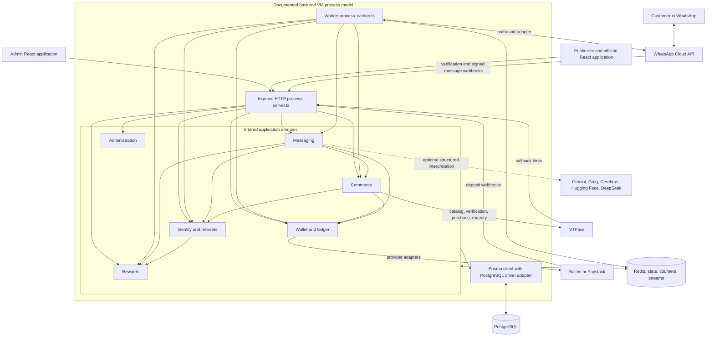

The `Identity → Rewards` connection includes referral qualification triggering policy processing through service interfaces. The `Commerce → Identity` connection includes referral qualification events created when settlement evidence is sufficient. The diagram deliberately does not imply that every domain directly queries every other domain's tables. Source imports and repository calls must still be inspected at each boundary.

The domain-to-Prisma connection represents repositories and some infrastructure-owned persistence, not controllers executing SQL themselves. The Prisma client is a library inside the process. It is not a remote service placed between Express and PostgreSQL. [config/prisma.ts](src/config/prisma.ts) constructs `PrismaPg` and a generated `PrismaClient`; the PostgreSQL driver manages actual database connections.

<a id="section-2-3"></a>

### 2.3 What each component owns

| Component            | Primary responsibility                                                                                                    | What to avoid assuming                                                      |
| -------------------- | ------------------------------------------------------------------------------------------------------------------------- | --------------------------------------------------------------------------- |
| WhatsApp Cloud API   | Accept outbound requests and send incoming messages/status callbacks                                                      | API acceptance proves neither delivery nor reading                          |
| Express HTTP process | HTTP validation, identity checks, REST operations, webhook persistence, initial asynchronous inbound scheduling           | Returning a purchase response does not prove provider fulfillment           |
| Identity             | Accounts, sessions, roles, WhatsApp identities, referral identity and qualification                                       | A WhatsApp profile name is not verified funding identity                    |
| Wallet               | Wallet ownership, funding, ledger posting, spendable balance                                                              | Redis is not the wallet's source of truth                                   |
| Commerce             | Catalog, quotes, purchase creation, provider fulfillment, refunds, reconciliation, completion notification coordination   | A database debit is not external service delivery                           |
| Messaging            | Text parsing, conversation state, deterministic flows, optional intent interpretation, durable inbound/outbound messaging | AI is not a financial authority                                             |
| Rewards              | Versioned reward policies, reward computation, separate reward balances, affiliate reports                                | Rewards are not automatically spendable wallet funds                        |
| Administration       | Authorized monitoring, operational controls, financial exception views                                                    | Dashboard presence is not complete automated incident response              |
| PostgreSQL           | Durable records, relationships, constraints, transactions, jobs, attempts, audit evidence                                 | A local transaction cannot atomically commit Meta or VTPass operations      |
| Redis                | Expiring conversation state, shared counters, AI controls, cooldowns, stream delivery coordination                        | In-memory speed implies neither unlimited durability nor automatic recovery |
| Worker process       | Stream consumption and periodic recovery/synchronization                                                                  | A separate process implies neither a separate codebase nor a microservice   |
| React applications   | Render user interfaces, route between pages, call backend APIs                                                            | Client-side route guards replace backend authorization                      |

<a id="section-2-4"></a>

### 2.4 Follow data instead of arrows

Consider an illustrative data purchase. The customer sends “buy data.” Meta sends an HTTP webhook. The backend verifies the message signature, extracts text, and persists a `WhatsappInboundEvent`. Database conversation sequence numbers help process events in the order they were stored for that WhatsApp identity. The service reads conversation state from Redis and replies with a product or network prompt. That reply first becomes a durable outbound database record, then a Redis stream item, and finally an external send request from the messaging worker.

After product selection and explicit confirmation, Messaging calls Commerce. Commerce validates the current product and confirmation details, calls the wallet service within the purchase database transaction, and creates a durable fulfillment job. The purchase/debit/job commit is one local financial decision. A Redis stream entry tells the commerce worker which job to examine. The worker claims the database job before contacting the supplier. The supplier's result is recorded; an uncertain result leads to requery rather than another purchase submission.

Notice three different meanings of “message” in this account: the user's WhatsApp text, a Redis stream record carrying work, and an outbound WhatsApp reply. They are not interchangeable. A Redis job reference may be delivered more than once even if the customer's financial action must post once.

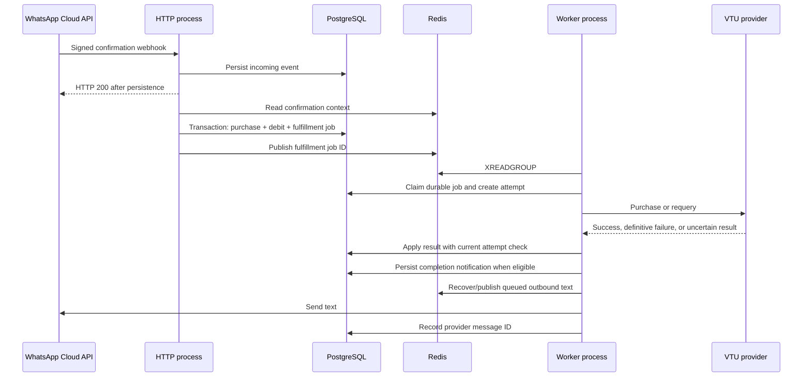

API-side inbound processing is scheduled without awaiting the full conversation before acknowledging Meta. A periodic worker pass also recovers pending inbound database events. Therefore, it would be inaccurate to draw every incoming conversation handler exclusively inside the worker process. The source supports processing in either process, coordinated by database claims.

<a id="section-2-5"></a>

### 2.5 Three kinds of state and why they are separated

**Durable business state** must survive restarts and support investigation: who owns the wallet, whether money was posted, the accepted purchase price, the supplier request reference, and which attempts ran. PostgreSQL stores it.

**Temporary interaction state** describes a conversation in progress: the selected network, displayed menu, recipient phone, or pending confirmation. [messaging.state.ts](src/domains/messaging/messaging.state.ts) stores this in Redis with a ten-minute expiry. A customer losing an unfinished menu is inconvenient; losing a posted wallet debit is a fundamentally different failure. Conversation expiry does not cancel an already committed purchase.

**Delivery coordination state** tracks work availability and consumer progress. Redis Streams provide it, while the durable commerce job remains in PostgreSQL. This split allows a reconciliation scan to rediscover commerce work when a stream publication failed. It also creates two persistence systems with different guarantees. You must check the recovery code rather than assume every Redis record can always be rebuilt; outbound messaging has narrower recovery conditions explained in Chapter 10.

A fourth category is **process-local cache state**. The wallet summary cache is in a process's memory. An invalidation in the worker does not automatically invalidate a copy in the HTTP process. A successful debit still depends on the database path, not the cached display. The cache improves reads but complicates the freshness of what a user sees.

<a id="section-2-6"></a>

### 2.6 Deployment facts versus deployment evidence

[package.json](package.json) defines `start` for the compiled HTTP entry point and `start:worker` for the compiled worker. The committed CI workflow describes deploying to a VM and restarting `swifttopup-api.service` and `swifttopup-worker.service`. Frontend [admin/vercel.json](../admin/vercel.json) and [client/vercel.json](../client/vercel.json) contain their routing configuration. These files establish intended launch commands and hosting configuration, not successful current deployments.

The VM's public hostname, effective systemd unit content, proxy configuration, TLS termination, secrets, provider activation, persistence settings, and restore capability require operational verification. The handbook does not infer a specific reverse proxy or container platform when source does not establish one.

**Architecture rationale inferred from implementation:** Separate processes let slow external work and recovery continue without making every HTTP request wait. Shared code and PostgreSQL transactions keep financial coordination understandable. Redis supports quick conversation state and waiting consumers. This is a sensible early-stage structure, provided the operational team runs both processes and monitors pending work.

<a id="section-2-7"></a>

### 2.7 Chapter review

**Key takeaways:** Follow entry points before dependency lists. Domains are business boundaries; processes are runtime boundaries. PostgreSQL records business truth, Redis helps interaction and work distribution, and external providers remain independent failure domains. Installed BullMQ does not make BullMQ part of the active runtime.

**Review questions:** Which process starts catalog synchronization? Can inbound conversations execute after the webhook has returned? Why can a purchase be pending after its debit commits? What information would be lost if Redis alone disappeared? Which deployment facts require evidence outside the repository?

**Further reading:** [Node.js blocking versus non-blocking overview](https://nodejs.org/learn/asynchronous-work/overview-of-blocking-vs-non-blocking) introduces the runtime model; read it before Chapter 10. [Redis Streams](https://redis.io/docs/latest/develop/data-types/streams/) introduces logs and consumer groups; use it after drawing the source flow.

**Explain this in an interview:** “SwiftTopUp is a modular monolith with separate HTTP and worker processes. Both share domain services and PostgreSQL. Redis stores conversation context and distributes job references through Streams. Financial state and durable jobs live in PostgreSQL, and recovery scans reconcile incomplete work. External payment, VTU, messaging, and optional AI providers are isolated behind adapters.”

<a id="chapter-3"></a>

## Chapter 3: Why a Modular Monolith?

**Learning objectives:** Compare deployment styles; recognize real module boundaries; explain how local transactions simplify money movement; identify when extraction would help. **Prerequisites:** Chapter 2 and the distinction between a process and a domain. **Difficulty:** Intermediate. **Practical exercise:** Trace one Commerce import of Wallet and write down the public service method it calls. Then find the transaction object passed through that call and explain why opening an unrelated transaction would change the guarantee.

<a id="section-3-1"></a>

### 3.1 Four terms that describe different things

A **monolith** is an application deployed as a coordinated unit. It can still have many files, packages, processes, and layers. A monolith becomes difficult when unrelated responsibilities are tangled together, but tangling is not inherent to a single deployment model.

A **modular monolith** deliberately groups responsibilities into modules with recognizable interfaces. Modules can call each other inside the same program. Their internal persistence and implementation details should stay behind their boundaries. SwiftTopUp's `domains/identity`, `domains/wallet`, and other domain directories make business organization visible in the code.

**Microservices** divide an application into independently operated services with explicit network contracts and stronger data ownership boundaries. Independence matters more than the number of servers. If every “service” must be released together and all write the same tables without coordination, introducing HTTP between them has mostly added failure modes.

A **distributed system** coordinates multiple independently failing components across communication boundaries. SwiftTopUp already participates in one: the backend, PostgreSQL, Redis, Meta, Bachs, Paystack, and VTPass can fail independently. You do not need internal microservices to face retries, ambiguous outcomes, duplicated deliveries, clock differences, and partial failure.

This distinction prevents a common interview mistake: “We chose a monolith, so distributed-system problems do not apply.” Internal database mutations are local and transactional. Provider requests remain distributed interactions.

<a id="section-3-2"></a>

### 3.2 Comparison through a wallet purchase

| Question                                    | Traditional tightly coupled monolith        | Modular monolith                                         | Microservices with separate ownership                           |
| ------------------------------------------- | ------------------------------------------- | -------------------------------------------------------- | --------------------------------------------------------------- |
| Where does a purchase call the wallet?      | Anywhere, possibly direct table writes      | Through a wallet operation or interface                  | Over a network contract or event                                |
| Can purchase and debit share a transaction? | Usually, if one database                    | Yes; SwiftTopUp does this                                | Usually not across independent databases                        |
| What keeps responsibilities separate?       | Often conventions are weak                  | Module structure and explicit interfaces                 | Network/data boundaries plus conventions                        |
| Deployment effort                           | One coordinated application                 | One coordinated backend, possibly multiple process roles | Several independently deployed applications                     |
| Failure during an internal call             | Function failure                            | Function failure                                         | Network failure, timeout, unavailable service, version mismatch |
| Scaling                                     | Scale the application                       | Scale HTTP/worker roles, tune modules                    | Scale individual services                                       |
| Typical cost                                | Simple operations, potentially tangled code | Modularity requires discipline                           | Operational tooling and distributed coordination                |
| Main risk                                   | Changes affect unrelated behavior           | Boundaries erode through convenience imports             | Complexity exceeds the team's ability to operate it             |

Imagine splitting Wallet and Commerce into two network services immediately. Commerce asks Wallet to debit ₦1,000. Wallet commits, but the response disappears. Should Commerce retry? Did the debit happen? If Commerce then fails before saving a purchase, which service repairs the orphan debit? You need durable command identities, state transitions, reconciliation, and possibly compensating operations between two internal systems before you even contact VTPass.

The existing code makes the purchase, wallet debit, and fulfillment job one PostgreSQL transaction. It still needs recovery for external fulfillment, but it does not introduce another distributed boundary inside that financial acceptance step.

<a id="section-3-3"></a>

### 3.3 Domain-driven organization without overstating the pattern

**Domain-Driven Design**, or DDD, starts with the business problem and its vocabulary. “Wallet funding,” “purchase,” “provider outcome,” and “qualified referral” have precise meanings that are more useful than organizing everything into a giant `utils/` directory. A **bounded context** is the area within which a model and vocabulary have a clear meaning. For example, a reward balance and a spending-wallet balance both involve amounts, but represent different rights and workflows. Treating them as one generic “balance” invites errors. [Fowler's bounded-context explanation](https://martinfowler.com/bliki/BoundedContext.html) is a useful conceptual starting point.

SwiftTopUp shows domain-oriented folders, service/repository separation, provider interfaces, and financial invariants. It does not prove every tactical DDD pattern is implemented. Many services are plain exported objects and functions; the code does not require every business concept to be a rich class or an aggregate root. Calling the application “DDD-inspired” or “domain-oriented” is more precise than claiming a complete textbook DDD architecture.

**Separation of concerns** means each part has a reason to exist. A controller translates HTTP. A repository persists. A wallet service enforces financial behavior. A provider adapter translates an external API. The concerns cooperate, but combining them into one request handler would make each harder to change and test.

**Cohesion** asks whether the things inside a module belong together. Wallet posting, balance derivation, and wallet ownership have strong cohesion. **Coupling** asks how strongly one module depends on another's details. Commerce depending on a wallet operation is necessary coupling; Commerce directly rewriting ledger entry internals would create much stronger and more dangerous coupling.

<a id="section-3-4"></a>

### 3.4 How the domains actually communicate

The source primarily uses direct imports and asynchronous function calls. For example, [messaging.service.ts](src/domains/messaging/messaging.service.ts) imports `identityService`, `walletService`, `commerceService`, and reward reporting. It translates a conversation action into those services. It does not send an HTTP request back into the application's own REST endpoints.

[commerce.service.ts](src/domains/commerce/commerce.service.ts) calls `walletService.debitForPurchase`. [commerce.fulfillment.service.ts](src/domains/commerce/commerce.fulfillment.service.ts) calls wallet refund operations and completion notification coordination. [commerce.repository.ts](src/domains/commerce/commerce.repository.ts) records referral qualification work through the referral qualification service when settlement evidence is complete.

Asynchronous communication also exists. Commerce publishes a Redis stream reference to a PostgreSQL fulfillment/refund job. The worker loads the job and invokes a domain service. Referral qualification events share the commerce stream. These are internal asynchronous work boundaries, not evidence that each domain is independently deployable.

The architecture's dependency direction is practical rather than perfectly layered. Some repositories coordinate service behavior inside shared transactions, and Administration legitimately performs cross-domain operational reads. The `CommerceDatabaseClient` type includes model access needed by the injected wallet operation. Those are visible seams, not absolute encapsulation enforced by the language or a separate database.

**Identified limitation:** TypeScript directories do not prevent any developer from importing another domain's repository or Prisma model. Maintaining the boundary depends on review, conventions, and tests. Source organization is useful evidence of intent, not mechanical proof that no boundary can ever be crossed.

<a id="section-3-5"></a>

### 3.5 A shared transaction without sharing wallet internals

The central seam is `commerceRepository.createPurchaseWithDebitAndJob`. Its input includes a `debit` callback. Commerce supplies a function that delegates to Wallet, and the repository invokes it with its current transaction client. These are real excerpts from [commerce.service.ts](src/domains/commerce/commerce.service.ts) and [commerce.repository.ts](src/domains/commerce/commerce.repository.ts), shown separately:

```ts
// commerce.service.ts, inside createPurchaseWithDebitAndJob input
debit: (client) =>
  walletService.debitForPurchase(
    {
      userId,
      amount: quote.price,
      idempotencyKey:
        `purchase-debit:${purchaseIdempotencyKey}`,
    },
    client,
  ),
```

```ts
// commerce.repository.ts, inside the Prisma transaction
const debit = await input.debit(transaction);
```

Read this in four steps. First, Commerce decides that a purchase needs a debit for the quoted retail price. Second, Wallet remains responsible for interpreting that debit operation, including financial validation. Third, the repository supplies the transaction already creating the purchase. Fourth, if the callback fails, the purchase transaction fails too. The repository then attaches the returned wallet transaction ID and creates the fulfillment job before commit.

This is a small dependency-injection pattern: the repository receives behavior instead of reaching into Wallet's implementation. It avoids duplicating ledger rules inside Commerce while preserving one database transaction. It is not a general-purpose dependency-injection container.

The transaction must stay local. The supplier call runs later from the fulfillment worker. Holding wallet locks while waiting on an external purchase would make other requests wait for unpredictable network latency, and a SQL rollback still could not undo airtime already delivered by a supplier.

<a id="section-3-6"></a>

### 3.6 Why this fits an early-stage product

**Architecture rationale inferred from implementation:** SwiftTopUp needs strong local consistency around money, frequent changes to conversation/product behavior, and manageable deployment effort. Shared transactions reduce the number of financial states that must be repaired. Direct imports make code tracing accessible to one founder. One schema exposes constraints and relationships in a place that can be studied and tested. Separate process roles provide a useful degree of operational isolation without separating every business module.

A small team can reproduce an issue by running the API, worker, PostgreSQL, Redis, and mock providers. Microservices would add internal service discovery, network authentication, contract versioning, distributed tracing, multiple deployments, and more complicated test environments. None of those solve a business problem merely by existing.

There is also a learning advantage. You can first understand transaction boundaries and idempotency in one database. Then you can reason about the one unavoidable distributed edge: the supplier or payment provider. Learning every infrastructure tool simultaneously can hide whether the underlying purchase algorithm is correct.

<a id="section-3-7"></a>

### 3.7 The costs are real

A modular monolith shares a failure and release surface. A dependency or startup configuration issue can prevent the process starting even if the failing feature is unrelated to a particular request. Large modules such as Messaging can accumulate responsibilities. Database migrations affect all process roles. Schema changes must remain compatible with the API and worker release sequence. Shared PostgreSQL connections and hot wallet rows can become bottlenecks.

A process-local cache creates hidden coupling through freshness: two processes can disagree about the displayed balance. Shared Redis infrastructure can affect conversations, admission controls, AI limits, and stream consumers at once. Separate workers reduce HTTP latency coupling, but do not provide separate databases or independent network failure isolation for each domain.

These limits justify measurement and disciplined boundaries. They do not automatically justify a rewrite. The most useful near-term improvements are often better recovery visibility, stronger tests of concurrency, and clearer interfaces around growing services.

<a id="section-3-8"></a>

### 3.8 When extraction becomes justified

A service extraction should answer a concrete question. Is messaging delivery consuming disproportionate resources? Does a dedicated team need an independent release cycle? Is one workload scaling differently enough to justify operating another service? Can its data and contract be separated without violating financial invariants?

Outbound notification delivery is a possible candidate because it already has a durable record and external send boundary. Extracting it still requires a clear contract for delivery state, deduplication, retries, and authorization. Wallet extraction is substantially harder: the current purchase acceptance transaction crosses Commerce and Wallet. Replacing it with network calls requires redesigning that coordination, not moving files into another repository.

A measured extraction plan would preserve event identities, define who owns each table, build reconciliation before cutover, and test duplicate/out-of-order behavior. A hypothetical request count alone does not prove the need. A single well-indexed database and several workers may serve the actual workload longer than expected; no performance benchmark was established by this inspection.

[Fowler's microservice trade-offs](https://martinfowler.com/articles/microservice-trade-offs.html) provides further context on deployment independence, boundary difficulty, and operational cost. Treat it as a comparison framework, not an instruction to reproduce another company's architecture.

<a id="section-3-9"></a>

### 3.9 Chapter review

**Key takeaways:** Modularity is about boundaries; microservices add deployment and communication independence. SwiftTopUp already handles distributed failure at provider boundaries. Shared PostgreSQL transactions are a significant benefit of its current structure. Domain-oriented folders help, but do not enforce complete isolation.

**Review questions:** Why is the worker a separate process but not a separate microservice? Which current financial guarantee changes if Wallet gets an independent database? What is the difference between coupling and cohesion? Where does the debit callback preserve a boundary? What measurement would make you consider extracting messaging?

**Further reading:** [Bounded Context](https://martinfowler.com/bliki/BoundedContext.html), intermediate, for vocabulary boundaries; [Microservice Trade-Offs](https://martinfowler.com/articles/microservice-trade-offs.html), intermediate, after tracing one shared transaction. Revisit the two callback excerpts and write their purpose without using the phrase “clean architecture.”

**Explain this in an interview:** “I chose a domain-oriented monolith because purchase acceptance and wallet posting benefit from one local transaction, while a small team benefits from simple releases and direct code tracing. HTTP and background work run separately for latency and recovery. I would extract a service when ownership or measured scaling needs justify the additional network, data-consistency, and operational costs.”

<a id="chapter-4"></a>

## Chapter 4: Backend Code Organization and Request Lifecycle

**Learning objectives:** Locate a business operation; follow middleware in order; distinguish syntactic validation from business validation; explain error and response behavior. **Prerequisites:** Chapters 2–3, functions, imports, promises, HTTP methods. **Difficulty:** Beginner to intermediate. **Practical exercise:** Trace `GET /api/v1/commerce/products?type=DATA` from its mount point to its Prisma query. At each step, write what information is added, checked, or returned.

<a id="section-4-1"></a>

### 4.1 The folder structure is a navigation tool

```text
api/src/
  app.ts                   # Compose the Express middleware pipeline
  server.ts                # Start HTTP and register shutdown
  worker.ts                # Start background consumers and timers
  config/                  # Validated configuration and shared clients
  routes/router.ts         # Mount domain routers under /api/v1
  domains/
    identity/              # Accounts, sessions, access, referrals
    wallet/                # Wallets, funding, ledger behavior
    commerce/              # Catalog, quotes, purchases, recovery
    messaging/             # WhatsApp intake and conversations
    rewards/               # Policy processing and reports
    administration/        # Authorized operational views and controls
  infra/
    payments/              # Payment interfaces, adapters, fees, routing
    vtu/                   # VTU interfaces and adapters
    messaging/             # WhatsApp outbound adapters and signature checks
    ai/                    # Optional interpretation gateway and providers
    queues/                # Active streams, consumers, catalog scheduler
    database/              # Database-related infrastructure
    redis/                 # Redis-backed infrastructure helpers
  shared/                  # HTTP utilities, logs, caches, observability
```

A file's name tells you its likely responsibility. A `*.routes.ts` file answers “which endpoint and middleware?” A `*.controller.ts` file answers “how do HTTP input and output map to services?” A `*.service.ts` file answers “what business decision happens?” A `*.repository.ts` file answers “which records are read or changed?” A provider file answers “how does the outside API differ from our internal contract?”

These patterns have exceptions and growing modules. Treat them as a map, then inspect the function itself. Not every operation must pass through every layer: a health endpoint may be much simpler; a webhook also validates external authenticity; a worker invokes a service without an Express controller.

<a id="section-4-2"></a>

### 4.2 Express is an ordered function pipeline

Express runs matching middleware in registration order. Middleware receives `request`, `response`, and `next`. It can attach data to the request, end the response, pass control onward with `next()`, or send an error into the error pipeline with `next(error)`. This is the core model taught in the [Express middleware guide](https://expressjs.com/en/guide/using-middleware.html).

[createApp](src/app.ts) disables the framework header, sets trusted-proxy behavior, adds Helmet, applies CORS, parses JSON while capturing its original body, adds request IDs and logging, mounts the versioned router behind global admission controls, then registers not-found and error handlers.

```mermaid
flowchart LR
  Request[HTTP request] --> Headers[Helmet and CORS]
  Headers --> JSON[JSON parser and raw body capture]
  JSON --> ID[Request ID and request logger]
  ID --> Global[Global API rate limiter]
  Global --> Router[Versioned and domain routers]
  Router --> RouteChecks[Authentication, authorization, validation as configured]
  RouteChecks --> Controller[Controller]
  Controller --> Service[Domain service]
  Service --> Repo[Repository and Prisma]
  Repo --> DB[(PostgreSQL)]
  DB --> Result[Service result]
  Result --> Response[Controller response]
  RouteChecks -. rejected .-> Error[Error middleware]
  Controller -. rejected promise .-> Error
  Service -. error .-> Error
```

The order has consequences. Raw JSON must be captured before a webhook signature is checked. The request logger attaches a `finish` listener before the controller responds. Global API admission applies before domain middleware. A blocked CORS origin can fail before request-ID middleware. Invalid JSON is handled before a business schema runs. Do not describe “all failures always have the exact same context” without checking where they arise.

<a id="section-4-3"></a>

### 4.3 Input validation: runtime data is not a TypeScript type

A TypeScript annotation disappears at runtime. An attacker can still send a numeric `recipientPhone`, an unexpected product type, or a malformed amount. [validateRequest](src/shared/http/validate-request.ts) calls Zod schemas on the actual body, query, and parameters and replaces each parsed value on the request.

Real excerpt:

```ts
if (schema.body) {
  request.body = schema.body.parse(request.body);
}
```

`schema.body` makes body validation optional for routes that do not need it. `.parse()` checks runtime data and can normalize it through schema transforms such as trimming. An invalid value throws, and the surrounding middleware forwards the error to Express. Replacing the body means downstream handlers use the parsed form.

[commerce.schema.ts](src/domains/commerce/commerce.schema.ts) accepts only known product categories; checks Nigerian phone formats; limits biller identifiers; represents amounts as decimal strings; bounds quantity; and requires a purchase idempotency key. That answers whether input is well formed. It does not establish that a particular product is active, that an electricity meter exists, or that the wallet has funds. Those are service and database decisions.

The WhatsApp top-level webhook schema is deliberately permissive because provider envelopes contain many nested fields and event types. [whatsapp-parser.ts](src/domains/messaging/whatsapp-parser.ts) subsequently narrows unknown records, arrays, and text fields. “There is a Zod schema” is therefore not equivalent to “every nested value is trusted.”

<a id="section-4-4"></a>

### 4.4 A full read request: list products

Take `GET /api/v1/commerce/products?type=DATA`. [app.ts](src/app.ts) mounts `/api/v1`; [routes/router.ts](src/routes/router.ts) mounts `/commerce`; [commerce.routes.ts](src/domains/commerce/commerce.routes.ts) declares `/products`. The complete URL is formed by those nested prefixes.

The route authenticates the bearer token, validates `type` and `network` query values, and wraps the asynchronous controller with `asyncHandler`. [commerceController.listProducts](src/domains/commerce/commerce.controller.ts) passes `request.query` to `commerceService.listProducts`. The service chooses the configured provider, asks [commerceRepository.listProducts](src/domains/commerce/commerce.repository.ts) for active visible products, recalculates presentation prices according to the current pricing rules, and returns serialized values.

The repository builds the Prisma query. Prisma sends parameterized database operations through the PostgreSQL adapter. PostgreSQL reads the matching rows. The service returns strings suitable for money display rather than leaking Prisma decimal objects as the public API contract. The controller emits HTTP 200 with `successResponse(result, request.requestId)`.

Why does the service do work after the repository? A database row is storage representation; the API result is application behavior. Supplier fee completeness, product activation, and pricing policy can influence what may be offered. A controller should not duplicate those rules, because the same catalog is also used from WhatsApp and background synchronization.

<a id="section-4-5"></a>

### 4.5 A write request: create purchase

The route is more demanding:

```ts
commerceRouter.post(
  '/purchases',
  authenticateRequest,
  purchaseRateLimiter,
  validateRequest({ body: createPurchaseSchema }),
  asyncHandler(commerceController.createPurchase),
);
```

This is copied from [commerce.routes.ts](src/domains/commerce/commerce.routes.ts). Read its lines in order. `post` associates a state-changing HTTP operation with `/purchases`. `authenticateRequest` establishes the authenticated principal. `purchaseRateLimiter` applies purchase admission rules. `validateRequest` checks and parses external input. `asyncHandler` forwards promise rejection to the common error handler instead of leaving an unhandled asynchronous failure.

[commerceController.createPurchase](src/domains/commerce/commerce.controller.ts) obtains `request.auth.userId`, delegates to `commerceService.createPurchase`, and returns 202 for a new accepted purchase or 200 for a duplicate response. The authenticated user ID comes from the verified request context, not a user-controlled `userId` body field. This is an ownership safeguard.

The service scopes its operation identity to the user and quote ID or caller key, finds an existing purchase, resolves the active product, verifies quote binding and expected price, and invokes `createPurchaseWithDebitAndJob`. That repository transaction creates the pending purchase, calls Wallet's debit operation inside the transaction, links its wallet transaction ID, and creates the durable fulfillment job. Only then does the service publish the job reference to Redis. A failed publication can be recovered from PostgreSQL; a failed debit rolls back the purchase creation.

HTTP 202 means the application accepted work for processing. It does not mean airtime or data has arrived. The frontend or bot must display the purchase state and allow status checks. Conversely, a duplicate HTTP 200 is not a second purchase: it reports an already identified operation.

<a id="section-4-6"></a>

### 4.6 Controllers, services, repositories, and adapters

A controller knows about Express requests, status codes, and response formatting. A service knows whether an operation is allowed and how domains cooperate. A repository knows persistence operations and transaction mechanics. An adapter knows headers, URLs, payload fields, and error formats of an external API.

Suppose VTPass changes its response envelope. Ideally the adapter's parser changes while Commerce still receives `VtuPurchaseResult`. Suppose the business requires a signed electricity quote before confirmation. The Commerce/quote path changes; the controller remains a small delegate. Suppose a new database index speeds pending-job scans. The schema/migration changes; the WhatsApp command parser does not.

[conversation-intent.service.ts](src/domains/messaging/conversation-intent.service.ts) demonstrates factory-based dependency injection: `createConversationIntentService` accepts the AI gateway, Commerce service, state store, Wallet service, and billing handler. Tests can supply substitutes. Other modules use imported singleton objects that tests replace with Node's method mocking. The code mixes these simple patterns rather than using a dependency-injection framework.

The tradeoff is concrete: factories make dependencies explicit and easier to isolate; direct imports reduce assembly code but make global setup and test isolation more important. Neither pattern alone guarantees maintainability. The important question is whether dependencies can be understood and safely substituted.

<a id="section-4-7"></a>

### 4.7 Error handling and response contracts

[async-handler.ts](src/shared/http/async-handler.ts) contains this real bridge:

```ts
return (request, response, next) => {
  handler(request, response, next).catch(next);
};
```

The returned function matches Express middleware. It calls the promise-returning handler. `.catch(next)` forwards failure to Express's error pipeline. This is relevant because the runtime dependency is Express 4; do not rely on later-version promise forwarding without checking the installed version. The [Express error guide](https://expressjs.com/en/guide/error-handling/) explains that passing an error to `next` skips normal handlers.

[error.middleware.ts](src/shared/http/error.middleware.ts) preserves recognized `AppError`s, maps `ZodError` to a 400 `VALIDATION_ERROR`, and turns unrecognized failures into a generic 500. It logs request context and excludes stack traces from production logs in that handler. The response envelope contains `success: false`, a machine-readable code, a message, optional details, and a request ID when available.

Do not use status codes as decoration. 400 communicates malformed/invalid request data; 401 means authentication or webhook authenticity failed; 403 means an authenticated action is forbidden or the verification token is invalid; 404 indicates a missing resource; 409 indicates a state conflict such as changed purchase details; 422 can communicate a missing required purchase quote; 429 indicates admission limits; 502/503 communicate upstream failure or unavailability. Exact code selection belongs to the actual throwing function.

An error message must also respect uncertainty. After an external timeout, telling the customer “nothing happened; try again” could encourage a second purchase. Messaging instead directs them to purchase status when the result could still be processing.

<a id="section-4-8"></a>

### 4.8 Configuration, logging, and REST design

[env.ts](src/config/env.ts) uses Zod to parse configuration at startup, applies defaults, validates ranges and required combinations, and enforces additional production checks. Configuration includes database/Redis URLs, token/security settings, payment mode, provider keys, WhatsApp setup, worker recovery intervals, and optional AI controls. This handbook names settings by purpose and does not reproduce secret values.

[logger.ts](src/shared/logger/logger.ts) writes JSON log entries with level, message, timestamp, and structured fields. [request-logger.middleware.ts](src/shared/http/request-logger.middleware.ts) records method, path, status, duration, and request ID at response completion. [request-id.middleware.ts](src/shared/http/request-id.middleware.ts) accepts a nonblank incoming ID or generates a UUID and echoes it in the response header. A request ID aids correlation; it is not authentication and should not be treated as trustworthy proof of origin.

The API uses versioned resource routes under `/api/v1`. GET endpoints read products/purchases; POST creates purchases, quotes, and authentication/funding actions; webhooks are external event intake. The design is REST-influenced rather than an attempt to encode every action as a pure resource operation. `/products/sync` is an explicit operational action, for example.

A stateless HTTP interface can coexist with stateful sessions, conversation context, and durable jobs. “REST API” does not mean the database stores no state. It means each HTTP request carries enough context, such as its bearer token and validated body, for the server to interpret that request.

<a id="section-4-9"></a>

### 4.9 Chapter review

**Key takeaways:** Route prefixes compose the URL. Middleware order is behavior. Runtime validation and business validation solve different problems. Controllers translate, services decide, repositories persist, and adapters normalize. A 202 purchase response is acceptance of asynchronous work.

**Review questions:** Why capture raw JSON before validating a webhook? Why does the purchase controller get user ownership from `request.auth`? How does an asynchronous rejection reach `errorHandler`? Which layer should decide whether a quoted price changed? Why is `requestId` useful but unsuitable as authorization?

**Further reading:** [Express middleware](https://expressjs.com/en/guide/using-middleware.html), beginner, alongside `app.ts`; [Express error handling](https://expressjs.com/en/guide/error-handling/), intermediate, alongside `asyncHandler`. For the database side, continue to Chapters 6, 8, and 14 before treating this generic pipeline as the whole purchase algorithm.

**Explain this in an interview:** “A request passes through ordered global middleware, a domain router, route-specific authentication and validation, then a thin controller. The service applies business rules and delegates persistence to a repository. Purchase acceptance commits its debit and durable job together, then external fulfillment runs asynchronously. Common error middleware produces consistent safe responses and structured logs.”

# Part III — Understanding every major service

<a id="chapter-5"></a>

## Chapter 5: Identity and Authentication

**Learning objectives:** Trace registration, explain the difference between identity and permission, understand access and refresh tokens, and identify the limits of the current session design. **Prerequisites:** HTTP requests, database rows, functions and promises. **Difficulty:** Intermediate. **Practical exercise:** On paper, follow one login, one token refresh and one logout through the files below; write down which database row is active at each stage.

<a id="section-5-1"></a>

### 5.1 What the identity service owns

An identity is the application's durable answer to “which person is this?” Authentication establishes that a request can act as that identity. Authorization decides whether that identity may perform the requested action. A customer successfully logging in is authenticated; that customer remains unauthorized to synchronize the product catalog.

SwiftTopUp's identity domain owns user registration, password verification, WhatsApp identity association, sessions, usernames, credential changes and the authentication context used by other domains. Its important files are [identity.service.ts](src/domains/identity/identity.service.ts), [identity.repository.ts](src/domains/identity/identity.repository.ts), [identity.crypto.ts](src/domains/identity/identity.crypto.ts), [identity.routes.ts](src/domains/identity/identity.routes.ts), [auth.middleware.ts](src/domains/identity/auth.middleware.ts), and [authorization.middleware.ts](src/domains/identity/authorization.middleware.ts). Referral attribution has dedicated files within identity, discussed in Chapter 12.

The [Prisma schema](prisma/schema.prisma) expresses separate concerns:

| Model                     | Purpose                                                                        | Important protection                                             |
| ------------------------- | ------------------------------------------------------------------------------ | ---------------------------------------------------------------- |
| `User`                    | Application identity, optional password, WhatsApp association, status and role | Unique username, email, WhatsApp phone and WhatsApp ID           |
| `AuthSession`             | Refresh-token hash, expiry, active/revoked status and request metadata         | Unique `refreshTokenHash`; session checked on protected requests |
| `UsernameChangeHistory`   | Previous/new username and change time                                          | Indexed user/change time for rolling-window enforcement          |
| `PasswordResetToken`      | Expiring one-use recovery credential                                           | Unique hash and transactional claim                              |
| `PasswordChangeChallenge` | Six-digit confirmation challenge                                               | Expiry, attempts and consumed state                              |

A null password hash is meaningful. WhatsApp-first registration can establish a user and wallet without first creating a browser password. The user is not an anonymous wallet: the identity is associated with the sender extracted from a verified WhatsApp event.

<a id="section-5-2"></a>

### 5.2 REST registration is a transaction across domain services

`POST /api/v1/identity/register` runs registration admission control and the Zod `registerSchema`, then `identityController.register` delegates to `identityService.register`.

The schema trims/lowercases usernames, restricts them to lowercase letters, digits and underscores, and enforces 3–32 characters. Optional email is normalized. Passwords must contain 8–128 characters; this is a length policy, not a claim of breached-password screening or multifactor authentication.

`identityService.register` checks existing username/email, hashes the password, then calls the internal `createUserAndReferralIdentity`. That helper opens a Prisma transaction and passes its transaction client through the participating services. It creates the user, creates the referral identity/attribution, calls `walletService.createWalletForUser`, reloads the user and issues a session when a request context was supplied. A failure rolls back the shared local transaction.

The order matters. An application that created a user, returned success and only later tried to create the wallet could strand an account without its required wallet. Here the service coordinates domain operations while wallet database details remain in the wallet domain. This is a practical benefit of the modular monolith: separate business responsibilities can still use one PostgreSQL transaction.

The preliminary “does this username exist?” query improves error messages but cannot guarantee uniqueness under concurrency. Two requests can both see no row. Database unique constraints remain the final authority. The registration helper uses `retryOnUniqueConflict` for conflicts encountered during identity/referral creation; that is bounded retry, not permission to ignore a real duplicate username.

<a id="section-5-3"></a>

### 5.3 Password hashing: verification without storing the password

A password hash is a one-way verifier. It is not encryption that the application later decrypts. In [identity.crypto.ts](src/domains/identity/identity.crypto.ts), the actual hashing function is:

```ts
export async function hashPassword(password: string): Promise<string> {
  const salt = randomBytes(16).toString('hex');
  const derivedKey = (await scrypt(password, salt, passwordKeyLength)) as Buffer;

  return `scrypt$${salt}$${derivedKey.toString('hex')}`;
}
```

`randomBytes(16)` supplies a fresh salt. The salt is stored with the derived key; it need not be secret. Its job is to make equal passwords produce different stored values and prevent one precomputed lookup table from working for all users. `scrypt` performs deliberately expensive password derivation. `passwordKeyLength` is 64 bytes. Promisifying Node's callback API lets the service await its result without writing a callback chain.

`verifyPassword` splits the stored representation, derives a key from the submitted password and the stored salt, checks equal lengths, and uses `timingSafeEqual`. A plain string equality check can reveal timing differences; constant-time comparison reduces that particular signal. Password hashing still needs adequate rate limits, secret-safe logs and measured resource budgets. Slow hashing can itself become an availability cost when attackers submit many login requests.

`identityService.login` looks up by email when the identifier contains `@`, otherwise by username. Unknown user, missing password, inactive user and incorrect password produce the same `INVALID_CREDENTIALS` response. This avoids explicitly telling a caller which login failure occurred. It does not prove all timing paths are indistinguishable.

<a id="section-5-4"></a>

### 5.4 Access tokens, bearer credentials and live session checks

A bearer credential grants access to whoever possesses it. The server does not know whether the person presenting a stolen token is its original owner. It therefore matters where tokens are stored, how long they remain usable and how revocation works.

`createAccessToken` builds an HS256 JWT using Node's HMAC-SHA256. Its payload contains `sub` (user ID), `sid` (session ID), username, issued time and expiry. The token has three dot-separated parts: encoded header, encoded payload and signature. Encoding is not encryption: a JWT's claims are readable. Never put a password or provider secret in the payload.

The signature protects integrity: changing the user ID invalidates the signature when the attacker does not possess the signing key. `verifyAccessToken` verifies the HMAC and expiry. `authenticateRequest` then calls `identityService.assertSessionIsActive`, which loads the active, unexpired `AuthSession` and current user. Disabled users are rejected, and the current role comes from the database rather than a stale browser role value.

This is **hybrid stateful authentication**. The access token is self-contained enough to verify its signature, but a valid signature alone is insufficient because each protected request also depends on a database session. Immediate server-side revocation is useful for a financial application. The tradeoff is a database read and database availability dependency on protected requests. Calling this fully stateless JWT authentication would be inaccurate.

Configuration defaults in [env.ts](src/config/env.ts) give access tokens a 15-minute lifetime and refresh sessions 30 days. These are defaults, not verified deployment values. Production requires a configured signing secret. The same secret also HMAC-hashes refresh/reset credentials and signs purchase quotes elsewhere, so rotating it has broader invalidation consequences than merely changing one endpoint's setting.

<a id="section-5-5"></a>

### 5.5 Refresh rotation, logout and the concurrency limitation

Refresh tokens are 48 random bytes encoded as base64url. They are opaque random credentials, not JWTs. The browser receives the raw token; `AuthSession` stores its HMAC hash. If someone reads only database rows, that stored hash is not the raw refresh credential accepted by the API.

`POST /identity/refresh` hashes the submitted token, finds an active session, rejects expired sessions and inactive users, generates a new credential and calls `identityRepository.rotateSession`. Rotation revokes the old row and creates a new row in one database transaction. The new access token points at the new session ID. Consequently, old access tokens are also rejected on subsequent protected requests after that old session is revoked.

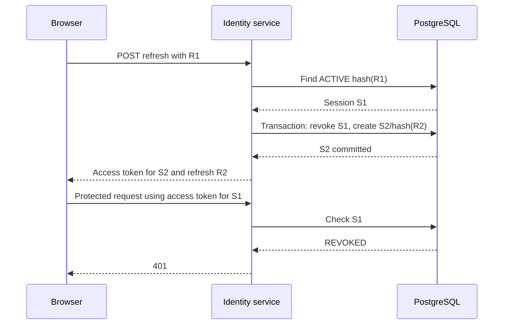

Sequential replay of R1 fails after rotation. **Identified limitation:** `rotateSession` updates by session ID alone, after an earlier active-session lookup outside its transaction. It does not conditionally claim `status='ACTIVE'` and require exactly one claimant. Consider two requests:

| Time | Request A                 | Request B                                          |
| ---- | ------------------------- | -------------------------------------------------- |
| 1    | Reads S1 as active        | Reads S1 as active                                 |
| 2    | Revokes S1 and creates S2 | Waits for the row update                           |
| 3    | Commits                   | Updates the same already-revoked S1 and creates S3 |
| 4    | Receives R2               | Receives R3                                        |

The transaction makes each revoke/create pair atomic; it does not establish exclusive one-use refresh consumption. This is a static finding, not a race reproduced during handbook preparation. A conditional update/claim and a deliberate replay/session-family policy would strengthen it. Frontend `refreshPromise` coordination reduces accidental overlap inside one JavaScript runtime; it does not prevent cross-tab or attacker concurrency.

`POST /identity/logout` hashes the supplied refresh token and revokes a matching active row. That is session logout, not logout of every device. The live session check makes its associated access token stop working. A network failure during logout can still leave the server session active even when the browser clears local state.

<a id="section-5-6"></a>

### 5.6 WhatsApp association and affiliate credential recovery

`findOrCreateWhatsappUserWithStatus` first searches by WhatsApp ID, then by phone. An existing phone record can have its WhatsApp ID updated; otherwise the service creates a generated `wa_...` username, referral identity and wallet. An inactive existing identity is rejected. This relies on verified upstream message provenance and correct sender extraction. It is not an arbitrary public “claim this phone number” route.

For WhatsApp users, `generateAffiliatePasswordForVerifiedWhatsapp` checks the supplied verified sender matches the stored `whatsappWaId`, creates a readable 12-character random password and stores only its scrypt hash. It returns the password for delivery and sets `passwordChangeRequired=true`. Treat this delivery as sensitive; it is a bootstrap mechanism whose confidentiality depends on the WhatsApp account and delivery path.

A required-password-change session is restricted by `authenticateRequest` to the password-change routes. The affiliate UI uses `issuePasswordChangeCode` and `confirmPasswordChange`: the code is six digits, expires, has a configured attempt limit and is stored as a hash. Confirmation checks ownership, expiry, consumption and attempts, then conditionally claims the challenge and updates the password transactionally. The controller sends the code through [affiliate-credentials.notification.ts](src/infra/messaging/affiliate-credentials.notification.ts); its response excludes the code.

A separate verified-WhatsApp reset flow creates an expiring `PasswordResetToken`, revokes open reset tokens and allows `/identity/password/reset` to consume the new credential once. `resetPassword` changes the password and revokes active sessions in the same transaction. Ordinary `changePassword` and challenge-based password replacement do not perform the same blanket session revocation. Also, the direct current-password route remains allowed for required-change sessions: the presence of a code-based UI is not evidence that every password change requires a second factor.

Username changes use a locked user row and serializable transaction, enforce two changes in a rolling 30-day window, and write `UsernameChangeHistory`. Usernames are mutable display/login identifiers; durable relationships continue to use the stable user ID.

<a id="section-5-7"></a>

### 5.7 Authorization and ownership are separate checks

`requireOperatorOrAdmin` permits `OPERATOR` and `ADMIN`; `requireAdmin` permits only `ADMIN`. Administration installs authentication and role checks at its router boundary. Wallet and customer purchase handlers derive their acting user from `request.auth.userId`, so a caller-supplied user ID is not automatically trusted as ownership proof.

**Identified limitation:** the authenticated `/identity/users/...` lookup routes do not check owner or operator role, and their safe-user response includes another person's email and WhatsApp fields. “Safe” here means the password hash is omitted; it does not mean all remaining fields are appropriate for every authenticated customer. Chapter 18 describes this access-control issue and the desired regression tests.

<a id="section-5-8"></a>

### 5.8 Testing and explaining the service

[affiliate.access.test.ts](test/affiliate.access.test.ts) contains PostgreSQL-gated cases for username changes, rolling limits, concurrent username edits, generated credential storage, one-time reset credentials and challenge consumption. Its challenge test calls the service and checks a six-digit code and rejection on reuse; it does not prove Meta delivered a WhatsApp message. [administration.authorization.test.ts](test/administration.authorization.test.ts) directly invokes middleware with test requests and checks missing auth/customer rejection and allowed roles. These tests exist in source; execution status belongs to Chapter 20.

**Key takeaways:** A user, password, access token and session are different objects. Hashing protects stored verifiers; signatures protect token integrity; authorization still requires ownership and role checks. Database-backed session checks enable revocation, but transactionality alone does not make refresh rotation an exclusive claim.

**Review questions:** Why does revoking S1 invalidate an otherwise unexpired access token? Why is hashing a refresh token useful? Which two requests can race during rotation? Why should a mutable username never become a wallet foreign key?

**Further reading:** [OWASP Authentication Cheat Sheet](https://cheatsheetseries.owasp.org/cheatsheets/Authentication_Cheat_Sheet.html) provides an intermediate checklist after tracing login. [OWASP Session Management Cheat Sheet](https://cheatsheetseries.owasp.org/cheatsheets/Session_Management_Cheat_Sheet.html) is the next reading for credential lifecycle and browser storage.

**Explain this in an interview:** “SwiftTopUp authenticates with a short-lived signed access token and a durable refresh session. Every protected request checks session status and the user's current role. Registration creates user, referral identity and wallet in one transaction. I would improve concurrent refresh consumption and identity lookup authorization before claiming a hardened authentication system.”

<a id="chapter-6"></a>

## Chapter 6: Wallet and Financial Ledger

**Learning objectives:** Reconstruct a wallet balance from entries; explain every debit and credit; trace the transaction and lock boundaries; distinguish safe spending decisions from cached display data. **Prerequisites:** Chapters 3–5; basic SQL relationships, `async`/`await`, and decimal numbers. **Difficulty:** Intermediate, with challenging concurrency sections. **Opening practical exercise:** On paper, create a wallet with ₦0, fund it with ₦2,000, buy ₦750 of airtime, and refund that purchase. Write both entries for each operation before reading the answer below.

<a id="section-6-1"></a>

### 6.1 What the wallet owns

A wallet is SwiftTopUp's internal record of value a customer may spend. It is not the customer's bank account and does not itself prove that an equal bank balance exists at a payment provider. A bank transfer is external evidence; a funding transaction records the internal credit granted after that evidence passes validation. Matching those two worlds is reconciliation.

The wallet domain owns wallet creation, four ledger accounts per wallet, balance calculation, purchase debits, purchase refunds, funding intents, virtual-account mappings, and funding receipt processing. Its HTTP boundary is [wallet.routes.ts](src/domains/wallet/wallet.routes.ts), orchestration is [wallet.service.ts](src/domains/wallet/wallet.service.ts), posting rules are [wallet.ledger.ts](src/domains/wallet/wallet.ledger.ts), and persistence is [wallet.repository.ts](src/domains/wallet/wallet.repository.ts). [wallet.schema.ts](src/domains/wallet/wallet.schema.ts) validates external funding input. Chapter 7 explains the payment-specific half of the domain.

The authenticated `/wallet/summary` and `/wallet/transactions` route suffixes derive ownership from the authenticated user. They do not accept an arbitrary owner ID from the body. Commerce calls the wallet service internally; it does not write ledger entries directly. Identity can pass its registration transaction client when creating the wallet, allowing user and wallet creation to succeed or roll back together.

| Important function                          | Responsibility and caller                                                                                          |
| ------------------------------------------- | ------------------------------------------------------------------------------------------------------------------ |
| `walletService.createWalletForUser`         | Finds an existing wallet or creates its accounts; used by account creation and internal flows.                     |
| `walletRepository.createWalletForUser`      | Creates `Wallet` plus nested `LedgerAccount` rows.                                                                 |
| `walletLedgerService.postWalletTransaction` | Checks balanced entries, serializes the wallet mutation, deduplicates, and creates a transaction with its entries. |
| `walletService.getAvailableBalanceMinor`    | Sums wallet-balance entries using the supplied database client; used for authoritative spending decisions.         |
| `walletService.debitForPurchase`            | Locks, checks idempotency, calculates sufficient funds, and posts a purchase debit.                                |
| `walletService.refundPurchaseDebit`         | Posts the opposite pair of entries under a stable refund key.                                                      |
| `walletService.getWalletSummary`            | Builds the customer-facing summary and caches it within the current Node process.                                  |

The main models are `Wallet`, `LedgerAccount`, `WalletTransaction`, and `LedgerEntry` in [schema.prisma](prisma/schema.prisma). `Purchase.debitWalletTransactionId` ties a purchase to its original debit. Refund jobs separately record the eventual refund transaction. These links let an investigator trace the business action and its financial consequences.

<a id="section-6-2"></a>

### 6.2 Why there is no `Wallet.balance` column

The `Wallet` model has identity, currency, funding contact details, and a mutation version. It has no authoritative spendable-balance column. The available balance is calculated as:

```text
available NGN = credits to WALLET_BALANCE − debits to WALLET_BALANCE
```

An entry is an immutable-style financial fact in the application workflow: “this transaction credited this account by this amount.” The inspected service paths create additional entries for refunds instead of editing the original debit into a smaller number. That preserves the explanation of what happened. However, the database does not enforce universal immutability: a sufficiently privileged SQL user or future application function could still alter rows. Application discipline and database permissions remain part of the guarantee.

The summary reports `available`, `totalCredited`, and `totalDebited`. The latter two are lifetime movement totals for `WALLET_BALANCE`; they are not revenue and expense. A refund increases total credited, so total credited is not simply “bank deposits.” There is no separate held, reserved, or pending-spend balance in this schema. A pending purchase has already reduced spendable funds because its successful wallet debit is committed before fulfillment. A pending funding intent contributes nothing until its credit is posted.

`ReferralRewardBalance.balance` is a different figure entirely. It is a reward accrual maintained by the rewards domain, with no implemented transfer into the spending wallet. Adding it to `available` would misrepresent what `debitForPurchase` can spend.

<a id="section-6-3"></a>

### 6.3 Double-entry accounting, explained through the actual accounts

“Debit” does not universally mean decrease and “credit” does not universally mean increase. The effect depends on the account. SwiftTopUp gives the customer's wallet-balance account a credit normal balance: credits increase the amount owed to the customer, while debits reduce it. This is consistent with treating customer funds as a platform obligation.

[wallet.constants.ts](src/domains/wallet/wallet.constants.ts) defines four account codes. All four belong to an individual wallet; this is a customer subledger, not a complete company accounting system containing bank assets, tax liabilities, every revenue account, and provider settlements.

| Account               | Normal direction in the schema | Role in current postings                                                                |
| --------------------- | ------------------------------ | --------------------------------------------------------------------------------------- |
| `WALLET_BALANCE`      | Credit                         | The account used to calculate customer spending funds.                                  |
| `FUNDING_CLEARING`    | Debit                          | Counter-entry for accepted funding.                                                     |
| `PURCHASE_CLEARING`   | Credit                         | Counter-entry for purchase debits and refunds.                                          |
| `ADJUSTMENT_CLEARING` | Debit                          | An available account code; its presence is not evidence of a public adjustment feature. |

Here is the opening exercise worked through:

| Operation     | Debit                   | Credit                 | Available afterward |
| ------------- | ----------------------- | ---------------------- | ------------------- |
| Fund ₦2,000   | Funding clearing ₦2,000 | Wallet balance ₦2,000  | ₦2,000              |
| Purchase ₦750 | Wallet balance ₦750     | Purchase clearing ₦750 | ₦1,250              |
| Refund ₦750   | Purchase clearing ₦750  | Wallet balance ₦750    | ₦2,000              |

Every transaction's total debits equal its total credits. The entire ledger therefore remains balanced, while the balance of a particular account changes. Summing every account together would be the wrong way to calculate a customer's spendable balance.

Copied excerpt from `assertBalancedEntries` in [wallet.ledger.ts](src/domains/wallet/wallet.ledger.ts):

```ts
const debitTotal = entries
  .filter((entry) => entry.direction === 'DEBIT')
  .reduce((total, entry) => total + parseMoneyToMinorUnits(entry.amount), 0n);

const creditTotal = entries
  .filter((entry) => entry.direction === 'CREDIT')
  .reduce((total, entry) => total + parseMoneyToMinorUnits(entry.amount), 0n);
```

`filter` selects one direction; `reduce` accumulates exact integer kobo; `0n` is a bigint literal. The following condition rejects unequal totals with `UNBALANCED_LEDGER_ENTRIES`. Balancing is necessary but insufficient: two wrong entries can balance perfectly. Correct ownership, account selection, amount, event validation, and idempotency still matter.

An identified limitation is that posting does not separately prove the outer `WalletTransaction.amount` equals each intended financial movement, and balance aggregation does not filter by transaction status. Current runtime service paths post `SUCCESSFUL` money movements, so they fit the calculation. A future caller that posts entries on a `PENDING` or `FAILED` transaction could accidentally affect spending balance. The database schema has no trigger enforcing the sum of child rows. Treat the posting service as a controlled internal boundary, not a generic API safe for arbitrary inputs.

<a id="section-6-4"></a>

### 6.4 Financial precision: why kobo are integers

JavaScript `number` uses binary floating-point. Many decimal fractions have no exact representation, making a long chain of money calculations unreliable if repeatedly rounded. SwiftTopUp stores currency amounts in PostgreSQL `Decimal(18,2)` columns and converts strings to bigint minor units for wallet comparisons and totals.

`parseMoneyToMinorUnits('1250.50')` yields `125050n`. It permits a non-negative decimal with at most two fractional digits; the regular expression does not itself require a value greater than zero. External funding validation and purchase quoting add positivity and range rules. “The parser exists” is not equivalent to “every internal caller is fully validated.”

`formatMinorUnits` reverses the representation into a two-decimal money string. JSON responses use strings, preserving decimal formatting and avoiding bigint's incompatibility with direct JSON serialization. Prisma Decimal values become strings with `toFixed(2)` when serializing wallet transactions.

For quantities, `Product.value` and `Purchase.amount` use six decimal places because data volume is not necessarily whole naira. The purchase price remains two-decimal NGN. Do not confuse “3.000000 GB” with “₦3.00.” The business meaning of a field is as important as its database type.

<a id="section-6-5"></a>

### 6.5 Atomic posting and transaction-client propagation

`postWalletTransaction` can create its own Prisma interactive transaction or accept a client supplied by another transaction. This small design choice is crucial. Commerce passes the _same_ transaction client while creating a purchase, debiting the wallet, and inserting a durable fulfillment job. A thrown error causes those local writes to roll back together.

Within a posting, the service checks balanced totals, finds the wallet, locks it through the repository, checks the idempotency key, resolves account IDs, and creates the `WalletTransaction` with nested `LedgerEntry` records. The nested write prevents a transaction record being committed with only one of its intended entries through that path.

This is a database transaction, not a distributed transaction. An HTTP request already accepted by an outside provider cannot be undone by rolling back PostgreSQL. SwiftTopUp deliberately commits the local debit and job before sending fulfillment to the VTU provider, and uses later refunds as compensating financial movements when failure is definitive.

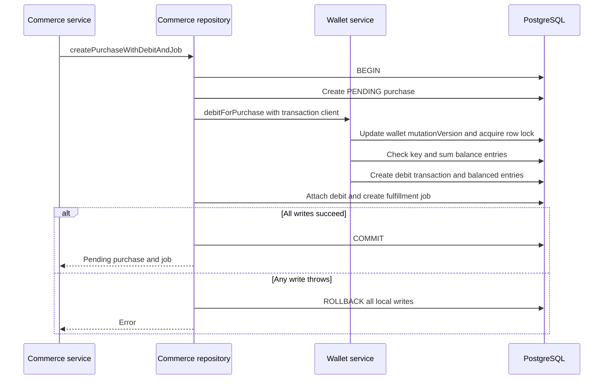

<a id="section-6-6"></a>

### 6.6 Concurrency: why the row lock precedes the balance check

Suppose a wallet holds ₦1,000 and two simultaneous purchases each cost ₦750. Reading the same starting balance and then writing two debits would overspend. A transaction alone does not automatically prevent this: two transactions can independently observe sufficient funds.

`walletRepository.lockWalletForUpdate` issues an update that increments `Wallet.mutationVersion`. PostgreSQL's update acquires a row lock; that lock stays held until the surrounding transaction ends. It is a pessimistic serialization point even though the function does not use literal `SELECT FOR UPDATE`. The version is not used as an optimistic compare-and-swap condition in this function. [PostgreSQL's locking documentation](https://www.postgresql.org/docs/current/explicit-locking.html) explains the distinction between row locks and ordinary concurrent reads.

| Time | Purchase A                                     | Purchase B                                |
| ---- | ---------------------------------------------- | ----------------------------------------- |
| T0   | Begins transaction.                            | Begins transaction.                       |
| T1   | Updates the wallet row and holds its lock.     | Attempts the same update and waits.       |
| T2   | Reads authoritative balance ₦1,000.            | Still waiting.                            |
| T3   | Posts ₦750 debit and commits; balance is ₦250. | Acquires the row lock after A commits.    |
| T4   | Returns pending purchase.                      | Reads ₦250 and throws insufficient funds. |
| T5   | —                                              | Rolls back; no second debit.              |

The serialization works only if all spend-affecting mutations follow the same lock discipline. A future direct write into `LedgerEntry` could bypass it. A wallet is the natural lock unit: different customers can spend concurrently, while purchases against one wallet must compete for the same funds.

The lower posting layer locks the wallet again when called by `debitForPurchase`. This occurs inside the same transaction and does not create a second independent lock owner. Avoid describing it as two separately committed balance updates.

<a id="section-6-7"></a>

### 6.7 Idempotency: same operation, one financial effect

Retries are normal: a phone loses connectivity, Meta redelivers a message, or a worker restarts after a commit. An idempotency key identifies the same intended operation across those retries. `WalletTransaction.idempotencyKey` is globally unique; posting checks it under the wallet lock and returns an existing transaction when found.

Commerce builds scoped keys such as `purchase:<userId>:<quoteId>` and `purchase-debit:<purchase-key>`. Refund jobs persist a stable key derived from the purchase. Funding uses the provider name plus the provider payment reference. The precise strings are less important than the principles: a legitimate new operation needs a new identity, while a retry needs the existing identity.

An idempotency key does not replace atomicity. A crash halfway through two nontransactional entries could still leave inconsistent records. Conversely, a perfectly atomic transaction could be repeated twice under two different keys. SwiftTopUp needs both properties.

**Identified limitation:** The low-level wallet service returns an existing globally keyed transaction without comparing the caller's amount, type, or user against the original payload. Current service-generated scoped keys reduce accidental collisions, but the lower layer is not a complete payload-bound idempotency implementation. Funding initialization explicitly rejects a reused key with another amount. Generalizing the wallet API would require stronger conflict checks.

<a id="section-6-8"></a>

### 6.8 Refunds and crash recovery

A refund is a new successful `PURCHASE_REFUND` transaction that reverses the purchase's account movement. It does not erase the original debit. The durable `PurchaseRefundJob` provides a place to record retries and link the completed refund transaction.

There are two local commit points in current refund processing: first the wallet refund posts, then commerce marks the refund job succeeded and the purchase refunded. A crash between them is recoverable because retrying the wallet posting under the same key returns the original refund transaction. The second step can then complete. The system temporarily tolerates “money restored but purchase metadata still failed,” rather than pretending those commits are one transaction.

The refund claim path is less strongly fenced than fulfillment: it does not use fulfillment's conditional attempt-count claim and result fence. Wallet idempotency remains the central defense against duplicate money credits. This is a useful example of separating a protected financial effect from metadata races that still deserve review.

<a id="section-6-9"></a>

### 6.9 The balance cache and its limits

`walletSummaryCache` is a `SlidingTtlCache` with a five-minute lifetime stored in a JavaScript `Map`; it is not Redis. Successful local funding, debit, and refund methods invalidate the current process's entry. Cache read or write errors fall back to loading fresh database data.

The authoritative debit path calls `getAvailableBalanceMinor` within its transaction and does not trust the summary cache. A stale display therefore does not by itself allow overspending through that path.

Cross-process invalidation is a real limitation. The API and worker are distinct processes, each with its own map. A worker refund does not automatically invalidate an API instance's cache. Sliding expiry extends on every hit, so a frequently read stale entry can survive longer than five minutes after the underlying change; the lifetime is measured from the most recent cache access, not necessarily the original load. A future shared version check, fixed maximum age, shared cache, or cross-process invalidation could improve display freshness. These are alternatives, not current guarantees.

<a id="section-6-10"></a>

### 6.10 Verification and interview practice

The inspected [wallet.concurrency.integration.test.ts](test/wallet.concurrency.integration.test.ts) starts with ₦100 and concurrently attempts two ₦75 debits. Its assertions require one success, one insufficient-funds failure, one debit row, and ₦25 remaining. A separate test repeats a ₦60 debit under one key and asserts identical transaction IDs and ₦40 remaining. Another throws after a debit inside a surrounding transaction and asserts zero persisted debits and the original ₦100 balance. Those are meaningful tests of financial invariants when run against isolated PostgreSQL.

[wallet.cache.test.ts](test/wallet.cache.test.ts) mocks repository methods and checks that repeated summary reads perform one wallet load, two ledger aggregates, and one transaction-history load. It also tests cache fallback and funding invalidation. It does not prove cache coherence across two running processes. These tests were inspected for this handbook; no financial database test was executed as part of writing it.

**Key takeaways:** Ledger entries explain the money; available funds come from one account's signed movements; wallet locks serialize decisions; transactions prevent partial local mutations; idempotency prevents repeated effects; caches serve display speed without authorizing spending.

**Review questions:** Why can a balanced ledger still record a wrong payment? Why does a pending purchase reduce available funds? What fails if a future developer sums balance before taking the wallet lock? Why can a refund recover after two separate commits? Which cache guarantee would change when adding another API replica?

**Further reading:** Study [PostgreSQL row locking](https://www.postgresql.org/docs/current/explicit-locking.html) after tracing `lockWalletForUpdate`, then [transaction isolation](https://www.postgresql.org/docs/current/transaction-iso.html) before Chapter 15. Both are intermediate resources; reproduce their timelines using wallet examples rather than memorizing lock names.

**Explain this in an interview:** “Our spendable balance is derived from an auditable customer ledger. A purchase transaction locks the wallet row, checks the uncached balance, and records the debit with the purchase and fulfillment job atomically. Stable unique keys make retries return the original financial transaction. External fulfillment happens later, and definitive failures create an idempotent compensating refund.”

<a id="chapter-7"></a>

## Chapter 7: Payment and Wallet Funding

**Learning objectives:** Distinguish payment initialization from collected money; trace Bachs and Paystack evidence into one wallet credit; explain safe fallback, fee gross-up, duplicate delivery, and review cases. **Prerequisites:** Chapter 6, HTTP requests, JSON, hashes versus keyed signatures. **Difficulty:** Intermediate to challenging. **Opening practical exercise:** Draw three boxes labelled requested wallet credit, customer payment, and provider fee. Explain why requesting ₦1,000 of usable funds might require paying more than ₦1,000.

<a id="section-7-1"></a>

### 7.1 Responsibility and implementation map

Funding converts a validated external collection into an internal wallet credit. It owns the business distinction between “instructions created,” “provider says paid,” “evidence matches the intended owner,” and “ledger credit committed.” Merely generating a checkout URL cannot increase the wallet.

| Source                                                                            | Important responsibilities                                                                                 |
| --------------------------------------------------------------------------------- | ---------------------------------------------------------------------------------------------------------- |
| [wallet.service.ts](src/domains/wallet/wallet.service.ts)                         | `getFundingAccount`, `createPermanentVirtualAccount`, `processDepositWebhook`, expiry, and funding status. |
| [payment-provider.types.ts](src/infra/payments/payment-provider.types.ts)         | Common `PaymentProvider` contract, `CreatedFundingAccount`, and normalized deposit shape.                  |
| [payment-provider.factory.ts](src/infra/payments/payment-provider.factory.ts)     | Selects a concrete adapter. Webhook selection remains provider-specific.                                   |
| [payment-provider.router.ts](src/infra/payments/payment-provider.router.ts)       | Provider order, Redis cooldown, provider fee-policy selection.                                             |
| [funding-fees.ts](src/infra/payments/funding-fees.ts)                             | Exact minor-unit arithmetic, fee rounding, cap, flat-fee threshold, and gross-up.                          |
| [bachs-payment-provider.ts](src/infra/payments/bachs-payment-provider.ts)         | Hosted transfer checkout initialization and strict deposit normalization.                                  |
| [bachs-deposit-verification.ts](src/infra/payments/bachs-deposit-verification.ts) | Conditional live Payments API verification for incomplete or conflicting settlement evidence.              |
| [paystack-payment-provider.ts](src/infra/payments/paystack-payment-provider.ts)   | Temporary transfer charge, customer/dedicated account creation, signature and event normalization.         |
| [webhook-signature.ts](src/infra/payments/webhook-signature.ts)                   | HMAC verification with constant-time comparison and Bachs timestamp window.                                |

The main models are `FundingIntent`, `VirtualAccount`, `FundingDepositReceipt`, and the wallet ledger models. Wallet funding routes include `/funding/account`, `/funding/permanent-account`, and provider-specific webhook suffixes. User actions require authentication and appropriate funding validation/rate limiting; payment webhooks use provider signatures because providers do not hold customer login tokens.

<a id="section-7-2"></a>

### 7.2 What the providers actually implement

| Provider path              | Actual behavior                                                                                             | Status and limit                                                                                                                         |
| -------------------------- | ----------------------------------------------------------------------------------------------------------- | ---------------------------------------------------------------------------------------------------------------------------------------- |
| Bachs temporary funding    | Creates `/v1/checkout-sessions` using an NGN bank-transfer method and returns an HTTPS hosted checkout URL. | Implemented; sandbox/live base URL follows payment mode. Merchant approval and real collection were not verified.                        |
| Paystack temporary funding | Calls `/charge` with `bank_transfer` expiry and returns transfer bank details.                              | Implemented; the code sends kobo, not naira, to Paystack.                                                                                |
| Paystack permanent funding | Creates a provider customer, then a dedicated account and persists its owner mapping.                       | Implemented but explicitly gated by the permanent-account setting outside mock mode. Actual availability requires external verification. |
| Mock payment               | Returns deterministic account-like details without calling a real bank.                                     | Implemented for development; it does not collect real money or synthesize accepted deposit events.                                       |
| Bachs permanent funding    | Throws `PERMANENT_ACCOUNT_NOT_SUPPORTED`.                                                                   | Unsupported, not an unfinished hidden live pathway.                                                                                      |

The adapter contract is capability-shaped but includes a permanent-account method even for Bachs, whose implementation rejects it. A more elaborate capability registry is an alternative; the current explicit rejection is small and understandable.

<a id="section-7-3"></a>

### 7.3 First funding, returning funding, and persisted contact details

`getFundingAccount` parses its input again in the service, gets or creates the wallet, and saves normalized funding contact details on that wallet. Funding email and names are separate from the account's login identity: entering a different payer contact does not mutate `User.email`. Persisting contacts before initialization means a remote timeout does not erase the details the conversation just collected.

The service expires stale pending intents, then checks for an active permanent account. If one exists, it returns that account and a quote with the permanent provider fee policy. Otherwise, it creates a temporary intent. Returning users do not universally switch to permanent accounts after their first payment: the current temporary response explicitly sets the permanent-account prompt flags false. Historical hybrid-funding plans should not be presented as an automatic current rule.

Temporary instructions normally expire after thirty minutes unless the adapter supplies another expiry. The reference is a random funding reference when no caller idempotency key is supplied. When one is supplied, it is deterministically derived by hashing the wallet ID plus key. The stored amount is the requested wallet credit; `feeAmount` and `totalPayable` are separate snapshot fields.

If the same reference exists, a changed amount causes `IDEMPOTENCY_CONFLICT`; an already successful request produces `FUNDING_ALREADY_PAID`; a ready unexpired request returns existing instructions. A `CREATING` or `UNKNOWN` request is not silently initialized again. A ready but expired request asks the customer to create a new operation with a new key.

Permanent account creation is explicitly requested. An existing account is returned with `created: false`; otherwise the service checks the feature gate, creates remotely, validates required bank fields, and stores the mapping. This remote-create/local-save sequence is not one database transaction spanning the provider. A crash after remote creation can leave an external account that requires operational reconciliation. The implementation should not be described as guaranteeing atomic permanent-account provisioning.

<a id="section-7-4"></a>

### 7.4 Initialization safety and fallback

The first durable funding intent is persisted with `initializationStatus: 'CREATING'` _before_ the remote HTTP call. This gives an uncertain request a stable local identity. Bachs receives the same reference as its `Idempotency-Key` header.

Provider ordering follows configuration. Mock mode uses only mock. Explicit Paystack mode uses only Paystack. Bachs mode checks a Redis cooldown and optionally includes Paystack as fallback. A cooldown is a simple temporary provider-avoidance mechanism, not a complete circuit breaker with rolling failure ratios, half-open probing, and latency metrics.

The distinction between rejection and uncertainty is financially important. Bachs HTTP responses classified by the adapter as explicit initialization rejection permit trying another provider. A timeout, malformed success response, or other uncertain result leaves the intent `UNKNOWN` and returns `FUNDING_INITIALIZATION_PENDING`. It does not automatically produce a second payable checkout elsewhere.

Why? The provider may have created a valid checkout immediately before the connection broke. Creating another checkout could confuse the customer and complicate attribution. The same principle is even more important for purchase retries, where two submissions may deliver value twice.

After remote creation succeeds, the service updates the intent to `READY` with its checkout or bank details. A database error during this save is deliberately outside the provider-call catch block; it must not be misinterpreted as permission to fail over. The code comment explicitly records that safety rule.

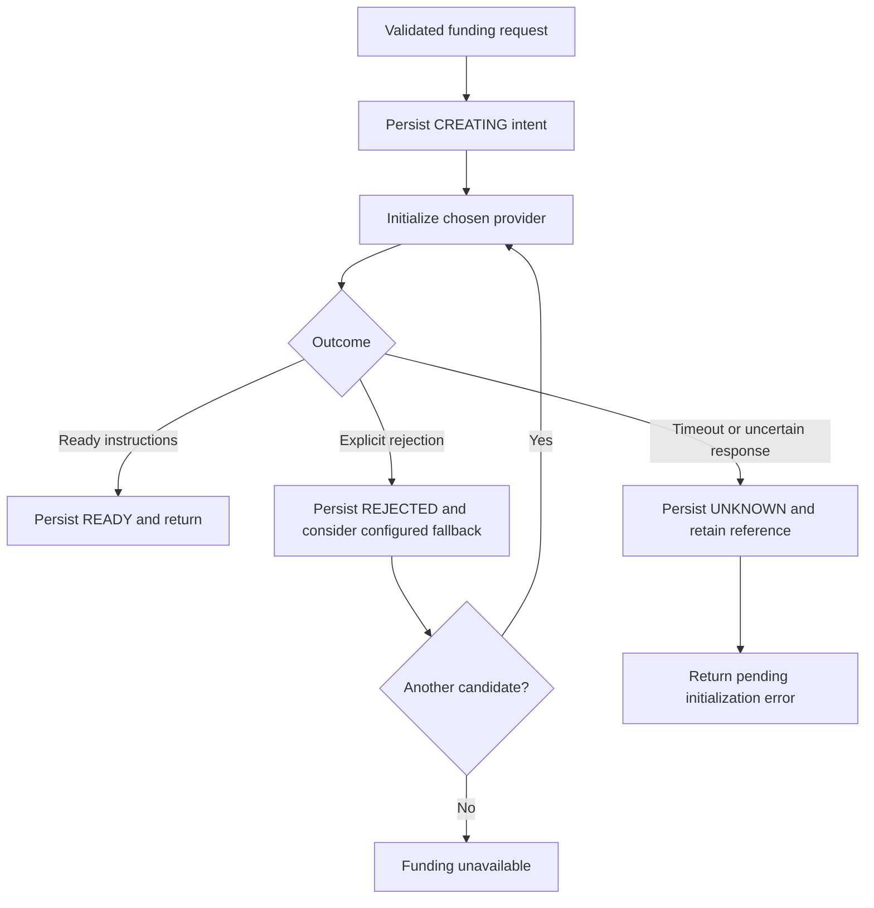

<a id="section-7-5"></a>

### 7.5 Funding fees: gross-up rather than subtracting the requested credit

Funding fees are payment-processing costs, not VTU product margins. The implementation distinguishes temporary funding, where the customer asks for a net wallet credit, from permanent-account deposits, where an incoming gross transfer is reduced by the actual or configured fee.

`quoteFunding` repeatedly computes `gross = requested credit + fee(gross)` until stable. Percentage fees use basis points: 150 basis points means 1.5%. Fee arithmetic rounds fractions upward to a kobo, then applies any flat fee and configured cap. Flat-fee waiver thresholds are evaluated against the gross amount, which is why one simple percentage calculation can be insufficient.

**Illustrative example using the policy in the fee test, not a statement of current provider tariffs:** With a 1.5% fee, no flat fee, and a sufficiently high cap, the request for ₦1,000 credit yields ₦1,015.23 total payable and ₦15.23 fee. The test asserts that the final gross minus the fee equals exactly the requested credit. Do not replace this with ₦1,015.00: 1.5% of the gross payment differs from 1.5% of the desired net credit.

Permanent accounts have no one-use quote to match every transfer. If the provider reports a fee, the service deducts it; otherwise `feeForPermanentDeposit` uses the configured permanent policy. A ₦500 gross deposit with a ₦5 actual fee credits ₦495. This behavior is explicitly asserted in the mocked funding tests.

The wallet ledger records the accepted _net credit_. Provider gross and fee evidence live in funding intent/receipt records. This is useful separation, but it is not a full general ledger of company bank fees and income. Do not use wallet credits as a substitute for proper business accounting.

<a id="section-7-6"></a>

### 7.6 Webhook trust starts before business processing

A webhook is an HTTP request arriving from outside SwiftTopUp. Anyone can attempt to POST JSON claiming that a customer paid. Receiving it establishes no financial truth by itself.

The service obtains the adapter for the webhook's named provider and verifies the signature before opening a financial transaction. Paystack uses HMAC-SHA512 over the raw request body. Bachs uses HMAC-SHA256 over the timestamp plus raw body, accepts the supported timestamp/signature header formats, and rejects timestamps outside a five-minute window. Comparisons use `timingSafeEqual` with appropriate length checks. Reconstructing JSON after parsing could change whitespace or property formatting and therefore invalidate the original signature; the application's raw-body capture is essential.

Valid signatures authenticate evidence under the shared secret. They do not prove that the amount, account, reference, or business mapping is right. Replay protection also requires persistent duplicate handling: a valid event can legitimately be delivered multiple times. Paystack's signature path has no separate timestamp freshness check here, so its durable idempotency is especially important. [Paystack's webhook documentation](https://paystack.com/docs/payments/webhooks/) explains event delivery and its signature contract.

Normalization then limits accepted events. Paystack accepts successful NGN `charge.success` bank-transfer/dedicated-account channels with safe integer kobo amounts and valid reported fees. Bachs requires the collection-success event shape, succeeded status, matching configured organization ID, required charge/checkout identifiers, and valid decimal strings. Neither adapter treats arbitrary provider JSON as an already trusted TypeScript object.

<a id="section-7-7"></a>

### 7.7 One credit despite duplicate payment events

`processDepositWebhook` builds an identity such as `bachs:<charge-id>` or `paystack:<reference>`. Inside one PostgreSQL transaction it upserts `FundingDepositReceipt` on unique `(provider, providerReference)`. Updating that row serializes simultaneous redelivery for the same charge. It checks for an existing wallet transaction before doing fresh attribution.

If the wallet transaction exists, the receipt is marked `CREDITED` and the handler returns `duplicate: true`; it does not post another credit. If there is no transaction, the service validates evidence, atomically claims the matching funding intent, posts balanced net-credit entries, and links the receipt to the transaction. The intent claim accepts `PENDING` and `EXPIRED`, deliberately allowing verified late payments to credit after instruction expiry.

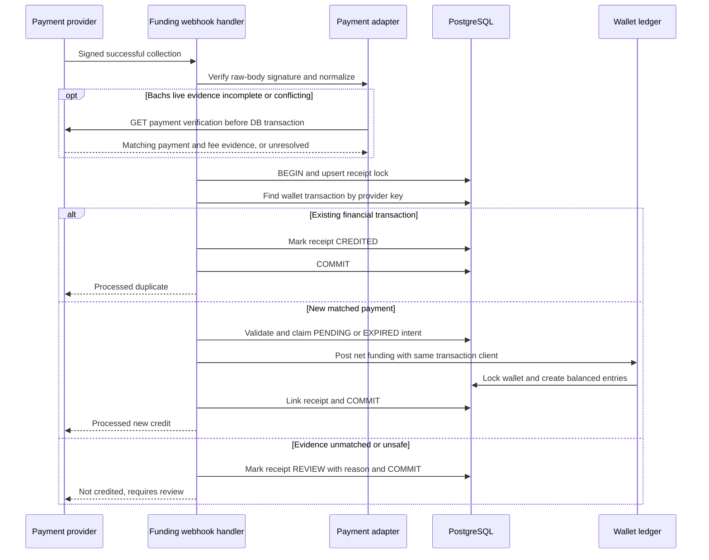

The same intent cannot be credited twice by two distinct charges: a conditional status transition must claim it exactly once. The second charge receives review reason `FUNDING_ALREADY_PAID`. That is a different protection from duplicate-event handling: two charges can have different provider references while pointing to the same intent.

<a id="section-7-8"></a>

### 7.8 Attribution, conflicting evidence, and late payments

For temporary funding the service matches provider reference or checkout identity and verifies provider, currency, expected total payable, checkout ID where relevant, and funding reference. It credits the stored requested amount only if the collected net covers it. Paying too much or too little does not silently change the intended wallet credit.

An unmatched Bachs payment enters `REVIEW`; the code explicitly refuses to guess the owner from amount, email, or timing. Fifty people can all pay ₦1,015.23; their checkout references must distinguish them. Paystack without a matching temporary intent may instead match an active permanent virtual account by account number and provider, whose stored relation identifies the wallet owner.

Review reasons include unknown checkout/account, wrong amount, checkout/reference mismatch, missing settlement information, conflicting settlement evidence, fee exceeding the quoted coverage, or a second payment against an already paid request. A valid webhook can therefore return “processed false” without being lost: its receipt records the reason for investigation.

Bachs reconciliation has a specific implemented verification path. If live-mode evidence has missing fees or settlement conflict, with the expected live credential class and required references, `resolveBachsDepositWebhook` queries the Payments API. It checks payment, checkout, reference, optional organization, currency, gross amount, full amount paid, zero remainder, merchant fee bearer, supported transfer method, and absence of unsupported split-payment evidence. A matching response can replace conflicting fee information; a failed lookup preserves the unresolved evidence for review. HTTP verification happens before the financial transaction, avoiding provider latency while holding wallet/receipt locks.

There are narrowly gated sandbox exceptions for known Bachs evidence differences, tied to test mode, sandbox credential class, stored sandbox checkout URL, exact references/amount, and net coverage. These are not general production bypasses. This handbook intentionally contains no credential values or usable signature examples.

**Identified limitation:** This is targeted evidence resolution during webhook handling, not a general periodic bank settlement importer. The inspected code does not establish an automatic operator-approved credit path for every review receipt, nor a scheduler that safely resolves every `UNKNOWN` initialization. Corrected provider delivery can be reprocessed; unresolved cases require operational diagnosis rather than an assumed automatic eventual credit.

<a id="section-7-9"></a>

### 7.9 Notification after money commits

After the transaction commits, the local summary cache is invalidated and the service tries to enqueue a WhatsApp funding confirmation. Missing WhatsApp identity skips the notification. A summary read can add the available balance; failure of that optional read does not undo the credit. Enqueue errors are logged rather than rolling back already committed money.

This order protects the ledger from a messaging outage, but the funding notification itself lacks the purchase-completion outbox flag introduced elsewhere. A crash after funding commit but before enqueue can leave a credited wallet without a confirmation. A duplicate payment callback returns through the existing-transaction branch without recreating that original notification. Distinguish “credit recovery” from “notification recovery.”

<a id="section-7-10"></a>

### 7.10 Testing, alternatives, and honest operating limits

[payment.funding.test.ts](test/payment.funding.test.ts) mocks provider/repository/ledger behavior. Its assertions cover net postings, preserved fee quotes, changed-amount key rejection, one credit for redelivery, fifty same-value payments assigned by checkout identity, unknown-checkout review, late accepted payments, signature rejection before database access, and no fallback after uncertain initialization. It also asserts fallback after explicit rejection and fee recalculation for the backup provider. These are orchestration tests, not real payment approvals.

[payment.funding.integration.test.ts](test/payment.funding.integration.test.ts) contains isolated PostgreSQL assertions: five concurrent copies of one payment produce one wallet transaction and two entries; equal-value deposits reach separate owners; a simulated ledger failure rolls back the receipt and intent claim; conflicting evidence remains reviewed and corrected evidence credits once. [funding-fees.test.ts](test/funding-fees.test.ts) checks gross-up, cap, upward kobo rounding, threshold boundaries, zero-cost mock policy, and malformed/oversized input rejection. The handbook inspected these tests; it did not execute database tests or send provider calls.

An alternative is a hosted checkout for every provider, simplifying UI presentation but sacrificing some direct-transfer flexibility. Another is one permanent account for every customer, which requires provider support, account provisioning recovery, privacy decisions, and external approval. A general payment-intent state machine with automated requery could reduce uncertain initialization cases, but it is additional engineering and cannot be described as already implemented.

**Key takeaways:** Payment initiation creates instructions; verification establishes acceptable collection evidence; references establish ownership; a durable receipt and intent claim protect duplicate credit; provider uncertainty requires preserving identity; messaging success is separate from financial success.

**Review questions:** Why is an HTTP timeout not sufficient evidence to fail over? Why use both a charge-level key and an intent-level claim? What happens if a customer pays after expiry? Why is a correctly signed but mismatched webhook still rejected? Why is a funding confirmation less recoverable than purchase completion notification?

**Further reading:** Use [Paystack webhooks](https://paystack.com/docs/payments/webhooks/) for the primary signature/delivery contract; compare it with [webhook-signature.ts](src/infra/payments/webhook-signature.ts). Read [Node's crypto documentation](https://nodejs.org/api/crypto.html) for HMAC and constant-time equality when studying the cryptographic concepts in Chapter 15. Provider adapter source remains the authority for SwiftTopUp's particular supported fields.

**Explain this in an interview:** “We persist the funding intent before initialization, and we distinguish explicit rejection from uncertainty so a timeout cannot blindly create a second provider flow. Webhooks require signature and business validation. A receipt lock, unique provider key, atomic intent claim, and balanced ledger posting make repeated successful payment delivery produce one wallet credit.”

<a id="chapter-8"></a>

## Chapter 8: Commerce and Purchase Processing

**Learning objectives:** Trace catalog-to-quote-to-debit-to-delivery; explain why a pending purchase is durable work; distinguish provider request amount, actual supplier cost, customer charge, and profit; reason through uncertain fulfillment and refunds. **Prerequisites:** Chapters 6–7, basic transactions, HTTP, and union types. **Difficulty:** Challenging; study the normal flow before the recovery branches. **Opening practical exercise:** Draw a timeline where the provider delivers data but the worker loses the response. Decide which actions are safe before reading the recovery sections.

<a id="section-8-1"></a>

### 8.1 What commerce owns and why it exists

Commerce turns a customer's purchase decision into a tracked product delivery. Wallet answers “can this owner spend this money?” Commerce answers “what are they buying, at what confirmed price, from which provider, and what is the eventual result?” Messaging collects intent and shows the result, but it should not invent product prices or directly modify ledger tables.

| Source                                                                                        | Central functions and responsibilities                                                                          |
| --------------------------------------------------------------------------------------------- | --------------------------------------------------------------------------------------------------------------- |
| [commerce.service.ts](src/domains/commerce/commerce.service.ts)                               | `syncProducts`, `listProducts`, `quotePurchase`, `createPurchase`, `listPurchases`.                             |
| [commerce.pricing.ts](src/domains/commerce/commerce.pricing.ts)                               | `money`, `retailPrice`, exact Decimal-based rounding.                                                           |
| [commerce.quote.ts](src/domains/commerce/commerce.quote.ts)                                   | `encodeQuote` and `decodeQuote`, validating and signing the confirmed purchase snapshot.                        |
| [commerce.repository.ts](src/domains/commerce/commerce.repository.ts)                         | Atomic purchase/debit/job creation, job claims, result application, provider events, refunds, recovery scans.   |
| [commerce.fulfillment.service.ts](src/domains/commerce/commerce.fulfillment.service.ts)       | `processFulfillmentJob` and `processRefundJob`, orchestrating provider and wallet services.                     |
| [commerce.reconciliation.service.ts](src/domains/commerce/commerce.reconciliation.service.ts) | `run`, discovering missing/due/stale work and financial exceptions.                                             |
| [commerce.notification.service.ts](src/domains/commerce/commerce.notification.service.ts)     | `createPurchaseCompletionNotificationService`, `notify`, `recover`, durable completion-notification scheduling. |
| [data-plan.catalog.ts](src/domains/commerce/data-plan.catalog.ts)                             | Data-plan interpretation, comparison, ranges, and sensible customer choices.                                    |
| [commerce.routes.ts](src/domains/commerce/commerce.routes.ts)                                 | Authenticated product, quote, purchase/history endpoints; restricted sync; VTpass callback entry.               |

Models include `Product`, `Purchase`, `PurchaseFulfillmentJob`, `PurchaseFulfillmentAttempt`, `PurchaseProviderEvent`, `PurchaseRefundJob`, and `FinancialException`. Commerce calls wallet services for money, the selected VTU adapter for verification/fulfillment, qualification services for referral events, and messaging through the completion-notification service. Redis Streams carry wake-up messages; PostgreSQL owns durable work and financial state.

<a id="section-8-2"></a>

### 8.2 The product catalog and its safeguards

`syncProducts` asks the selected provider adapter for products, normalizes them, computes customer prices, upserts rows, and deactivates missing products for the active provider. The database key `(provider, providerProductCode)` identifies one supplier product. Repeating synchronization updates that catalog item instead of generating unrelated duplicates.

The schema supports `AIRTIME`, `DATA`, `ELECTRICITY`, `CABLE_TV`, and `EXAM_PIN`. Actual availability follows the adapter's returned catalog, supported service configuration, provider state, and active flags. An enum value does not prove every brand, meter type, exam product, or denomination works in production.

The data path interprets plan names/validity and stores data volume with six decimal places. A VTpass data item that cannot be understood safely can be deactivated rather than shown with a misleading value. VTpass items with unknown provider fees are not offered as safely priced products. JAMB products must satisfy the published-price constraints represented by the implementation.

`listProducts` reads active products for the currently selected provider and recomputes presentable retail price. It excludes VTpass entries missing required pricing fields. Catalog synchronization is an operator/admin route, not a customer permission. Existing purchases retain their own provider/pricing snapshots; changing a catalog row must not silently change work that already debited a customer.

<a id="section-8-3"></a>

### 8.3 Four amounts that must not be confused

| Amount               | Meaning                                                           | Where preserved                                     |
| -------------------- | ----------------------------------------------------------------- | --------------------------------------------------- |
| Product value        | What the customer receives, such as data volume or a bill amount. | `Product.value`, quoted `value`, `Purchase.amount`. |
| Provider amount      | Face amount or variation amount submitted to the supplier.        | Quote and `Purchase.providerAmount`.                |
| Customer price       | Amount debited from the wallet.                                   | Quote and `Purchase.price`.                         |
| Actual provider cost | Supplier debit verified from fulfillment evidence.                | `Purchase.providerCost`.                            |

`platformProfit = customer price − actual provider cost` is stored when supplier cost is known. It is a purchase-level spread before any broader operating expenses. It does not prove company profitability. Funding-processing fees, infrastructure, losses, support, and taxes are separate concerns. Referral share is calculated from that spread, not from all customer spending.

`retailPrice` applies a 10% markup to the VTpass data base, adds the provider fee, then rounds the customer charge upward to a whole naira. Other types do not receive that data multiplier through this function, although fees and whole-naira ceiling still apply. The mock provider follows the mock pricing branch.

Copied excerpt from [commerce.pricing.ts](src/domains/commerce/commerce.pricing.ts):

```ts
const total = new Prisma.Decimal(money(providerAmount))
  .mul(provider === 'VTPASS' && type === 'DATA' ? '1.10' : '1')
  .add(money(providerFee));
// Do not round the marked-up subtotal to kobo before taking the ceiling.
return money(total.toDecimalPlaces(0, Prisma.Decimal.ROUND_CEIL).toFixed(2));
```

The Decimal operation preserves the subtotal before the final ceiling. **Illustrative example:** a ₦200 base VTpass data variation with zero provider fee quotes ₦220. If fulfillment later reports an actual supplier debit of ₦194, the stored spread is ₦26. Do not use the ₦200 submission amount as a fabricated settled supplier cost. The PostgreSQL purchase-integrity tests assert this exact distinction even after the catalog changes to another price.

<a id="section-8-4"></a>

### 8.4 Quotes bind the customer's confirmation to a snapshot

A quote is a server-created description of the proposed purchase: owner, product, provider, environment base URL, recipient, provider amount/fee, customer price, expiry, and any biller or quantity details. SwiftTopUp signs the serialized payload with an HMAC and returns a token. The signature detects changes; it does not encrypt the contents.

`encodeQuote` validates the quote with Zod, base64url-encodes JSON, and signs the encoded payload using the domain prefix `commerce-quote:v1:`. The key is the configured JWT access-token secret. Domain separation prevents the same byte string being confused with another signing purpose, but reusing a secret couples key rotation between features. A dedicated quote key would be an alternative, not the current implementation.

`decodeQuote` requires a valid signature, expected user, and future expiry; quotes last five minutes. Invalid, malformed, foreign-user, expired, or tampered tokens produce the public `QUOTE_EXPIRED` response. The wording intentionally does not reveal every verification distinction.

`createPurchase` checks the quote against product ID, recipient, provider product code, active provider, and configured provider environment. This environment snapshot helps prevent a sandbox quote being submitted to a newly configured live endpoint. For non-token VTpass paths the client must send an expected price that equals the newly generated quote. Electricity, cable, and examination purchases require a confirmed quote token.

Quotes also provide an operation identity. With a token, the purchase key uses `quoteId` and owner; without one it uses the caller's idempotency key and owner. Repeating confirmation of the same valid quote returns the existing purchase. A legitimate new purchase needs a new quote or operation key. An expired token is decoded before the existing purchase lookup, so retrying that old token can return expiry even if its earlier purchase exists; the history remains the source for checking what happened. It does not debit again.

<a id="section-8-5"></a>

### 8.5 Verification and category-specific purchase rules

Electricity and cable require a biller code, such as a meter or smartcard number, and an adapter supporting `verify`. JAMB also requires profile verification. Customer name from verification becomes part of the quote so the user can confirm the intended account before spending.

For electricity, the entered amount is validated against positivity and any provider minimum/maximum returned by verification. Product code must identify a supported prepaid or postpaid variation. For cable renewal, the verification response must supply a positive renewal amount; STARTIMES renewal is rejected by this path and the customer must select a package. For exam PIN purchases, quantity is one through ten where supported. JAMB requires one verified profile and zero provider fee with no above-approved-price customer charge.

These rules demonstrate why deterministic financial validation belongs after conversational interpretation. An AI can suggest a biller intent, but it cannot make a nonexistent meter valid or authorize a different amount. The final quote and service validation define the purchase that may be debited.

The fulfillment receipt is structured data, including a prepaid token/units or exam PIN/card information where applicable. Such receipts are sensitive customer value; the handbook does not reproduce real receipts. Successful external delivery may still require requery if the expected prepaid token or complete PIN quantity has not been recovered.

<a id="section-8-6"></a>

### 8.6 A successful local transaction creates pending external work

`createPurchaseWithDebitAndJob` creates one database transaction containing: a `PENDING` purchase, successful wallet debit with balanced entries, attachment of that debit ID, and a `QUEUED` fulfillment job. If the debit fails for insufficient funds, all these local writes roll back. The provider has not been called at this point.

After commit, `createPurchase` tries to enqueue the job ID to Redis Streams. If enqueue fails, the error is logged and the API still returns the durable pending purchase. Reconciliation can discover the queued job in PostgreSQL and publish its ID later. Redis availability affects prompt processing; it does not erase the durable obligation to fulfill or refund.

This is why “purchase accepted” and “airtime delivered” are separate statuses. The API's success means it safely recorded the purchase and debit. The worker's eventual result determines fulfillment. Pretending these are one synchronous result would make a transient provider outage or HTTP timeout much harder to recover honestly.

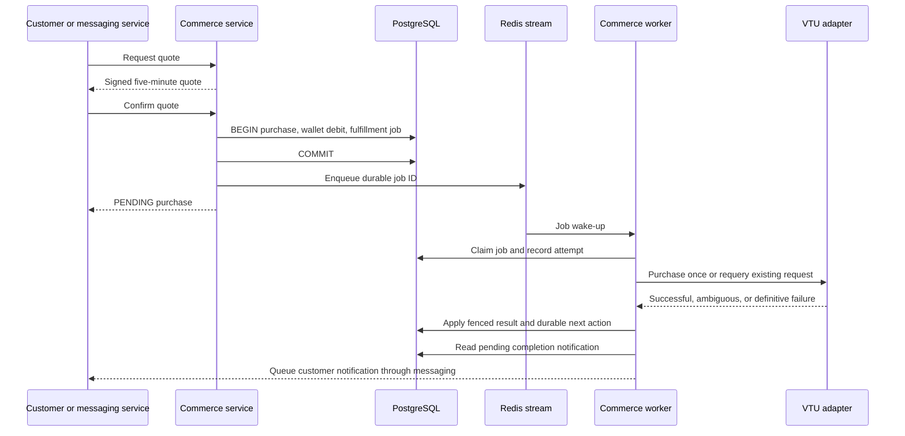

<a id="section-8-7"></a>

### 8.7 Claiming work without two initial purchases

`claimFulfillmentJob` determines whether a queued/due, awaiting-requery/due, or stale processing job is eligible. A conditional `updateMany` includes the current status, attempt count, and `purchaseAttempted` value. If two workers read the same row, only one matching update claims that observed version.

The claim commits `purchaseAttempted: true`, increments the count, records `lockedAt`, and writes a `PurchaseFulfillmentAttempt` before the provider call. Initial VTpass claims generate an appropriate request ID and persist it. Subsequent claims retain that identity and use requery instead of issuing another purchase.

There is an intentional uncertainty window: the worker can crash after marking purchase attempted but before sending the HTTP request. Recovery still queries the persisted provider request ID because it cannot know whether the old worker sent anything. A requery reporting “not found” is not automatically permission to resend in the inspected flow. Avoiding duplicate value takes priority over claiming every such case resolves immediately.

Result application adds a stronger stale-worker fence. `applyFulfillmentResult` locks the job with `SELECT ... FOR UPDATE`, checks that the attempt belongs to the job, requires its attempt number to match the job's current count, and requires `PROCESSING`. An old worker returning after lease recovery cannot overwrite the newer attempt's result through this path. A lease alone cannot stop old code running; the fence stops its stale result becoming authoritative.

<a id="section-8-8"></a>

### 8.8 Provider outcomes and the local state machine

`processFulfillmentJob` uses the purchase's saved provider and product snapshot. Missing snapshot data or an environment mismatch becomes ambiguous work for investigation, not a blind purchase using today's catalog. The selected provider is called outside the database transaction.

If the first purchase throws or returns ambiguous/pending, the service attempts a requery. Requery failure becomes an ambiguous normalized result. The same worker invocation can therefore include purchase then requery, but it does not send a second purchase.

| Outcome                                                                     | Purchase state            | Job and money behavior                                                   |
| --------------------------------------------------------------------------- | ------------------------- | ------------------------------------------------------------------------ |
| Verified successful delivery with known cost and complete required receipt  | `SUCCESSFUL`              | Job `SUCCEEDED`; no refund; qualification event may be enqueued.         |
| Successful delivery, missing actual cost/receipt, or conflicting known cost | `SUCCESSFUL`              | Job `AWAITING_REQUERY`; financial exception; no invented profit/reward.  |
| Pending/ambiguous provider outcome                                          | Usually remains `PENDING` | Job `AWAITING_REQUERY`; funds remain debited until the outcome is known. |
| Definitive failure                                                          | `FAILED`                  | Job `FAILED`; durable refund job created.                                |
| Refund posted and metadata completed                                        | `REFUNDED`                | Refund job `SUCCEEDED`; refund qualification event may be enqueued.      |

The important subtlety is that `Purchase.status` and fulfillment job status represent different dimensions. `SUCCESSFUL` can mean the customer received value while accounting evidence or receipt recovery remains incomplete. A customer-facing delivered state must not fabricate a supplier cost. Likewise, a provider timeout is not a definitive failure and should not immediately refund potentially delivered value.

Provider events are persisted with unique identities, and duplicates create a visible `DUPLICATE_PROVIDER_EVENT` exception rather than an extra debit. A previously refunded purchase ignores later fulfillment mutation in the guarded branch. Late and contradictory evidence still needs operational review; a database unique key cannot make an inconsistent supplier infallible.

<a id="section-8-9"></a>

### 8.9 Crash timeline and later reconciliation

Consider a ₦220 data purchase:

| Time | Durable/local state                                                         | External reality                            |
| ---- | --------------------------------------------------------------------------- | ------------------------------------------- |
| T0   | Debit, pending purchase, queued job committed.                              | No request yet.                             |
| T1   | Job claimed, request ID and initial attempt committed.                      | Worker is about to submit.                  |
| T2   | No successful local result yet.                                             | Provider accepts and delivers data.         |
| T3   | Worker crashes before recording response.                                   | Customer may already have data.             |
| T4   | Lease expires; recovery makes job queryable again.                          | Re-delivery of stream wake-up is harmless.  |
| T5   | New claim creates a `REQUERY` attempt with the original request ID.         | Provider reports delivered and actual cost. |
| T6   | Fenced result commits success, receipt/cost, and notification pending flag. | Delivery is now reflected locally.          |

Refunding at T3 merely because the process crashed could give away delivered data for free. Reissuing purchase at T5 could deliver twice. Requery is the safe information-gathering action.

`commerceReconciliationService.run` recovers completion notifications, referral qualification events, stale fulfillment/refund leases, pending callback signals, missing fulfillment jobs, due jobs, and failed purchases missing refund jobs. It records missing-debit exceptions instead of silently inventing a debit. It returns deduplicated stream messages for the worker's recovery loop to enqueue.

Reconciliation is repair based on durable facts, not a promise of automatic resolution for every financial discrepancy. An ambiguous provider can remain ambiguous. The normal retry scheduling shown here uses a thirty-second delay; it should not be described as exponential backoff. Financial exceptions are durable cases to inspect, not a dead-letter queue with a universal automatic fix.

<a id="section-8-10"></a>

### 8.10 Callbacks are hints, not settlement authority

The VTpass callback endpoint validates the supported request shape, records the callback signal, and schedules requery of a matching request/environment. It does not directly trust a callback's claimed successful status to credit or refund. This is particularly useful where callback authentication is limited: authenticated provider requery is the source for the actual outcome.

The callback handler's durable record means enqueue failure does not necessarily lose the signal; recovery scans pending callback events. Do not confuse `PurchaseProviderEvent` receipt with a guarantee that its raw payload was sufficient to settle money. Event storage supports audit and wake-up; outcome verification remains separate.

<a id="section-8-11"></a>

### 8.11 Refunds, receipts, and completion notification

Definitive failure ensures a `PurchaseRefundJob` with a unique purchase and stable refund key. `processRefundJob` calls wallet refund, then completes job/purchase state. A failed refund records the error, schedules another attempt, and opens `FAILED_REFUND`. A crash after wallet credit but before metadata completion retries idempotently, as Chapter 6 explains.

Purchase success notification has a durable outbox-like flag: `completionNotificationPending` is committed in the same transaction as the verified result when the required receipt is present. `notify` reads flagged purchases, resolves the purchaser's active linked WhatsApp identity, validates receipt shape, and creates a unique outbound message with `purchase-completed:<purchaseId>`. It notifies the purchaser, not necessarily the recipient whose phone or meter received the product.

Only after scheduling or determining that no eligible linked identity exists does it mark the flag handled. Enqueue failures leave the flag for `recover`. The schema's unique outbound deduplication key handles duplicate notification scheduling. This closes the success-commit/enqueue gap for purchase completion; it does not prove that Meta delivered or the customer read the message. Those states belong to messaging.

<a id="section-8-12"></a>

### 8.12 Tests, alternatives, and limitations to remember

[commerce.phase-b.test.ts](test/commerce.phase-b.test.ts) covers pricing/quote behavior with mocks, including customer price and validation rules. [commerce.fulfillment.test.ts](test/commerce.fulfillment.test.ts) exercises provider success, timeout/requery behavior, refund orchestration, and recovery-related branches. Read its mocks before inferring real concurrency: a mocked claim cannot prove PostgreSQL protects two workers.

[commerce.phase-b.integration.test.ts](test/commerce.phase-b.integration.test.ts) asserts that five simultaneous claim attempts yield exactly one initial purchase claim; a later claim becomes requery with the same request ID. It changes catalog prices after creation and verifies the original purchase retains ₦220 price, ₦200 provider amount, ₦194 actual cost, and ₦26 spread. It verifies delivery with missing cost remains `SUCCESSFUL` but `AWAITING_REQUERY`, without a qualification event. It also asserts rollback when the transactional debit callback throws.

[commerce.reconciliation.test.ts](test/commerce.reconciliation.test.ts) asserts missing work becomes a recoverable stream message and notification recovery runs. [commerce.notification.test.ts](test/commerce.notification.test.ts) and [commerce.notification.integration.test.ts](test/commerce.notification.integration.test.ts) provide separate evidence for notification orchestration and persistence. These test files were inspected; this handbook did not execute database/provider workflows.

A synchronous purchase implementation is shorter but ties HTTP reliability to a supplier response and makes crash recovery obscure. A full external message broker is another choice but still needs durable business jobs and idempotency around money. A reservation/hold model could distinguish reserved from spent funds but would require explicit hold release/capture rules absent from this schema. The current immediate-debit/compensating-refund approach is understandable at this stage, with the cost of temporarily reduced funds while uncertain work is reconciled.

Known limits include provider/environment dependencies, customer-visible pending periods, indefinite ambiguous cases, separate commits for refunds, weaker refund claim fencing than fulfillment, and incomplete reverse-reward economics discussed in Chapter 12. Never equate “the worker retries” with “eventual success is guaranteed.”

**Key takeaways:** A quote is a signed confirmation snapshot; purchase/debit/job creation is atomic; provider calls are outside that transaction; one initial attempt is persisted before external action; later work re-queries; actual cost and receipt completeness matter separately from delivery; refunds compensate rather than erase.

**Review questions:** Why does the purchase retain a base URL? Why does a successful purchase sometimes have a nonterminal job? Why does marking `purchaseAttempted` before the HTTP call create both safety and recovery difficulty? What would break if every timeout triggered a refund? What protects the completion notification after a crash?

**Further reading:** Revisit [PostgreSQL explicit locking](https://www.postgresql.org/docs/current/explicit-locking.html) for result serialization and [transaction isolation](https://www.postgresql.org/docs/current/transaction-iso.html) for conditional claims. Study Chapter 10 for stream delivery, then Chapter 15 for leases, fencing, and compensating transactions. These are challenging topics; trace one actual job row before comparing distributed alternatives.

**Explain this in an interview:** “We separate local acceptance from external delivery. The purchase, wallet debit, and durable job commit together. A worker conditionally claims the job and records a single initial attempt; retries query the same provider request. Fenced result application prevents stale workers overwriting newer state. Definitive failure queues an idempotent refund, and ambiguous delivery keeps funds debited until verified.”

<a id="chapter-9"></a>

## Chapter 9: Messaging and WhatsApp Integration

**Learning objectives:** Explain durable webhook intake, stateful conversations, deterministic confirmation, optional AI interpretation, and delivery recovery; identify the remaining duplicate-processing windows. **Prerequisites:** Chapters 4–8; HTTP, unique constraints, promises, and idempotency. **Difficulty:** Intermediate to challenging. **Practical exercise:** Read the routed `receiveWhatsappWebhook` path and the older `processWhatsappWebhook` helper side by side. Write two lists of their actual safeguards and underline which function the controller calls.

<a id="section-9-1"></a>

### 9.1 What the Messaging domain is responsible for

Messaging turns text into a controlled customer journey. It owns extraction of supported WhatsApp events, durable message records, conversation progression, customer replies, and delivery-status handling. It asks other domains to perform identity, funding, purchase, and reporting actions; it does not replace their business rules.

The main implementation is [messaging.service.ts](src/domains/messaging/messaging.service.ts), supported by [messaging.repository.ts](src/domains/messaging/messaging.repository.ts), [messaging.state.ts](src/domains/messaging/messaging.state.ts), [messaging.outbound.ts](src/domains/messaging/messaging.outbound.ts), [whatsapp-parser.ts](src/domains/messaging/whatsapp-parser.ts), [messaging.delivery.ts](src/domains/messaging/messaging.delivery.ts), [conversation-intent.service.ts](src/domains/messaging/conversation-intent.service.ts), and the billing/catalog conversation files. Delivery runs through [messaging.worker.ts](src/infra/queues/messaging.worker.ts) and WhatsApp adapters under `infra/messaging/`.

The durable models include `WhatsappConversation`, `WhatsappInboundEvent`, `WhatsappOutboundMessage`, `WhatsappOutboundAttempt`, and `WhatsappDeliveryEvent`. Their roles are conversation ordering, received-work persistence, outbound intention, send-attempt history, and later provider delivery evidence. They complement Redis context; they do not make the whole conversation a single atomic transaction.

<a id="section-9-2"></a>

### 9.2 Two webhook operations with different purposes

`GET /api/v1/messaging/whatsapp/webhook` establishes subscription verification. [messagingService.verifyWebhook](src/domains/messaging/messaging.service.ts) requires `hub.mode` to equal `subscribe` and checks the supplied verification token against configuration, then returns the challenge as plain text. This proves possession of the configured verification value during setup. It does not authenticate every future payload.

The POST route verifies each incoming body's HMAC signature. [verifyWhatsappSignature](src/infra/messaging/whatsapp-signature.ts) accepts the `sha256=` header form, calculates HMAC-SHA256 over the preserved raw body using the app secret, checks digest lengths, and uses `timingSafeEqual`. Re-serializing parsed JSON can change whitespace or property formatting, so the original body matters.

The route then applies the WhatsApp-specific limiter, validates its envelope, and calls `messagingController.receiveWhatsappWebhook`. There is also a global API limiter before the domain route. A valid signature means the body passed the authenticity check; normal schema checks, user eligibility, deduplication, and financial validation remain necessary. An authentic provider can legitimately redeliver the same event.

<a id="section-9-3"></a>

### 9.3 Persist before acknowledging

`receiveWhatsappWebhook` extracts supported text messages, persists each message, persists recognized delivery updates, schedules conversation processing without awaiting its completion, and returns counts. The controller responds HTTP 200 after that persistence work succeeds. If persistence throws, it logs and forwards the failure rather than pretending the message was safely retained.

This reduces the work done before Meta gets its acknowledgement. It also improves crash recovery: the conversation instruction is already in PostgreSQL even if the process exits immediately after returning 200. The worker's five-second recovery pass can find it later.

`persistInboundMessage` checks `providerMessageId`, then uses a transaction to upsert `WhatsappConversation`, increment `nextSequence`, and create the event. A unique provider-message constraint handles a concurrent duplicate that slips past the preliminary lookup; the repository catches `P2002` and returns the existing row. The lookup improves the common path; the constraint protects concurrency.

**Subtlety:** The returned `persistedMessages` count is the number of extracted event references handled by the service, including duplicates that resolve to existing events. It is not a reliable count of new database inserts. Read API field names alongside their calculation.

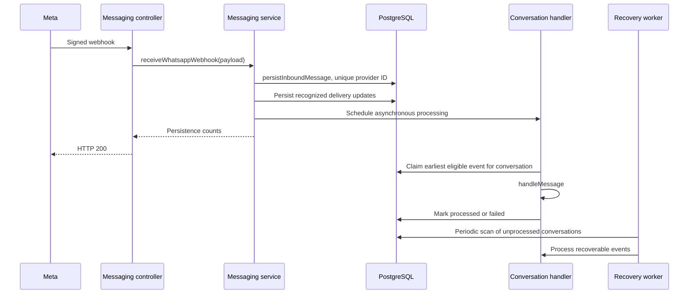

The handler may begin before or after the HTTP response; “fire and forget” describes awaiting behavior, not a guaranteed execution order between independent asynchronous effects.

<a id="section-9-4"></a>

### 9.4 Ordering, claims, and deduplication

`claimNextInboundEvent` finds the smallest sequence among a conversation's nonprocessed events. It considers `RECEIVED` and `FAILED` eligible, and considers `PROCESSING` eligible after its processing timestamp is older than five minutes. A conditional `updateMany` claims the candidate only if its status still matches the eligible condition. This prevents two normal concurrent claimers from both transitioning the same freshly received event.

The sequence is database receipt order. It cannot reconstruct original human send order if Meta delivers messages late or out of order. It also creates an intentional ordering consequence: a failed earlier event stays ahead of later events for that conversation.

**Identified limitation:** This is a timestamp-based recovery claim, not the attempt-fenced Commerce job implementation. Marking processed checks the processing status but does not bind completion to an attempt identity. A very slow old handler and a recovery handler can overlap after the timeout. Side-effect idempotency in Wallet and Commerce is therefore still essential.

There is another important failure behavior: `processClaimedInboundEvent` catches failures and marks the event `FAILED`; its caller loops and immediately asks for the next eligible event. Since the failed oldest event is immediately eligible, a persistent failure can repeatedly retry it without a deliberate backoff or retry ceiling. This can monopolize that conversation's processing and postpone later messages. Durable persistence is implemented; comprehensive poison-message handling is not.

The older `processWhatsappWebhook` method uses a process-local promise chain and Redis `SET NX` with a 24-hour TTL to deduplicate messages. It releases that claim on failure. Some existing unit tests exercise it. The HTTP controller calls `receiveWhatsappWebhook`, so you must not attribute this older helper's promise serialization or Redis deduplication to the routed durable intake path.

<a id="section-9-5"></a>

### 9.5 Conversation state is a state machine

A state machine describes a set of allowed stages and the transitions between them. An illustrative deterministic airtime journey is `NETWORK → PRODUCT → RECIPIENT_PHONE → CONFIRMATION`. Each incoming text means something different depending on the stored stage. “1” can select MTN at one stage and select a particular product at another.

[messaging.types.ts](src/domains/messaging/messaging.types.ts) represents these flows as a discriminated union. A `flow` and, where applicable, `step` narrow the fields available to TypeScript. [messaging.state.ts](src/domains/messaging/messaging.state.ts) stores the JSON under a WhatsApp-identity key with a ten-minute expiry. Cancellation and restart clear it, except safeguards preserve a billing submission that has already begun.

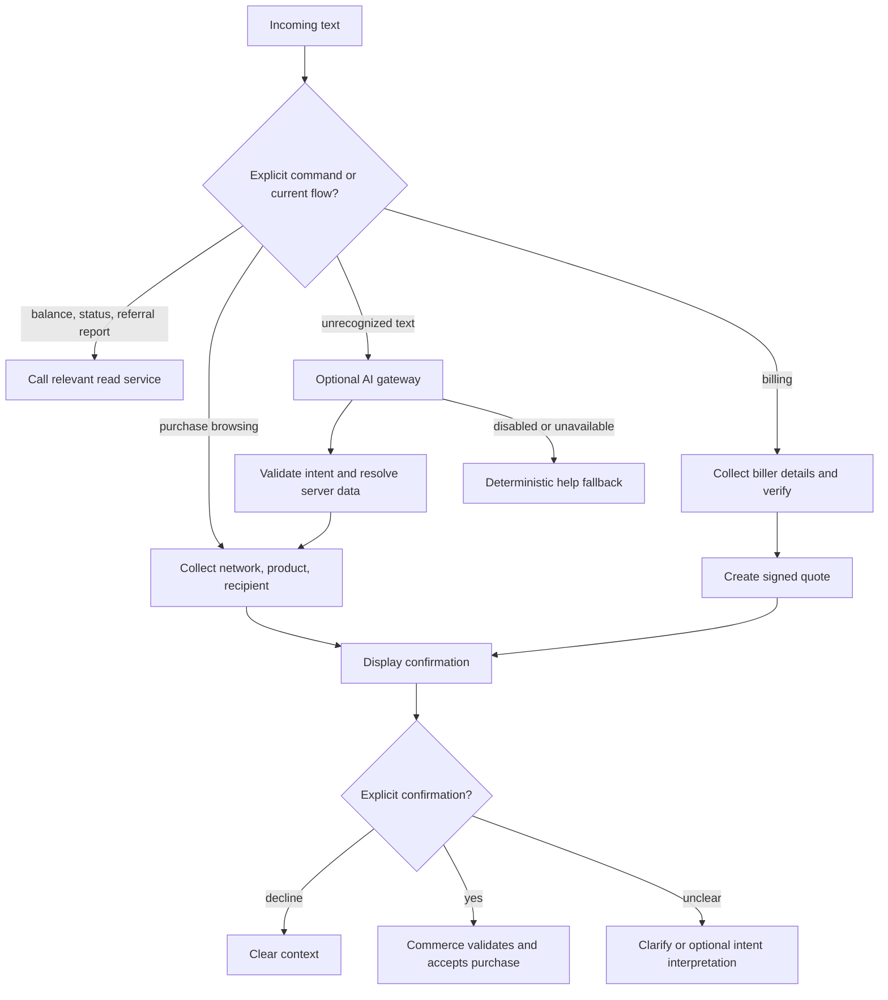

The state contains interaction context, not the financial ledger. If it expires after purchase acceptance, the durable purchase and job remain. A later “yes” without an active confirmation receives a no-active-confirmation response. Conversely, a repeated original confirmation event can be recovered, so its operation identity must prevent a second financial posting.

`handlePurchaseState` re-resolves current product choices and calls `commerceService.createPurchase` only after confirmation. Its legacy key derives from the inbound provider message ID. The AI confirmation path uses the stored draft ID. Signed billing confirmation uses the quote identity. These keys protect slightly different notions of “same operation”; do not substitute a fresh random key on every retry.

<a id="section-9-6"></a>

### 9.6 Optional AI interprets; deterministic code authorizes

An intent is a structured hypothesis about what the user wants: product type, network, quantity/amount, recipient scope, and missing fields. It is not a command with authority to debit. `conversationIntentService.interpret` calls `aiGateway.interpret` when the conversation route needs interpretation. The gateway supports Gemini, Groq, Cerebras, Hugging Face, and DeepSeek. An OpenAI-compatible transport helper exists; no OpenAI provider is registered in this source.

The gateway applies enablement/rollout gates, request quotas, provider limits, structured output parsing, confidence checks, redaction, circuit decisions, and guardrails. A model draft is merged with server-maintained context in [conversation-context.ts](src/domains/messaging/conversation-context.ts). When the recipient changes, dependent purchase details can be cleared so a previous network/product assumption does not silently follow a new recipient.

The server resolves real catalog products, checks the recipient, creates confirmation state, verifies expiry/ownership, compares current prices, and calls Commerce. Billing follows deterministic account verification and signed quotes. Prompt instructions alone are not the security boundary; validated service behavior is.

**Configured but inactive by default:** `AI_ENABLED` defaults to false. Feature flags may further disable it for a user or force deterministic-only mode. **Partially implemented journey:** “fund wallet” opens an amount prompt, but subsequent `FUND_WALLET` replies are routed to interpretation. Do not promise a complete deterministic-only funding conversation. The REST funding service remains implemented independently.

Saved contact names such as “send to Ebuka” do not imply a contact-book lookup. `SELF` can resolve the sender's known phone, but the code does not possess an arbitrary address book merely because the model can parse names.

<a id="section-9-7"></a>

### 9.7 Outbound intention, transport attempt, and delivery evidence

`messagingOutboundService.enqueueWhatsappTextMessage` creates a `QUEUED` database row, appends a Redis stream record containing its durable ID, then attaches the stream ID. If Redis publishing fails, the unscheduled database row remains recoverable. `enqueueUniqueWhatsappTextMessage`, used for deduplicated completion notifications, persists the unique intention without publishing directly; recovery publishes it.

The stream worker validates its payload, starts a durable attempt, calls `sendTextMessage`, records the provider message ID with `markOutboundSent`, then acknowledges the stream entry. A typing indicator is an ephemeral stream operation and has no equivalent durable text record.

Three states must be distinguished:

| Evidence                                  | Meaning                                                         | What it does not prove                              |
| ----------------------------------------- | --------------------------------------------------------------- | --------------------------------------------------- |
| Successful send response with provider ID | Meta accepted the outgoing request; local status becomes `SENT` | Customer device received it                         |
| `delivered` callback                      | Provider reports delivery                                       | Customer read or acted on it                        |
| `read` callback                           | Provider reports reading                                        | Purchase fulfillment or wallet settlement succeeded |

The worker log says an outbound message was “delivered” after sending/acknowledging; interpret that log in light of the code, not as delivery-receipt evidence. `WhatsappDeliveryEvent` and the later status callback are the relevant delivery records.

`applyDeliveryStatus` persists an event and uses a rank to avoid ordinary backward status updates. In the current rank, `FAILED` outranks `READ`; this is the implemented policy rather than a universal model of messaging chronology. Unknown outbound provider IDs return false rather than creating a new outbound record. A callback arriving before the provider ID was persisted therefore has a correlation gap; durable send intent does not automatically solve every status race.

<a id="section-9-8"></a>

### 9.8 Retries and remaining limitations

Messaging retries failed stream entries through pending-entry claiming. A Redis counter records attempts with a seven-day expiry. At three failures the worker writes a dead-letter record and acknowledges the original entry. It does not implement automatic replay from that dead-letter stream. Recovery, retry timing, and a send attempt are distinct mechanisms; Chapter 10 separates them.

Outbound `startOutboundAttempt` accepts `QUEUED`, `FAILED`, and `SENDING` states. It does not have Commerce's stale-lease ownership check or result-attempt fence. If Meta accepts a send and the database write fails, a retry can send the text again. If two copies of an unscheduled row are published before stream attachment, overlapping sends are also possible. A unique notification key prevents multiple logical notification rows, not exactly one physical external send.

`whatsappCloudProvider` currently uses `fetch` without an explicit abort timeout. Unlike payments, VTU, and AI, its request duration is not bounded by an application-configured timeout in that adapter. This matters because pending entry recovery assumes elapsed time is evidence of possible abandonment. A long request can overlap a later claimant.

Voice/audio interpretation is not implemented. Context loss can interrupt an uncommitted conversation. Ordinary reply creation and incoming-event completion are not one atomic transaction, so a handler replay may create duplicate reply intentions. These are operational and learning limitations to understand, not reasons to weaken the existing financial safeguards.

<a id="section-9-9"></a>

### 9.9 How to test and explain the service

[messaging.durable.test.ts](test/messaging.durable.test.ts) asserts intake persistence calls and delivery extraction, and verifies unique completion notification enqueue persists without calling Redis publication directly. Its duplicate delivery test uses a mocked repository with a set; it demonstrates the mock behavior, not a concurrent PostgreSQL uniqueness race. [messaging.worker.test.ts](test/messaging.worker.test.ts) supplies fake Redis/provider behavior and asserts successful acknowledgement, three failures leading to one DLQ record, and recovery after acknowledgement failure. [messaging.service.test.ts](test/messaging.service.test.ts) checks confirmation requirements, inactive-confirmation rejection, deterministic fallback, catalog behavior, referrals, and signed billing confirmation.

Those tests are valuable, but unit assertions with mocked storage do not prove real Meta connectivity, provider permissions, Redis durability, or concurrent database claim correctness. Test existence is distinct from execution; this chapter reports inspected assertions, not a live WhatsApp journey performed for this handbook.

**Key takeaways:** Acknowledge after durable intake. Keep temporary context separate from financial truth. Explicit confirmation and service validation control financial actions. Sending, delivery, and reading are different evidence. Recovery is at least once and must be paired with idempotency.

**Review questions:** Which unique key deduplicates durable intake? What does the five-minute processing timeout permit? Why can a poison event delay later text? What can happen after Meta accepts a send but local persistence fails? Why does AI being disabled expose a funding-conversation gap?

**Further reading:** [Express middleware](https://expressjs.com/en/guide/using-middleware.html), beginner, to understand signature placement; [Redis Streams](https://redis.io/docs/latest/develop/data-types/streams/), intermediate, before inspecting delivery retries. Continue to Chapter 18 for the security implications of message authentication and sensitive content.

**Explain this in an interview:** “We persist signed incoming text events before acknowledging Meta, claim them in database conversation order, and store short-lived context in Redis. Deterministic server logic owns validation and confirmation; optional AI only extracts intent. Outbound text has durable intentions and attempts, Redis Streams handles delivery coordination, and later callbacks establish delivered/read status. External sends remain at least once.”

<a id="chapter-10"></a>

## Chapter 10: Background Processing, Workers, and Redis

**Learning objectives:** Explain the active stream consumers, durable jobs, leases, claim fencing, reconciliation, and recovery limits; reason about crashes at every boundary. **Prerequisites:** Chapters 6, 8, and 9; transactions, unique constraints, promises. **Difficulty:** Challenging. **Practical exercise:** For a purchase, mark every durable write and external call on a timeline. Place a crash between each neighboring pair and state which process, record, or scheduler can resume the work.

<a id="section-10-1"></a>

### 10.1 Asynchronous does not automatically mean durable

A synchronous request waits for the operation's result before responding. An asynchronous design can accept work and return while processing continues. But an unawaited promise alone is not a durable job. If its process exits, memory disappears. Durability requires enough persisted information for another process to discover and safely resume the operation.

SwiftTopUp combines two mechanisms: PostgreSQL records business work and attempts; Redis Streams distributes references for prompt processing. Incoming WhatsApp events are durable database records processed asynchronously, not an incoming Redis Stream. Outgoing WhatsApp text and commerce job references use active Redis Streams.

Awaiting an external network call normally yields Node.js execution rather than blocking the JavaScript thread. It still ties the business operation and client response to network duration. Moving fulfillment into the worker improves request responsiveness and crash recovery; it does not magically create additional CPU parallelism. [Node.js's event-loop guide](https://nodejs.org/learn/asynchronous-work/event-loop-timers-and-nexttick) explains the runtime distinction.

<a id="section-10-2"></a>

### 10.2 Verify what is active

[worker.ts](src/worker.ts) imports `createMessagingWorker`, `createCommerceWorker`, and `createProductSyncScheduler`. The first two instantiate custom stream worker classes. Searches of current source find the BullMQ `Queue` import in [queues.ts](src/infra/queues/queues.ts), but no source importer of that module. Its messaging queue is commented out; an exported commerce queue remains unused by the executable paths.

**Implemented and wired:** Redis Streams consumers, durable PostgreSQL commerce jobs, recovery timers, inbound recovery, funding expiry, referral/reward recovery, and VTpass catalog synchronization when selected. **Present but inactive:** the unused BullMQ queue definition and installed dependency. **Not implemented:** a commerce stream DLQ policy, although constants for one exist.

| Active channel                    | Payload                                                           | Consumer group                | Durable business authority                             |
| --------------------------------- | ----------------------------------------------------------------- | ----------------------------- | ------------------------------------------------------ |
| `swifttopup:whatsapp:outbound`    | Type plus text/typing payload; text includes durable ID           | `swifttopup-whatsapp-senders` | PostgreSQL outbound row and attempts for durable text  |
| `swifttopup:commerce:fulfillment` | `FULFILLMENT`/`REFUND` job ID, or referral qualification event ID | `swifttopup-commerce-workers` | PostgreSQL purchase/refund jobs or qualification event |
| Incoming WhatsApp                 | Database event, not an active inbound stream                      | No inbound stream group       | `WhatsappInboundEvent`                                 |

<a id="section-10-3"></a>

### 10.3 Redis fundamentals in this application

Redis is a server exposing data structures such as strings, hashes, and streams. A key identifies a stored value. Expiry automatically removes temporary keys after their TTL. Atomic commands such as `INCR` help several processes update a shared counter without a read-modify-write race. Lua scripts can combine several related Redis operations atomically, as the AI control code does.

A Redis stream is an ordered append log. `XADD` adds a record and assigns an ID. A consumer group tracks which records have been assigned and which remain pending acknowledgement. Consumers in the same group share work rather than each independently receiving every new item. Redis's [Streams guide](https://redis.io/docs/latest/develop/data-types/streams/) explains that distinction.

Redis is accessed through the native ioredis connection in [config/redis.ts](src/config/redis.ts). The current configuration uses a five-second connection timeout, disables the offline command queue, and sets `maxRetriesPerRequest` to null. `waitForRedisReady` resolves on readiness or rejects an initial connection error/end state. The connection logs connect, ready, reconnecting, close, and error events. Provider hosting claims and persistence guarantees still require external verification.

<a id="section-10-4"></a>

### 10.4 Read, process, acknowledge

Both active stream modules create a group at `0-0` with `MKSTREAM`, ignoring the expected `BUSYGROUP` result when it already exists. Starting at the beginning allows the group to see existing history according to its group state. Consumers get names containing hostname and process ID.

Here is a real excerpt from [messaging.worker.ts](src/infra/queues/messaging.worker.ts):

```ts
const response = await this.blockingRedis.xreadgroup(
  'GROUP',
  messagingStreamConfig.consumerGroup,
  this.consumerName,
  'COUNT',
  1,
  'BLOCK',
  messagingStreamConfig.blockMilliseconds,
  'STREAMS',
  messagingStreamConfig.stream,
  '>',
);
```

`GROUP` supplies the group and consumer identity. `COUNT 1` requests a small batch. `BLOCK` waits up to the configured 30 seconds when no new work exists. `STREAMS` identifies the source log. `>` asks for entries not yet delivered to the group. The worker parses the Redis response as unknown data before processing.

The blocking operation uses `redis.duplicate()`. A connection waiting on a blocking stream read would delay other commands sent through that same socket. The duplicate allows regular Redis operations and recovery bookkeeping to continue. “Blocking read” refers to waiting on that Redis connection; the JavaScript event loop can still handle other asynchronous work.

After the handler succeeds, `XACK` removes the item from the group's pending-entry accounting. It does not delete the stream entry itself. The distinction matters for retention and memory: acknowledgement alone is not a stream trimming policy. Redis documents acknowledgement semantics in [XACK](https://redis.io/docs/latest/commands/xack/).

<a id="section-10-5"></a>

### 10.5 Pending entries and claiming

An assigned entry remains pending until acknowledgement. A consumer may die while owning it. Another consumer uses `XAUTOCLAIM` to take entries idle for at least 30 seconds. Both workers check claiming approximately every 60 seconds, request up to ten entries, and then process them. Timing is approximate because the loop can also be waiting on a blocking read or processing an entry.

The workers currently start each claim scan at `0-0` and use returned entries without carrying the returned scan cursor forward. This is simpler, but not a complete cursor-driven sweep of an arbitrarily large pending list. A large or pathological backlog deserves specific investigation rather than assuming uniform prompt recovery.

Stream ownership is not financial ownership. Claiming a Redis entry only says that a consumer has been assigned the delivery task. Before a commerce provider call, PostgreSQL still decides whether the durable job is due and claimable. This separation makes duplicate stream entries safe to encounter when the job state prevents repeated financial work.

<a id="section-10-6"></a>

### 10.6 Durable commerce jobs and the claim algorithm

`PurchaseFulfillmentJob` stores the purchase link, status, attempt count, lock time, next attempt time, stable provider reference, and whether purchase submission has already been attempted. `PurchaseFulfillmentAttempt` records each purchase/requery attempt. `PurchaseRefundJob` records retryable refund work. These rows let reconciliation answer what remains unfinished without relying on a process's memory.

[commerceRepository.claimFulfillmentJob](src/domains/commerce/commerce.repository.ts) runs inside a transaction. It reads the current job and purchase, checks whether a queued/requery job is due or a processing job is stale, and performs a conditional update matching status, attempt count, and `purchaseAttempted`. Only the successful conditional update advances the claim. It marks the job processing, sets the lock time, increments the attempt count, and sets `purchaseAttempted` before any provider submission. An attempt row records whether this execution is `PURCHASE` or `REQUERY`.

The first VTpass submission obtains the provider-compatible request ID in this claim. Later attempts retain that reference. `shouldCallPurchase` is derived from the persisted attempted flag. A crash after the claim but before the network call therefore errs toward requery rather than blindly submitting another purchase. This may leave a reference that the provider never saw; that is safer than assuming a timeout means no purchase happened.

**A lease** is temporary ownership inferred from a timestamp. A stale worker's lock can expire so recovery continues. Expiry does not kill the old worker; it may still be waiting on a network response. **A fence** prevents that old worker from applying a result after another attempt becomes current.

`applyFulfillmentResult` locks the job row with parameterized `SELECT ... FOR UPDATE`, loads the attempt and job, and verifies that the attempt belongs to the job, its attempt number equals the job's current count, and the job remains processing. Otherwise it returns `IGNORED`. This is the key fence. A lease alone would not reject a delayed old result.

<a id="section-10-7"></a>

### 10.7 Crash timeline: supplier acceptance before local completion

The following is an illustrative schedule of actual code behavior, not a measured production incident:

| Time | Worker A                                               | Worker B / scheduler                    | Durable implication                                               |
| ---- | ------------------------------------------------------ | --------------------------------------- | ----------------------------------------------------------------- |
| T0   | Claims attempt 1 and persists `purchaseAttempted=true` | —                                       | Future attempts know submission may have happened                 |
| T1   | Sends stable reference to VTPass                       | —                                       | Provider may commit independently                                 |
| T2   | Provider accepts; A loses connection or crashes        | —                                       | PostgreSQL cannot infer external result from the missing response |
| T3   | —                                                      | Reconciliation detects stale processing | Job becomes due for requery                                       |
| T4   | —                                                      | B claims attempt 2                      | Current attempt number advances                                   |
| T5   | A eventually returns with old response                 | B requeries same reference              | A's stale result cannot overwrite B's current attempt             |
| T6   | —                                                      | B applies authenticated provider result | Local result converges on supplier evidence                       |

The actual fulfillment service also tries an immediate requery after a thrown purchase call, and after an ambiguous initial response if a requery has not already been performed. If requery is still uncertain, it schedules another attempt for 30 seconds later. This is fixed delay, not exponential backoff.

No implementation can guarantee both immediate certainty and no duplicate effects from an opaque provider after an arbitrary timeout. SwiftTopUp chooses durable uncertainty and reconciliation over optimistic resubmission.

<a id="section-10-8"></a>

### 10.8 What reconciliation repairs

[commerceReconciliationService.run](src/domains/commerce/commerce.reconciliation.service.ts) recovers completion notification intentions, reconciles referral qualification work, resets stale fulfillment/refund jobs, schedules provider callbacks for authenticated requery, repairs pending purchases missing jobs when a debit exists, identifies pending purchases missing debit evidence, finds due fulfillment jobs, creates missing refund jobs, and identifies due refunds. It returns stream references to publish and opens deduplicated financial exceptions for states requiring attention.

The commerce worker runs this at startup and on `COMMERCE_RECONCILIATION_INTERVAL_MS`, defaulting to 60 seconds. It also reconciles pending reward events and expires temporary funding intents at startup and on their own timer. A separate five-minute product scheduler runs when VTpass is selected. That scheduler prevents overlap within its own process; multiple worker processes can still each run their scheduler, so it is not a distributed leader election.

Reconciliation makes a queue publication a prompt rather than the only memory of the work. Suppose the purchase/debit/job commit succeeds and `XADD` fails. The HTTP path logs publication failure; a later scan finds the due database job and republishes it. Suppose Redis loses the commerce stream entirely. Durable due jobs still exist for scanning. The worker needs Redis to resume stream processing, but business work has not been erased with the log.

<a id="section-10-9"></a>

### 10.9 Messaging recovery has different guarantees

The messaging worker runs a five-second timer. It asks the service to recover pending inbound database events and finds outbound messages with `status='QUEUED'` and `streamId=null`. It publishes those messages and attaches their stream IDs.

That recovers an outbound database insert followed by a failed publication. It does not automatically recover every possible Redis loss. If a row already has an attached stream ID and Redis later loses that entry, the current query does not select it for republishing. `FAILED`/`SENDING` rows are also not selected by that particular queued-outbox scan. Pending-entry claiming helps while the stream and group state still exist; it cannot claim records that have vanished.

Messaging's three-attempt counter and DLQ are stream-level policy. The counter is per stream ID, not an absolute global count of all possible sends of a logical notification. Publishing duplicates under new IDs changes that accounting. Its start-attempt method also lacks Commerce's equivalent claim fence. Be precise about the domain when describing “the worker's guarantee.”

<a id="section-10-10"></a>

### 10.10 Dead-letter queues and retries are explicit code

A dead-letter queue or stream retains failed work separately after a retry policy gives up. Messaging appends `sourceId`, type, payload, error, attempts, and failure time to its DLQ, then acknowledges the original. This stops that original pending entry circulating forever, but an operator still needs a diagnosis and replay policy. No automatic replay route is implemented.

Commerce's stream configuration declares a dead-letter name and `maxAttempts`, but the active commerce consumer does not use them. It calls domain processing and acknowledges on successful return; on a thrown error, the entry remains pending and the outer loop logs and retries later through claiming. Durable commerce job state and exceptions drive business recovery. Claiming “all jobs have three retries and then DLQ” would be false.

A retry should answer three questions: is the failure transient, is the operation safe to repeat, and what delay avoids making the failure worse? A Redis read can be repeated. A supplier purchase whose result is unknown should normally be queried by reference. A wallet refund uses a persistent idempotency key because a crash after ledger posting must not add money twice.

<a id="section-10-11"></a>

### 10.11 Delivery guarantees and eventual consistency

**At least once** means work can be delivered again when acknowledgement is missing. It favors eventual processing but requires duplicate-safe effects. **Exactly once** is meaningful only with a defined scope. A unique local wallet transaction can post once for one idempotency identity. That does not mean an external network send occurred exactly once across PostgreSQL, Redis, and Meta.

**Eventual consistency** means some views converge after asynchronous processing. A purchase can be locally accepted and pending while fulfillment runs; a successful purchase's terminal WhatsApp notification may arrive later. It is not permission for arbitrary wrong balances. Wallet mutations still need immediate transactional integrity even when the notification is delayed.

An acknowledgement can also fail after successful domain processing. Then another worker receives the same stream entry. Commerce sees a terminal/nonclaimable durable job and skips it before acknowledging. A durable text already marked sent is skipped by its start-attempt check. If external success was not persisted first, duplicates remain possible. The exact crash point determines the guarantee.

<a id="section-10-12"></a>

### 10.12 Compare the chosen mechanism with alternatives

| Mechanism                         | Useful capability                                                                | Cost or limit in SwiftTopUp's context                                                         |
| --------------------------------- | -------------------------------------------------------------------------------- | --------------------------------------------------------------------------------------------- |
| Current Streams + PostgreSQL jobs | Visible transport primitives plus financial work committed with database state   | Custom claiming, retry, retention, recovery, and monitoring code must be maintained           |
| BullMQ                            | Job/worker abstractions and built-in facilities such as delayed work and retries | Still needs financial idempotency and safe database-to-queue handoff; currently inactive here |
| PostgreSQL-only job polling       | One durable store and transaction boundary                                       | Polling, locking, scheduling, and load need deliberate design                                 |
| Dedicated message broker          | Purpose-built routing/delivery facilities depending on product                   | Another operated system; cannot itself make an external payment exactly once                  |
| Unawaited in-memory promise       | Very little setup                                                                | No durable restart recovery by itself                                                         |

The [BullMQ worker guide](https://docs.bullmq.io/guide/workers) is useful comparative study. Its current documentation may describe facilities beyond the exact package version installed here. Do not copy its examples into the handbook as evidence that this runtime uses them.

<a id="section-10-13"></a>

### 10.13 Tests, takeaways, and interview explanation

[commerce.fulfillment.test.ts](test/commerce.fulfillment.test.ts) mocks repository/provider behavior and asserts stable references, requery after timeout, no purchase submission on requery jobs, durable refund delegation, and notification behavior after result persistence. [commerce.reconciliation.test.ts](test/commerce.reconciliation.test.ts) checks recovery of a pending purchase missing a job and notification recovery invocation. These verify service orchestration assumptions; concurrency/constraint guarantees need database-backed tests. [messaging.worker.test.ts](test/messaging.worker.test.ts) exercises fake stream delivery, DLQ, acknowledgement failure, restart recovery, and blocking-connection errors. Their assertions were inspected, not run against remote infrastructure for this chapter.

**Key takeaways:** Durable records preserve intent; streams distribute references. `XACK` is not deletion. Leases permit recovery; fences reject stale completion. Commerce and Messaging have different safeguards. A transaction protects one database, and at-least-once external workflows still require reconciliation.

**Review questions:** Why duplicate the Redis connection? What happens if `XADD` fails after purchase commit? Why does `purchaseAttempted` become true before the network call? What rejects worker A's delayed result? Which domain has an active DLQ? Which outbound rows are not covered by current queued recovery?

**Further reading:** [Redis XREADGROUP](https://redis.io/docs/latest/commands/xreadgroup/), intermediate, alongside the read excerpt; [Redis XACK](https://redis.io/docs/latest/commands/xack/), beginner, for acknowledgement semantics; [Redis Streams](https://redis.io/docs/latest/develop/data-types/streams/), intermediate, for pending-entry recovery; [BullMQ workers](https://docs.bullmq.io/guide/workers), intermediate, for comparison after understanding the active implementation.

**Explain this in an interview:** “We use Redis Streams for work delivery and PostgreSQL for durable financial jobs. Consumers acknowledge after processing and reclaim abandoned entries. Fulfillment claims are conditional, and result application checks the active attempt under a row lock. Once submission may have happened, retries requery the supplier reference. Periodic reconciliation repairs missing publication and stale jobs. This supports duplicate-safe local effects, not universal exactly-once delivery.”

<a id="chapter-11"></a>

## Chapter 11: External Integrations and Provider Abstractions

**Learning objectives:** Explain provider interfaces, adapters, normalization, timeouts, safe retries, cooldowns, and AI circuits; distinguish a configured integration from a verified live capability. **Prerequisites:** Chapters 4, 7–10; TypeScript object types, HTTP, exceptions, and unknown outcomes. **Difficulty:** Intermediate to challenging. **Practical exercise:** Take a mocked VTpass response from the tests and trace it into `VtuPurchaseResult`. Then explain which behavior Commerce can implement without knowing the provider's original field names.

<a id="section-11-1"></a>

### 11.1 What a provider abstraction solves

A provider is an outside system offering a capability: receiving payment, supplying airtime, delivering a WhatsApp message, or interpreting text. Each has its own authentication, URLs, amount units, response envelopes, status vocabulary, and failure semantics. An adapter translates those details into an internal contract that business services can use.

Without that boundary, Commerce would contain checks for provider-specific nested JSON fields and Wallet would mix fee rules with every external header format. Tests would require realistic remote responses everywhere. Replacing a supplier would touch unrelated conversations and controllers.

SwiftTopUp uses small TypeScript contracts and factory functions. These are structural types: an object satisfies the required methods and return types. The pattern does not require inheritance or a large plugin framework. The important inversion is that business services depend on an internal capability contract while infrastructure supplies the external implementation.

<a id="section-11-2"></a>

### 11.2 The implemented families

| Family            | Contract and factory                                                                                                                                           | Implementations                                | Important boundary                                                          |
| ----------------- | -------------------------------------------------------------------------------------------------------------------------------------------------------------- | ---------------------------------------------- | --------------------------------------------------------------------------- |
| Payment           | [payment-provider.types.ts](src/infra/payments/payment-provider.types.ts), [payment-provider.factory.ts](src/infra/payments/payment-provider.factory.ts)       | Bachs, Paystack, mock                          | Funding instructions and normalized authenticated deposit evidence          |
| VTU               | [vtu-provider.types.ts](src/infra/vtu/vtu-provider.types.ts), [vtu-provider.factory.ts](src/infra/vtu/vtu-provider.factory.ts)                                 | VTpass, mock                                   | Catalog, purchase, requery, optional account verification                   |
| WhatsApp outbound | [whatsapp-provider.types.ts](src/infra/messaging/whatsapp-provider.types.ts), [whatsapp-provider.factory.ts](src/infra/messaging/whatsapp-provider.factory.ts) | WhatsApp Cloud, mock                           | Accepted outgoing message and optional typing indicator                     |
| AI                | [ai.types.ts](src/infra/ai/ai.types.ts), [ai.providers.ts](src/infra/ai/ai.providers.ts)                                                                       | Gemini, Groq, Cerebras, Hugging Face, DeepSeek | Structured interpretation, capabilities, usage metadata, categorized errors |

**Implemented:** These adapters are wired into factories/services. **Configured but inactive:** External calls remain inactive when mock providers or disabled AI are selected; permanent-account capabilities also depend on feature flags and account approval. **Unverified:** Presence in source proves neither credentials, supplier funding, API provisioning, live commercial terms, nor successful production requests.

<a id="section-11-3"></a>

### 11.3 Read a contract before an adapter

The VTU contract is a useful example. This is a real excerpt from [vtu-provider.types.ts](src/infra/vtu/vtu-provider.types.ts):

```ts
export type VtuProvider = {
  listProducts(): Promise<VtuProduct[]>;
  purchase(input: VtuPurchaseInput): Promise<VtuPurchaseResult>;
  requery(input: VtuRequeryInput): Promise<VtuPurchaseResult>;
  verify?(input: { productCode: string; billersCode: string }): Promise<VtuVerification>;
};
```

`listProducts` returns a normalized catalog. `purchase` accepts the server's stable reference and normalized product/recipient details. `requery` asks what happened to that same reference. `verify?` is optional because not every product/provider requires or supports account verification. Each operation returns a promise because external I/O is asynchronous.

The result type includes more than a Boolean: `successful`, `pending`, `ambiguous`, `reversed`, references, provider cost, receipts, failure reason, and optional raw payload. A single success/failure flag would collapse “definitely rejected” and “unknown after timeout,” even though those outcomes require different financial behavior.

The adapter owns translation; Commerce owns the next business step. A definitive failure can lead to a durable refund. Ambiguity leads to requery. A successful electricity delivery with missing token evidence can still require receipt reconciliation. This is why normalization needs to preserve meaningful uncertainty rather than returning a convenient but misleading `false`.

<a id="section-11-4"></a>

### 11.4 Bachs and Paystack are not identical funding products

[Bachs](src/infra/payments/bachs-payment-provider.ts) creates a hosted checkout session restricted to `NGN_BANK_TRANSFER`. It supplies a stable reference as an `Idempotency-Key` header, passes the quoted payable amount, validates the response with Zod, checks a returned reference for mismatch, and rejects already-expired checkout information. The URL depends on test/live mode.

[Paystack](src/infra/payments/paystack-payment-provider.ts) implements temporary bank-transfer funding through `/charge` and optional dedicated virtual account creation. Its HTTP helper uses an explicit timeout. Amount conversion and result normalization isolate kobo/API details from Wallet's decimal-string domain contract. Dedicated virtual accounts require both application enablement and provider availability; the adapter does not bypass business-account provisioning or customer validation rules. [Paystack's dedicated virtual account documentation](https://paystack.com/docs/payments/dedicated-virtual-accounts/) describes feature availability and its workflow.

[payment-provider.router.ts](src/infra/payments/payment-provider.router.ts) selects temporary provider order and funding fee policy. With Bachs selected, an optional fallback can use Paystack. A Redis cooldown marks Bachs temporarily unavailable after relevant failures. With mock or explicitly selected Paystack, the order differs. The Wallet service decides when trying another provider is safe; the router alone is not authorization to start a second financial request after an unknown first result.

The shared `PaymentProvider` contract includes temporary/permanent account creation, signature verification, deposit normalization, and optional `resolveDepositWebhook`. The optional resolution step allows Bachs to obtain authenticated settlement evidence in relevant cases. Normalization is not merely renaming fields: the application must compare charged amount, fees, settlement, reference, currency, account correlation, and success status before crediting money.

**Rationale inferred from implementation:** A common contract lets Wallet orchestrate one funding lifecycle while preserving provider-specific evidence and limitations. **Limitation:** The method name `createTemporaryFundingAccount` encompasses Bachs hosted checkout even when no account number is returned. Understand the semantic result fields instead of assuming the name promises bank details for every provider.

<a id="section-11-5"></a>

### 11.5 VTpass catalog, verification, purchase, and requery

[vtpass-vtu-provider.ts](src/infra/vtu/vtpass-vtu-provider.ts) builds catalog rows for airtime/data, electricity, cable television, and supported examination products. Product codes encode service/category/variation information so the adapter can produce the provider's expected purchase body. Catalog discovery uses provider variations; unavailable or unknown fees can keep products inactive instead of inventing a price.

The adapter's request helper selects public/secret credential headers according to request kind, rejects redirects, supplies an abort signal with the configured request timeout, and validates the response as a record. Parsing functions narrow external `unknown` values. `parseResult` maps response codes and transaction status into successful, pending, ambiguous, or reversed outcomes while extracting cost and supported receipts.

Airtime uses a face amount. Data supplies a variation and recipient. Electricity uses the biller identifier, meter variation, and amount. Cable differentiates renewal from package change where supported. Examination products may require quantity or a JAMB profile identifier. These differences belong in the adapter and quote/verification rules, not in a generic “send amount and phone” assumption.

The fulfilled purchase also stores provider/product/amount/environment snapshots. [commerceFulfillmentService.processFulfillmentJob](src/domains/commerce/commerce.fulfillment.service.ts) checks that a VTpass purchase's saved base URL matches the current environment before submitting or interpreting a job. This prevents a sandbox-created financial intention silently running against a different configured endpoint after a deployment change. A mismatch becomes an uncertain/reconciliation condition rather than a new live purchase.

<a id="section-11-6"></a>

### 11.6 Timeout is an observation about the client

A timeout says, “I did not receive a usable result within my wait.” It does not say, “the provider did nothing.” The server may have committed and its response may have been lost. This distinction is especially important for a payment initialization or supplier purchase.

**Illustrative timeline:** At T0 the worker sends a purchase. At T1 the supplier accepts it. At T2 the connection is interrupted. At T3 the client timeout fires. Creating another purchase at T4 could deliver twice. SwiftTopUp instead uses the persisted reference for requery and retains ambiguous state until stronger evidence appears.

Payment adapters use `AbortSignal.timeout` for their configured request bound. VTpass uses `AbortController` plus a timer. The AI gateway races the provider promise with a timeout and aborts the request. The WhatsApp Cloud adapter currently lacks an explicit request timeout. A common interface does not make every implementation's resilience identical.

The [MDN AbortSignal timeout reference](https://developer.mozilla.org/en-US/docs/Web/API/AbortSignal/timeout_static) explains the API. Cancelling the local request still does not roll back an external operation already accepted. Cancellation controls local waiting and resource use; business recovery requires references and evidence.

<a id="section-11-7"></a>

### 11.7 Retries, availability controls, and their limits

There is no universal retry policy across all integrations. Commerce avoids resubmitting after the attempted flag is set and uses requery with a fixed next-attempt delay. Messaging retries pending stream entries and then DLQs after its configured attempt count. AI has bounded per-provider retries and fallback order. Payment initialization distinguishes rejected outcomes from uncertain outcomes before considering fallback.

The payment cooldown is a simple shared “temporarily avoid this route” flag. It is not a complete closed/open/half-open circuit-breaker state machine. The AI subsystem does implement those circuit states through [ai.circuit-breaker.ts](src/infra/ai/ai.circuit-breaker.ts), with Redis Lua scripts coordinating counts and half-open probes across processes. A successful call clears the circuit; repeated categorized failures can open it for a cooldown.

AI configured provider limits are separate from the circuit. [ai.provider-limits.ts](src/infra/ai/ai.provider-limits.ts) reserves minute requests, daily requests, and requested output tokens atomically in Redis. These are conservative configured admission controls, not proof of the remote provider's exact billing balance or current account quota. Reservations can count attempts that ultimately fail, and requested output tokens differ from exact final usage.

**Identified limitation:** AI retry loops are bounded, but do not implement an exponential sleep/backoff between attempts. Provider fallback and circuits reduce some failure pressure; they do not replace all rate-limit behavior. No comparable general circuit breaker is implemented around every VTU/payment/WhatsApp call. Explain the specific subsystem rather than saying “the platform uses circuit breakers” without scope.

<a id="section-11-8"></a>

### 11.8 The AI gateway is an integration subsystem, not a chat authority

[AiGateway](src/infra/ai/ai.gateway.ts) validates the input, extracts and later rehydrates supported phone numbers, reserves usage quota, evaluates feature access, selects configured providers, checks structured-output capabilities, applies circuits and limits, enforces timeout, parses a model draft, evaluates guardrails, and returns metadata. [ai.feature-flags.ts](src/infra/ai/ai.feature-flags.ts) supports global enablement, deterministic-only mode, allow/deny lists, and a deterministic hash bucket for rollout percentage.

The factory returns no configured AI providers when AI is disabled. Enabled providers require their own flag, model, and key. This is useful for staged operation and tests. It also means an AI name in the type union is not evidence that all providers are live or used on every message.

Redaction removes supported phone-number patterns before external interpretation and restores the validated recipient from server extraction. That reduces exposure; it is not a blanket guarantee that every personal detail is removed. Funding emails and names are distinct fields, and the system's compact context must be reviewed for what is transmitted. AI metrics/logging use hashed actor identifiers in relevant paths, but structured logging still requires deliberate sensitive-data policy.

The AI's permitted result is an intent object, not prices, wallet balances, provider success, or debit instructions. [ai.guardrails.ts](src/infra/ai/ai.guardrails.ts) contains that contract, while schema validation and domain operations enforce the practical boundary. Out-of-scope behavior can show a capability overview once in a warning window and ignore repeated unrelated messages. Unavailability falls back to deterministic handling/help where the conversation supports it.

<a id="section-11-9"></a>

### 11.9 Mock implementations and what tests establish

Mock providers give predictable local behavior without spending money or contacting suppliers. They are important for financial regression tests and safe development. They do not simulate every error, latency, approval rule, fee, or webhook ordering found in real providers. A mock funding instruction does not automatically credit a wallet: credit still needs the implemented funding-processing path.

[payment.providers.test.ts](test/payment.providers.test.ts) replaces `fetch` and inspects Bachs checkout URL/method, idempotency header, fee-inclusive amount, supported channel, signature verification, normalization, and Bachs settlement-resolution conditions. [vtu.provider.test.ts](test/vtu.provider.test.ts) asserts requery uses the original request ID and that a configured timeout aborts a purchase request. [ai.providers.test.ts](test/ai.providers.test.ts) checks adapter request/response contracts; [ai.gateway.test.ts](test/ai.gateway.test.ts) checks validated intent, metadata, redaction hydration, low-confidence rejection, and billing intent normalization. [ai.circuit-breaker.test.ts](test/ai.circuit-breaker.test.ts) exercises the in-memory circuit behavior, not a live distributed Redis failure.

Read mocks as explicit assumptions. A test that returns a provider reference does not prove the real account can produce one. A test of in-memory circuit states does not establish Redis persistence. A test that checks a signature function does not verify production secret deployment. This chapter reports source and assertions inspected; live credentials, remote provider state, and real-money requests were not used.

<a id="section-11-10"></a>

### 11.10 Alternatives and justified future changes

Directly embedding provider-specific code in services is initially shorter, but creates wider change impact and harder failure testing. A small adapter contract is a better fit for the existing multiple-provider implementation. Conversely, a universal integration framework with dynamic plugins, automatic retries for all HTTP verbs, and one generic status enum would hide meaningful differences. Financial uncertainty is not an abstraction detail to discard.

Possible future improvements should be driven by observed incidents: add explicit WhatsApp timeout control, test shared Redis circuit behavior, improve provider availability evidence, monitor timeout/requery age, and define retry/jitter rules appropriate to each operation. These are suggestions, not features claimed to exist. Adding automatic supplier failover for a pending purchase would require a careful duplicate-fulfillment design and should not be inferred from the payment router's fallback capability.

**Key takeaways:** Contracts isolate API differences while preserving uncertainty. Mocks support safe tests but do not prove external readiness. Timeouts bound waiting, not external effects. Retries must respect operation identity. AI circuits and payment cooldowns are different mechanisms with specific scopes.

**Review questions:** Why does `VtuPurchaseResult` need ambiguity? Which adapter returns hosted checkout rather than account details? What makes retrying a supplier purchase unsafe? Why is the saved provider environment part of fulfillment validation? Which circuit tests actually use an in-memory implementation? What does phone redaction fail to prove about other personal fields?

**Further reading:** [TypeScript interfaces](https://www.typescriptlang.org/docs/handbook/interfaces.html), beginner, to understand capability contracts; [AbortSignal timeout](https://developer.mozilla.org/en-US/docs/Web/API/AbortSignal/timeout_static), intermediate, alongside payment requests; [Paystack Dedicated Virtual Accounts](https://paystack.com/docs/payments/dedicated-virtual-accounts/), intermediate, when studying the difference between adapter support and account provisioning. Chapter 15 develops idempotency and retry timelines in more detail.

**Explain this in an interview:** “Our services depend on normalized payment, VTU, messaging, and AI contracts. Adapters translate credentials, units, payloads, statuses, and errors. We preserve pending and ambiguous outcomes so financial logic can requery rather than blindly repeat a request. Provider selection, cooldowns, timeouts, circuits, and quotas are implemented at appropriate specific boundaries; their presence is separate from proof that a live account is provisioned.”

<a id="chapter-12"></a>

## Chapter 12: Referrals and Rewards

**Learning objectives:** Distinguish attribution, qualification, tier eligibility, reward snapshots, and reward credit; calculate a profit-based reward; explain versioning and replay protection; identify what payout and reversal functionality is absent. **Prerequisites:** Identity relationships, Chapter 8 settlement, Decimal arithmetic, transactions. **Difficulty:** Intermediate to challenging. **Opening practical exercise:** A referred customer spends ₦600 and later ₦500 successfully, then receives a ₦500 refund. Calculate qualifying spend after each event and decide whether a previously credited affiliate reward should be assumed reversed.

<a id="section-12-1"></a>

### 12.1 There are several different referral decisions

“Referral system” sounds like one feature but contains distinct decisions. Attribution asks who introduced the new customer. Qualification asks whether that customer's eligible spend reached the threshold. Tier selection asks whether the referrer has enough qualified referrals for a policy tier. Reward calculation asks what share of positive purchase spread belongs to that tier. Crediting asks whether that calculated reward has already increased the separate reward balance.

Those stages cannot be replaced with “if referral code exists, credit commission.” Such a shortcut would reward empty accounts, repeat purchases twice after retries, use unknown supplier cost, or expose normal wallet funds without a payout decision.

| Source                                                                                                                        | Responsibility                                                                                            |
| ----------------------------------------------------------------------------------------------------------------------------- | --------------------------------------------------------------------------------------------------------- |
| [referral-code.ts](src/domains/identity/referral-code.ts) and [referral.service.ts](src/domains/identity/referral.service.ts) | Code generation/normalization, profile creation, validated attribution, and self/duplicate rejection.     |
| [referral.qualification.service.ts](src/domains/identity/referral.qualification.service.ts)                                   | Durable settlement/refund events, threshold application, serializable processing and reconciliation.      |
| [referral.qualification.repository.ts](src/domains/identity/referral.qualification.repository.ts)                             | Event upsert/claim/retry, missing-event discovery, and confirmed/pending counts.                          |
| [reward.policy.service.ts](src/domains/rewards/reward.policy.service.ts)                                                      | Policy validation/version creation, tier selection, reward snapshots, credit, and pending-event recovery. |
| [reward.policy.repository.ts](src/domains/rewards/reward.policy.repository.ts)                                                | Effective policy lookup and uniquely keyed purchase reward events.                                        |
| [reward.balance.repository.ts](src/domains/rewards/reward.balance.repository.ts)                                              | Separate balance creation, locking, and atomic increment.                                                 |
| [rewards.service.ts](src/domains/rewards/rewards.service.ts)                                                                  | `rewardReportingService`, customer/admin summaries, lists, leaderboard, exceptions, suspension controls.  |
| [rewards.routes.ts](src/domains/rewards/rewards.routes.ts)                                                                    | Authenticated `/me`, `/progress`, `/referrals`, `/transactions`, and `/leaderboard` route suffixes.       |

Identity owns referral identity/attribution and qualification, while rewards owns economic policy and reward credits. The implementation crosses those boundaries through service calls and transaction-client propagation; it is not a collection of independent referral microservices.

<a id="section-12-2"></a>

### 12.2 Referral identity and attribution

Every profile has one unique eight-character uppercase alphabetic code. `generateReferralCode` uses cryptographic randomness; normalization makes valid mixed/lowercase input comparable. The database's unique constraint is the final collision guard. `ensureReferralProfileForUser` retries unique conflicts and can return a concurrently created profile instead of inventing a second identity.

`resolveReferralCode` requires an active profile whose owner is active. `createResolvedAttribution` rejects self-referral and maps uniqueness conflicts to `REFERRAL_ALREADY_ATTRIBUTED`. `ReferralAttribution.referredUserId` is the primary key, so each referred customer has at most one referrer. One referrer can have many referred customers. `source` distinguishes REST and WhatsApp attribution.

New-user creation can create the referral profile and optional attribution within the registration transaction. The supported WhatsApp path can allow an invalid invitation code to be rejected without losing the entire registration flow, using the explicit `allowInvalidReferralCode` option; it is not permission to attribute to an arbitrary account. Existing-user attribution has its own transaction and validation.

A code is an invitation identifier, not an authentication token. Knowing it should not grant wallet access, and “code is hard to guess” is not a substitute for ownership checks on referral reporting.

<a id="section-12-3"></a>

### 12.3 Qualification counts successful purchase spend, not deposits

The current qualification threshold is ₦1,000. The source constructs a Decimal `1000.00`; it is not a configurable policy tier field. Qualification uses customer purchase price in NGN. Funding the wallet does not qualify the referral because it is not proof of product usage.

`enqueuePurchaseSettled` and `enqueuePurchaseRefunded` check the expected purchase status and attribution, then upsert a durable event under unique `(purchaseId, type)`. Events have amount, applied amount, attempt count, due time, lock time, status, and error details. Their amount is the eligible purchase price snapshot.

`processEvent` claims eligible queued/failed/stale work. `applyClaimedEvent` runs a serializable transaction with bounded retry for Prisma serialization conflicts. It rechecks current purchase status rather than trusting the old event alone. A settle event adds its amount only if the purchase is still successful. A refund event subtracts only the amount that a completed corresponding settle event actually applied.

That last rule handles event reordering. If a refund arrives before settlement processing, there may be no applied qualifying spend to reverse. Later processing of the now-refunded purchase's settle event adds zero. Arbitrarily subtracting its full price from the total would wrongly remove spend from other purchases.

The total is clamped to zero; qualification becomes `QUALIFIED` at or above ₦1,000 and `PENDING` below. `qualifiedAt` is retained while qualification continues, cleared when lost, and set anew if qualification is regained. The system does not permanently qualify an account merely because it once crossed the threshold.

| Event                               | Example qualifying spend | Qualification |
| ----------------------------------- | ------------------------ | ------------- |
| Successful ₦600 purchase applied    | ₦600                     | Pending       |
| Successful ₦500 purchase applied    | ₦1,100                   | Qualified     |
| Refund of the applied ₦500 purchase | ₦600                     | Pending again |

The opening exercise's last question has a different answer: losing qualification does not prove an already credited reward is reversed. Current reward status has only `PENDING` and `CREDITED`; qualification reversal is implemented, reward reversal is not.

<a id="section-12-4"></a>

### 12.4 Reward policies are effective-dated snapshots

`RewardPolicy` has a unique integer version, status, effective start/end, and required change reason. `RewardTier` records code, confirmed-referral bounds, and profit-share percentage. Creating a new active policy can close the prior active policy at the new start time. Lookups choose an active policy covering the purchase settlement time, ordered by start and version.

Initial tiers in the service's seed constant are:

| Confirmed referrals | Initial tier        | Share of positive purchase spread |
| ------------------- | ------------------- | --------------------------------- |
| Fewer than 30       | No initial tier     | No tier reward                    |
| 30–59               | `T1`                | 5%                                |
| 60–149              | `T2`                | 10%                               |
| 150–299             | `T3`                | 15%                               |
| 300 and above       | `AFFILIATE_PARTNER` | 40%                               |

These are implemented initial-policy values, not a guarantee that a running database currently has version 1 active. Administrative policy changes can alter economics. Tests often create their own low-threshold policy fixtures; a test's one-referral tier should not be mistaken for the default business rule.

Tier selection sorts by descending minimum and finds a matching inclusive range. Validation rejects malformed/overlapping tier structures. Database uniqueness on version and tier keys helps detect duplicate definitions, but the schema does not contain a PostgreSQL exclusion constraint preventing every overlapping effective policy window. Service behavior, administrative discipline, and tests therefore remain important.

For a given purchase, the chosen policy ID, tier ID/code, percentage, customer price, provider cost, spread, reward, and settlement time are copied into `ReferralRewardEvent`. Historical rewards do not get recomputed simply because the current policy changes. This is the purpose of snapshotting: an investigator can explain the exact rule and operands used for that event.

There is a subtle timing distinction: policy selection uses settlement time, but confirmed-referral count is queried when processing the event. The implementation does not reconstruct a historical confirmed count as of settlement. Delayed processing may therefore see another count than existed at the exact purchase time. That is a current semantic limit, not a claim of point-in-time economic reconstruction.

<a id="section-12-5"></a>

### 12.5 Reward calculation and rounding

Copied excerpt from `calculateAffiliateReward` in [reward.policy.service.ts](src/domains/rewards/reward.policy.service.ts):

```ts
if (profit.isNegative() || profit.isZero()) {
  return new Prisma.Decimal(0);
}

return profit.mul(percentage).div(100);
```

If the customer price is ₦220 and the actual supplier debit is ₦194, the spread is ₦26. Under a 5% tier, the calculated affiliate reward is ₦1.30. At 40%, it is ₦10.40. A loss-making purchase does not produce a negative affiliate debit through this function; reward is zero.

Eligibility requires a successful purchase with known provider cost, a qualified referred customer, an applicable active policy, and an earned tier for the referrer. Reward is based on actual supplier debit, not guessed markup. There is no artificial maximum reward cap in this function; the tier percentage applies to positive spread.

Reward event money columns use two-decimal database precision. Decimal arithmetic can produce fractions of a kobo before persistence. The calculation function does not explicitly apply a separate business rounding rule at that boundary. For an amount such as ₦0.335, inspect and test database coercion instead of promising an unstated rounding policy. A clearly specified and tested rounding rule would be an appropriate improvement.

<a id="section-12-6"></a>

### 12.6 One reward event and one balance increment

`ReferralRewardEvent.purchaseId` is unique. Creating a snapshot uses an upsert, returning the existing event on repetition. Crediting then obtains or creates `ReferralRewardBalance`, increments its mutation version to acquire a row lock, rereads the event, and conditionally changes `PENDING` to `CREDITED`. Only a successful state transition increments the balance in the same transaction.

| Time | Reward processor A                                 | Reward processor B                        |
| ---- | -------------------------------------------------- | ----------------------------------------- |
| T0   | Finds pending event.                               | Finds same pending event.                 |
| T1   | Acquires referrer's balance lock.                  | Waits for that balance.                   |
| T2   | Rereads pending event; marks credited; adds ₦1.30. | Waiting.                                  |
| T3   | Commits.                                           | Acquires lock and rereads credited event. |
| T4   | Returns credited event.                            | Returns same event; no second increment.  |

For standalone reward operations the service uses serializable transactions with bounded retry for selected Prisma errors and increasing short waits. When called within qualification's transaction, the supplied transaction is reused. Do not describe the balance increment and event status as two unrelated commits: their atomicity is the core credit safeguard.

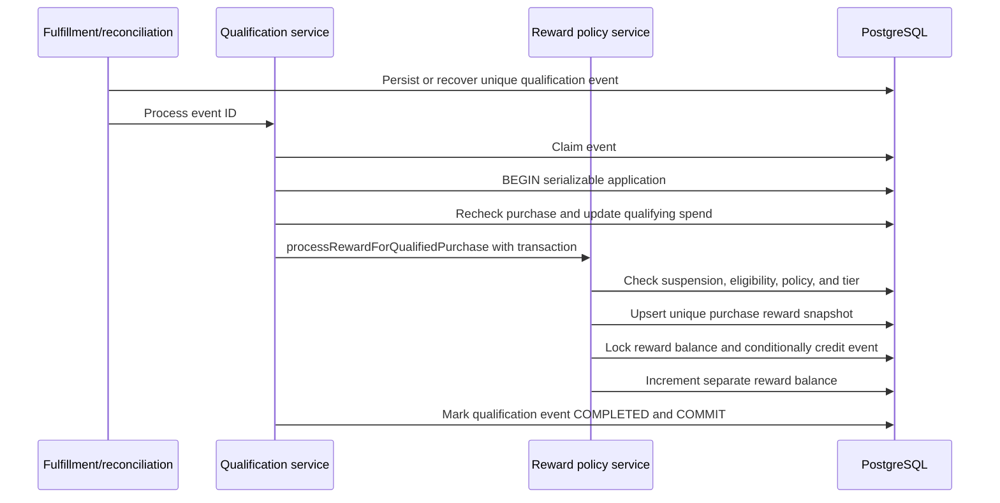

<a id="section-12-7"></a>

### 12.7 Recovery, suspension, and important gaps

Qualification reconciliation resets stale processing events, discovers successful/refunded purchases missing events, and returns due event IDs. Reward reconciliation scans existing `PENDING` reward events and calls idempotent credit. A global `RewardProcessingControl` can suspend creation/credit; reporting exposes the suspension and administrative operations record the control reason.

**Identified source-level limitation:** Suspending reward processing can allow qualification to finish while reward creation is skipped. The pending-reward reconciler only scans reward rows that already exist; it does not automatically reconstruct every omitted reward after suspension. A missing reward and a pending reward are different recovery problems.

**Identified source-level limitation:** Normal fulfillment emits settlement qualification only when cost and required receipt are complete. However, qualification's missing-event scan selects `SUCCESSFUL` purchases without checking fulfillment completion or known cost. It can therefore process qualifying spend earlier than the normal emission path. If the qualification event completes while cost is missing, reward creation returns null; later settlement upserts the same completed qualification event and may not trigger reward creation again. This is a gap inferred from reading the connected functions, not a reproduced incident or proof that real customers were affected.

**Unimplemented economics:** No reward payout model, bank disbursement pipeline, wallet-transfer pipeline, or credited-reward reversal state was found. Referral spend can fall after refunds, but existing credited rewards are not automatically clawed back. No claim of withdrawable or spendable commission should be made from the presence of `ReferralRewardBalance` alone. A future payout/reversal design must define accounting, eligibility, fraud review, idempotency, and refund consequences rather than simply copying the numeric balance into a wallet credit.

<a id="section-12-8"></a>

### 12.8 Testing and how to explain the domain

[referral.identity.test.ts](test/referral.identity.test.ts) asserts the eight-letter code format, normalization/rejection, REST/WhatsApp attribution, invalid/self/duplicate handling, and repeat profile behavior. Many identity/qualification/reward tests are database-gated despite having ordinary `.test.ts` filenames: inspect the `RUN_DATABASE_TESTS` guard before interpreting a skipped default run as functional coverage.

[referral.qualification.test.ts](test/referral.qualification.test.ts) asserts pending versus threshold qualification, retained or cleared `qualifiedAt`, duplicate-event identity, skipped repeated processing, exclusion of pending/failed purchases, refund subtraction, concurrent processing, missing-event reconciliation, and expired-lease recovery. These assertions test business consequences, not just function return shapes.

[reward.policy.test.ts](test/reward.policy.test.ts) checks every tier boundary, uncapped profit share, policy snapshots across changes, no reward for invalid eligibility/cost, one event per purchase, pending-to-credited recovery, and concurrent/repeated credit yielding one balance increment. [rewards.reporting.test.ts](test/rewards.reporting.test.ts) asserts owner progress, filtered history, masked/stable leaderboard behavior, admin summaries, pending exceptions, and suspension preventing credit. These were inspected, not executed against PostgreSQL for this handbook.

An alternative design could calculate eligibility solely at checkout, but then purchase failure and refunds would require compensations after a reward had already been granted. The implemented settlement-driven design delays rewards until delivery/cost evidence is available through the normal path. An append-only reward ledger would strengthen reversal/audit semantics compared with a mutable accumulated balance, but it is an alternative and should not be attributed to the current code.

**Key takeaways:** Attribution identifies a relationship; qualification measures eligible usage; policy versioning explains economic rules; reward events preserve calculation inputs; a locked conditional credit prevents duplicate accrual; reward balance is separate from spending money; reversal and payout are absent.

**Review questions:** Why does a wallet deposit not qualify a referral? Why subtract the actually applied settle event on refund? Which values are historical snapshots and which count is queried at processing time? What does recovery miss when reward creation never happened? Why is qualification reversal insufficient for reward clawback?

**Further reading:** Study [PostgreSQL serializable isolation](https://www.postgresql.org/docs/current/transaction-iso.html) alongside `runSerializable`. Compare the event/status pattern with Chapter 15's idempotency and state-machine explanations. For a practical code-reading exercise, change only a hypothetical tier boundary on paper and predict which existing reward rows should stay unchanged.

**Explain this in an interview:** “We separate invitation attribution from spend-based qualification and profit-based reward credit. Durable unique purchase events update qualification in serializable transactions. Effective-dated policies and copied operands make each reward explainable. Crediting locks a separate reward balance and atomically transitions a pending event, preventing duplicate increments. Payout and credited-reward reversal are not implemented.”

<a id="chapter-13"></a>

## Chapter 13: Administration and Frontend Applications

**Learning objectives:** Separate browser presentation from server authority, trace both React bootstraps, and understand query caching, sessions and UI failure states. **Prerequisites:** React components, state, HTTP and Chapter 5. **Difficulty:** Beginner to intermediate. **Practical exercise:** Trace the admin purchase filter from a changed select field to `administrationApiRepository.listPurchases`, then explain which validation is duplicated for usability and which is authoritative.

<a id="section-13-1"></a>

### 13.1 Three codebases, two browser applications

The accessible workspace contains [api/](README.md), [admin/](../admin/README.md) and [client/](../client/README.md). Both frontends are real React applications; neither is a backend microservice. They are built with Vite into static assets and call the Express REST API. PostgreSQL, provider credentials, ledger writes and purchase fulfillment remain server responsibilities.

The admin app serves operators monitoring customers, balances, funding, purchases, products and operational exceptions. The public client supplies marketing/legal pages and a logged-in affiliate workspace. The latter is not currently a general customer shopping website: no browser registration, purchase checkout or wallet-management screen is implemented there. A WhatsApp conversation preview on a landing page is a presentation component, not evidence of a transaction performed by that browser.

<a id="section-13-2"></a>

### 13.2 Administration backend: bounded operational views

[administration.routes.ts](src/domains/administration/administration.routes.ts) begins with `authenticateRequest`, `requireOperatorOrAdmin`, and `administrationRateLimiter`. Its endpoints include dashboard summaries; paginated users, wallets, wallet transactions, funding intents and purchases; products; provider configuration signals; worker/queue signals; failed/pending operations; reconciliation exceptions; and AI status.

Controllers delegate to [administration.api.service.ts](src/domains/administration/administration.api.service.ts), [administration.kpi.service.ts](src/domains/administration/administration.kpi.service.ts) and domain-specific services. The administration domain owns reporting/operational orchestration, not the financial meaning of a wallet debit. Its repositories read cross-domain data for views; that reporting dependency is a coupling point to recognize when discussing architectural boundaries.

The route group also exposes reward reporting and policy operations. Reward policy creation, reconciliation and processing suspension add `requireAdmin`. Product sync/visibility are available to the router's allowed operator/admin roles; do not describe all mutations as admin-only.

The service deliberately masks email, phone, WhatsApp ID and funding-account number in several administration responses. Purchase serialization uses `purchaseVisibility` to expose settlement/profit/receipt flags without disclosing electricity tokens, exam PINs or billing identifiers. This is an example of an explicit response projection: the API chooses what to reveal instead of serializing a complete Prisma record.

`getProviderHealth` explicitly returns `source: 'configuration'`. Its runtime repository currently reports Paystack, VTPass and WhatsApp configuration, and its Paystack-centric snapshot does not fully describe Bachs routing/fallback behavior. `getInfrastructureSnapshot` always sets `workerStatus: 'UNKNOWN'`; it has no active heartbeat. An `AVAILABLE` or `DEGRADED` badge must be interpreted in terms of its source. Presence of an API key does not prove provider connectivity, sufficient supplier balance or successful delivery.

<a id="section-13-3"></a>

### 13.3 Audit records and their transaction boundary

`executeAuditedAction` in [administration.service.ts](src/domains/administration/administration.service.ts) wraps actions such as product synchronization and visibility changes. On success it writes an `AdminAuditLog`; on failure it attempts a failure audit and then rethrows the original error. The record includes actor, role, action, resource, outcome, request ID, IP, user agent and sanitized metadata.

[administration.privacy.ts](src/domains/administration/administration.privacy.ts) recursively redacts sensitive key names and recognizable email/phone values. This limits accidental collection; it is not a universal data-loss prevention system and does not retroactively sanitize arbitrary application logs.

**Identified limitation:** the action and its success audit do not share one database transaction. An action may commit successfully and the subsequent audit write fail, causing an error response even though the product state changed. Operators should verify state before retrying. If the business later requires an inseparable audit trail, design the mutation and audit in one transaction where possible, or use a durable audit/outbox intent for external work. Do not assume a wrapper function provides atomicity across its awaited operations.

<a id="section-13-4"></a>

### 13.4 The admin React bootstrap and routing

[admin/src/main.tsx](../admin/src/main.tsx) wraps the application in React `StrictMode`, `QueryClientProvider`, `ThemeProvider` and `AdminAuthProvider`. Context providers make shared state available without passing props through every intermediate component. `StrictMode` is a development aid, not a permission check.

[admin/src/App.tsx](../admin/src/App.tsx) implements a small path router with `window.history.pushState`, a `popstate` listener and a supported-path set. `/` and `/login` normalize to `/dashboard`. The permitted paths are dashboard, users, wallets, purchases, funding, products, providers and operations. This app does not use React Router.

Until auth is ready, it renders a boot screen. Without a stored authenticated session it renders `LoginPage`; otherwise `AdminShell` renders `DashboardPage` or `WorkspacePage`. `AdminAuthProvider.login` calls the shared identity endpoint, rejects a customer role and attempts to revoke that newly issued customer session. The backend independently enforces roles on each administration request, so editing browser storage cannot grant server permission.

`WorkspacePage` contains reusable loading/error/empty patterns, domain-specific table views, wallet drill-down and product actions. Purchase filters include service, status, UTC date bounds and pages. The browser date validation rejects reversed or excessive ranges; [administration.api.schema.ts](src/domains/administration/administration.api.schema.ts) validates independently. Someone can bypass the UI with a direct HTTP request, which is why server validation is necessary.

The frontend uses UTC day boundaries (`T00:00:00.000Z` and `T23:59:59.999Z`) for selected dates. That is the implemented interpretation, not necessarily the Lagos calendar day an operator assumes. Clarifying date semantics is part of correct reporting, especially when comparing provider statements across midnight.

<a id="section-13-5"></a>

### 13.5 Server state versus local UI state

Server state is information fetched from the API; local state is transient interface state such as which wallet is expanded or which date is typed. Admin data hooks in [resource.query.ts](../admin/src/features/administration/resource.query.ts) use TanStack Query for server state. React `useState` holds filters and dialog choices.

[admin-query.ts](../admin/src/lib/admin-query.ts) configures five-minute `staleTime` and `gcTime`, one query retry, and no window-focus refetch. Query keys distinguish resources and purchase filters. The purchase key includes the filter object, ensuring a request for page 2 does not overwrite page 1 under an identical key. Product mutations invalidate the `['admin']` query family so affected views can refetch.

The actual wallet detail hook illustrates a useful guard:

```ts
return useQuery({
  queryKey: [...adminResourceKeys.wallets, walletId, 'transactions'],
  enabled: walletId !== null,
  queryFn: () => apiClient.get(/* wallet-specific URL */),
});
```

This is an abbreviated excerpt of the hook: the omitted URL is constructed with `encodeURIComponent`. `enabled` avoids fetching before a wallet is selected. The key separates each wallet's transactions. The function returns a promise, which Query observes to derive loading, success or error state.

Five-minute caching improves responsiveness but can display older operational state. Most resource hooks currently request page 1/page size 50; purchase views have explicit page state. The backend's pagination capability does not imply every view exposes complete navigation or search controls.

**Identified limitation:** auth logout/account changes do not clear the shared admin query cache. Because keys are not scoped to a user identity, cached data from the previous account can remain available in memory and render during another session until refetch. Server authorization still guards new requests. Clearing sensitive cache on session changes is a focused future fix, not a change made by this handbook.

<a id="section-13-6"></a>

### 13.6 Public and affiliate React architecture

[client/src/main.tsx](../client/src/main.tsx) installs `BrowserRouter`, theme and affiliate-auth providers. [client/src/App.tsx](../client/src/App.tsx) declares React Router routes for `/`, `/privacy-policy`, `/terms-of-service`, `/affiliate-login` and `/affiliate-dashboard`. Landing pages share `Layout`; affiliate pages use `AffiliateShell`. This separation keeps public navigation and the authenticated workspace from becoming one conditional component tree.

The route guards wait for auth restoration, redirect missing sessions to login and redirect authenticated login visits to the dashboard. The auth provider calls `/identity/me` when restoring stored credentials. Recoverable errors may leave local session state present until subsequent requests resolve it; locally “authenticated” therefore means a session object exists, not that the API has just approved every capability.

[AffiliateDashboardPage.tsx](../client/src/pages/affiliate/AffiliateDashboardPage.tsx) loads progress, referrals, transactions and leaderboard using `Promise.all`. Each list uses page size 25. A `requestNumberRef` prevents an older response from applying after a newer refresh/page request. This protects display order, not backend concurrency. Because the requests are grouped, one rejection can prevent the batch from producing a ready dashboard; separate query caching would be an alternative if independent partial panels become valuable.

Reward amount strings come from the server and are formatted with `Intl.NumberFormat('en-NG', ...)`. Display formatting may convert to `Number`; it does not authorize financial movement or replace the backend's decimal/minor-unit calculations. The interface shows progress, tiers and a separate reward balance. It supplies no payout, withdrawal or reward-to-wallet transfer control.

Referral codes can be copied, and invitations can use native sharing or clipboard fallback. These are browser convenience functions; actual referral attribution and qualification remain server-side. Static legal copy should be reviewed against operations rather than interpreted as evidence of compliance.

<a id="section-13-7"></a>

### 13.7 Actual token storage and API refresh behavior

Both browser apps store the user plus access and refresh tokens in **`window.sessionStorage`**, under separate `swifttopup.admin.session` and `swifttopup.affiliate.session` keys. Theme preference is separate and uses `localStorage`. These are not HTTP-only cookies. Session storage survives reload within the tab and is readable by JavaScript executing on the origin.

[admin/src/lib/api.ts](../admin/src/lib/api.ts) and [client/src/lib/affiliate-api.ts](../client/src/lib/affiliate-api.ts) attach `Authorization: Bearer ...`, parse the API success/error envelope, share a refresh promise for concurrent 401 responses and retry an authenticated request once after refresh. Generic response types help the compiler but are not full runtime validation of all response fields.

The affiliate provider obtains the latest stored tokens before logout. The admin provider instead closes over the React session's refresh token; refresh updates storage without synchronizing that context object. After a rotation, admin logout can send the old revoked token, clear the browser UI and leave the current server session active. This static issue deserves a browser/API regression test before relying on logout as a security control.

The `VITE_API_BASE_URL` setting is public build configuration. No secret should be put in a `VITE_` variable. Vite embeds these values in browser assets; it cannot keep provider credentials confidential. [admin/vercel.json](../admin/vercel.json) and [client/vercel.json](../client/vercel.json) supply SPA fallback configuration; hosting health and deployment success remain unverified.

<a id="section-13-8"></a>

### 13.8 What testing proves here

Backend administration tests verify role middleware, query validation, selected response masking, KPI calculations and audit behavior with mocked dependencies. No dedicated automated frontend unit/component/browser suites were found. Admin `npm test` runs `node --test` but has no dedicated UI tests; client has no test script. A frontend build checks the referenced TypeScript projects and generates assets; it does not prove login, layout accessibility or password-code delivery.

During this documentation task, the API/admin/client `npm run typecheck` commands completed successfully. Both frontend root tsconfigs have empty file lists and project references, so standalone `tsc --noEmit` is weaker evidence than the `tsc -b` included in `npm run build`. Do not report those successful commands as complete browser verification.

**Key takeaways:** React controls presentation; Express controls permission and money. Distinguish local UI state, cached API state and durable database state. Session storage is JavaScript-accessible. Operator badges and provider configuration indicators require interpretation.

**Review questions:** Why can a route guard not secure an API? What does a query key identify? Why should logout clear sensitive cached data? What happens if one request in the affiliate dashboard's `Promise.all` fails?

**Further reading:** [React: Managing State](https://react.dev/learn/managing-state) is beginner/intermediate reading before changing shared state. Revisit the [OWASP session guidance](https://cheatsheetseries.owasp.org/cheatsheets/Session_Management_Cheat_Sheet.html) when designing browser credential storage.

**Explain this in an interview:** “The admin is an operational React client with TanStack Query; the public client combines landing pages with affiliate reporting. Both call the same versioned backend and store bearer credentials in session storage. Financial decisions stay server-side. I can explain the remaining session/cache limitations and would test them before claiming production hardening.”

# Part IV — Databases and advanced backend engineering

<a id="chapter-14"></a>

## Chapter 14: Database Architecture

**Learning objectives:** Read the actual Prisma schema; explain cardinality, uniqueness, and indexes; identify ownership and transaction boundaries; distinguish foreign-key protection from service invariants; reason about PostgreSQL versus Redis. **Prerequisites:** Domain chapters, basic tables and SQL, primary/foreign keys. **Difficulty:** Intermediate; index/isolation tradeoffs are more challenging. **Opening practical exercise:** Starting from a purchase ID, name the relations needed to locate its user, debit, fulfillment attempts, refund, reward, and outgoing receipt message without examining any customer record.

<a id="section-14-1"></a>

### 14.1 The schema is a map, migrations are its history

[schema.prisma](prisma/schema.prisma) defines the current models and enums. [prisma.config.ts](prisma.config.ts) points Prisma at that schema, migration directory, and configured database URL. [prisma/migrations](prisma/migrations) records SQL changes. [src/config/prisma.ts](src/config/prisma.ts) creates `PrismaClient` with the PostgreSQL driver adapter and reuses an instance during nonproduction reloads. Repositories import that client or receive a restricted transaction-capable client.

PostgreSQL stores authoritative identities, sessions, ledger entries, purchase outcomes, jobs, message records, audit logs, and referral economics. Redis stores transient/runtime coordination such as streams, conversation context, admission/rate-limit state, and provider cooldown. Redis does not replace PostgreSQL simply because both can store keys. Their roles follow the consequences of losing the data: losing an acceleration/wake-up mechanism should be recoverable; losing the financial journal is a different class of incident.

The schema uses string `cuid()` identifiers for most entities. These are application-generated identifiers rather than meaningful customer names or sequential financial references. Some relationship tables deliberately use an existing key, such as `ReferralProfile.userId` and `ReferralAttribution.referredUserId`, because one row per owner is the invariant.

Do not infer actual deployed schema state from the existence of SQL files. A database may be behind migrations or differ through manual changes; this handbook inspected definitions and migration files, not a production migration ledger.

<a id="section-14-2"></a>

### 14.2 Financial and purchase ER diagram

The following diagram shows declared Prisma relationships for the core money and commerce tables. `o|` means zero or one; `o{` means zero or many; `||` means exactly one. Selected fields are shown for orientation, not as a complete schema listing.

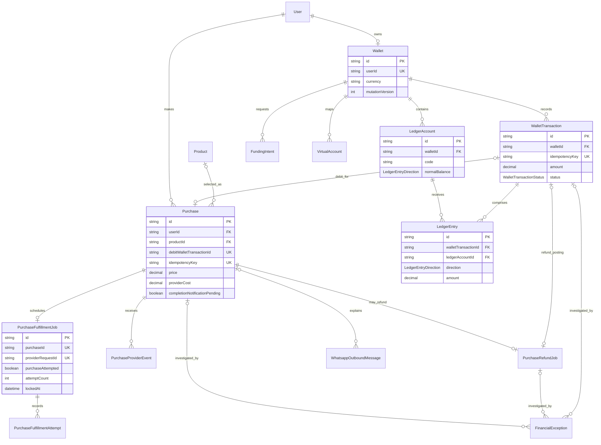

`Product` is optional on a purchase, and the debit reference is optional in the schema even though normal new-purchase creation attaches one. Optionality supports historical/recovery states; it does not mean spending without a debit is correct. Reconciliation explicitly flags pending purchases with no attached debit.

`FundingDepositReceipt` is intentionally absent from the FK relationship edges: its unique `walletTransactionId` is a scalar string with no declared Prisma relation or database foreign key in the inspected creation migration. It is a logical link used by application code. Drawing a declared FK relationship would overstate referential protection. Receipt `fundingReference` and `checkoutReference` are also provider/business correlation strings, not foreign keys into `FundingIntent`.

<a id="section-14-3"></a>

### 14.3 Identity, messaging, and referral relationships

This second diagram completes the main identity, messaging, and reward model map. Standalone `RewardProcessingControl` holds the global control row and has no user FK. It is deliberately not drawn as owned by a customer.

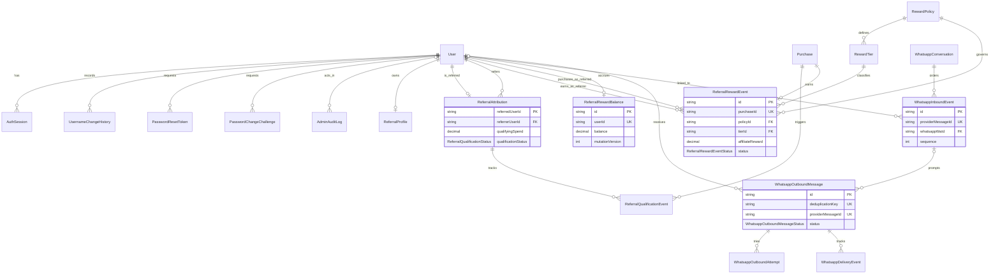

The two reward-event edges are separate declared relations to `User`; the actual schema names them `RewardReferrer` and `RewardReferred`. They are different foreign keys with different roles. Similarly, the two `ReferralAttribution` edges represent different foreign keys. Read role names before writing a join or an authorization rule.

Messages can arrive before a user exists, so inbound/outbound user relations can be null. `WhatsappInboundEvent.whatsappWaId` references `WhatsappConversation.whatsappWaId`, a unique natural provider identifier. That relation supports a per-conversation sequence independently of an optional registered account.

<a id="section-14-4"></a>

### 14.4 Primary keys, foreign keys, and delete behavior

A primary key identifies a row. A foreign key requires a referenced row to exist. A unique constraint rejects duplicate values or combinations. Each solves a different problem: an existing user ID does not prove the requesting caller owns that user, and a valid foreign key does not prove a financial amount is correct.

Most financial relations use `onDelete: Restrict`, protecting the graph against casual deletion of a user, wallet, ledger account, transaction, purchase, or reward policy with dependent financial records. Session/password challenge records use cascade where appropriate to their identity lifecycle. Audit actor and some messaging/exception references use `SetNull`, preserving the event even when the optional referenced object is removed. Fulfillment attempts cascade with their parent job, but the purchase-to-job relation is restricted.

This is why financial fixture cleanup in database tests deletes children in dependency order. Those destructive test helpers must run only on an isolated test database. The presence of cleanup SQL in a test file is not permission to apply it to development customer records or production.

Some important rules are _not_ foreign-key expressible in this schema. `LedgerEntry.ledgerAccountId` and `walletTransactionId` can each point to valid rows while belonging to different wallets. The posting service resolves accounts from the chosen wallet to prevent that through normal paths, but the schema does not encode a composite “same wallet” relation. Debit/credit equality similarly spans multiple rows and is checked by the service rather than a database trigger.

<a id="section-14-5"></a>

### 14.5 Unique constraints as concurrency protection

| Constraint                                                              | Business invariant it helps protect                                            |
| ----------------------------------------------------------------------- | ------------------------------------------------------------------------------ |
| `Wallet.userId`                                                         | At most one spending wallet per user.                                          |
| `LedgerAccount(walletId, code)`                                         | One named account of each type per wallet.                                     |
| `WalletTransaction.idempotencyKey`                                      | One local financial transaction per operation identity.                        |
| `FundingDepositReceipt(provider, providerReference)`                    | One durable receipt identity for a provider collection.                        |
| `FundingIntent.providerReference`                                       | Stable one-use funding reference.                                              |
| `Product(provider, providerProductCode)`                                | One current catalog row per supplier item.                                     |
| `Purchase.idempotencyKey`                                               | One purchase record per confirmed operation.                                   |
| `PurchaseFulfillmentJob.purchaseId` and `providerRequestId`             | One durable fulfillment job per purchase and unique external request identity. |
| `PurchaseFulfillmentAttempt(jobId, attemptNumber)`                      | One audit attempt at a job's numbered claim.                                   |
| `PurchaseProviderEvent(provider, providerEventId)` plus `eventIdentity` | Event deduplication and globally constructed event identity.                   |
| `PurchaseRefundJob.purchaseId` and `idempotencyKey`                     | One tracked refund obligation/key per purchase.                                |
| `ReferralQualificationEvent(purchaseId, type)`                          | At most one settlement and one refund qualification event per purchase.        |
| `ReferralRewardEvent.purchaseId`                                        | At most one reward snapshot per purchase.                                      |
| `WhatsappInboundEvent.providerMessageId`                                | Deduplicate the incoming provider message.                                     |
| `WhatsappInboundEvent(whatsappWaId, sequence)`                          | Unique per-conversation ordering number.                                       |
| `WhatsappOutboundMessage.deduplicationKey`                              | Durable prevention of duplicate logical notification scheduling.               |
| `WhatsappDeliveryEvent(providerMessageId, status)`                      | One recorded event for a given delivery stage.                                 |

The safe pattern is not “SELECT first, then INSERT, therefore duplicate impossible.” Two requests can both read no row. The unique constraint arbitrates the final insert, while service handling converts selected conflicts into repeat-operation results or bounded retries. Unique constraints remain useful even when the service normally takes a lock, because future paths and independent replicas must obey the same data rule.

Several unique columns are nullable, including provider references and notification deduplication keys. PostgreSQL normally allows multiple null values in ordinary unique constraints, so many messages without a deduplication key can coexist. A unique nullable field does not imply every operation is deduplicated; callers must supply the intended stable key.

<a id="section-14-6"></a>

### 14.6 Indexes follow actual reads and recovery scans

An index is an additional structure helping PostgreSQL find matching rows without inspecting the entire table. It has write/storage cost, and a listed index does not guarantee the query planner uses it for every query. The repository's filters and ordering determine whether it is useful.

The schema includes `[walletId]` for wallet history, `[ledgerAccountId]` for ledger sums, `[userId]` for purchases, `[status, nextAttemptAt]` for due fulfillment/refund/qualification work, `[lockedAt]` for lease recovery, `[status, lastSeenAt]` for open financial exceptions, and `[completionNotificationPending, completedAt]` for completion-outbox recovery. Referral reporting uses `[referrerUserId, qualificationStatus]` and time-oriented indexes. Message status/time indexes support recovery and ordered history.

Column order matters. `[status, nextAttemptAt]` fits “find queued/failed work due before now” better than an unrelated index on a display name. A single foreign-key index often helps joining but does not necessarily optimize sorting by newest per owner. For example, wallet history filters by wallet and orders by creation time; the schema currently has separate wallet/time indexes rather than a dedicated `(walletId, createdAt)` composite. Only measured query plans and realistic data volume justify adding another index; this handbook makes no throughput claim.

Ledger balance uses aggregation, so its cost grows with ledger history. An index helps identify account entries but does not make summing millions of rows constant-time. A transactionally maintained balance snapshot or periodic verified summary is a possible later optimization. It adds consistency obligations and should be designed around measured latency, while preserving reconstructability from the journal.

<a id="section-14-7"></a>

### 14.7 Normalization, snapshots, JSON, and ownership

Normalization separates facts by entity: user identity is not copied into every transaction, and a ledger account is distinct from every entry made against it. Relationships reduce accidental inconsistency and make ownership traceable.

Deliberate denormalization appears in purchase and reward snapshots. A purchase keeps price, provider amount, product code, environment, and metadata even though some values originated in `Product`. This protects already confirmed work from catalog changes. A reward event copies policy/tier operands so its historical amount remains explainable even as eligibility and policies change.

JSON fields hold provider payloads, structured receipts, and flexible metadata. They are useful for external evidence that varies by integration. They do not automatically receive relational constraints or TypeScript runtime guarantees. The application uses parsing/normalization and receipt schemas at important boundaries. Avoid putting a core lookup or invariant solely inside arbitrary JSON when a typed column/relation is needed for correctness or indexing.

Domain ownership is mainly enforced by module structure and service conventions, not separate database users or schemas for each domain. This enables one PostgreSQL transaction across registration/wallet creation or purchase/debit/job creation. It also means an undisciplined import can bypass architectural boundaries. A modular monolith gains transaction simplicity by sharing a database while relying on code review to preserve responsibility boundaries.

<a id="section-14-8"></a>

### 14.8 Transaction isolation and connection implications

Wallet and purchase operations use interactive transactions around related writes. Wallet row-update locks serialize money mutations. Fulfillment result application uses an explicit job row lock and attempt fence. Qualification and standalone reward processing explicitly request serializable isolation with bounded retries. Not every transaction in the application uses serializable isolation; do not generalize those domain-specific choices to the entire backend.

PostgreSQL's default read-committed behavior and serializable behavior have different failure/visibility properties. Under serializable concurrency, a transaction may need to restart even when all individual statements were valid. The retry loops re-run complete local transaction logic; they do not surround provider purchase calls. Repeating an external financial side effect inside such a retry would be unsafe. [PostgreSQL's isolation reference](https://www.postgresql.org/docs/current/transaction-iso.html) is the authority for the database mechanics.

The PostgreSQL adapter is initialized per process. An API replica, worker replica, and administrative process can each maintain database connections. A singleton module prevents accidental repeated clients within that process; it is not a global pool shared across all deployed machines. The inspected client setup does not explicitly establish a fleet-wide connection budget or verify a hosted connection-pooler configuration. Deployment scaling must account for the sum of all process pools and interactive-transaction behavior.

<a id="section-14-9"></a>

### 14.9 Migrations and current-versus-historical evidence

The migration history shows the project's evolution: core data model, hybrid funding, Paystack/VTpass additions, audit roles/logs, durable messaging, fulfillment recovery, wallet lock version, referral identity/qualification/policies/balance/reporting, payment routing/fees, service catalog expansion, persisted funding contacts, and finally purchase completion outbox/deduplication.

The [payment-routing migration](prisma/migrations/20261024090000_launch_a_payment_routing_and_funding_fees/migration.sql) adds Bachs, makes temporary bank fields nullable for hosted checkout, adds funding fee/initialization fields, and creates `FundingDepositReceipt`. The [completion-outbox migration](prisma/migrations/20261107162537_purchase_completion_outbox/migration.sql) adds `Purchase.completionNotificationPending`, its scan index, and unique outbound `deduplicationKey`. A README or phase note predating that change cannot establish the current completion-notification behavior.

Migration files are evidence of intended transitions, not safe commands to run blindly. Production deployment requires the correct migration procedure, checked target database, backup/recovery plan, and compatibility understanding. For local study, use an empty disposable database and the documented Prisma workflow. Do not reset or replay migrations against a financial database containing customer records.

<a id="section-14-10"></a>

### 14.10 Limits, testing, and interview practice

Database constraints protect existence and selected uniqueness, while services protect balanced postings, sufficient funds, provider/environment matching, and business eligibility. There are no inspected triggers enforcing ledger balance, immutable posting history, reward clawback, or universal policy-window exclusion. `FundingDepositReceipt` lacks a transaction FK despite its logical correlation field. Those facts identify where application correctness currently carries the burden.

Database integration tests are valuable because mocks cannot reproduce real uniqueness waiting, row locking, isolation conflicts, Decimal storage, or referential actions. The wallet, payment-funding, purchase-integrity, qualification, reward, and notification integration tests inspected here assert different parts of that contract. They were not run against any database during handbook creation. Static schema inspection cannot prove that a deployed PostgreSQL instance has every index, constraint, backup policy, or maintenance setting.

**Key takeaways:** Schema relationships explain ownership; unique keys are concurrency rules; indexes support real reads and recovery; snapshots preserve historical decisions; PostgreSQL transactions cover local state, not provider effects; Redis accelerates coordination while durable records survive; constraints and service invariants complement each other.

**Review questions:** Which logical receipt link lacks a foreign key? Why is a product-price snapshot useful denormalization? What does nullable uniqueness permit? Which compound index supports due-job recovery? Why does one Prisma singleton per process not solve fleet-wide connection limits? Which financial invariants are currently service-enforced?

**Further reading:** Use [PostgreSQL constraints](https://www.postgresql.org/docs/current/ddl-constraints.html), [indexes](https://www.postgresql.org/docs/current/indexes.html), and [isolation](https://www.postgresql.org/docs/current/transaction-iso.html) as progressively deeper resources after tracing the schema. Prisma's online documentation can target a newer major than this repository's Prisma 7 client; use this project's actual `$transaction` source and installed version when comparing examples.

**Explain this in an interview:** “PostgreSQL is our financial and workflow source of truth. Prisma expresses ownership and uniqueness, while service transactions enforce cross-row business invariants. We normalize identities and ledger entries but snapshot confirmed prices and reward operands for auditability. Recovery scans use indexed durable job state. Redis stream delivery can be reconstructed from those durable obligations, whereas the financial journal must be protected independently.”

<a id="chapter-15"></a>

## Chapter 15: Deep Dives Into Complex Engineering Concepts

**Learning objectives:** reason about concurrent money movement, uncertain remote outcomes and durable recovery; explain what each mechanism guarantees and what it cannot guarantee. **Prerequisites:** Chapters 4, 6–10 and 14. **Difficulty:** intermediate to challenging. **Practical exercise:** reproduce the timelines below on paper before writing an isolated toy wallet with integer kobo and a transactional job table.

Each concept follows twelve teaching steps. Related terms are grouped where separating them would obscure the same mechanism. Examples are illustrative unless explicitly identified as repository excerpts. Never experiment with a customer wallet or live provider account.

<a id="section-15-1"></a>

### 15.1 Concept: Idempotency and idempotency keys

1. **Beginner explanation:** a repeat request should return or converge on the original financial result instead of charging again. An idempotency key identifies the _operation_, not the user and not the HTTP connection.
2. **Everyday analogy:** paying an invoice twice at the counter should not mean there were two invoices. The invoice number connects repeated attempts to one obligation.
3. **Technical explanation:** persist a stable key under a unique constraint; look up the earlier result; create the effect and its key within the same transaction. The same key must survive a client timeout. A newly generated key for every retry identifies a new operation and defeats this purpose.
4. **Problem it solves:** browsers retry, networks lose responses, providers redeliver webhooks and workers crash after doing useful work. A transaction makes one attempt atomic; it does not identify two attempts as the same operation.
5. **SwiftTopUp implementation:** [commerceService.createPurchase](src/domains/commerce/commerce.service.ts) scopes keys as `purchase:${userId}:${quoteId-or-client-key}`. Signed quotes use their quote UUID. Wallet debit keys add `purchase-debit:`. [walletLedgerService.postWalletTransaction](src/domains/wallet/wallet.ledger.ts) and schema uniqueness protect posting. [walletService.processDepositWebhook](src/domains/wallet/wallet.service.ts) uses provider-scoped deposit receipts and provider payment references. Funding uses a stable wallet-scoped initialization reference.
6. **Walkthrough:** A and B submit one quote concurrently. Both can initially see no purchase. A creates purchase+debit+job and commits. B's attempt either observes the row or loses the unique-key race; the service catches Prisma `P2002` and loads the stored purchase. The stream might contain duplicate wake-ups, but durable job claims decide whether there is work.
7. **Failure scenario:** changing the body while keeping a key is not consistently rejected everywhere. Funding checks saved amount; signed quotes bind their contents. Purchase lookup returns an existing purchase before comparing all new payload fields, and low-level ledger replay does not compare owner/amount. These APIs require carefully scoped trusted keys; they do not implement a universal request-fingerprint protocol. An expired quote is decoded before the duplicate lookup, so a repeat can fail expiry without creating another debit.
8. **Alternatives:** store a canonical request fingerprint and reject mismatches; reserve a key with an in-progress state; use provider-native idempotency as an additional boundary. An in-memory set disappears on restart and cannot coordinate replicas.
9. **Interview explanation:** “A unique operation key, transaction and replay lookup make local effects repeat-safe. Remote provider effects need their own stable reference and reconciliation; HTTP retries alone are insufficient.”
10. **Learning resources:** [PostgreSQL constraints](https://www.postgresql.org/docs/current/ddl-constraints.html); [Prisma transactions](https://www.prisma.io/docs/orm/prisma-client/queries/transactions), checking the installed Prisma version.
11. **Practice task:** in an isolated table, submit 20 identical operation keys concurrently. Require one debit, one purchase and one replayed result; then add a fingerprint conflict case.
12. **Knowledge check:** Who generates the key? Why must it survive a timeout? What should happen if the same key arrives with another recipient?

Concurrent duplicate webhook timeline, illustrating the receipt/claim design:

| Time | Callback A                                              | Callback B                                                 | Durable outcome                                            |
| ---- | ------------------------------------------------------- | ---------------------------------------------------------- | ---------------------------------------------------------- |
| T0   | Authenticate raw body; normalize payment P              | Same                                                       | No money changed yet.                                      |
| T1   | Find/create provider receipt and lock it in transaction | Wait for same receipt/unique conflict path                 | One logical payment identity.                              |
| T2   | Match intent and post balanced credit                   | Still waiting                                              | Receipt, claim and credit belong to one commit.            |
| T3   | Commit                                                  | Find existing wallet transaction and mark receipt CREDITED | One wallet credit, repeated acknowledgement.               |
| T4   | Response lost                                           | Provider redelivers later                                  | Durable identity remains after HTTP connection disappears. |

This does not mean an unrelated second payment to the same intent is an ordinary duplicate: a distinct payment can require review.

<a id="section-15-2"></a>

### 15.2 Concept: Database transactions and ACID

1. **Beginner explanation:** a transaction groups database changes into one all-or-nothing operation.
2. **Everyday analogy:** a bank transfer must take money from one account and add it to the other as a single bookkeeping action.
3. **Technical explanation:** **atomicity** is all-or-nothing commit; **consistency** preserves defined constraints and correctly implemented invariants; **isolation** controls concurrent observations; **durability** retains committed records across failures within the storage system's guarantees. ACID does not mean every business invariant is automatically correct.
4. **Problem it solves:** a purchase without its debit, or a debit without a recoverable job, leaves the system unable to explain its obligation.
5. **SwiftTopUp implementation:** [commerceRepository.createPurchaseWithDebitAndJob](src/domains/commerce/commerce.repository.ts) opens `prisma.$transaction`, creates the purchase, invokes the injected wallet debit using the transaction client, links the debit and creates the fulfillment job. Wallet posting writes its transaction and entries together. Provider HTTP calls happen afterward.
6. **Walkthrough:** start transaction → create pending purchase → lock/check wallet → create debit entries → link debit → create job → commit. If job insertion throws, the purchase and debit roll back. Returning from the callback does not commit a remote provider request.
7. **Failure scenario:** if a helper accidentally uses the global Prisma client instead of the supplied transaction client, its write may escape the intended boundary. A Redis enqueue inside a database transaction is not rolled back by PostgreSQL either.
8. **Alternatives:** application compensation after independent writes is much harder to get right. A distributed transaction coordinator would require participation from external providers, which this system does not have.
9. **Interview explanation:** “One PostgreSQL transaction protects the locally coupled purchase, debit and job. Provider fulfillment is a subsequent state transition with recovery, not part of that ACID transaction.”
10. **Learning resources:** [PostgreSQL transactions tutorial](https://www.postgresql.org/docs/current/tutorial-transactions.html).
11. **Practice task:** throw after debit but before job creation in an isolated integration fixture. Assert there are no purchase/debit/job rows from that attempt.
12. **Knowledge check:** Which writes share a connection? What does rollback do to an HTTP request already accepted by a supplier?

Rollback timeline: T0 balance ₦1,000; T1 tentative ₦300 debit; T2 job write fails; T3 rollback; T4 committed balance remains ₦1,000. Another transaction must not treat uncommitted ledger entries as settled money.

<a id="section-15-3"></a>

### 15.3 Concept: Row-level locking and pessimistic concurrency control

1. **Beginner explanation:** make competing money mutations wait their turn for the same wallet.
2. **Everyday analogy:** one cashier holds the account book while updating it; another cashier waits before checking the remaining allowance.
3. **Technical explanation:** PostgreSQL row updates acquire locks held until transaction end. A competing update waits, then proceeds after the first transaction commits or rolls back. A plain read does not automatically create this serialization.
4. **Problem it solves:** two purchases can each believe the same ₦1,000 is available and both spend ₦700.
5. **SwiftTopUp implementation:** [walletRepository.lockWalletForUpdate](src/domains/wallet/wallet.repository.ts) increments `Wallet.mutationVersion` with an update inside the transaction. The name expresses intent; the implementation is an `UPDATE`, not wallet `SELECT FOR UPDATE`. [debitForPurchase](src/domains/wallet/wallet.service.ts) locks before aggregating funds. Fulfillment result application separately uses actual parameterized `SELECT ... FOR UPDATE` on its job row.
6. **Walkthrough:** transaction A updates wallet version and holds the lock; B blocks on that wallet. A reads fresh ledger totals, debits ₦700 and commits. B acquires the lock, reads the new ₦300, and rejects its ₦700 debit. This depends on all competing writers using the protocol and compatible transaction isolation.
7. **Failure scenario:** a new direct ledger writer that bypasses the wallet lock breaks the shared convention. Long transactions holding the lock while waiting on a supplier also harm throughput.
8. **Alternatives:** atomic conditional balance update, serializable transactions with retry, or optimistic version comparisons. A JavaScript mutex cannot coordinate independent Node processes.
9. **Interview explanation:** “We serialize wallet mutations through a PostgreSQL row update, then read the authoritative ledger under that lock. A cache never authorizes the debit.”
10. **Learning resources:** [PostgreSQL explicit locking](https://www.postgresql.org/docs/current/explicit-locking.html).
11. **Practice task:** run the wallet concurrency integration test only against a disposable database, and draw both statement timelines before reading its assertions.
12. **Knowledge check:** When is the lock released? Why is `mutationVersion` here not automatically optimistic locking?

| Time | Purchase A: ₦700                        | Purchase B: ₦700                            | Committed spendable |
| ---- | --------------------------------------- | ------------------------------------------- | ------------------- |
| 0    | Begins                                  | Begins                                      | ₦1,000              |
| 1    | Acquires wallet update lock             | Waits for wallet lock                       | ₦1,000              |
| 2    | Aggregates ₦1,000; posts balanced debit | Waiting                                     | ₦1,000              |
| 3    | Commits                                 | Acquires lock afterward                     | ₦300                |
| 4    | Done                                    | Aggregates ₦300; rejects insufficient funds | ₦300                |

<a id="section-15-4"></a>

### 15.4 Concept: Race conditions, lost updates and concurrency

1. **Beginner explanation:** the outcome becomes wrong when two operations interleave in an unexpected order.
2. **Everyday analogy:** two people edit separate copies of a shopping list; the last saved copy erases the other's additions.
3. **Technical explanation:** a read-modify-write sequence spans multiple moments. `await` yields execution; requests in one process interleave, and independent processes and database sessions run concurrently. A lost update overwrites another committed change using an old value; overspending can occur even without literally overwriting a balance column.
4. **Problem it solves:** “Node runs JavaScript on one thread” does not make an entire web request an indivisible operation.
5. **SwiftTopUp implementation:** wallet locks, fulfillment conditional claims, unique keys, referral serializable retries and Redis Lua each protect specific shared state. [identityService.refresh](src/domains/identity/identity.service.ts) shows a limit: two requests may read one active session before each revokes it and creates a descendant; a transaction alone does not make that initial check exclusive.
6. **Walkthrough:** identify shared state → mark every read and write → interleave requests → state the invariant → locate the enforcing lock/condition/constraint. Apply this method to the actual function, not a general architecture slogan.
7. **Failure scenario:** `const balance = await read(); await write(balance - amount)` accepts stale data and can lose a debit. A local promise chain does not serialize other replicas.
8. **Alternatives:** compare-and-swap, atomic SQL updates, queues partitioned by wallet, or pessimistic locks; each still needs durable idempotency for repeats.
9. **Interview explanation:** “A race is a missing ordering guarantee around shared state. I demonstrate the harmful interleaving, then enforce the invariant at the shared database boundary.”
10. **Learning resources:** [PostgreSQL isolation](https://www.postgresql.org/docs/current/transaction-iso.html); [Node event loop](https://nodejs.org/en/learn/asynchronous-work/event-loop-timers-and-nexttick).
11. **Practice task:** write a toy asynchronous counter with an intentional yield between read/write, then fix it with an atomic database increment.
12. **Knowledge check:** Can one Node process have races? Does `Promise.all` imply database serialization?

<a id="section-15-5"></a>

### 15.5 Concept: Isolation levels, serializability and optimistic locking

1. **Beginner explanation:** isolation determines which concurrent changes a transaction can see and which conflicting executions the database permits.
2. **Everyday analogy:** taking one photograph of a shop's stock differs from checking the shelves afresh before every item is sold.
3. **Technical explanation:** PostgreSQL's usual default is Read Committed, with a new committed snapshot per statement. Repeatable Read keeps a transaction snapshot but can still require conflict handling. Serializable detects executions inconsistent with an equivalent serial order and may abort one. Optimistic locking updates only if a version/status still matches; pessimistic locking waits before proceeding. Serializable is not a promise that applications never need retries.
4. **Problem it solves:** referral counts and qualification thresholds involve relationships across rows, where a single unique key or an unprotected initial read is insufficient.
5. **SwiftTopUp implementation:** [referral qualification](src/domains/identity/referral.qualification.service.ts) and [reward policy processing](src/domains/rewards/reward.policy.service.ts) request serializable transactions and retry supported conflicts. Many wallet/commerce transactions do not explicitly set isolation and rely on the database default plus locks. The deployed database setting was not inspected. Fulfillment uses conditional status/attempt updates as optimistic claims; wallet `mutationVersion` increment alone is a pessimistic lock protocol.
6. **Walkthrough:** read attribution/count → compute result → update under Serializable → if Prisma reports supported serialization conflict, rerun the entire transaction using fresh reads. The code's bounded retry budget can still exhaust.
7. **Failure scenario:** retrying only the last write reuses a decision made on a stale snapshot. Assuming every Prisma transaction is Serializable overstates protection.
8. **Alternatives:** explicit aggregate-row locking, atomic counters with constraints, or conditional version writes. Pick the smallest mechanism that protects the actual invariant.
9. **Interview explanation:** “Isolation constrains interleavings, while retries recover rejected interleavings. I choose isolation per workflow rather than treating transaction syntax as sufficient.”
10. **Learning resources:** [PostgreSQL transaction isolation](https://www.postgresql.org/docs/current/transaction-iso.html).
11. **Practice task:** compare two concurrent qualification attempts at the threshold; list what must be recomputed after retry.
12. **Knowledge check:** Does Read Committed keep one snapshot for every statement? Is a serialization abort data corruption?

<a id="section-15-6"></a>

### 15.6 Concept: Deadlocks and lock ordering

1. **Beginner explanation:** two operations can each hold something the other needs, so neither can finish.
2. **Everyday analogy:** two cars meet in a narrow passage, each blocking the other's exit.
3. **Technical explanation:** T1 locks A then requests B; T2 locks B then requests A. PostgreSQL detects the cycle and aborts one transaction. Ordinary waiting for one wallet is lock contention, not necessarily a deadlock.
4. **Problem it solves:** as financial transactions touch wallet, receipt, job and reward rows, inconsistent lock order becomes a correctness and availability concern.
5. **SwiftTopUp implementation:** inspect the lock order in [wallet service](src/domains/wallet/wallet.service.ts), [commerce repository](src/domains/commerce/commerce.repository.ts), and [reward processing](src/domains/rewards/reward.policy.service.ts). There is no demonstrated global deadlock-proof ordering framework or universal retry policy. Some workflows retry specific Prisma conflicts; do not extend that guarantee to every transaction.
6. **Walkthrough:** enumerate locks in each transaction; draw edges from held row to requested row; look for cycles. Keep provider calls outside locked database work.
7. **Failure scenario:** a future reward-to-wallet transfer locks reward then wallet while another path locks wallet then reward. That feature does not exist now; this is a proposed-design warning.
8. **Alternatives:** consistent resource ordering, shorter transactions, bounded retries of the entire safe transaction, and smaller lock scope.
9. **Interview explanation:** “Locks protect invariants but create ordering obligations. I keep transactions short, order resources consistently, and retry only where the full operation is repeat-safe.”
10. **Learning resources:** [PostgreSQL deadlocks](https://www.postgresql.org/docs/current/explicit-locking.html#LOCKING-DEADLOCKS).
11. **Practice task:** on a disposable database, create two toy rows and intentionally acquire them in opposite order. Observe the abort without touching application tables.
12. **Knowledge check:** How does contention differ from deadlock? Why retry the whole transaction?

<a id="section-15-7"></a>

### 15.7 Concept: Unique constraints as concurrency protection

1. **Beginner explanation:** the database refuses a second record for an identity that must exist only once.
2. **Everyday analogy:** only one ticket can occupy seat A12, even if two agents sell simultaneously.
3. **Technical explanation:** a unique index arbitrates concurrent inserts. An application `findUnique` followed by `create` is only an early convenience check; the constraint is the final defense.
4. **Problem it solves:** separate processes cannot reliably agree “nothing exists” and then both insert without a shared authority.
5. **SwiftTopUp implementation:** [schema.prisma](prisma/schema.prisma) has wallet-per-user, purchase/wallet transaction idempotency, provider receipt identity and outbound deduplication constraints. [createPurchase](src/domains/commerce/commerce.service.ts) handles `P2002` by loading the duplicate. [retryOnUniqueConflict](src/shared/prisma/retry-on-unique-conflict.ts) is a small generic retry helper, not a cure for every conflict.
6. **Walkthrough:** two inserts race → one succeeds → the other conflicts → fetch the authoritative existing operation or report a meaningful conflict. A duplicate username should not silently log into the existing user's account.
7. **Failure scenario:** catching all uniqueness errors as harmless can hide a different constraint failure or ownership mismatch.
8. **Alternatives:** locks can serialize creation through an existing parent row; a unique constraint is still useful as an invariant.
9. **Interview explanation:** “I use uniqueness to make identity rules true under concurrency, and domain-specific conflict handling to decide whether replay or rejection is correct.”
10. **Learning resources:** [PostgreSQL unique constraints](https://www.postgresql.org/docs/current/ddl-constraints.html#DDL-CONSTRAINTS-UNIQUE-CONSTRAINTS).
11. **Practice task:** distinguish duplicate purchase key, duplicate username and duplicate provider event in three error-handling examples.
12. **Knowledge check:** Why is checking existence insufficient? Should every uniqueness conflict be retried?

<a id="section-15-8"></a>

### 15.8 Concept: Double-entry accounting and auditability

1. **Beginner explanation:** every financial movement records equal value on two sides, preserving where the value came from and where it went.
2. **Everyday analogy:** moving water between labeled containers changes their contents but should not invent water.
3. **Technical explanation:** debit and credit are accounting directions, not universally “bad” and “good.” An account's normal balance gives the interpretation. The wallet liability is credit-normal; funding credits it, spending debits it. For a posting, debit total equals credit total in the same currency.
4. **Problem it solves:** a lone editable balance cannot explain its history or distinguish funding, purchase and refund.
5. **SwiftTopUp implementation:** [wallet.ledger.ts](src/domains/wallet/wallet.ledger.ts) checks balanced entries. [wallet.repository.ts](src/domains/wallet/wallet.repository.ts) creates four ledger accounts per wallet. Ledger totals determine spendable value; this is an internal wallet ledger, not a complete audited company general ledger with all banking assets, revenue and tax accounts.
6. **Walkthrough:** funding ₦2,000 debits funding clearing and credits wallet balance; purchase ₦500 debits wallet balance and credits purchase clearing; refund reverses the purchase directions with a new transaction. Result: ₦2,000 → ₦1,500 → ₦2,000.
7. **Failure scenario:** two equal entries can still be posted to the wrong customer. Balancing is necessary but insufficient. No database trigger enforces balanced arbitrary inserts; active service discipline matters. Aggregation does not automatically exclude every failed/pending transaction status.
8. **Alternatives:** a mutable balance with an append-only audit journal can work if atomically maintained; reconciling two independent sources is harder. Event sourcing is a broader pattern and is not automatically established by ledger rows.
9. **Interview explanation:** “Balanced, immutable-in-practice postings explain money movement. The account directions and idempotent transaction identity matter as much as the sum.”
10. **Learning resources:** Chapter 6's actual postings; [PostgreSQL constraints](https://www.postgresql.org/docs/current/ddl-constraints.html) for what the database can and cannot enforce directly.
11. **Practice task:** write a pure validator that rejects unmatched totals, then add a same-owner/same-currency rule in a toy implementation.
12. **Knowledge check:** Why does a wallet credit increase a credit-normal account? Can a balanced entry still be fraudulent?

<a id="section-15-9"></a>

### 15.9 Concept: Financial precision, rounding and basis points

1. **Beginner explanation:** store and calculate money in exact units, with an explicit rounding rule.
2. **Everyday analogy:** count coins rather than estimating the height of a pile.
3. **Technical explanation:** binary floating-point cannot exactly represent many decimal fractions. `bigint` kobo gives exact integer arithmetic; database decimals/Prisma Decimal give controlled decimal precision. One basis point is 0.01 percentage point; 150 basis points is 1.5%.
4. **Problem it solves:** repeated fractional rounding can make totals, quoted fees and posted amounts disagree.
5. **SwiftTopUp implementation:** [funding-fees.ts](src/infra/payments/funding-fees.ts) converts strings to kobo, rounds percentage fees upward using integer division, applies thresholds/caps and iterates to a stable gross amount. [commerce.pricing.ts](src/domains/commerce/commerce.pricing.ts) uses Decimal and rounds the retail result upward to whole naira. [reward.policy.service.ts](src/domains/rewards/reward.policy.service.ts) calculates profit share with Decimal, but does not explicitly define a separate fractional-kobo rounding rule before persistence; inspect and test the database Decimal-column coercion.
6. **Walkthrough:** desired credit C is not gross G. Solve `G = C + fee(G)` until stable. A percentage fee on gross means `C + fee(C)` can be insufficient. Reuse the exact saved quote when matching temporary funding.
7. **Failure scenario:** rounding an intermediate marked-up subtotal before applying a final ceiling can change the price. Treating a quoted fee as actual settlement evidence can also credit unsupported value.
8. **Alternatives:** fixed-point integers for every operation, or a disciplined decimal library. Neither removes the need to specify when and in which direction to round.
9. **Interview explanation:** “Precision is a representation choice; rounding is a business rule. I use exact decimal strings/kobo and preserve supplier evidence separately from retail quotes.”
10. **Learning resources:** [PostgreSQL numeric types](https://www.postgresql.org/docs/current/datatype-numeric.html); [MDN BigInt](https://developer.mozilla.org/en-US/docs/Web/JavaScript/Reference/Global_Objects/BigInt).
11. **Practice task:** calculate fee gross-up around a flat-fee threshold and cap; prove net receipt covers requested credit.
12. **Knowledge check:** Why can `fee(credit)` be too low? Why should funding fee excess not silently increase requested wallet credit?

<a id="section-15-10"></a>

### 15.10 Concept: Atomic operations and compare-and-swap

1. **Beginner explanation:** make a small shared-state decision and change indivisible to competitors.
2. **Everyday analogy:** a turnstile checks and consumes a ticket in one action.
3. **Technical explanation:** atomic SQL increments avoid application read/write gaps; conditional `UPDATE ... WHERE status/version = expected` implements compare-and-swap. Redis Lua executes its script without other Redis commands interleaving, but that does not include PostgreSQL.
4. **Problem it solves:** two workers can both believe a job is available; two rate-limiter operations can disagree about whether expiry was initialized.
5. **SwiftTopUp implementation:** [claimFulfillmentJob](src/domains/commerce/commerce.repository.ts) uses `updateMany` matching status, attempt count and purchase-attempt flag; count 1 wins. [rate-limit.ts](src/shared/http/rate-limit.ts) combines counter increment/first expiry in Lua. Wallet version increment serializes a different invariant.
6. **Walkthrough:** both workers load attempt 2; A updates matching attempt 2 to 3; B's conditional update now matches zero; B returns without calling the provider.
7. **Failure scenario:** making only the final write atomic while the predicate omits relevant state can still permit stale decisions.
8. **Alternatives:** explicit row locking around read/decision/write, serializable transactions, or single-owner processing backed by durable constraints.
9. **Interview explanation:** “Atomicity has a scope: one SQL update, one Redis script or one database transaction. It never implicitly spans independent systems.”
10. **Learning resources:** [Redis scripting](https://redis.io/docs/latest/develop/programmability/eval-intro/); [PostgreSQL locking](https://www.postgresql.org/docs/current/explicit-locking.html).
11. **Practice task:** show why a zero-row conditional update is an expected losing claim rather than an exception.
12. **Knowledge check:** Does Lua make a PostgreSQL write atomic with Redis? What must the conditional predicate include?

<a id="section-15-11"></a>

### 15.11 Concept: Durable jobs and the transactional outbox

1. **Beginner explanation:** save the fact that work must happen before relying on a worker to do it.
2. **Everyday analogy:** write an order in the restaurant's order book before ringing the kitchen bell. If the bell breaks, the kitchen can still find the order.
3. **Technical explanation:** the durable job row is the recoverable obligation; a stream entry is a wake-up signal. A transactional outbox stores an event/notification obligation in the same database commit as the state that creates it, then separately publishes it. The two-system publication gap still exists, but a durable scan can repair it.
4. **Problem it solves:** committing a debit and then failing to publish to Redis must not strand a customer indefinitely without any record of fulfillment work.
5. **SwiftTopUp implementation:** purchase+debit+`PurchaseFulfillmentJob` commit together in [createPurchaseWithDebitAndJob](src/domains/commerce/commerce.repository.ts). [commerceService.createPurchase](src/domains/commerce/commerce.service.ts) publishes afterward and logs failures. [commerceReconciliationService.run](src/domains/commerce/commerce.reconciliation.service.ts) rediscovers due work. Purchase completion uses `completionNotificationPending` and [purchaseCompletionNotificationService.notify/recover](src/domains/commerce/commerce.notification.service.ts), with unique outbound deduplication. This is a specialized outbox-style mechanism, not a general event bus for all domains.
6. **Walkthrough:** commit obligation → attempt publish → worker claims durable row → record result → acknowledge stream. If publish fails, reconciliation publishes again. If completion scheduling crashes, the pending notification marker remains for recovery.
7. **Failure scenario:** PostgreSQL and Redis cannot commit atomically here. Duplicate publication is therefore normal and must be harmless. Funding notification creation occurs after its financial commit and has a weaker gap than the purchase outbox; do not generalize one path's recovery to all notifications.
8. **Alternatives:** poll PostgreSQL directly, use CDC to publish committed outbox rows, or place all authoritative job state in a broker. Each changes latency, complexity and operational ownership.
9. **Interview explanation:** “The database records obligations atomically with the financial action. Redis wakes workers, and recovery repairs publication failure. This gives durable intent, not exactly-once delivery.”
10. **Learning resources:** [Redis Streams](https://redis.io/docs/latest/develop/data-types/streams/); Chapter 10 for the actual recovery loops.
11. **Practice task:** in an isolated mock, force stream publication to fail after commit and show reconciliation still discovers one pending job.
12. **Knowledge check:** Which record is authoritative? Why can an outbox publish an event more than once?

<a id="section-15-12"></a>

### 15.12 Concept: Job leasing, recovery and claim fencing

1. **Beginner explanation:** a worker temporarily owns a job, but an old worker must not overwrite a newer worker's result after ownership changes.
2. **Everyday analogy:** a replacement courier receives a new dispatch ticket; an old ticket cannot authorize a later status change.
3. **Technical explanation:** a lease uses a timestamp to permit recovery after a worker disappears. Fencing uses a monotonically changing attempt/version to reject stale completions. A lease alone cannot stop a paused worker from resuming after expiry.
4. **Problem it solves:** network stalls and process pauses can leave two workers believing they own the same task at different times.
5. **SwiftTopUp implementation:** [claimFulfillmentJob](src/domains/commerce/commerce.repository.ts) stores `lockedAt`, increments `attemptCount`, persists an attempt and sets `purchaseAttempted` before external work. [applyFulfillmentResult](src/domains/commerce/commerce.repository.ts) locks the job and checks attempt identity/number and `PROCESSING` status before applying the result. Refund and messaging paths do not demonstrate equivalent full fencing.
6. **Walkthrough:** A claims attempt 1; A stalls; timeout makes job reclaimable; B claims attempt 2 and requeries using the stable reference; A returns with attempt 1; result application detects its number is stale and ignores it. Only the current attempt can drive the durable transition.
7. **Failure scenario:** the database fence protects local result application, not a supplier that has already acted. The persisted `purchaseAttempted` flag makes recovered work query rather than automatically submit again. A crash after setting it but before HTTP submission creates a conservative unresolved state, favoring caution over blind re-purchase.
8. **Alternatives:** heartbeats extend leases, distributed locks coordinate ownership, or providers accept idempotent submissions. Any lease-based alternative still needs stale-owner protection.
9. **Interview explanation:** “Leases recover abandoned work; fencing rejects outdated owners. Stable supplier references address remote uncertainty. Those are three distinct concerns.”
10. **Learning resources:** [PostgreSQL locking](https://www.postgresql.org/docs/current/explicit-locking.html); [Redis XAUTOCLAIM](https://redis.io/docs/latest/commands/xautoclaim/).
11. **Practice task:** mock two claims and apply results out of order. Assert the earlier result cannot change the current job.
12. **Knowledge check:** Why can a worker resume after lease expiry? Does fencing reverse an external request?

| Time | Worker A                                       | Worker B                | Safe interpretation                 |
| ---- | ---------------------------------------------- | ----------------------- | ----------------------------------- |
| T0   | Claims attempt 1, marks purchase attempted     | —                       | Submission may happen.              |
| T1   | Supplier accepts; A stalls before local commit | —                       | Outcome unknown locally.            |
| T2   | Lease becomes stale                            | Claims attempt 2        | B must requery, not buy again.      |
| T3   | Returns with old success                       | Requery confirms result | A's attempt is fenced; B may apply. |
| T4   | Duplicate stream delivery                      | Claim returns no work   | Durable terminal state wins.        |

<a id="section-15-13"></a>

### 15.13 Concept: At-least-once delivery and exactly-once limitations

1. **Beginner explanation:** reliable delivery often means a message may arrive again; correctness must tolerate repeats.
2. **Everyday analogy:** a postal service resends an unsigned delivery because it cannot tell whether the recipient received the first copy.
3. **Technical explanation:** Streams consumer groups retain pending entries until `XACK`. A crash before acknowledgement permits reclaim/redelivery. If an external effect happens before acknowledgement, that effect can be repeated unless the receiver recognizes operation identity. Exactly-once _local financial effect_ is narrower than exactly-once _end-to-end execution_.
4. **Problem it solves:** acknowledging before processing risks lost work; acknowledging afterward risks repetition across a crash window.
5. **SwiftTopUp implementation:** custom [messaging worker](src/infra/queues/messaging.worker.ts) and [commerce worker](src/infra/queues/commerce.worker.ts) read/claim/ack Streams. Commerce combines durable claims, unique IDs and fencing. Outbound Meta delivery has no equivalent provider-side idempotency guarantee demonstrated by source; a timeout after acceptance can produce duplicate messages.
6. **Walkthrough:** read → perform work → write result → acknowledge. Crash after write and before ack leads to another delivery; replay should discover the earlier result. If the write itself did not happen, the next worker must inspect the remote reference rather than assume failure.
7. **Failure scenario:** an internal outbound deduplication key prevents duplicate message _creation_, but two send attempts can still reach Meta after an uncertain send.
8. **Alternatives:** at-most-once processing loses some work; distributed transactional messaging requires compatible participants and still needs precise scope. “Exactly once” marketing without boundary definitions is not a useful design guarantee.
9. **Interview explanation:** “We use at-least-once wake-ups and repeat-safe database effects. We do not claim every external supplier or WhatsApp message executes exactly once.”
10. **Learning resources:** [Redis XREADGROUP](https://redis.io/docs/latest/commands/xreadgroup/).
11. **Practice task:** place a simulated crash at every step between read, effect, persistence and ack; write the expected replay behavior.
12. **Knowledge check:** Which crash loses work under early ack? Which crash repeats work under late ack?

<a id="section-15-14"></a>

### 15.14 Concept: Distributed transactions and compensating transactions

1. **Beginner explanation:** separate systems cannot share an ordinary local rollback; undoing an already committed action requires another action.
2. **Everyday analogy:** cancelling a train booking after paying requires a refund record, not erasing the fact that payment occurred.
3. **Technical explanation:** PostgreSQL, Redis and a VTU provider have independent failure and commit boundaries. A saga coordinates steps and compensations, but a compensation may fail and may not fully undo a real-world effect. SwiftTopUp has compensation-oriented workflows, not a generic saga orchestration framework or two-phase commit.
4. **Problem it solves:** a purchase can be debited locally and rejected remotely. Removing the original debit would destroy the audit trail and complicate replay.
5. **SwiftTopUp implementation:** [processFulfillmentJob/processRefundJob](src/domains/commerce/commerce.fulfillment.service.ts) and [refundPurchaseDebit](src/domains/wallet/wallet.service.ts) create a new idempotent compensating credit after definitive failure. Unknown provider outcomes remain pending/requeryable; they are not automatically refunded on every timeout.
6. **Walkthrough:** local purchase+debit commit → supplier definite failure → durable refund job → balanced refund posting → job/purchase linkage completes. If the worker crashes after posting, the same refund key prevents a second credit on retry.
7. **Failure scenario:** refunding an ambiguous supplier timeout may give both airtime and money if the supplier actually succeeded. A local rollback cannot undo delivered airtime.
8. **Alternatives:** reserve funds then capture on success, where the ledger and product rules support it; provider authorization/capture if available; manual review. No separate universal spend reservation balance is implemented here.
9. **Interview explanation:** “A refund is a compensating transaction preserving history. It handles a known failure; reconciliation handles uncertainty before deciding whether compensation is safe.”
10. **Learning resources:** Chapters 6 and 8; [PostgreSQL transactions](https://www.postgresql.org/docs/current/tutorial-transactions.html) to understand the boundary being exceeded.
11. **Practice task:** design a toy refund that can safely retry after a process crash between credit and job completion.
12. **Knowledge check:** Why not delete the debit? Why is timeout not sufficient evidence for a refund?

<a id="section-15-15"></a>

### 15.15 Concept: Eventual consistency and event-driven architecture

1. **Beginner explanation:** related views can become correct at different times after a committed action.
2. **Everyday analogy:** a parcel is shipped before every tracking screen updates.
3. **Technical explanation:** persisted events/jobs and asynchronous consumers move the system through intermediate states. Eventual consistency requires an actual recovery mechanism and its operating assumptions; it is not a promise that all stale state magically fixes itself.
4. **Problem it solves:** making a user wait for every supplier call and every notification would couple response time and availability to all downstream components.
5. **SwiftTopUp implementation:** pending purchase commits precede fulfillment; qualification/reward events and outbound notifications follow; [reconciliation](src/domains/commerce/commerce.reconciliation.service.ts) and worker recovery drive convergence. Internal domain calls remain common: the system is not entirely event-driven and has no universal domain-event bus.
6. **Walkthrough:** response says pending → worker records provider outcome → completion notification queued → Meta accepts → delivery callback updates message status. Each is a separate observation, with different stored evidence.
7. **Failure scenario:** a permanent poison inbound event or an unavailable worker can prevent convergence. A local cache with sliding expiry may remain stale under continuous reads without invalidation; that is not a bounded eventual-consistency guarantee.
8. **Alternatives:** synchronous orchestration reduces intermediate states but increases latency/coupling; read-after-write strategies can improve one user's display while durable asynchronous processing remains.
9. **Interview explanation:** “I identify which state is authoritative, which is temporarily stale, and which recovery loop makes it converge. Pending is a real state with operational obligations.”
10. **Learning resources:** [Redis Streams](https://redis.io/docs/latest/develop/data-types/streams/); Chapters 9–10.
11. **Practice task:** map each customer-visible status to the durable row that proves it and the worker that advances it.
12. **Knowledge check:** Does eventual mean an exact deadline? Can a failed notification make a completed purchase financially unsuccessful?

<a id="section-15-16"></a>

### 15.16 Concept: Retries, exponential backoff and uncertainty

1. **Beginner explanation:** trying again can recover temporary failure, but repeating the wrong action can create another charge.
2. **Everyday analogy:** asking “did you receive my order?” differs from placing the order again.
3. **Technical explanation:** retry policy defines retryable errors, operation identity, attempt limit and delay. Exponential backoff increases delay geometrically; jitter randomizes it to avoid synchronized storms. A timeout means a response was not observed, not that the request was not accepted.
4. **Problem it solves:** immediate unlimited retries overload a failing dependency and can repeat financial effects.
5. **SwiftTopUp implementation:** commerce stores attempts and normally schedules ambiguous requery at a **fixed 30 seconds**, not exponential backoff. Messaging stream retries have a bounded counter/dead-letter path. AI attempts are bounded but do not demonstrate a general sleeping exponential policy. Referral/reward transaction conflicts use bounded retries. Bachs fallback distinguishes explicit rejection from uncertain initialization.
6. **Walkthrough:** supplier purchase times out → worker requeries stable request ID → still ambiguous → persist next requery time → scheduler republishes due job → query again. Do not replace the original reference merely to get a successful HTTP response.
7. **Failure scenario:** an adapter switches suppliers after a timeout, and both suppliers fulfill. A poison inbound failure can also retry immediately in its processing loop; source lacks a bounded inbound poison policy.
8. **Alternatives:** capped exponential backoff with jitter for appropriate network reads, manual review after an ambiguity budget, and provider-specific status endpoints. These are proposals unless present on the exact path.
9. **Interview explanation:** “I retry observations more freely than financial commands. Every retry policy must classify uncertainty and preserve operation identity.”
10. **Learning resources:** [BullMQ retry documentation](https://docs.bullmq.io/guide/retrying-failing-jobs), as comparison rather than active runtime configuration.
11. **Practice task:** classify 401, 429, timeout, malformed success and 503 for funding initialization using the real Bachs tests.
12. **Knowledge check:** Which current retry interval is fixed? Why does 503 not prove the provider did nothing?

<a id="section-15-17"></a>

### 15.17 Concept: Dead-letter queues and poison messages

1. **Beginner explanation:** isolate repeatedly failing messages so healthy work can continue and operators can investigate.
2. **Everyday analogy:** a damaged parcel goes to an exception desk instead of circling the sorting belt forever.
3. **Technical explanation:** after a bounded retry count, preserve the message and failure context in a separate stream/store. A dead letter is unresolved work, not proof the original operation was cancelled.
4. **Problem it solves:** one unprocessable payload can consume worker capacity indefinitely or block ordered conversation processing.
5. **SwiftTopUp implementation:** [MessagingStreamWorker](src/infra/queues/messaging.worker.ts) maintains retry counts and dead-letters after three failures. The commerce stream constants include dead-letter-looking names, but the active commerce worker has no equivalent full DLQ path. Durable inbound processing lacks a demonstrated poison-event retry cap.
6. **Walkthrough:** send attempt fails → count failure → retry as implemented → reach limit → add DLQ entry → acknowledge original → investigate database delivery state before replay.
7. **Failure scenario:** blindly replaying an outbound message after Meta accepted it can duplicate delivery. A DLQ alone does not provide a repair UI, alerting or guaranteed retention.
8. **Alternatives:** a durable exception table, per-actor quarantine or manual workflow. Commerce already has financial exception records for specific anomalies.
9. **Interview explanation:** “A DLQ bounds repeated processing; safe repair still needs identity, evidence and ownership of the exception.”
10. **Learning resources:** [Redis Streams](https://redis.io/docs/latest/develop/data-types/streams/); Chapter 10's worker comparison.
11. **Practice task:** design a read-only dead-letter inspection checklist that never resubmits a financial request automatically.
12. **Knowledge check:** Does a dead letter mean no message was delivered? Does the commerce constant prove runtime use?

<a id="section-15-18"></a>

### 15.18 Concept: Reconciliation and financial integrity

1. **Beginner explanation:** compare records to find work that should exist, state that is stuck, and outcomes that disagree.
2. **Everyday analogy:** compare receipts, cash in the drawer and the sales book at closing time.
3. **Technical explanation:** reconciliation queries durable invariants, restores missing jobs, resets stale processing and requests authoritative provider evidence. It complements the normal path; it must itself be repeat-safe and cannot invent certainty.
4. **Problem it solves:** crashes occur between commits, enqueue calls, remote responses and notification creation.
5. **SwiftTopUp implementation:** [commerceReconciliationService.run](src/domains/commerce/commerce.reconciliation.service.ts) covers stale jobs, missing debit/job relationships, failed purchases needing refunds, due work and completion notifications. [referralQualificationService.reconcile](src/domains/identity/referral.qualification.service.ts) and [rewardPolicyService](src/domains/rewards/reward.policy.service.ts) recover parts of their event flows. Funding expiration is not a complete financial settlement reconciliation engine.
6. **Walkthrough:** query suspect rows → check invariant → create/requeue missing durable work or exception → let normal idempotent handler process it. For remote uncertainty, requery the recorded environment and provider reference.
7. **Failure scenario:** qualification recovery selects `SUCCESSFUL` purchases without necessarily proving complete provider cost/receipts. Reward recovery primarily retries existing pending events and may miss absent reward events after suspension or early qualification. These are source-level limitations, not reproduced financial incidents.
8. **Alternatives:** periodic independent audit jobs, provider statement imports and outbox sweeps; each needs explicit ownership and safe matching rules.
9. **Interview explanation:** “Reconciliation repairs invariant drift using durable evidence. It is an engineered workflow, not an operator rerunning random requests.”
10. **Learning resources:** Chapters 8, 12 and 21; [PostgreSQL queries](https://www.postgresql.org/docs/current/queries.html) for safe read-only investigation.
11. **Practice task:** define ten invariants such as ‘a failed debited purchase eventually has one refund’ and identify the query/handler for each.
12. **Knowledge check:** What cannot be concluded from a missing webhook? Why must reconciliation tolerate repeats?

<a id="section-15-19"></a>

### 15.19 Concept: Webhooks, HMAC signatures and replay

1. **Beginner explanation:** a webhook is an external system calling your endpoint to report an event; a signature helps prove who could have produced those exact bytes.
2. **Everyday analogy:** a tamper-evident seal authenticates a document, but the claims inside still need to match your records.
3. **Technical explanation:** HMAC combines a secret and message bytes to produce an authentication code. Verify the raw body using the provider's algorithm and timing-safe comparison. A signature is not encryption. Timestamp tolerance can limit replay freshness, while durable event/payment identity prevents duplicate effects after authentic redelivery.
4. **Problem it solves:** a public endpoint cannot trust a JSON field saying `successful: true` or a caller-supplied wallet ID.
5. **SwiftTopUp implementation:** [whatsapp-signature.ts](src/infra/messaging/whatsapp-signature.ts), [webhook-signature.ts](src/infra/payments/webhook-signature.ts), and provider adapters verify signatures. Express captures raw bytes. Bachs supports timestamped signatures and replay tolerance; Paystack and Meta differ. [walletService.processDepositWebhook](src/domains/wallet/wallet.service.ts) then validates payment identity, account, currency, exact expected gross and settlement evidence.
6. **Walkthrough:** receive raw body → authenticate → parse/normalize → verify provider/account/reference/payment status → lock receipt/intent → post once → acknowledge. A signed event for a different account or amount still must not credit the requested wallet.
7. **Failure scenario:** reserializing JSON before hashing changes whitespace/order and may reject authentic data. Accepting every signed ‘checkout completed’ event as money received can create false credit.
8. **Alternatives:** asymmetric signatures, mutual TLS and provider IP restrictions supplement the actual provider contract; none substitutes for business-level attribution and deduplication.
9. **Interview explanation:** “Signature validation establishes message authenticity, not financial eligibility. I authenticate bytes, then validate and idempotently apply the business event.”
10. **Learning resources:** [Paystack webhooks](https://paystack.com/docs/payments/webhooks/); [Node crypto](https://nodejs.org/api/crypto.html).
11. **Practice task:** sign one synthetic body, alter one byte and assert rejection. Then deliver the original twice and assert one credit in an isolated test.
12. **Knowledge check:** Is HMAC encrypted? Why is a fresh authentic callback still subject to amount matching?

<a id="section-15-20"></a>

### 15.20 Concept: Cryptographic signing and purchase quotes

1. **Beginner explanation:** the server seals a price and purchase details so the client cannot quietly change them before confirmation.
2. **Everyday analogy:** a dated written quotation gives a customer a defined offer for a limited time.
3. **Technical explanation:** [commerce.quote.ts](src/domains/commerce/commerce.quote.ts) validates and base64url-encodes a quote payload, then HMAC-signs a version-prefixed message. Verification checks signature, schema, user and expiry. Base64url is encoding, not confidentiality. Quote IDs also identify purchase intent.
4. **Problem it solves:** prices/catalogs change, and clients can tamper with amounts, supplier environments or recipients.
5. **SwiftTopUp implementation:** `encodeQuote/decodeQuote`, `quotePurchase/createPurchase`, five-minute validity, product/provider/base URL matching, and biller verification for relevant products. The signing secret is shared with JWT, although the quote message uses a distinct prefix; separate keys would reduce compromise scope.
6. **Walkthrough:** validate request → resolve product/verification → calculate price → create quote bound to user → display → confirm token → verify and compare → atomically purchase. A signature does not mean the customer's wallet has enough funds or that the supplier will fulfill.
7. **Failure scenario:** a stolen valid quote cannot be reassigned to another user, but shared-key compromise affects more than one trust boundary. Expired tokens require a fresh quote rather than trusting the displayed old price.
8. **Alternatives:** persist quotes server-side and give clients opaque IDs; use asymmetric signatures where independent services need verification. Persistence adds state but permits revocation and richer replay auditing.
9. **Interview explanation:** “The quote binds the confirmed commercial terms; transaction-time ownership, availability and balance validation still authorize the actual debit.”
10. **Learning resources:** [Node HMAC](https://nodejs.org/api/crypto.html#class-hmac); Chapter 8.
11. **Practice task:** change price, user, recipient and expiry independently; require every tampered/expired token to fail before financial mutation.
12. **Knowledge check:** What is readable in the token? Why does signing not replace validation?

<a id="section-15-21"></a>

### 15.21 Concept: Caching, invalidation and cross-process consistency

1. **Beginner explanation:** a cache keeps a convenient copy to avoid repeating expensive reads.
2. **Everyday analogy:** a photograph of the shop's price board is quick to consult but may no longer match the board.
3. **Technical explanation:** cache-aside reads a saved value or loads the authoritative source. TTL expires copies; invalidation deletes them when writes happen. Sliding TTL extends expiry on every hit and therefore does not impose a maximum age while a key is continuously accessed.
4. **Problem it solves:** repeated wallet summaries need repeated ledger aggregation, but performance optimization must not become permission to spend stale money.
5. **SwiftTopUp implementation:** [SlidingTtlCache](src/shared/cache/sliding-ttl-cache.ts) is a process-local generic Map; [walletSummaryCache](src/domains/wallet/wallet.service.ts) uses five-minute sliding TTL. Wallet writes invalidate the local process's entry. The API and worker have different memory; worker invalidation cannot delete an API copy. Debit logic reads the database instead of the summary cache.
6. **Walkthrough:** API A caches ₦1,000 → worker B credits ₦500 → B invalidates its own cache → A may still show ₦1,000 → repeated A reads extend the old entry → an eventual cold/expired/restarted read loads ₦1,500. The spending invariant remains guarded by database locking.
7. **Failure scenario:** using the display cache for authorization would overspend or falsely reject based on stale values. “Five-minute TTL” must not be described as a guaranteed five-minute staleness bound for this implementation.
8. **Alternatives:** absolute maximum age, Redis shared cache, cross-process invalidation, versioned keys or no cache until measurement justifies it. Shared caches still require invalidation design.
9. **Interview explanation:** “Caching changes read freshness, not the source of truth. Our local sliding cache has cross-process staleness limits, so debits deliberately bypass it.”
10. **Learning resources:** Chapter 6; [MDN Map](https://developer.mozilla.org/en-US/docs/Web/JavaScript/Reference/Global_Objects/Map).
11. **Practice task:** with two cache instances and a fake clock, demonstrate worker invalidation not affecting API state and hot reads extending staleness.
12. **Knowledge check:** Is this wallet cache Redis-backed? What does a sliding TTL measure?

Redis outage timeline: admission Lua fails → protected requests can return 503; already committed PostgreSQL purchases remain durable → stream publication/consumption is interrupted → recovery resumes when connectivity returns. Conversation state may expire or disappear; losing a conversation draft does not roll back a committed purchase. A total Redis data-loss event has additional outbound recovery limits described in Chapter 10.

<a id="section-15-22"></a>

### 15.22 Concept: Pagination and bounded work

1. **Beginner explanation:** return a manageable page instead of every row ever created.
2. **Everyday analogy:** open one page of a ledger book rather than carrying the entire archive to a desk.
3. **Technical explanation:** offset pagination uses `skip/take` and often a total count; cursor pagination uses a stable last-seen key and deterministic ordering. Both need maximum sizes and indexes.
4. **Problem it solves:** unbounded result sets consume memory, slow clients and make database work grow with history.
5. **SwiftTopUp implementation:** [rewards reporting](src/domains/rewards/rewards.service.ts) builds page metadata; [administration API repository](src/domains/administration/administration.api.repository.ts) provides resource pagination. Do not claim every history endpoint is paginated: [commerceService.listPurchases](src/domains/commerce/commerce.service.ts) and its repository should be checked independently, and the wallet history exposes a bounded limit rather than universal cursors. The current purchase repository filters by user, orders by newest creation and takes 30 rows; it does not expose page/cursor continuation.
6. **Walkthrough:** validate page/limit → construct user-scoped filter → query deterministic order → retrieve bounded rows → return page metadata. Keep the count filter identical to the rows filter.
7. **Failure scenario:** new rows inserted between page 1 and page 2 can shift offset boundaries, causing repeats or gaps. Very deep offsets can become expensive.
8. **Alternatives:** composite cursor `(createdAt,id)`, snapshot/export jobs, or report-specific aggregation. Cursor complexity is justified by observed access patterns.
9. **Interview explanation:** “Pagination bounds resource use; stable ordering and concurrent inserts determine whether pages remain navigable without duplication.”
10. **Learning resources:** [PostgreSQL LIMIT/OFFSET](https://www.postgresql.org/docs/current/queries-limit.html).
11. **Practice task:** design a two-column cursor for purchase history without implementing a new production endpoint.
12. **Knowledge check:** Why order by a tie-breaker? Why can total count and rows disagree during activity?

<a id="section-15-23"></a>

### 15.23 Concept: Rate limiting and admission control

1. **Beginner explanation:** limit how much work one actor may ask the server to do during a period.
2. **Everyday analogy:** a receptionist admits a manageable number of customers rather than allowing one person to occupy every counter.
3. **Technical explanation:** Redis counters shared across replicas implement named windows. Atomic Lua increments and sets expiry on the first count. A rejected call returns 429 with `Retry-After`; infrastructure failure has a separate status.
4. **Problem it solves:** password guessing, repeated funding initialization, expensive AI requests and accidental client loops can consume capacity or supplier quota.
5. **SwiftTopUp implementation:** [createRedisRateLimiter](src/shared/http/rate-limit.ts) scopes limits by IP, authenticated user or webhook actor and hashes key material. Redis failure returns 503: this is fail-closed admission, so Redis is an availability dependency even for many database-backed HTTP paths. Express proxy settings affect trusted client IP interpretation.
6. **Walkthrough:** derive actor → evaluate atomic counter/TTL → admit if within budget → otherwise emit rate metric and reject → let client wait. This gate does not prove user authorization or sufficient funds.
7. **Failure scenario:** trusting arbitrary forwarded IP headers lets attackers change identity; sharing one NAT IP can also affect innocent users. Fixed-style windows allow boundary bursts.
8. **Alternatives:** token buckets, sliding windows, per-route costs and edge limits. Edge and application limits address different scopes.
9. **Interview explanation:** “Rate limiting bounds admission using shared atomic counters, but key design, proxy trust and outage policy determine whether it is safe and usable.”
10. **Learning resources:** [Redis Lua](https://redis.io/docs/latest/develop/programmability/eval-intro/); [OWASP Top 10](https://owasp.org/www-project-top-ten/).
11. **Practice task:** mock Redis unavailable and require 503, then simulate threshold crossing and require 429 with retry timing.
12. **Knowledge check:** Why is a local counter insufficient across replicas? Is rate limiting authentication?

<a id="section-15-24"></a>

### 15.24 Concept: API security and validation boundaries

1. **Beginner explanation:** every value crossing a trust boundary must be checked, and every action must be permitted for the caller.
2. **Everyday analogy:** checking a visitor's identity does not authorize them to open every office cabinet.
3. **Technical explanation:** authenticate actor, authorize resource/action, validate runtime data, constrain effects and avoid sensitive outputs. TypeScript disappears at runtime; a type assertion does not validate JSON. Parameterized Prisma queries reduce SQL injection risk but do not fix missing authorization or unsafe raw SQL construction.
4. **Problem it solves:** forged amounts, cross-user object access, malicious provider payloads and accidental secret exposure.
5. **SwiftTopUp implementation:** Zod schemas, [validateRequest](src/shared/http/validate-request.ts), auth/role middleware, Helmet, CORS, provider verification and privacy helpers. [identity routes](src/domains/identity/identity.routes.ts) include authenticated cross-user lookup paths without demonstrated owner/admin checks; Chapter 18 records this source-level personal-data exposure risk. CORS constrains browsers, not all API callers.
6. **Walkthrough:** trace the route middleware → verify service ownership decisions → inspect selected fields → examine errors/logs. For provider data, apply the same distrust even after signature validation.
7. **Failure scenario:** a valid customer token requests another known user's lookup and receives email/phone fields. “Authenticated” alone does not mean “authorized for this object.”
8. **Alternatives:** owner-scoped routes, explicit administrative capabilities, minimal projections and dedicated public profiles. Do not introduce a complex policy engine unless needed.
9. **Interview explanation:** “Security comes from enforcing each trust boundary. Static types and signed payloads help different layers but cannot replace resource ownership checks.”
10. **Learning resources:** [OWASP Top 10](https://owasp.org/www-project-top-ten/); Chapter 18.
11. **Practice task:** write an authorization matrix for CUSTOMER, OPERATOR and ADMIN access using current role definitions.
12. **Knowledge check:** Can non-browser callers ignore CORS? What does `as User` validate at runtime?

<a id="section-15-25"></a>

### 15.25 Concept: Stateless versus stateful authentication

1. **Beginner explanation:** a token can carry signed identity, while a stored session decides whether that identity is still allowed to act.
2. **Everyday analogy:** a dated entry badge can still be cancelled in the security desk's register.
3. **Technical explanation:** self-contained JWT verification can be stateless, but server session/role lookups add state and immediate revocation semantics. Refresh tokens maintain longer-lived sessions; rotation changes the bearer credential and needs concurrency-safe handling.
4. **Problem it solves:** stolen or logged-out tokens should not remain useful merely because their signature is valid.
5. **SwiftTopUp implementation:** [identity.crypto.ts](src/domains/identity/identity.crypto.ts) creates HS256 access JWTs; [auth.middleware.ts](src/domains/identity/auth.middleware.ts) and `assertSessionIsActive` query active session/user state. Both frontends store bearer/refresh tokens in `sessionStorage`, readable by script in the origin. Refresh digests are persisted rather than raw refresh tokens.
6. **Walkthrough:** extract bearer → verify signature/expiry → resolve active session and current user status/role → attach request auth → authorize route. Refresh validates stored digest and rotates session; logout revokes an active session.
7. **Failure scenario:** parallel refresh calls can create more than one descendant under the current initial-read/update pattern. Admin logout can use a stale context token after API-client refresh; the affiliate implementation reads the latest storage. See Chapters 5 and 18.
8. **Alternatives:** HttpOnly cookie sessions, stronger token-family reuse detection, or fully stateless short-lived tokens with delayed revocation. Each changes CSRF/XSS/storage and operational tradeoffs.
9. **Interview explanation:** “Our access tokens are signed JWTs, but authentication is a hybrid because protected requests also check durable session and user state.”
10. **Learning resources:** [Node crypto](https://nodejs.org/api/crypto.html); [OWASP guidance](https://owasp.org/www-project-top-ten/).
11. **Practice task:** draw the behavior of a revoked session with an unexpired access JWT; then identify the current refresh race.
12. **Knowledge check:** Does JWT imply stateless auth? Can sessionStorage prevent XSS token theft?

<a id="section-15-26"></a>

### 15.26 Concept: Horizontal and vertical scaling

1. **Beginner explanation:** grow one machine or run more machines/processes.
2. **Everyday analogy:** hire another cashier versus give one cashier a faster workstation.
3. **Technical explanation:** vertical scaling increases resources in one host; horizontal scaling adds instances sharing coordination infrastructure. More instances increase connections and expose assumptions hidden by local memory. Neither fixes a serial bottleneck such as one hot wallet lock or a supplier quota.
4. **Problem it solves:** sustained API load, background backlog and failure isolation can outgrow a single process.
5. **SwiftTopUp implementation:** separate API/worker entry points and shared Redis/PostgreSQL permit incremental replication in principle. Stream groups distribute work; local wallet caches are independent; durable inbound processing can run from API and recovery worker. Actual multi-replica performance/failover was not measured.
6. **Walkthrough:** add one API replica → verify shared signing/config/schema → budget connection pools → check proxy/client IP → test token rotation and local cache consistency. Add workers separately and test stale claims, outbound duplicates and scheduler behavior.
7. **Failure scenario:** doubling workers can exhaust provider rate limits without improving completion rate; scaling API replicas can exhaust PostgreSQL connections.
8. **Alternatives:** optimize slow queries, bound history responses, increase machine resources, partition responsibilities or extract a service when evidence justifies it.
9. **Interview explanation:** “I scale the measured bottleneck while preserving shared-state guarantees. Replicas are not independent if they contend on one database or provider.”
10. **Learning resources:** Chapter 19; [PostgreSQL connections](https://www.postgresql.org/docs/current/runtime-config-connection.html).
11. **Practice task:** create a hypothetical connection budget for three API and two worker processes.
12. **Knowledge check:** Which cache changes with more replicas? Why can more workers lower reliability?

<a id="section-15-27"></a>

### 15.27 Concept: Database indexes and query planning

1. **Beginner explanation:** an index helps the database locate relevant rows without checking every row.
2. **Everyday analogy:** a book's index helps find a topic without reading every page.
3. **Technical explanation:** indexes store ordered/searchable keys; unique indexes also enforce identity. Composite key order matters. Extra indexes consume storage and add write cost. A planner chooses between indexes and scans based on selectivity/statistics.
4. **Problem it solves:** status/time scans for due jobs, owner-scoped histories and provider references become expensive as records grow.
5. **SwiftTopUp implementation:** [schema.prisma](prisma/schema.prisma) declares owner/time and status/due indexes for multiple models. Inspect generated migration SQL to know actual DDL; an un-applied schema edit does not change a database. No production execution plans were inspected.
6. **Walkthrough:** choose a real reconciliation query → identify filters and order → match index leading columns → use `EXPLAIN` on a disposable representative dataset → compare estimated/actual work safely. `EXPLAIN ANALYZE` executes the query, so never casually apply it to mutations.
7. **Failure scenario:** an index on `createdAt` alone may not efficiently serve `WHERE walletId=? ORDER BY createdAt`, while a low-selectivity status predicate can still scan many rows.
8. **Alternatives:** narrower queries, partial indexes, archival and read models after measurement. Adding an index for every column usually hurts writes and maintainability.
9. **Interview explanation:** “Indexes are designed around actual predicates and ordering, then validated by query plans and workload, not guessed from model names.”
10. **Learning resources:** [PostgreSQL indexes](https://www.postgresql.org/docs/current/indexes.html).
11. **Practice task:** annotate three actual repository queries with the matching schema index and one possible mismatch.
12. **Knowledge check:** Why does composite column order matter? Why can an index slow writes?

<a id="section-15-28"></a>

### 15.28 Concept: Connection pooling

1. **Beginner explanation:** reuse a controlled number of database connections rather than opening unlimited sessions.
2. **Everyday analogy:** a taxi fleet serves many journeys by reusing cars, but cannot serve infinite simultaneous journeys.
3. **Technical explanation:** a pool hands a connection to a request and returns it afterward. A transaction occupies one connection for its duration; queries sharing that transaction do not become independent parallel sessions merely because JavaScript uses `Promise.all`.
4. **Problem it solves:** connection creation is expensive, while too many connections consume database memory and increase contention.
5. **SwiftTopUp implementation:** [config/prisma.ts](src/config/prisma.ts) creates a Prisma client using `PrismaPg` and the PostgreSQL driver adapter; the database URL comes from environment. It reuses a client in development through `global`. No explicit production pool budget or external pooler is proven by the source, and each API/worker process can own its own pool.
6. **Walkthrough:** estimate peak simultaneous database work → assign per-process pool sizes → multiply by replica count → reserve capacity for migrations/operations → monitor wait time before raising limits.
7. **Failure scenario:** keeping a wallet transaction open during slow remote HTTP consumes both a connection and a lock. Increasing replicas without a budget can exhaust the server.
8. **Alternatives:** a pooler such as PgBouncer, smaller transaction scopes, fewer concurrent jobs, or higher database capacity. Pooler compatibility with installed Prisma/driver features requires verification.
9. **Interview explanation:** “A pool limits and reuses sessions; it does not create database capacity. Transaction duration and replica count determine demand.”
10. **Learning resources:** [PostgreSQL connection settings](https://www.postgresql.org/docs/current/runtime-config-connection.html); installed adapter documentation.
11. **Practice task:** calculate a hypothetical upper bound of 5 processes × 8 connections plus 10 reserved sessions; compare with an invented 60-session limit.
12. **Knowledge check:** What happens when every pool connection is busy? Does one module singleton span OS processes?

<a id="section-15-29"></a>

### 15.29 Concept: Observability, structured logging and metrics

1. **Beginner explanation:** leave enough safe evidence to understand what a running system is doing and why it failed.
2. **Everyday analogy:** receipts explain individual sales; a daily sales counter shows a trend; a delivery trail connects the steps.
3. **Technical explanation:** logs record events, metrics aggregate quantities, and traces connect work across boundaries. Request IDs correlate events but do not automatically establish distributed tracing. Useful signals include age of oldest pending job, completion/error rates and provider latency, rather than only process uptime.
4. **Problem it solves:** ‘the bot is down’ may actually be Redis admission failure, a poison conversation, supplier timeout or outbound send failure.
5. **SwiftTopUp implementation:** [logger.ts](src/shared/logger/logger.ts) serializes JSON fields; request middleware adds IDs/timing; [RedisOperationalMetrics](src/shared/observability/operational-metrics.ts) tracks a small named set of daily counters. Administration KPIs query durable business records. There is no demonstrated complete OpenTelemetry tracing, alerting/SLO stack or live dashboard evidence.
6. **Walkthrough:** start from purchase/reference → connect job/attempt/provider event → inspect status/error timestamps → distinguish supplier outcome from notification outcome → record repair evidence without sensitive receipt payloads.
7. **Failure scenario:** logging full headers, bearer credentials, funding personal details or exam PINs creates a new security incident. In-memory/Redis counters are not the authoritative financial ledger.
8. **Alternatives:** centralized structured logging, trace propagation and metrics export when deployment needs justify them. Instrument a concrete failure question first.
9. **Interview explanation:** “Observability lets me follow one operation and measure systemic health. I correlate durable IDs while minimizing personal and secret data.”
10. **Learning resources:** Chapter 21; [Node diagnostics channels](https://nodejs.org/api/diagnostics_channel.html).
11. **Practice task:** write the five IDs you need to investigate one stuck purchase and identify which should be safe to log.
12. **Knowledge check:** Does a 200 health response prove a worker is running? Why is queue age often more informative than queue count?

<a id="section-15-30"></a>

### 15.30 Concept: Fault tolerance and circuit breakers

1. **Beginner explanation:** continue useful work or fail clearly when a dependency is unhealthy, instead of repeatedly overwhelming it.
2. **Everyday analogy:** an electrical breaker stops repeated current through a faulty circuit, then allows a cautious test after repair.
3. **Technical explanation:** a circuit transitions CLOSED → OPEN after failures, then HALF_OPEN for limited probes. Timeouts bound waiting; bulkheads limit how much unrelated work a fault can consume. Recovery, degradation and data durability are distinct properties.
4. **Problem it solves:** repeated AI/provider failures can consume request slots, cost and quota while delaying deterministic work.
5. **SwiftTopUp implementation:** [ai.circuit-breaker.ts](src/infra/ai/ai.circuit-breaker.ts) provides Redis, in-memory and no-op variants with cooldown/probe behavior. Payment routing has shared cooldown/fallback rules, not automatically the same generic circuit abstraction. Payment/VTpass/AI HTTP paths use timeout mechanisms; the current [WhatsApp Cloud adapter](src/infra/messaging/whatsapp-cloud-provider.ts) lacks an explicit request timeout.
6. **Walkthrough:** AI failures increment category counts → threshold opens circuit → subsequent calls skip provider → cooldown permits limited probe → success closes/reset state. Deterministic financial validation remains responsible regardless of AI availability.
7. **Failure scenario:** fallback after uncertain financial initialization can create two payable instructions. An AI breaker does not make the WhatsApp send path timeout-safe or recover a database outage.
8. **Alternatives:** fail fast, bounded concurrency, provider-specific cooldowns and manual disablement. Universal failover is inappropriate when remote effects are uncertain.
9. **Interview explanation:** “Fault tolerance needs explicit failure classification and recovery boundaries. A breaker protects capacity; idempotency and reconciliation protect effects.”
10. **Learning resources:** [Martin Fowler circuit breaker](https://martinfowler.com/bliki/CircuitBreaker.html); Chapter 11.
11. **Practice task:** simulate CLOSED/OPEN/HALF_OPEN transitions with fake time and one permitted probe.
12. **Knowledge check:** Is a timeout equivalent to opening a circuit? Which current provider lacks a send timeout?

<a id="section-15-31"></a>

### 15.31 Concept: State machines

1. **Beginner explanation:** list the states an operation may occupy and the events allowed to move it between them.
2. **Everyday analogy:** a traffic light should follow defined transitions rather than show arbitrary colors.
3. **Technical explanation:** a state machine combines state, guarded transitions and effects. Database conditional updates enforce important transition preconditions under concurrency. A status enum alone does not enforce a state machine.
4. **Problem it solves:** paid intents must not credit twice, old worker responses must not overwrite newer state, and a conversational ‘yes’ must refer to an actual unexpired draft.
5. **SwiftTopUp implementation:** [ConversationState](src/domains/messaging/messaging.types.ts), durable message statuses, purchase/job statuses and funding `status` versus `initializationStatus`. Conversation Redis TTL is ten minutes; quote expiry is five minutes. `SUCCESSFUL` purchase can coexist with settlement/receipt recovery work, so one status field does not tell the whole story.
6. **Walkthrough:** pending draft → quote → explicit confirmation → committed purchase → fulfillment processing → success/awaiting requery/definitive failure → refund path if appropriate. Inspect guards at each transition and distinguish purchase status from job status.
7. **Failure scenario:** applying an out-of-order callback without checking current attempt can regress a terminal state. A late valid funding payment may legitimately settle an expired instruction, so not every apparent backward-looking transition is invalid.
8. **Alternatives:** explicit transition tables, discriminated unions and database constraints; a dedicated state-machine library is optional, not inherently necessary.
9. **Interview explanation:** “I model intermediate and uncertain states explicitly, and enforce transitions with predicates rather than treating status fields as free-form labels.”
10. **Learning resources:** [TypeScript narrowing](https://www.typescriptlang.org/docs/handbook/2/narrowing.html); Chapters 7–10.
11. **Practice task:** draw legal transitions for a funding intent using both outcome and initialization state dimensions.
12. **Knowledge check:** Is `PENDING` failure? What happens to a committed purchase when conversation state expires?

<a id="section-15-32"></a>

### 15.32 Concept: Service boundaries and dependency inversion

1. **Beginner explanation:** keep each business module responsible for its rules, and make vendor details replaceable behind a contract.
2. **Everyday analogy:** a shop orders delivery through an agreed form rather than learning every courier's internal paperwork.
3. **Technical explanation:** cohesion keeps related rules together; coupling measures assumptions one module makes about another. Dependency inversion means high-level behavior depends on a contract rather than a concrete vendor. Not every imported singleton or repository is a fully enforced clean-architecture boundary.
4. **Problem it solves:** changing a supplier should not rewrite wallet rules; commerce should not independently invent another wallet debit implementation.
5. **SwiftTopUp implementation:** [VtuProvider](src/infra/vtu/vtu-provider.types.ts), payment/WhatsApp/AI contracts and factories; commerce injects a debit callback into its repository transaction; [createPurchaseCompletionNotificationService](src/domains/commerce/commerce.notification.service.ts) accepts explicit dependencies for testing. Many services still import concrete singletons and repositories use shared Prisma; boundaries are practical, not mechanically absolute.
6. **Walkthrough:** commerce chooses a product and stable request snapshot → provider factory returns adapter → adapter translates supplier request/result → domain service interprets normalized success/ambiguity → wallet rules remain in wallet service.
7. **Failure scenario:** a provider-specific amount/status assumption leaks into domain code and makes mock tests falsely representative. Cross-domain reporting queries can also increase schema coupling even when mutation boundaries are kept clearer.
8. **Alternatives:** direct vendor calls are initially simple but spread change; a full DI container or microservices impose extra machinery. Lightweight contracts/functions fit the present repository.
9. **Interview explanation:** “We use domain modules and provider contracts to contain change, with selected dependency injection. It is a modular monolith, not a claim of perfectly isolated ports-and-adapters everywhere.”
10. **Learning resources:** [Microservice trade-offs](https://martinfowler.com/articles/microservice-trade-offs.html); Chapter 3.
11. **Practice task:** implement a tiny fake `VtuProvider` in a separate exercise and swap success/ambiguity without changing a toy purchase coordinator.
12. **Knowledge check:** Why is a transaction-client callback useful? Does a `services/` folder alone establish separation of concerns?

<a id="section-15-33"></a>

### 15.33 Close the chapter

**Key takeaways:** identify the invariant before choosing a mechanism. Transactions protect one database boundary; keys protect repeat identity; locks/conditions protect concurrency; durable jobs protect obligations; reconciliation protects recovery after interruption. None alone makes external execution exactly once. Security and financial correctness depend on every trust and process boundary, including the weaker paths.

**Review questions:** Draw the double-debit interleaving and its fix. Explain the crash after supplier acceptance. Distinguish retry, replay, compensation and reconciliation. Which source paths lack the strongest fencing or recovery? Why can a hot wallet-summary entry remain stale beyond five minutes?

**Further reading:** Chapter 27 contains a restrained resource ladder. Start with PostgreSQL transactions/locking and Redis Streams before reading service extraction discussions.

**Explain this in an interview:** “I explain guarantees by boundary: a wallet lock and transaction protect local spending, unique keys protect repeats, attempt fences reject stale completions, and provider references plus reconciliation handle uncertainty outside PostgreSQL.”

# Part V — End-to-end workflow walkthroughs

<a id="chapter-16"></a>

## Chapter 16: Follow Real Transactions Through the System

**Learning objectives:** Reconstruct fifteen real journeys; identify database transaction boundaries and external calls; explain each success, duplicate, and recovery path. **Prerequisites:** Chapters 4–15; request validation, transactions, ledger posting, idempotency, leases, and provider uncertainty. **Difficulty:** Intermediate to challenging. **Practical exercise:** Choose one flow and cover its explanation. Starting only from the linked entry point, reproduce the sequence diagram and annotate every place a crash changes the next step.

<a id="section-16-1"></a>

### 16.1 How to read these walkthroughs

These are source-derived workflows, not reports of live transactions. Amounts and customer actions are illustrative. A `rect` region in a sequence diagram marks a local PostgreSQL transaction; no such region includes an external provider call. An arrow returning to a caller is not proof of delivery beyond the component receiving that arrow.

Shared HTTP middleware from [app.ts](src/app.ts) applies before the domain routes. Authentication, authorization, and schema checks vary by route. API prefixes below include `/api/v1`. The diagrams omit repetitive header/logging steps so the transaction and recovery boundaries remain visible. The full lifecycle is explained in Chapter 4.

<a id="section-16-2"></a>

### 16.2 Flow 1: REST registration and wallet creation

**Entry/handler:** `POST /identity/register` → `identityController.register` → `identityService.register`. See [identity.routes.ts](src/domains/identity/identity.routes.ts), [identity.service.ts](src/domains/identity/identity.service.ts), and [identity.repository.ts](src/domains/identity/identity.repository.ts).

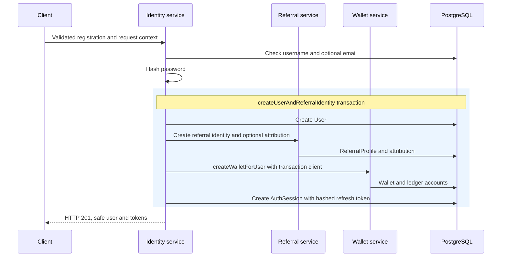

Registration hashes the password before the transaction, then `createUserAndReferralIdentity` coordinates identity, referral profile, wallet/account setup, and the refresh session. Passing the transaction client through service calls makes failure roll everything back. No payment provider or stream job runs; an empty wallet is not a funded wallet.

**Failure/recovery:** Existing username/email produce conflict responses. Unique-conflict retry protects generated/referral identities where implemented. Invalid REST attribution can reject the registration transaction. No partial user should be treated as successfully registered if wallet creation rolls back. A lost HTTP response can leave a completed registration; repeating it encounters uniqueness rather than creating another account.

<a id="section-16-3"></a>

### 16.3 Flow 2: login and refresh rotation

**Entry/handler:** `POST /identity/login` and `/identity/refresh` → `identityController.login`/`refresh` → corresponding Identity service methods. The refresh token is supplied in the request body; client storage details belong to Chapter 5.

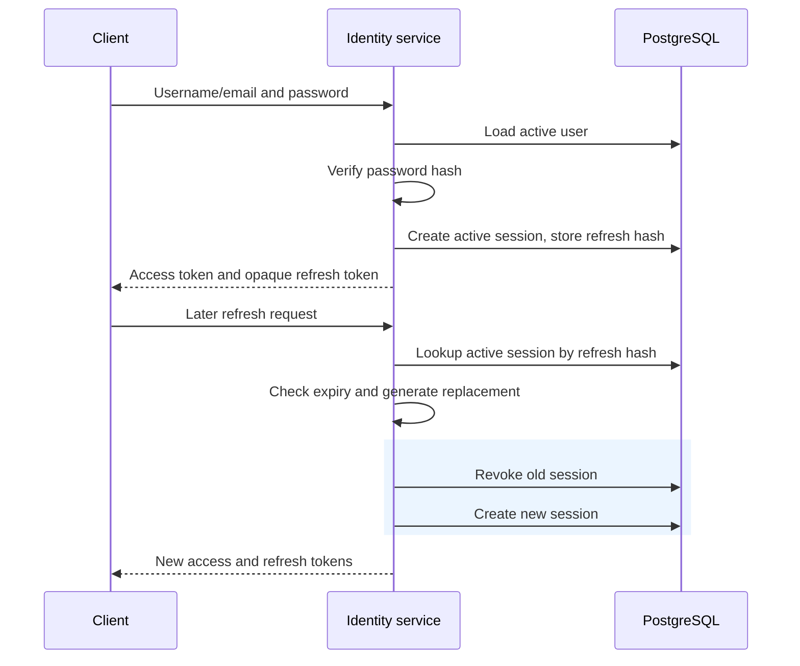

Login issues a JWT bound to the stored session ID and returns an opaque refresh credential whose hash is stored. Refresh rejects missing/inactive/expired sessions; expiry also triggers revocation. `rotateSession` revokes the previous row and creates its replacement in a transaction, so the ordinary serial refresh path invalidates the old credential.

**Failure/recovery and limit:** Incorrect credentials return the generic authentication error. There is no worker or external API. Do not claim the transaction alone prevents two simultaneous refreshes: the repository update is by session ID without an `ACTIVE` condition, while the earlier active lookup is outside that transaction. Concurrent callers that both pass the lookup are a separate race to address. Losing the new response after old-session revocation may require login again.

<a id="section-16-4"></a>

### 16.4 Flow 3: WhatsApp-first account registration

**Entry/handler:** Signed message webhook → durable incoming event → `handleMessage` → `getWhatsappUserWithStatus` → `identityService.findOrCreateWhatsappUserWithStatus`.

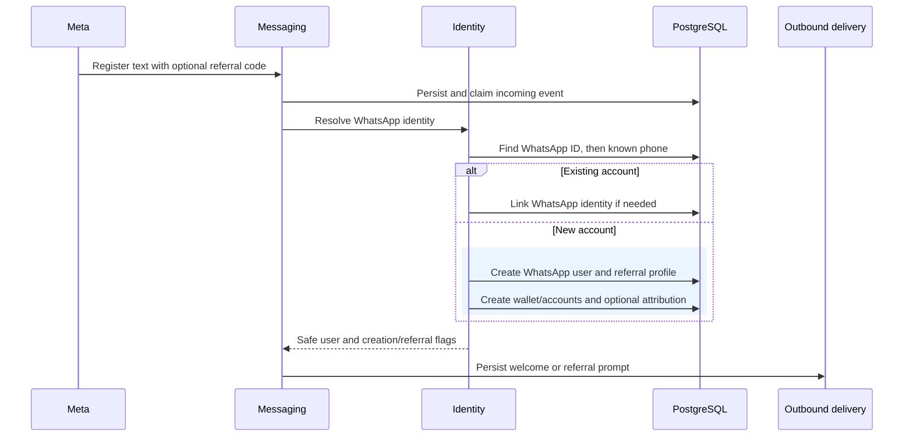

The Identity service first finds the exact WhatsApp ID, then attempts a phone-based link, otherwise creates a WhatsApp-first account. New-account creation shares the referral/wallet transaction described above but has no REST request context, so it does not issue dashboard tokens. A WhatsApp-origin account is not automatically given a normal password.

**State/result:** New registration can enter Redis `REFERRAL_ATTRIBUTION`; no-code registration asks for a code or skip. An invalid code can preserve the new account and prompt correction because the WhatsApp creation path allows invalid attribution. Existing accounts receive an already-registered response. Disabled accounts are rejected. Database claims and service uniqueness handle duplicate intake; outbound recovery remains at least once. See [messaging.service.ts](src/domains/messaging/messaging.service.ts) and [identity.service.ts](src/domains/identity/identity.service.ts).

<a id="section-16-5"></a>

### 16.5 Flow 4: first wallet funding

**Entry/handler:** Bot funding intent, or `POST /wallet/funding/account` → `walletController.getFundingAccount` → `walletService.getFundingAccount`. The bot's missing-field collection currently depends on optional interpretation after the initial prompt.

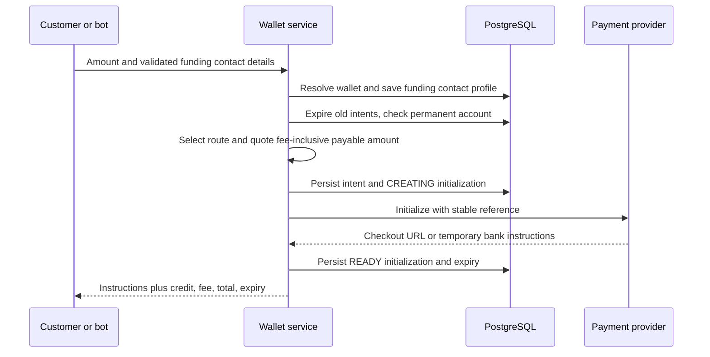

Saving funding contact fields is a separate persistence action before initialization; these fields survive abandoned flows and do not change login email. The intent records requested net credit, fee, total payable, provider/reference, and initialization state before external creation. Provider latency is outside the later wallet-credit transaction. Bachs returns hosted checkout; Paystack temporary funding returns bank-transfer instructions; mock mode returns synthetic instructions.

**Failure/recovery:** Explicit provider rejection can allow configured fallback with recalculated fees. Timeout/uncertain initialization becomes `UNKNOWN` and prevents blindly opening another checkout under the same identity. No wallet credit is posted yet. Funding expiry is maintained by the worker; unknown initialization is not guaranteed to resolve automatically. See [wallet.service.ts](src/domains/wallet/wallet.service.ts) and [payment-provider.router.ts](src/infra/payments/payment-provider.router.ts).

<a id="section-16-6"></a>

### 16.6 Flow 5: returning wallet funding

**Entry/handler:** The same Wallet method, with bot-side hydration from `getFundingProfile`. A returning user does not automatically gain a permanent virtual account.

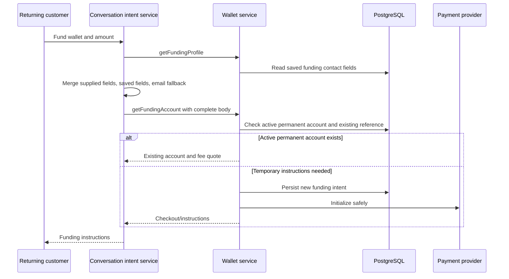

Explicitly supplied details win; saved funding contact fields fill omissions; login email can be a final fallback. Names are not inferred from WhatsApp display names. The REST route still expects its complete schema; the bot prepares that body internally. Reusing a ready unexpired intent with the same identity returns its instructions; changing the requested amount produces an idempotency conflict. An already paid or expired operation needs the appropriate new operation rather than an accidental second initialization.

**Failure/recovery:** Saved profile retention reduces repeated data collection but is not settlement proof. Permanent-account creation remains separately gated and externally provisioned. A periodic expiry scan changes overdue temporary intents; a correctly matched late payment can still credit under Flow 6. See [conversation-intent.service.ts](src/domains/messaging/conversation-intent.service.ts) and [wallet.service.ts](src/domains/wallet/wallet.service.ts).

<a id="section-16-7"></a>

### 16.7 Flow 6: successful payment webhook and wallet credit

**Entry/handler:** `POST /wallet/funding/webhooks/bachs` or `/paystack` → matching wallet controller → `processBachsDepositWebhook`/`processPaystackDepositWebhook` → `processDepositWebhook`.

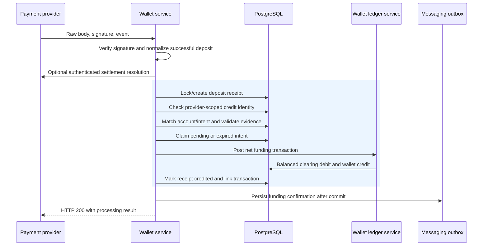

The signature check precedes financial database work. Optional provider resolution happens before the transaction, so external latency does not hold wallet/receipt locks. The receipt and idempotency identity bind to provider evidence. Temporary intent matching checks references and payable amount; permanent accounts have their own fee treatment. A valid late payment may claim an `EXPIRED` intent because expiry of instructions does not erase money actually received.

**Failure/recovery:** Wrong currency, unknown checkout, inconsistent settlement, excess fees, wrong amount, or already consumed intent can produce a review receipt instead of money. Ledger failure rolls the credit/receipt/claim transaction back. Notification failure after commit does not undo funding, and the current funding path does not have the purchase-completion wake-up repair for a failure before any outbound row is created. See [wallet.service.ts](src/domains/wallet/wallet.service.ts), [wallet.repository.ts](src/domains/wallet/wallet.repository.ts), and Chapter 7.

<a id="section-16-8"></a>

### 16.8 Flow 7: duplicate payment webhook

**Entry/handler:** Same as Flow 6; duplicated provider delivery is expected behavior, not a special endpoint.

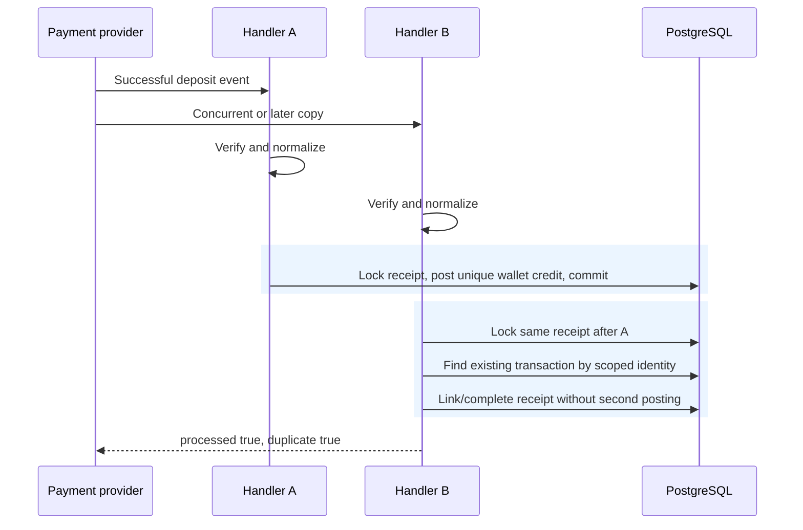

The database identity and lock are authoritative; a preliminary in-memory check would not protect two processes. The duplicate path returns the original wallet transaction ID. It does not create new ledger entries or produce another fresh funding notification state.

**Failure/recovery:** If the first handler rolls back, the next can perform the legitimate credit. If the provider assigns different references to genuinely distinct deposits, matching must still ensure the already paid intent is not consumed twice. An authentic signature does not authorize an unlimited number of credits against one funding request. [payment.funding.integration.test.ts](test/payment.funding.integration.test.ts) contains concurrent duplicate assertions, but this handbook did not execute them against PostgreSQL.

<a id="section-16-9"></a>

### 16.9 Flow 8: airtime purchase

**Entry/handler:** Deterministic WhatsApp selection/confirmation, AI-created confirmation, or `POST /commerce/purchases` → `commerceController.createPurchase` → `commerceService.createPurchase`.

```mermaid
sequenceDiagram
  participant C as Customer
  participant M as Messaging or REST
  participant S as Commerce service
  participant D as PostgreSQL
  participant R as Redis stream
  participant W as Commerce worker
  participant V as VTU provider
  C->>M: Choose airtime, recipient, confirm displayed price
  M->>S: createPurchase with expected price or signed quote
  S->>S: Validate active product and operation identity
  rect rgb(235,245,255)
    S->>D: Purchase PENDING plus wallet debit plus job QUEUED
  end
  S->>R: Publish job ID
  S-->>M: Accepted purchase
  W->>D: Claim job and create attempt
  W->>V: Purchase with persisted reference
  V-->>W: Normalized result
  W->>D: Apply current attempt result
```

The customer sees acceptance before external delivery. The supplier amount, retail price, provider identity, and product snapshot are separate values. Wallet locking and uncached balance validation happen inside the transaction. Another request using the same valid quote or scoped operation key returns the existing purchase.

**Failure/recovery:** Insufficient funds or invalid price/quote rolls back acceptance. Redis publication failure leaves a recoverable job. Provider uncertainty follows Flow 12; definitive failure follows Flow 11. A successful delivery can still require cost reconciliation. See [commerce.service.ts](src/domains/commerce/commerce.service.ts), [commerce.repository.ts](src/domains/commerce/commerce.repository.ts), and [commerce.fulfillment.service.ts](src/domains/commerce/commerce.fulfillment.service.ts).

<a id="section-16-10"></a>

### 16.10 Flow 9: data purchase and later receipt notification

**Entry/handler:** Same purchase service as airtime, with a catalog data variation. The displayed option is retained so a catalog refresh does not silently reinterpret the customer's menu number.

```mermaid
sequenceDiagram
  participant C as Customer
  participant M as Messaging
  participant S as Commerce
  participant D as PostgreSQL
  participant W as Worker
  participant V as VTU provider
  participant Meta as WhatsApp Cloud
  C->>M: Select network and data option, recipient, confirm
  M->>S: Validated data purchase
  rect rgb(235,245,255)
    S->>D: Purchase, debit, fulfillment job
  end
  S-->>C: Queued result through messaging
  W->>V: Purchase data variation
  V-->>W: Successful result with cost/evidence
  W->>D: Persist success and notification wake-up
  W->>D: Create unique purchase-completed outbound row
  W->>Meta: Later outbound send after outbox recovery
  Meta-->>C: Completion message
```

Data listing uses provider catalog metadata and the application's plan description/pricing rules. Confirmation re-resolves the selected product rather than trusting arbitrary AI IDs or a changed menu order. On complete settlement the fulfillment job succeeds. Missing cost or required receipt can retain requery even when the purchase status is successful.

**Failure/recovery:** The completion notification is addressed to the purchaser's linked WhatsApp account, even if the recipient of the data is another number. The transaction persists `completionNotificationPending`; notification recovery recreates scheduling after interruption, and a unique outbound deduplication key prevents multiple logical completion records. It still cannot promise exactly one Meta send. See [commerce.notification.service.ts](src/domains/commerce/commerce.notification.service.ts) and [commerce.notification.integration.test.ts](test/commerce.notification.integration.test.ts).

<a id="section-16-11"></a>

### 16.11 Flow 10: electricity or cable purchase with verification

**Entry/handler:** `handleBillingConversation` or `POST /commerce/purchases/quote` → `commerceService.quotePurchase`; explicit confirmation then calls `createPurchase` with the quote token.

```mermaid
sequenceDiagram
  participant C as Customer
  participant B as Billing conversation
  participant S as Commerce
  participant V as VTU provider
  participant D as PostgreSQL
  participant W as Fulfillment worker
  C->>B: Electricity meter or cable account/package details
  B->>S: quotePurchase
  S->>V: Verify account and required amount rules
  V-->>S: Customer and verification constraints
  S-->>B: Signed owner-bound expiring quote
  B-->>C: Verified summary and final payable amount
  C->>B: Explicit confirmation
  B->>B: Persist submissionStarted in Redis
  B->>S: createPurchase with same signed quote
  rect rgb(235,245,255)
    S->>D: Purchase snapshot, debit, job
  end
  W->>V: Fulfill verified product/account snapshot
  W->>D: Record outcome and receipt or requery need
```

Verification does not debit funds. The signed quote binds the owner, product, account/recipient details, amount/fees, environment, and expiry. Corrections invalidate the previous quote and require renewed verification/confirmation. Cable renewal versus package change affects the provider request; a named new package must not silently become a renewal of the old one.

**Failure/recovery:** Bad account, unknown fee, unavailable product, expired quote, or changed details prevents acceptance. Once submission starts, the billing context prevents edits from turning an uncertain financial intention into another purchase. An uncertain response retains the original submission state. A prepaid electricity purchase lacking its required token remains subject to receipt requery. See [billing-conversation.ts](src/domains/messaging/billing-conversation.ts), [commerce.quote.ts](src/domains/commerce/commerce.quote.ts), and [commerce.service.ts](src/domains/commerce/commerce.service.ts).

<a id="section-16-12"></a>

### 16.12 Flow 11: definitive purchase failure and refund

**Entry/handler:** `commerceFulfillmentService.processFulfillmentJob` applies a definitive failed result, producing durable refund work; `processRefundJob` executes it.

```mermaid
sequenceDiagram
  participant V as VTU provider
  participant F as Fulfillment service
  participant D as PostgreSQL
  participant R as Redis stream
  participant W as Wallet service
  V-->>F: Definitive rejection or supported reversal
  rect rgb(235,245,255)
    F->>D: Mark failed outcome and ensure refund job
  end
  F->>R: Publish refund job ID
  F->>D: Claim due refund job
  F->>W: refundPurchaseDebit with stable refund key
  rect rgb(235,245,255)
    W->>D: Post balanced compensating refund once
  end
  F->>D: Mark refund job complete and purchase REFUNDED
  F->>R: Qualification refund event when applicable
```

A refund adds compensating entries; it does not delete the original debit. The wallet refund commit and refund-job completion are distinct stages. If the process crashes between them, the stable refund identity returns the existing refund instead of crediting twice, then the job can complete. Exceptions and due-job recovery make incomplete refunds visible.

**Result/failure:** The purchase becomes `REFUNDED` after refund recording completes. A timeout alone is not grounds for this branch because delivery may have happened. Refund qualification subtracts the amount actually applied by the purchase's completed settlement qualification event. Credited affiliate rewards do not have an implemented automatic reversal workflow. See [commerce.fulfillment.service.ts](src/domains/commerce/commerce.fulfillment.service.ts), [wallet.service.ts](src/domains/wallet/wallet.service.ts), and Chapter 12.

<a id="section-16-13"></a>

### 16.13 Flow 12: provider timeout and later reconciliation

**Entry/handler:** A thrown/ambiguous supplier result inside `processFulfillmentJob`; later `commerceReconciliationService.run` republishes due work.

```mermaid
sequenceDiagram
  participant A as Worker A
  participant D as PostgreSQL
  participant V as VTU provider
  participant S as Reconciliation scheduler
  participant B as Worker B
  A->>D: Persist purchase attempted and attempt 1
  A->>V: Submit stable request reference
  V--xA: Response timeout or lost response
  A->>V: Immediate requery same reference
  V-->>A: Still pending or uncertain
  A->>D: AWAITING_REQUERY and next attempt time
  S->>D: Find due or stale job
  S->>B: Publish job ID through Redis
  B->>D: Claim attempt 2
  B->>V: Requery, never resubmit purchase
  V-->>B: Authenticated settled outcome
  B->>D: Apply only if attempt 2 remains current
```

The local purchase can remain pending. If delivery is confirmed but cost/receipt is incomplete, purchase `SUCCESSFUL` can coexist with job `AWAITING_REQUERY`. The result fence rejects an old worker's delayed completion after a newer attempt is current. A VTpass callback is a scheduling hint: the application persists it and obtains authenticated requery evidence before treating it as final financial truth.

**Result/failure:** Fixed requery delay is 30 seconds, while actual wake-up depends on reconciliation and consumer timing. Persistent uncertainty opens financial exceptions; it is not falsely converted to failure or a second purchase. Missing receipts suppress success notification until required receipt data arrives; missing supplier cost alone can still permit a success notification while settlement reconciliation continues. See [commerce.reconciliation.service.ts](src/domains/commerce/commerce.reconciliation.service.ts), [commerce.webhook.service.ts](src/domains/commerce/commerce.webhook.service.ts), and Chapter 10.

<a id="section-16-14"></a>

### 16.14 Flow 13: incoming WhatsApp text to outbound reply

**Entry/handler:** `messagingController.receiveWhatsappWebhook` → durable intake and `handleMessage` → `messagingOutboundService` → stream worker.

```mermaid
sequenceDiagram
  participant Meta as Meta
  participant API as HTTP intake
  participant D as PostgreSQL
  participant H as Conversation handler
  participant R as Redis
  participant W as Sender worker
  Meta->>API: Signed balance text
  API->>D: Persist unique event and sequence
  API-->>Meta: HTTP 200
  H->>D: Claim earliest eligible event
  H->>R: Read conversation context when needed
  H->>H: Resolve user and call wallet summary
  H->>D: Create outbound QUEUED row
  H->>R: XADD with durable outbound ID
  H->>D: Mark inbound processed
  W->>D: Start outbound attempt
  W->>Meta: Send reply
  W->>D: Persist SENT and provider message ID
  W->>R: XACK
```

There is no single transaction covering handler work, reply scheduling, and inbound completion. A handler retry can repeat some nonfinancial effects; financial service identities still matter. The API schedules processing and the worker recovers pending incoming events every five seconds, so either process may handle the instruction.

**Failure/recovery:** Initial persistence failure prevents successful acknowledgement. Unscheduled queued outbound rows can be recovered; assigned entries use pending claiming. Meta acceptance followed by failed local persistence can duplicate sending. A later delivery callback updates delivered/read separately. Poison inbound failures lack deliberate backoff/ceiling and can stall later conversation messages. These limitations are explained in Chapter 9 rather than hidden by the word “durable.”

<a id="section-16-15"></a>

### 16.15 Flow 14: referral qualification and reward processing

**Entry/handler:** Normal completed fulfillment calls `enqueuePurchaseSettled` inside result persistence; commerce stream processing calls `referralQualificationService.processEvent`, which invokes `rewardPolicyService.processRewardForQualifiedPurchase`.

```mermaid
sequenceDiagram
  participant F as Fulfillment result
  participant D as PostgreSQL
  participant C as Commerce worker
  participant Q as Qualification service
  participant R as Reward policy service
  rect rgb(235,245,255)
    F->>D: Complete settlement and unique qualification event
  end
  F->>C: Publish event ID through Redis
  C->>Q: processEvent
  Q->>D: Claim durable event
  rect rgb(235,245,255)
    Q->>D: Serializable update of qualifying spend and status
    Q->>R: Process eligible purchase reward
    R->>D: Select policy/tier and create unique snapshot
    R->>D: Lock separate reward balance
    R->>D: Conditional PENDING to CREDITED and balance increment
    Q->>D: Qualification event COMPLETED
  end
```

Qualifying spend reaches `QUALIFIED` at the implemented ₦1,000 threshold. The referrer's tier and effective policy determine the share of eligible purchase profit; the reward event preserves calculation operands. This increases a separate `ReferralRewardBalance`, not Wallet's spendable balance. No provider payout is triggered.

**Failure/recovery and limitation:** Serializable conflicts retry. Pending reward rows can be retried while processing is enabled. Qualification reconciliation scans `SUCCESSFUL` purchases missing events without requiring completed cost/receipt settlement; it can therefore get ahead of the normal emission path. If it completes qualification while supplier cost is absent, no reward event is created, and later pending-reward scanning cannot discover a row that never existed. Suspension can create a related missing-event gap. Do not describe recovery as complete for every missed reward. See [referral.qualification.service.ts](src/domains/identity/referral.qualification.service.ts), [reward.policy.service.ts](src/domains/rewards/reward.policy.service.ts), and Chapter 12.

<a id="section-16-16"></a>

### 16.16 Flow 15: admin monitoring of outcomes

**Entry/handler:** Admin browser → `/administration/dashboard/summary`, `/purchases`, `/funding-intents`, `/operations/pending`, `/operations/failed`, or `/reconciliation/exceptions` → administration controller and its API/KPI services.

```mermaid
sequenceDiagram
  participant A as Admin React app
  participant Auth as Authentication and RBAC
  participant C as Administration controller
  participant S as API or KPI service
  participant D as PostgreSQL
  A->>Auth: Bearer-authenticated monitoring request
  Auth->>D: Validate active session, user, role
  Auth->>C: Authorized operator or administrator
  C->>S: Parsed filters and pagination
  S->>D: Read purchases, funding, jobs, exceptions or aggregates
  D-->>S: Current stored evidence
  S-->>C: Safe response model
  C-->>A: HTTP 200 with request ID
  A->>A: Render data, loading or error state
```

These are reads, not a financial mutation transaction or automatic supplier probe. `administrationKpiService.getDashboardSummary` calculates dashboard results; `administrationApiService.listPurchases`, `listFundingIntents`, and operational helpers retrieve filtered views. The browser uses [admin API client](../admin/src/lib/api.ts); backend authorization is applied to the whole administration router before individual handlers.

**Result/failure:** Unauthorized roles never reach the data operation. Validation rejects invalid filters. Database errors produce the shared error envelope, and the frontend renders an error state rather than inventing an empty successful result. Provider/worker status endpoints include configuration-derived or unknown states; they are not proof every remote dependency is healthy. Product synchronization/visibility controls are separate audited mutations; there is no generic “refund this customer” route implied by a transaction table. See [administration.routes.ts](src/domains/administration/administration.routes.ts), [administration.controller.ts](src/domains/administration/administration.controller.ts), and Chapter 13.

<a id="section-16-17"></a>

### 16.17 Compare the boundaries across all flows

Registration and purchase acceptance are strong examples of local atomic coordination. Funding credits use authenticated external evidence followed by a local transaction. Supplier delivery and outbound messaging remain distributed operations. Refunds compensate earlier financial actions; they do not reverse time. Reward accrual is another domain with its own balance and incomplete reversal/payout capabilities.

A useful debugging habit is to ask four questions in order: Was the instruction durably received? Was the local financial decision committed? What external evidence exists? Which recovery mechanism owns the unfinished state? The answer determines whether you should inspect an incoming event, wallet transaction, supplier attempt, refund job, deposit receipt, notification wake-up, stream pending entry, or reward event.

**Key takeaways:** Each arrow has a different guarantee. Local transactions do not include providers. Stable identities survive retries. Success may mean accepted, delivered, settled, or notified depending on the record. Separate recovery paths must be evaluated independently.

**Review questions:** Which flows create money entries? Which contain an external call before a credit transaction? Where does a signed quote become an idempotency identity? What survives Redis loss? How can a purchase be successful while its job still needs requery? Why can a missing reward event evade pending-event recovery?

**Further reading:** Revisit the source-linked diagrams with [PostgreSQL explicit locking](https://www.postgresql.org/docs/current/explicit-locking.html) for database boundaries and [Redis Streams](https://redis.io/docs/latest/develop/data-types/streams/) for delivery boundaries. Both are intermediate references; first reproduce two simple flows without looking at their diagrams.

**Explain this in an interview:** “I can trace the system as distinct durable decisions: accept an authenticated instruction, atomically record local financial state and work, call a provider with a stable identity, apply evidence under concurrency checks, and repair incomplete work through reconciliation. I distinguish accepted purchases from fulfilled purchases, financial credit from notification delivery, and reward accrual from spending funds. The remaining gaps are specific rather than covered by a blanket exactly-once claim.”

# Part VI — Engineering decisions and tradeoffs

<a id="chapter-17"></a>

## Chapter 17: Architecture Decision Records

**Learning objectives:** defend implemented choices without inventing their history; compare alternatives against SwiftTopUp's present needs; identify when a useful choice becomes a constraint. **Prerequisites:** Chapters 2–15. **Difficulty:** Intermediate. **Opening practical exercise:** Pick one decision below and argue for its strongest alternative for five minutes before defending the implemented choice.

<a id="section-17-1"></a>

### 17.1 How to read these records

An Architecture Decision Record, or ADR, connects a concrete problem to a chosen approach and its consequences. “We use PostgreSQL” is inventory; “we use PostgreSQL to atomically record debits and durable work, accepting transaction/connection management responsibilities” is a decision explanation.

**Historical-status label for every ADR in this chapter:** The implementation is directly evidenced by the linked source. Unless a document explicitly records the original discussion, its motivation and rejected alternatives are **technical rationale inferred from the implementation**, not a verified transcript of the founder's historical decision. The reconsideration conditions are recommendations, not existing migration commitments.

<a id="section-17-2"></a>

### 17.2 ADR 01 — Express for the HTTP boundary

**Context/problem:** Web clients, Meta and payment providers need HTTP endpoints with validation, authentication, rate limits and consistent errors. **Chosen approach:** [createApp](src/app.ts) composes Express middleware, mounts `/api/v1`, captures webhook raw bodies, and installs error/not-found handling.

**Alternatives:** A framework with stronger built-in conventions, such as a dependency-injection/controller framework, could standardize modules; a smaller HTTP server could reduce machinery. Either would require adapting middleware and lifecycle behavior.

**Advantages:** The request path is explicit enough to trace, libraries fit the current Node stack, and domain logic can stay outside HTTP handlers. **Disadvantages:** Express does not itself enforce service boundaries, validate input, or generate a secure authorization policy; the application supplies those guarantees. Flexible middleware order is also a source of mistakes, especially around raw bodies and admission control.

**Operational implications:** Preserve middleware ordering; proxy trust and body limits affect both reliability and rate-limit identity. An HTTP process being alive does not prove background work is progressing. **Reconsider when:** Measured request overhead, team consistency needs, or a concrete protocol requirement justifies migration. Framework fashion alone does not repay changing stable financial endpoints.

<a id="section-17-3"></a>

### 17.3 ADR 02 — Strict TypeScript rather than untyped application code

**Context/problem:** Money, identities, provider payloads and intermediate job states are easy to confuse. **Chosen approach:** [tsconfig.json](tsconfig.json) enables strict checks, unchecked-index awareness and explicit override checks; types describe provider contracts and domain inputs.

**Alternatives:** Plain JavaScript with runtime checks reduces compilation requirements; a different statically typed language could enforce other constraints but would replace the current development ecosystem.

**Advantages:** Nullable values and incompatible shapes surface during development, and provider interfaces make normalized results easier to understand. **Disadvantages:** Types disappear at runtime. `as SomeType` is not validation, and generated Prisma types can still describe a business-invalid state such as a pending purchase missing its debit.

**Operational implications:** Typecheck and build must succeed before deployment; runtime Zod parsing still protects HTTP/provider boundaries. Library major versions and generated Prisma code affect compilation. **Reconsider when:** Usually refine types rather than replacing the language. A specific CPU-bound component might justify another implementation only after profiling and maintaining a clear interface. The current system's external latency and financial invariants are not solved by a language switch.

<a id="section-17-4"></a>

### 17.4 ADR 03 — PostgreSQL as authoritative state

**Context/problem:** A debit, purchase and fulfillment obligation must agree despite concurrency and crashes. **Chosen approach:** [schema.prisma](prisma/schema.prisma) and repositories use PostgreSQL relations, unique constraints, exact decimals, row locks and transactions.

**Alternatives:** A document database can model flexible records; a key-value store provides fast individual operations; an embedded relational database could simplify a single-instance prototype. None automatically removes the need for money invariants, durable references or concurrency design.

**Advantages:** One transaction can protect related financial/workflow writes; relational links support investigation; uniqueness arbitrates duplicate identity across processes. **Disadvantages:** Shared database capacity and connections become common dependencies. Locks can contend, schemas require migrations, and backups/restore need operational ownership.

**Operational implications:** Protect connection capacity, maintain constraints and migration discipline, and verify restore procedures. A ledger is valuable only if its committed records remain recoverable. **Reconsider when:** Introduce reporting replicas, archival or partitions after measured needs. Replacing the authoritative financial store is a much larger decision than adding a cache. No current evidence establishes that SwiftTopUp has outgrown one PostgreSQL database.

<a id="section-17-5"></a>

### 17.5 ADR 04 — Prisma for database access

**Context/problem:** Strict TypeScript needs maintainable queries and a clear schema/migration vocabulary. **Chosen approach:** [config/prisma.ts](src/config/prisma.ts) creates the PostgreSQL adapter/client; repositories use generated model operations and transaction clients.

**Alternatives:** Handwritten SQL gives exact control; a query builder preserves SQL structure with fewer ORM conventions; another ORM offers different relations/migrations. SQL is already used selectively where job locking requires it.

**Advantages:** Generated types connect schema and application code, nested writes simplify related creation, and transaction-client passing keeps financial boundaries visible. **Disadvantages:** Query cost is not obvious merely because TypeScript compiles. ORM error codes require interpretation; advanced constraints and locks may need SQL. Online docs can target another major version than the installed Prisma 7 client.

**Operational implications:** Generate compatible client code and apply reviewed migrations. A module singleton is per process, so replicate-aware connection budgeting remains necessary. **Reconsider when:** A measured query or required database feature is awkward or inefficient; use focused SQL before proposing a wholesale rewrite. Keep business rules in the domain even when persistence tooling changes.

<a id="section-17-6"></a>

### 17.6 ADR 05 — Redis for shared runtime coordination

**Context/problem:** Requests and workers need fast shared admission counters, conversation context, provider cooldown and delivery coordination. **Chosen approach:** [config/redis.ts](src/config/redis.ts) and Redis-backed components use a shared Redis service; durable financial facts remain PostgreSQL records.

**Alternatives:** PostgreSQL could provide more coordination through tables/polling; local memory is simpler but cannot coordinate replicas; a managed broker addresses different messaging requirements.

**Advantages:** Atomic counters/Lua and Streams fit existing runtime needs, while short-lived conversation state avoids unnecessary permanent draft tables. **Disadvantages:** Redis is an availability dependency: admission can fail closed, drafts can expire, and stream recovery has path-specific limitations. Redis is not interchangeable with the local wallet-summary Map cache.

**Operational implications:** Monitor connection errors, latency, memory, persistence/eviction configuration and pending stream work. Separate blocking readers from ordinary command connections as implemented. **Reconsider when:** Shared capacity or retention needs outgrow the deployment, or measured operational complexity favors a different component. Losing Redis must not be treated as permission to invent financial state from conversation text.

<a id="section-17-7"></a>

### 17.7 ADR 06 — Redis Streams plus PostgreSQL jobs

**Context/problem:** A debit must create recoverable fulfillment work even if publishing a queue message fails. **Chosen approach:** [createPurchaseWithDebitAndJob](src/domains/commerce/commerce.repository.ts) commits the job with money; [commerce.stream.ts](src/infra/queues/commerce.stream.ts) wakes consumers; [commerce.worker.ts](src/infra/queues/commerce.worker.ts) claims jobs and runs reconciliation.

**Alternatives:** BullMQ, direct PostgreSQL polling, a traditional broker, or change-data-capture outbox publication. BullMQ remains installed but current startup imports the custom Streams workers rather than BullMQ processing. A dependency listing is not runtime proof.

**Advantages:** Durable business obligations are queryable with purchases and debits, while Streams distribute wake-ups and retain pending entries for recovery. **Disadvantages:** Custom code owns acknowledgement, claims, retries, malformed entries and recovery. There is no universal commerce dead-letter policy merely because constants exist. Duplicate publication is expected.

**Operational implications:** Monitor PostgreSQL job age and stream pending state together; either alone gives an incomplete picture. Recovery schedulers must run. **Reconsider when:** Proven throughput, scheduling, tooling or operational demands exceed what this custom implementation should maintain. Moving queues still requires financial idempotency, durable obligations and provider uncertainty handling.

<a id="section-17-8"></a>

### 17.8 ADR 07 — Modular monolith with domain modules

**Context/problem:** One small product needs coherent financial transactions without a fleet of separately deployed business services. **Chosen approach:** [domains](src/domains) separates identity, wallet, commerce, messaging, rewards and administration inside one backend codebase and shared database.

**Alternatives:** A loosely structured monolith is quick initially but scatters rules; microservices create independent deployments and network boundaries; a stricter ports-and-adapters design could mechanically isolate dependencies further.

**Advantages:** Internal service calls and shared transactions are straightforward. One developer can trace behavior without correlating many deployments. Modules permit focused tests and later extraction boundaries. **Disadvantages:** Shared deployment/schema dependencies remain, and boundaries are conventions rather than absolute compile-time or database-access barriers. Reporting queries can cross domain data.

**Operational implications:** Keep mutation ownership explicit and avoid duplicating wallet rules in commerce or messaging. API/worker processes can scale separately without becoming independently owned microservices. **Reconsider when:** A module has a clear independent ownership, release, capacity or isolation need with measurable benefit. Extraction must define contracts, consistency and recovery before splitting tables and replacing calls with HTTP.

<a id="section-17-9"></a>

### 17.9 ADR 08 — Double-entry wallet subledger

**Context/problem:** A mutable balance alone cannot explain funding, spending, refunds or duplicate effects. **Chosen approach:** [wallet.ledger.ts](src/domains/wallet/wallet.ledger.ts) posts balanced account entries and [wallet.service.ts](src/domains/wallet/wallet.service.ts) calculates spendable funds from `WALLET_BALANCE` movements.

**Alternatives:** A balance plus transaction journal can work if atomically maintained; a full accounting engine provides broader controls but adds concepts beyond this customer-wallet scope.

**Advantages:** Every normal movement has a counter-entry and attributable transaction; refunds preserve history; sums reconstruct spendable value. **Disadvantages:** Aggregates cost more as history grows, and correctness still depends on account/owner selection and service-enforced balance checks. This is not complete company financial accounting and is not database-enforced immutability.

**Operational implications:** Preserve journal records, use stable operation keys, investigate missing-debit/ledger exceptions, and never authorize spending from the cached display. **Reconsider when:** Keep the journal even if adding verified balance snapshots for performance. Expansion into payouts, tax, provider settlement or reward reversals requires explicit accounting design rather than adding arbitrary balance columns.

<a id="section-17-10"></a>

### 17.10 ADR 09 — Provider adapters and normalized outcomes

**Context/problem:** Bachs, Paystack, VTpass, Meta and AI providers use different units, fields and error semantics. **Chosen approach:** Payment, VTU, messaging and AI contracts isolate translation into [infra](src/infra), with factories and mocks.

**Alternatives:** Call providers directly from controllers or domain services; use a universal payment/notification platform; introduce a plugin registry. Direct calls reduce initial files but spread vendor assumptions; a universal registry can be premature.

**Advantages:** Domain code can reason about supported success, failure and ambiguity; mock providers support safe local tests. **Disadvantages:** A shared contract cannot erase real capability differences. Bachs cannot create permanent accounts through its adapter. A normalized boolean that drops uncertainty would be dangerous, and mock success cannot establish live provider approval.

**Operational implications:** Preserve provider-specific evidence, timeouts and environment snapshots. Retries need operation-specific semantics rather than an indiscriminate wrapper. **Reconsider when:** Multiple active suppliers need runtime routing or capability negotiation that the current factory cannot express clearly. Extend real contracts before inventing generic abstractions for hypothetical integrations.

<a id="section-17-11"></a>

### 17.11 ADR 10 — Separate API and worker operating-system processes

**Context/problem:** A slow provider send or recovery loop should not occupy the API startup/listen path or be forgotten when HTTP returns. **Chosen approach:** [server.ts](src/server.ts) serves HTTP; [worker.ts](src/worker.ts) starts messaging, commerce and catalog scheduling with graceful shutdown.

**Alternatives:** Run all loops inside the web server; use serverless scheduled functions; extract independent services. Colocation is simple but couples restarts/capacity; separate services add stronger boundaries and deployment contracts.

**Advantages:** Worker restarts and capacity can be managed separately; background obligations survive through shared stores. **Disadvantages:** Deployment must actually run both roles. They share code/config/data, and one worker entry currently starts several responsibilities together, so their scaling is not fully independent.

**Operational implications:** HTTP health alone cannot show worker health. Coordinate shutdown, credentials, schema compatibility, shared signing settings and recovery timers. More worker replicas also duplicate scheduler scans unless deliberately controlled. **Reconsider when:** One worker responsibility has distinct rate, scaling or failure-isolation requirements. Splitting role commands can precede splitting the domain into a microservice.

<a id="section-17-12"></a>

### 17.12 ADR 11 — Asynchronous fulfillment after local acceptance

**Context/problem:** Supplier latency and uncertain responses make a single synchronous “buy now” request unreliable. **Chosen approach:** [createPurchase](src/domains/commerce/commerce.service.ts) returns a committed pending purchase, while [processFulfillmentJob](src/domains/commerce/commerce.fulfillment.service.ts) performs external work later.

**Alternatives:** Block HTTP until fulfillment finishes; reserve/capture funds rather than debit/refund; require manual processing. Synchronous execution may feel simple but still needs durable crash recovery.

**Advantages:** Local acceptance has a clear transaction boundary, queue publication failures are recoverable, and users can inspect durable status. **Disadvantages:** Pending is a real customer experience requiring truthful messaging, monitoring and support. Funds remain debited during ambiguity, and compensation is another operation that can fail.

**Operational implications:** Observe oldest pending jobs, distinguish delivered from settlement-complete, and requery stable provider references after uncertainty. **Reconsider when:** Provider semantics or a measured UX requirement justifies a bounded synchronous wait layered over the same durable workflow. Removing durability to make the screen appear immediate would not resolve the underlying failure problem.

<a id="section-17-13"></a>

### 17.13 ADR 12 — Persistent idempotency identities

**Context/problem:** Repeated HTTP confirmations, webhooks and worker deliveries must not repeat money movement. **Chosen approach:** Unique database operation keys and provider receipt identities in [schema.prisma](prisma/schema.prisma), plus replay-aware services.

**Alternatives:** In-memory deduplication, short-lived Redis locks, request-body fingerprints or provider-only deduplication. Memory disappears on restart; a lock expiring is not evidence the operation never happened; external deduplication cannot protect all local effects.

**Advantages:** Identity survives process/network failures and is enforced across replicas. Purchase/debit/job transactions combine repeat protection with atomic local state. **Disadvantages:** Key scope and reuse semantics must be designed. Low-level wallet replay does not compare every payload/owner field, and changed-body handling varies by entry point.

**Operational implications:** Preserve keys across retries and logs; distinguish a new intent from a repeated attempt. Add payload fingerprints if exposing more general financial mutation interfaces. **Reconsider when:** Richer in-progress responses, result retention or public client guarantees require a formal idempotency record protocol. Persistent uniqueness should remain part of the financial invariant even if the surrounding API evolves.

<a id="section-17-14"></a>

### 17.14 ADR 13 — Signed expiring purchase quotes

**Context/problem:** Customers must confirm a price, recipient and biller details without the client silently modifying them or using stale catalog terms. **Chosen approach:** [commerce.quote.ts](src/domains/commerce/commerce.quote.ts) signs a user-bound five-minute payload; commerce checks product, provider and environment at purchase creation.

**Alternatives:** Persist server-side quotes behind opaque IDs; reprice every confirmation and require another explicit agreement; use a longer-lived shopping cart. Persisted quotes allow revocation/audit but add state and cleanup.

**Advantages:** The confirmed snapshot travels with the request, tampering is detected, and quote UUID provides purchase identity. **Disadvantages:** Signed content is readable, expiry can reject delayed retries, and the signing key is currently shared with access JWTs despite purpose-prefix separation. Signing does not prove balance or delivery.

**Operational implications:** Synchronize clocks sensibly, preserve configuration consistency across replicas, and rotate keys with awareness of quote expiry. Avoid logging sensitive biller/receipt contents simply because the token is signed. **Reconsider when:** Server-side revocation, long purchase sessions, more sensitive payloads or independent verifiers warrant stored quotes or separate signing keys.

<a id="section-17-15"></a>

### 17.15 ADR 14 — Separate admin and public/affiliate frontends

**Context/problem:** Operators investigate outcomes and control policy, while customers/affiliates need onboarding, product information and their own reward views. **Chosen approach:** Separate [admin application](../admin/src/App.tsx) and [client application](../client/src/App.tsx), with dedicated API/auth helpers and role-oriented routes.

**Alternatives:** One React app with role-conditioned screens; server-rendered administrative pages; a third-party internal tool. One app reduces shared tooling duplication but can make navigation and releases more coupled.

**Advantages:** Each application can present a focused experience and deployment artifact. Administrative data workflows do not clutter public customer journeys. **Disadvantages:** Shared patterns, dependency upgrades, token handling and error UX can drift. Separate applications are not a security boundary by themselves.

**Operational implications:** Backend role/ownership authorization remains mandatory for every protected operation; hiding a button is not authorization. CORS, API base URLs and refresh/logout behavior must be verified per frontend. **Reconsider when:** Duplication becomes an actual maintenance cost or one deployment is preferable. Share focused utilities or a package only after common behavior is clear; do not merge apps merely to avoid two folders.

<a id="section-17-16"></a>

### 17.16 ADR 15 — Deterministic validation before financial action

**Context/problem:** Natural-language messages and optional AI interpretation can be ambiguous or manipulated. **Chosen approach:** Messaging resolves intent/drafts, while service schemas, catalog lookup, biller verification, explicit confirmation, signed quotes and wallet checks decide whether a purchase may occur.

**Alternatives:** Let an AI call financial mutation tools directly; require only rigid commands; move all purchasing to web forms. AI-led action reduces conversational steps but expands the trust boundary; rigid commands improve predictability at the expense of natural interaction.

**Advantages:** A probabilistic interpretation cannot invent a product, price, authorization or sufficient balance. The same domain rules serve HTTP and WhatsApp entry points. **Disadvantages:** More states and validation errors must be explained to users, and some questions require follow-up rather than immediate fulfillment.

**Operational implications:** Treat AI output as untrusted structured suggestions, preserve deterministic fallback and avoid provider calls before the correct confirmation boundary. **Reconsider when:** Improve the conversation ergonomics as evidence appears, while retaining deterministic money authorization. Better model accuracy is not evidence that ledger and ownership safeguards can be removed.

<a id="section-17-17"></a>

### 17.17 Review and explanation practice

**Key takeaways:** A defensible choice names the problem, invariant, tradeoff and operating cost. The strongest reason for this architecture is coherent local financial state with explicit recovery across external boundaries; none of the selected tools removes that design work.

**Review questions:** Which choices reduce deployment burden but increase code-review responsibility? Which costs grow when adding replicas? Why would moving from Streams to BullMQ leave financial idempotency work intact? Which choices would you reconsider only after measurement?

**Further reading:** Read [Martin Fowler's microservice tradeoffs](https://martinfowler.com/articles/microservice-trade-offs.html) after comparing ADRs 7 and 10. Use [PostgreSQL locking](https://www.postgresql.org/docs/current/explicit-locking.html) to support the money/concurrency rationale, and [TypeScript's handbook](https://www.typescriptlang.org/docs/handbook/intro.html) to connect compile-time choices with runtime validation limits.

**Explain this in an interview:** “I chose a modular monolith and shared PostgreSQL transactions to keep an early product understandable while protecting local financial state. Workers and provider contracts isolate latency and vendor differences. Durable jobs, operation keys and reconciliation address failures beyond one transaction. I would evolve the measured bottleneck rather than split services by default.”

<a id="chapter-18"></a>

## Chapter 18: Security and Reliability Review

**Learning objectives:** Distinguish implemented controls from security assurances, reason about trust boundaries, and prioritize concrete launch risks. **Prerequisites:** Chapters 5–12 and database transactions. **Difficulty:** Intermediate to challenging. **Practical exercise:** Draw the trust boundaries crossed by a payment webhook. At each boundary, write what is authenticated, what is validated and what is still unknown.

<a id="section-18-1"></a>

### 18.1 Review scope and evidence limits

This is a source-based engineering review, not a penetration-test certificate, compliance assessment or launch approval. It inspected application code, schema, selected assertions, CI and runbooks. No production system, customer account, live provider transaction or private environment value was accessed. Findings below describe code as inspected; suspected interleavings are explicitly identified rather than presented as reproduced exploits.

The most useful question is not “does the app use security library X?” It is “can an untrusted caller cause an unauthorized effect, expose another person's data, or make the financial record disagree with reality?” A library is one tool in that answer. The [Express security guidance](https://expressjs.com/en/advanced/best-practice-security/) explains the framework baseline; SwiftTopUp's transaction-specific safeguards require domain reasoning beyond that baseline.

<a id="section-18-2"></a>

### 18.2 Implemented controls at the HTTP boundary

[app.ts](src/app.ts) disables `X-Powered-By`, installs Helmet, sets explicit proxy hops, allowlists CORS origins, limits the JSON body size, captures the body used for signature verification, assigns request IDs and installs structured request/error logging. Routes sit under `/api/v1` and pass through global Redis admission control.

CORS is a browser response-reading rule. An allowlist can stop an unapproved website from reading an API response through a cooperating browser; it does not authenticate curl, a mobile client or another server. The implementation allows requests without an Origin header, which is appropriate for providers/server clients and not an authorization bypass by itself. Authorization must still exist on the route.

`TRUST_PROXY_HOPS` affects Express's interpretation of client IP. Since rate-limit keys use that IP, a wrongly configured proxy chain can either group all users under one proxy address or trust spoofed forwarding data. Production validation requires at least one hop to match the intended reverse-proxy deployment, but a number alone cannot prove the network topology. The edge must overwrite forwarding headers and prevent direct access paths that invalidate the assumption.

The body limit bounds JSON parsing work. It does not replace edge connection/header/slow-client controls. The parser runs before request ID and request logging middleware, so malformed JSON or oversized bodies can fail before normal request instrumentation is attached. These failures still reach error handling, but the resulting observability is not identical to a normal routed request.

<a id="section-18-3"></a>

### 18.3 Rate limiting: useful protection and an availability dependency

[rate-limit.ts](src/shared/http/rate-limit.ts) uses a Redis Lua script to atomically increment a counter and set expiry on its first increment. The key includes a hash of the actor/IP rather than directly embedding it. Different limiters cover global requests, authenticated users, registration, login, WhatsApp senders, funding, purchases and administration.

This is a fixed-window counter. It limits a class of bursts but can permit activity near both sides of a window boundary. It is not a sophisticated credential-stuffing detector. Login is specifically limited by IP; the wider application does not implement account-targeted progressive lockouts, device-risk assessment or MFA for administrators.

If Redis is unavailable, the limiter returns `503 RATE_LIMIT_UNAVAILABLE`. That fail-closed behavior avoids silently dropping admission controls during an outage. Its operational price is that Redis failure blocks otherwise valid API traffic, including the health route before its dependency checks run. Redis is therefore more than an optional cache in this application.

The [rate-limit tests](test/rate-limit.test.ts) validate result parsing and malformed-counter rejection. They do not prove production rate limits, proxy authenticity or multi-replica behavior. A provider retry policy must account for 429/503 webhook rejection and durable redelivery; an HTTP ingress failure is not evidence the provider's financial event never happened.

<a id="section-18-4"></a>

### 18.4 Webhooks authenticate origin, then domain logic validates meaning

The WhatsApp route runs `verifyWhatsappWebhookSignature` before its sender-specific limiter, schema validation and message controller. [whatsapp-signature.ts](src/infra/messaging/whatsapp-signature.ts) checks an HMAC-SHA256 in `X-Hub-Signature-256` against the captured body and app secret. App-level global admission has already occurred. A verified webhook still needs deduplication and sender/data validation; HMAC does not make delivery unique.

Funding uses provider-specific signature paths. [webhook-signature.ts](src/infra/payments/webhook-signature.ts) implements Paystack raw-body HMAC-SHA512 and Bachs HMAC-SHA256 over `timestamp.rawBody`. Bachs permits multiple candidate signatures and rejects timestamps outside a five-minute tolerance. Timestamp tolerance restricts old signed replay but does not replace payment-identity uniqueness, and it assumes reasonably synchronized server time.

A valid signature answers “was this body signed with the expected shared secret?” It does not answer “is this the right customer, amount, currency, environment and final settlement?” Wallet funding additionally validates attribution/settlement evidence and persists deposit receipts. Commerce provider callbacks cause controlled resolution against the original request; blindly accepting a callback's desired local state would be unsafe.

Use the exact body representation passed by the request parser; reconstructing an object with `JSON.stringify` can change whitespace or ordering and break a valid signature. Raw bodies can contain personal and financial information, so preserving them for verification is not permission to copy them into logs.

<a id="section-18-5"></a>

### 18.5 Passwords, sessions and browser exposure

Salted scrypt, random refresh credentials, hashed credential storage and live session checks are implemented. Reset tokens are one-use and resetting a password revokes active sessions. First-password change is enforced in server middleware rather than solely by hiding dashboard controls.

**SEC-01 — High: authenticated identity lookup exposes other users' personal fields.** Evidence: [identity.routes.ts](src/domains/identity/identity.routes.ts), lines 95–121, requires authentication for user ID/username/WhatsApp lookups but no owner/role check. `identityController.getUserBy*` delegates directly; `toSafeUser` in `identity.service.ts` includes email, phone and WhatsApp ID. A normal customer with a known username or phone can request another identity's response. Password hashes are omitted, but private contact fields remain exposed. **Recommended improvement:** restrict operational lookups to authorized roles or self, and define a separate minimal public profile projection if a product requirement exists. Add tests where customer A requests customer B by each lookup form and assert rejection or the intentionally restricted projection. No assumption about a hidden edge rule should replace the app-level ownership decision.

**SEC-02 — Medium: refresh rotation does not exclusively consume its source session.** Evidence: `identityService.refresh` reads an active row before [identity.repository.ts](src/domains/identity/identity.repository.ts), `rotateSession`, updates only by ID. Both concurrent callers can create new active sessions after seeing the same old refresh token. **Recommended improvement:** conditionally claim the active source row inside the transaction and define session-family replay behavior. Test concurrent refreshes with the same credential, asserting one successor. A single-process frontend refresh promise is only a local mitigation.

**SEC-03 — Medium: admin logout can revoke a stale refresh credential.** Evidence: [AdminAuthProvider.tsx](../admin/src/providers/auth/AdminAuthProvider.tsx), lines 92–109, reads its React context token. [admin API refresh](../admin/src/lib/api.ts) updates session storage, without synchronizing that context. After rotation, logout can clear the UI but leave the newly active server session usable by a holder of its tokens. **Recommended improvement:** read current stored credentials on logout and keep auth state/token updates coherent. A regression should rotate, log out, then verify the current access and refresh credentials both fail.

**SEC-04 — Medium: long-lived refresh credentials are JavaScript-readable.** Evidence: [admin auth storage](../admin/src/lib/auth.ts) and [affiliate auth storage](../client/src/lib/affiliate-auth.ts) persist complete token sets in `sessionStorage`. This does not demonstrate an XSS exploit; it means successful script injection or compromised same-origin code could steal both credentials. **Recommended improvement:** assess a server-managed/HTTP-only refresh mechanism with explicit CSRF/origin protections, or minimize credential exposure with an intentional alternative. Protect the separately hosted frontend with an appropriate CSP and dependency hygiene. Helmet on the API does not automatically set headers on the static frontend host. Merely replacing session storage with local storage would lengthen exposure rather than solve it. [OWASP session guidance](https://cheatsheetseries.owasp.org/cheatsheets/Session_Management_Cheat_Sheet.html) is the relevant design reference.

**SEC-05 — Medium: admin cache is not cleared on authentication change.** Evidence: [admin-query.ts](../admin/src/lib/admin-query.ts) configures five-minute cache freshness with keys under `['admin']`; `AdminAuthProvider` clears auth storage/state but not this cache. On a shared browser runtime, data fetched by one account may remain visible after another logs in. **Recommended improvement:** clear sensitive queries on logout/login identity changes and scope cache where permissions differ. Confirm by switching accounts in one tab; the API still enforces permissions for fresh calls.

The authentication code is custom rather than a mature JWT/session library integration. Its verifier checks signature and selected payload fields, but does not implement a complete issuer/audience/header/claim schema policy. A vetted library plus explicit validation is a reasonable future hardening option. The current signing key must be strong and private; the code's shared-secret use also couples access-token, refresh-hash and purchase-quote rotation.

<a id="section-18-6"></a>

### 18.6 Injection, validation and secret handling

Routes use Zod for external input. Prisma's structured operations and parameterized tagged raw SQL help separate values from SQL syntax. No `$queryRawUnsafe`/`$executeRawUnsafe` usage was found in the inspected source search. This is evidence about those paths, not proof no injection class can exist anywhere. Dynamic identifiers, external provider responses and URLs still need review when introduced.

The `redis.eval` calls here run fixed application-authored Lua for atomic Redis operations; they are not JavaScript `eval` of user input. Security reviews should follow data flow instead of flagging an API solely because its name contains “eval.” The inspected React source did not use `dangerouslySetInnerHTML`; React's normal text rendering reduces a common XSS sink, but does not eliminate dependency, URL or hosting risks.

Production config rejects missing selected credentials, HTTP frontend origins, plain `redis://`, and an HTTP WhatsApp API base. It does not prove secret strength, deployment permissions, credential rotation or database TLS policy. `VITE_` values are browser-visible; provider secrets belong only in server-side secret storage.

[security-audit.mjs](tools/security-audit.mjs) scans selected files for high-confidence secret patterns and checks tracked root environment files. A clean result means its patterns found nothing in its scope. It is not a complete secret-history scan, dependency vulnerability assessment or source security audit. The historical security runbook records an older dependency-audit result; that snapshot cannot establish the state of the current lockfile. No current external advisory audit result is claimed here.

<a id="section-18-7"></a>

### 18.7 Financial abuse protection and reliability gaps

Implemented safeguards include ownership-derived wallet actions, explicit confirmation/signed quotes, transactional ledger posting, wallet serialization, persistent idempotency/payment identities, fulfillment attempts, original provider request IDs, reconciliation and idempotent refunds. These protect different failure modes. A database transaction does not authenticate a webhook; a signature does not prevent double credit; an idempotency key does not establish successful provider delivery.

**REL-01 — High operational priority: qualification recovery can observe business success before complete settlement evidence.** [referral.qualification.repository.ts](src/domains/identity/referral.qualification.repository.ts), `findPurchasesMissingEvents`, selects `SUCCESSFUL` purchases missing a settlement event without requiring final provider cost or receipt readiness. Fulfillment can intentionally mark delivery success while retaining `AWAITING_REQUERY`. Recovery can therefore create/process qualification before complete cost evidence; reward creation may be skipped while the qualification event is completed, and the inspected recovery path does not sweep every qualified purchase missing its reward event. This is a static interleaving risk, not a reproduced missing customer payment. Follow the exact analysis in Chapter 12; add an integration timeline with missing cost first and later cost recovery before asserting complete reward recovery.

**REL-02 — Medium: refund jobs do not have fulfillment-grade claim fencing.** [commerce.repository.ts](src/domains/commerce/commerce.repository.ts), `claimRefundJob`, reads claimability then updates by ID; completion/failure paths lack the same attempt fencing used by fulfillment. Two workers can overlap after reads or lease expiry. `walletService.refundPurchaseDebit` still uses a stable idempotency key, so this does not imply a demonstrated double credit. It does create job-state and stale-worker risks. Test concurrent claims and late failure after successful refund; strengthen the state transition separately from ledger idempotency.

**REL-03 — Medium: success audits can fail after their mutation commits.** [administration.service.ts](src/domains/administration/administration.service.ts), lines 59–86, awaits the action before its success audit. The response can report failure after state changed. Keep operator retries evidence-driven and test audit-store failure explicitly.

Other limits with direct operational implications are missing active worker heartbeats, no automatic DLQ replay/stream trimming, process-local catalog scheduling/cache invalidation, inbound recovery without a complete bounded poison-message policy, and the WhatsApp outbound fetch lacking an explicit timeout. Backups, restore drills, provider statements and alert delivery require operational evidence beyond source code.

<a id="section-18-8"></a>

### 18.8 Relating this to OWASP and launch decisions

Use OWASP categories as a vocabulary, not a claim of certification:

| Risk family                            | SwiftTopUp example                                      | Appropriate evidence                                           |
| -------------------------------------- | ------------------------------------------------------- | -------------------------------------------------------------- |
| Broken access control                  | Identity lookup privacy, role and owner gates           | Negative cross-user/role tests plus route inspection           |
| Identification/authentication failures | Refresh race, stale-token logout, admin MFA gap         | Credential lifecycle and concurrent-request tests              |
| Injection                              | Queries, provider payloads, React output                | Input-to-query/output trace and targeted negative tests        |
| Security misconfiguration              | Proxy hops, frontend headers, live/mock settings        | Effective deployment configuration and controlled probes       |
| Software/dependency integrity          | Lockfiles, CI actions, external packages                | Current audit/advisory review and trusted release process      |
| Logging/monitoring failures            | Unknown worker state, missing actionable alert delivery | Failure injection with visible, sanitized operational response |

Before real customers, prioritize cross-user privacy and session/logout correctness; run all financial concurrency/recovery suites against an isolated PostgreSQL database; validate provider account permissions and settlement behavior; and record edge, backup, restore and monitoring evidence. These are specific gaps in demonstrated readiness, not a request to implement unrelated features in this documentation task.

<a id="section-18-9"></a>

### 18.9 Learning recap

**Key takeaways:** Security is a chain of independent checks. A source control is not evidence of deployed enforcement. Local financial idempotency can survive a job-state weakness while the weakness still matters. Precise limitations make the architecture more credible than blanket claims.

**Review questions:** Which layer stops another customer reading a profile? What can a valid HMAC not prove? Why does Redis failure become API failure? Why is a refresh race different from a database rollback bug? How can a refund be financially idempotent while job state is still raced?

**Further reading:** Read [Express production security](https://expressjs.com/en/advanced/best-practice-security/) after this baseline review, then [OWASP Authentication](https://cheatsheetseries.owasp.org/cheatsheets/Authentication_Cheat_Sheet.html) and [Session Management](https://cheatsheetseries.owasp.org/cheatsheets/Session_Management_Cheat_Sheet.html). These are intermediate references for turning the findings into explicit acceptance criteria.

**Explain this in an interview:** “I separate implemented defenses from verified guarantees. The application has schema validation, HMAC callbacks, role checks and durable financial controls, but I identified concrete access-control and session lifecycle gaps. I would close and regression-test those, then verify edge, provider and recovery behavior before describing the system as customer-ready.”

<a id="chapter-19"></a>

## Chapter 19: Scaling SwiftTopUp

**Learning objectives:** distinguish capacity from correctness; identify actual bottlenecks and replica hazards; design a staged growth response without fabricated performance claims. **Prerequisites:** Chapters 10, 14–18. **Difficulty:** Intermediate to challenging. **Opening practical exercise:** Assume, hypothetically, purchases arrive faster than one worker completes them. List the measurements needed to decide whether to add workers, improve SQL, or negotiate supplier capacity.

<a id="section-19-1"></a>

### 19.1 Scaling begins with a specific symptom

Scaling means preserving acceptable behavior under more work. Faster HTTP responses, higher purchase throughput, shorter queue age, and fewer outages are different objectives. Adding CPU does not fix a missing refund; adding workers does not improve an unavailable provider; adding Redis memory does not solve a hot wallet lock.

No benchmark, maximum transactions-per-second figure, production user count or verified deployment capacity was established by this repository inspection. The examples below are hypothetical planning exercises. Choose thresholds after observing the real workload and establishing a service objective, rather than presenting a guessed number as supported capacity.

Start by distinguishing the time spent receiving the request, waiting for PostgreSQL, waiting on locks, waiting for a worker, waiting on a supplier, and delivering the notification. A customer saying “my purchase took two minutes” does not identify which stage consumed that time.

<a id="section-19-2"></a>

### 19.2 What the current architecture can scale independently

[server.ts](src/server.ts) is the HTTP entry. [worker.ts](src/worker.ts) starts commerce, messaging and catalog scheduling in another process. This separation permits API and worker capacity to grow independently in principle. The worker's several responsibilities are still bundled together in one startup role; independent messaging-versus-commerce scaling would need deliberate process-role configuration or separate entry points.

Shared PostgreSQL and Redis coordinate replicas. Financial idempotency, wallet row locks, job conditional claims and result fencing are designed to work across processes, while local JavaScript memory is not shared. Replication is therefore an engineering test to perform, not a claim already proven across every path.

| Symptom                                      | First evidence to inspect                                            | Likely response if confirmed                                                      |
| -------------------------------------------- | -------------------------------------------------------------------- | --------------------------------------------------------------------------------- |
| HTTP latency rises, jobs are healthy         | Request timing, CPU, DB wait, admission errors                       | Query/runtime tuning or additional API capacity.                                  |
| Oldest due commerce job grows                | Worker liveness, claim rate, provider latency/quota                  | Fix stalled dependencies; then add bounded worker capacity if supplier/DB permit. |
| Meta delivery is slow                        | Durable outbound states, pending stream entries, send latency/errors | Address send timeout/retry/acceptance uncertainty, then delivery capacity.        |
| One wallet receives many concurrent requests | Lock waits and per-wallet operation identities                       | Preserve serialization; reduce transaction time and abusive retries.              |
| Most requests fail Redis admission           | Redis errors/latency/connection state                                | Restore the dependency and its capacity; more API replicas may worsen load.       |
| Reports become slow                          | Query plan, rows scanned, pagination                                 | Appropriate index/query/read-model work after measurement.                        |

<a id="section-19-3"></a>

### 19.3 API replicas expose hidden state assumptions

Additional API replicas should share compatible schema, signing keys, provider mode/base URLs and Redis configuration. An old quote created in one environment must not be sent through another. Token/session flows also need realistic concurrent-refresh tests; the current refresh rotation is not a complete exclusive token-family protocol.

The wallet summary cache is per process with sliding expiry. A write in replica A or a worker does not invalidate replica B's cache. Debit correctness still relies on uncached locked database reads, but display freshness can degrade. Before substantially increasing replicas, decide whether to use a fixed maximum age, version checks, shared invalidation, a shared cache or no summary cache. This is a correctness-of-presentation issue even when funds cannot be overspent.

Proxy trust and rate-limit identity must match the actual deployment path. Otherwise every user may appear as the same proxy or spoofed forwarding headers may distort admission. CORS controls browser origins, not business authorization. Verify those behaviors through a real staging proxy rather than assuming local middleware settings scale unchanged.

<a id="section-19-4"></a>

### 19.4 Worker throughput and provider capacity

The commerce worker's stream read uses `COUNT 1` and awaits processing. More worker processes can distribute wake-ups through the consumer group, but each adds database connections, blocking Redis connections and recovery scans. The fulfillment claim prevents two initial calls for the same observed job; refund and outbound paths have weaker ownership/fencing details and require particular care in multiworker testing.

**Hypothetical arithmetic:** If a worker normally spends two seconds per job and processes one at a time, its long-run service rate is roughly half a job per second before overhead. If arrival rate exceeds completion rate, backlog grows. These are invented inputs for learning; use measured service-time distributions, requery load and provider behavior before sizing actual workers.

Supplier rate limits are external ceilings. Ten workers sending into the same quota can produce more rejection and retry traffic rather than more purchases. Requeries and verification calls consume capacity too. Bound concurrency by provider and operation type; choose retry policies preserving identity and uncertainty. Financial commands cannot be indiscriminately replayed as a throughput optimization.

Every worker currently starts reconciliation and, when applicable, catalog scheduling. Replicas can perform overlapping scans/synchronization. Idempotency makes many duplicates safe, but duplicate work still costs database queries and supplier quota. A scheduler leader/lease or separated scheduler role is an alternative when scale justifies it; it is not a current global election guarantee.

<a id="section-19-5"></a>

### 19.5 PostgreSQL connections and transaction duration

Every process can own a PostgreSQL pool through its adapter. **Hypothetical budget:** three API processes plus two workers, each allowed eight sessions, can consume forty sessions before migration/admin headroom. The numbers are illustrative, not current configuration. Reserve capacity and monitor pool wait time; an application-level singleton does not span operating-system processes.

Keep provider HTTP calls outside financial transactions, as commerce does, to avoid holding wallet locks and connections during supplier latency. The hot-wallet case remains inherently serialized: if one wallet is spending rapidly, additional API replicas cannot safely let every request independently assume the same funds exist.

Read optimizations include narrower selects, suitable compound indexes, bounded histories, and carefully chosen reporting/read models. Adding replicas or indexes before examining actual plans can move the bottleneck or increase write cost. Read replicas introduce replication lag; do not authorize immediate spending against a lagging replica. The authoritative debit and its lock belong on the consistent write path.

<a id="section-19-6"></a>

### 19.6 Redis memory, retention and data loss

Streams contain pending/processed delivery history, rate counters expire, and conversation drafts have TTLs. These data classes have different acceptable retention/loss characteristics. Monitor memory use, oldest pending age, reclaim rate, connection churn and eviction/persistence settings. A Redis process being reachable does not mean its stream contents survived a restart.

PostgreSQL commerce jobs permit republishing missing wake-ups. That fact must not become the claim “all Redis data can be lost without consequences.” Outbound recovery is state-specific, and complete stream loss can strand already linked queued outbound rows without a universal reconstruction sweep. Conversation loss can require the customer to restart a draft; it must never undo a committed purchase or authorize the text “yes” without a current valid draft/quote.

As usage grows, consider separating workloads or using managed Redis features based on observed interference and recovery needs. Additional Redis instances add credentials, topology and failure modes; they do not automatically make the application financially safer.

<a id="section-19-7"></a>

### 19.7 Storage growth and operational cost

Growth creates ledger entries, provider events, attempts, audit records, inbound/outbound messages, and JSON payloads. Retries and recovery can grow attempt/event tables faster than completed purchases. Indexes multiply storage and write amplification. Sensitive receipts and personal metadata need a retention decision compatible with business/accounting requirements, verified professionally where necessary.

Cost categories include API/worker compute, PostgreSQL storage/backups/connections, Redis capacity, log retention, provider transaction fees, messaging charges where applicable, AI usage if enabled, and operational support. This handbook provides no current pricing quote or revenue forecast. Model a unit of activity: one successful purchase may involve quote verification, debit/job writes, one supplier submission, several requeries, reward work and notifications. Funding fees and product spread must be accounted for separately.

A sensible cost experiment uses measured counts per operation in a test/staging environment, then applies current verified vendor pricing. Do not forecast margin from the nominal data markup alone. Supplier discounts, actual cost evidence, refunds, reward share and infrastructure all affect the outcome.

<a id="section-19-8"></a>

### 19.8 Observability and recovery before service extraction

Scaling safely requires visibility into oldest pending purchase/job, processing lease age, fulfillment outcome distribution, missing cost/receipt cases, failed refund age, review funding receipts, outbound failure/acceptance latency, and reward discrepancies. Existing structured logs, durable exception records and operational counters provide building blocks, not a demonstrated complete alert/SLO system.

Recovery exercises should include restarting a worker after supplier acceptance, interrupting Redis publication after local commit, applying duplicate webhooks, restoring PostgreSQL from backup in an isolated environment, and reconnecting after Redis outage. An untested backup is an unverified recovery assumption. A successful restore still needs reconciliation with external provider actions that occurred after the restored snapshot.

Service extraction becomes reasonable when a domain has a distinct team/release cadence, capacity profile, isolation requirement or bounded data ownership whose benefit outweighs new network and consistency costs. Messaging delivery is a plausible discussion candidate because its provider latency differs from wallet mutations; this is an example, not a recommendation to extract it now. Moving it out requires durable contracts and delivery semantics, not merely replacing an import with `fetch`.

<a id="section-19-9"></a>

### 19.9 Changes to prioritize now versus after evidence

**Current correctness/operability priorities inferred from source:** Understand and address documented weaker paths before real scale: refresh races, cross-process summary staleness, incomplete notification/reward recovery cases, outbound uncertainty/timeouts, and safe handling of ambiguous financial states. Verify independent worker startup, isolated database tests, migration state, provider environments and recovery responsibility. These protect small deployments as much as large ones.

**Wait for measured need:** Sharding, a service per domain, broad read replicas, multiple brokers, a DI platform, global multi-region financial writes, or custom partitioning are substantial complexity. The source inspection does not establish that any is necessary today. A modest vertical increase or another worker can be the right incremental step once external quotas and shared-state limits are understood.

Use a repeatable decision loop: define the customer-visible objective; measure the stage failing it; reproduce safely; change the narrow bottleneck; verify invariants and recovery; compare the new result. This develops architectural judgment more effectively than memorizing a reference diagram of a large company.

<a id="section-19-10"></a>

### 19.10 Review and interview practice

**Key takeaways:** More replicas multiply connections, local caches and schedulers; provider quotas limit throughput; durable state and monitoring matter more than queue count alone; scaling cannot replace idempotency or uncertainty handling; service extraction is a tradeoff justified by evidence.

**Review questions:** What does a growing oldest-job age tell you that queue length does not? Why can adding workers lower completion rate? Which local-memory behavior changes with two APIs? Which reads must avoid replica lag? How would a restored database be reconciled with a provider that continued operating?

**Further reading:** Study [PostgreSQL connection settings](https://www.postgresql.org/docs/current/runtime-config-connection.html), [PostgreSQL indexes](https://www.postgresql.org/docs/current/indexes.html), and [Redis Streams](https://redis.io/docs/latest/develop/data-types/streams/) after deriving a hypothetical capacity budget. Revisit the ADRs before proposing a different tool.

**Explain this in an interview:** “I would scale from observed bottlenecks. API and workers can replicate, but they share PostgreSQL, Redis and supplier quotas. I would budget connections, test multiworker claims/recovery, fix local-cache freshness, and monitor pending age and financial exceptions. I would postpone service extraction until a concrete ownership or capacity benefit pays for distributed consistency and operations.”

# Part VII — Testing, debugging, and operations

<a id="chapter-20"></a>

## Chapter 20: Testing the Application

**Learning objectives:** Classify the existing tests accurately, read assertions as evidence, and choose safe checks for financial changes. **Prerequisites:** Assertions, promises, database transactions and the workflows in Chapters 6–12. **Difficulty:** Intermediate. **Practical exercise:** Predict the final balance and row counts in each `wallet.concurrency.integration.test.ts` case before reading its assertions.

<a id="section-20-1"></a>

### 20.1 What a test is evidence of

A test checks a behavior under particular inputs, dependencies and scheduling. It does not prove every production situation. “There is a test named concurrency” is much weaker than “the database-backed test starts two ₦75 debits from a ₦100 wallet and asserts exactly one debit record and ₦25 remaining.” Learn to describe the second form.

Distinguish these labels throughout this handbook:

- **Test present:** the source contains the case and assertions.
- **Test executed:** a specific command was run and its result recorded.
- **Behavior verified in deployment:** the configured environment performed the intended action, with appropriate evidence.

The inspection of assertions below establishes test presence and scope. During handbook preparation on 12 November 2026, `npm run typecheck` completed successfully in API, admin and client. Type checking is not test execution; frontend project-reference caveats are described below. The API test source was also compiled with `tsc -p tsconfig.test.json --outDir /tmp/swifttopup-handbook-test/dist` successfully, and its 53 compiled test files were run using the ordinary suite's serial/shared-process mode from temporary output. The result was **447 tests, 64 suites, 393 passed, 54 skipped, zero failed and zero cancelled**, in about 13.96 seconds. This was a controlled mock test run: the environment was cleared, dotenv pointed at `/dev/null`, `NODE_ENV=test`, `RUN_DATABASE_TESTS=false`, payment/VTU providers mocked, AI disabled, and an unmocked-fetch guard prevented accidental provider HTTP calls. The 54 skipped cases remain unexecuted; the result does not prove PostgreSQL financial integration behavior, live provider outcomes or production readiness. No database-backed suite, migration or deployment was performed for this validation.

<a id="section-20-2"></a>

### 20.2 Existing architecture and test execution modes

The API uses Node's built-in `node:test` and `node:assert/strict`, with TypeScript compiled by [tsconfig.test.json](tsconfig.test.json) to `dist-test`. Tests use `describe`, `it`, `assert.equal`, `assert.rejects`, `mock.method` and fixture setup/cleanup. No Jest framework is required for these suites.

[package.json](package.json) defines two materially different commands:

| Command             | What it does                                                                                                                                             | Important boundary                                                                 |
| ------------------- | -------------------------------------------------------------------------------------------------------------------------------------------------------- | ---------------------------------------------------------------------------------- |
| `npm test`          | Compiles tests, forces `NODE_ENV=test`, mock payment/VTU providers, AI off and `RUN_DATABASE_TESTS=false`; runs serially with process isolation disabled | Database-gated cases are skipped; imports may still initialize clients             |
| `npm run test:db`   | Compiles then enables a selected list of PostgreSQL suites, serially with normal file process isolation                                                  | Writes and deletes fixtures in the configured database; needs deliberate isolation |
| `npm run typecheck` | `tsc --noEmit`                                                                                                                                           | Compile-time checks, not runtime assertions                                        |
| `npm run build`     | TypeScript production compilation                                                                                                                        | Does not run financial scenarios                                                   |
| `npm run ci`        | Lint, typecheck, ordinary tests and build                                                                                                                | Does not run the entire opt-in database suite                                      |

The ordinary runner's `--test-concurrency=1` and `--experimental-test-isolation=none` reduce interference between tests patching shared singleton methods. They also mean import-time environment changes and unrecovered mocks can affect later files in the same runtime. `mock.restoreAll` and careful restoration in `finally` are correctness requirements of this test architecture, not cosmetic cleanup.

Files ending in `.integration.test.ts` are not automatically guaranteed to be database tests merely by name; inspect their gate and dependencies. Conversely, referral/affiliate tests with ordinary names contain database-gated cases. The [smoke.test.mjs](test/smoke.test.mjs) only asserts `true === true`; it supplies no business evidence and is not part of the default compiled `**/*.test.js` TypeScript suite. Do not count a smoke label as health or end-to-end coverage.

<a id="section-20-3"></a>

### 20.3 Unit tests, collaboration tests and database integration tests

A unit test exercises a small function with tightly controlled inputs. A collaboration/service test can keep real service logic but replace repositories/providers. A database integration test includes actual PostgreSQL constraints and transactions. An end-to-end test would traverse the relevant deployed or locally assembled stack from its public entry through persistence and external/mock boundary.

| Existing example                                                                            | Actual scope                                                               | What it cannot establish                                              |
| ------------------------------------------------------------------------------------------- | -------------------------------------------------------------------------- | --------------------------------------------------------------------- |
| [whatsapp.signature.test.ts](test/whatsapp.signature.test.ts)                               | Pure signature helper using generated test HMACs                           | Route ordering, internet delivery, real Meta credentials              |
| [rate-limit.test.ts](test/rate-limit.test.ts)                                               | Redis response parsing and malformed result rejection                      | Redis atomic increments, proxy identity or effective limits           |
| [commerce.fulfillment.test.ts](test/commerce.fulfillment.test.ts)                           | Service with mocked repository/provider collaborators                      | Real PostgreSQL claim isolation or a real VTPass outcome              |
| [messaging.worker.test.ts](test/messaging.worker.test.ts)                                   | Worker orchestration with controlled fake stream/provider behavior         | Production Redis/Meta delivery behavior                               |
| [wallet.concurrency.integration.test.ts](test/wallet.concurrency.integration.test.ts)       | Real ledger/wallet effects in PostgreSQL, DB gate required                 | Provider-side exactly-once fulfillment or every isolation anomaly     |
| [payment.funding.integration.test.ts](test/payment.funding.integration.test.ts)             | Real receipt, intent and ledger transaction behavior with controlled input | Live payment-provider approval, signatures on actual internet traffic |
| [commerce.notification.integration.test.ts](test/commerce.notification.integration.test.ts) | Real fulfillment/outbox rows and controlled notification callback behavior | WhatsApp delivery/read status                                         |

The current suite is strongest when its mocked service decisions and database invariants are read together. A mocked repository returning “claim succeeded” cannot prove the real claim is exclusive; a real ledger integration cannot prove the external provider never accepted an ambiguous request.

<a id="section-20-4"></a>

### 20.4 Read the wallet concurrency assertions

The wallet fixture funds a disposable wallet with ₦100.00. The first case launches two different-key ₦75.00 debits through `Promise.allSettled`. It asserts one fulfillment, one rejection mentioning insufficient balance, exactly one `PURCHASE_DEBIT` row and `2500n` minor units remaining. The final balance/row count matter more than which request wins.

The same-key case launches two ₦60.00 requests using the same idempotency key. It asserts the returned transaction IDs match, the database contains one debit and `4000n` remains. This distinguishes duplicate intent from competing new intent. The lock protects against overspending; the unique idempotent result protects against repeated application of one request. Both are needed.

The rollback case calls `walletService.debitForPurchase` using an explicitly passed Prisma transaction, then throws a simulated interruption. It asserts zero debit rows and the original `10000n` balance. That proves rollback within the database boundary under that error; it does not prove an external HTTP side effect can be rolled back.

A fourth case creates an expired funding intent and checks scheduled expiration without relying on a webhook/user request. Its cleanup service can inspect more than the one fixture; this is one reason a disposable database is mandatory. Unique fixture usernames are not sufficient protection if a helper intentionally performs a global due-work scan.

<a id="section-20-5"></a>

### 20.5 Funding, fulfillment and notification failure injection

[payment.funding.integration.test.ts](test/payment.funding.integration.test.ts) directly tests concurrent redelivery: repeated evidence results in one deposit receipt/credit and the expected balance. Another case sends simultaneous equal-value deposits to separate owners and asserts each wallet receives its own credit. This protects against unsafe matching by amount alone.

Its rollback case deliberately makes ledger posting fail after funding processing starts. It asserts the wallet remains zero, the intent remains `PENDING`, and receipt/claim effects roll back. Its conflict cases retain review evidence and accept corrected evidence only once. This is materially stronger than checking that a controller returned HTTP 200.

[commerce.fulfillment.test.ts](test/commerce.fulfillment.test.ts) counts calls to mock `purchase` and `requery`. The timeout case asserts one initial purchase, one requery and an `AMBIGUOUS` outcome applied to persistence; a requery job case asserts zero new purchase submissions. The intent is to prevent a new provider purchase when the old outcome is unknown. Because repository behavior is mocked, these cases complement rather than replace PostgreSQL claim tests.

[commerce.notification.integration.test.ts](test/commerce.notification.integration.test.ts) checks that success and the notification wake-up flag commit together; delivered data can be notified while cost reconciliation continues; missing required electricity/exam receipt content delays notification; concurrent duplicate completions create one outbound message; and a simulated crash after insertion can be recovered without duplicating the outbox row. Its injected `persistCompletionMessage` behavior is controlled. The test does not send a real electricity token or exam PIN to a customer and should not be described as live fulfillment.

[messaging.durable.test.ts](test/messaging.durable.test.ts) checks inbound persistence before scheduling, delivery-update deduplication and durable completion-message creation without direct Redis publication. [messaging.worker.test.ts](test/messaging.worker.test.ts) covers acknowledgement, retries/DLQ, recovery after acknowledgement failure and reconnect handling using fakes. Together they teach the difference between “our algorithm asked for X” and “real Redis/Meta executed X.”

<a id="section-20-6"></a>

### 20.6 Identity, rewards and administration tests

[affiliate.access.test.ts](test/affiliate.access.test.ts) contains database-backed checks that generated credentials are hashed, username changes have history/limits, reset tokens are stored hashed and consumed once, old passwords fail after reset, and password challenges reject reuse. The confirmation-code test calls identity services; its title about sending a WhatsApp code is not proof of actual delivery. A fixed incorrect code also needs care in future test maintenance because a random challenge can theoretically equal that chosen value.

The four referral/reward suites open in the IDE are especially worth studying: [referral.identity.test.ts](test/referral.identity.test.ts), [referral.qualification.test.ts](test/referral.qualification.test.ts), [reward.policy.test.ts](test/reward.policy.test.ts) and [rewards.reporting.test.ts](test/rewards.reporting.test.ts). They mix pure rules with database-gated scenarios. For example, reward policy has pure tier-boundary and profit-share calculations, while transactional policy/reward behavior needs the opt-in database mode. Passing the ordinary command can execute the pure cases and skip the integration cases in the same file.

[administration.authorization.test.ts](test/administration.authorization.test.ts) constructs request/auth objects and invokes role middleware directly, asserting 401 without authentication, 403 for customers and acceptance for allowed roles. It does not exercise the complete HTTP server. [administration.api.test.ts](test/administration.api.test.ts) uses mocked repositories to assert pagination, service filters, date checks, audit calls, and omission of private billing/PIN values from serialized purchase results.

[administration.audit.test.ts](test/administration.audit.test.ts) checks sensitive metadata keys become `[REDACTED]` and a failure audit contains the error code rather than the sensitive message. [administration.repository.test.ts](test/administration.repository.test.ts) replaces the Prisma delegate's `create` method and checks the submitted audit arguments. Despite its persistence-oriented name, that case does not actually write PostgreSQL.

<a id="section-20-7"></a>

### 20.7 Safe local commands and isolation requirements

Run commands from the indicated package. These are development instructions, not commands executed by writing this document.

```bash
cd api
npm run lint
npm run typecheck
npm test
npm run build
```

Use a local/test environment with no live provider credentials. The ordinary test script explicitly disables database-gated cases and mocks payment/VTU/AI settings, but modules can still initialize Redis or read environment configuration. Never assume `NODE_ENV=test` automatically rewrites an inherited production `DATABASE_URL`.

For database tests, first provision a **disposable database and isolated Redis instance** and explicitly set their URLs in that shell. Confirm the intended database name/host without printing credentials. Then, only for that isolated environment:

```bash
npx prisma generate
npx prisma migrate deploy
npm run test:db
```

`migrate deploy` changes the selected database, and fixtures insert/delete financial records. Do not use production, a shared financial staging database or a copied customer database for exercises. Do not substitute `migrate reset`, `db push` or a broad delete command to make a failing test green. If a fixture cleanup fails, preserve the error and diagnose the isolated database.

For frontends:

```bash
cd admin
npm run ci
```

```bash
cd client
npm run ci
```

Both builds include `tsc -b`, which checks their referenced projects; their standalone typecheck scripts run against solution tsconfigs with empty root file lists. Admin's test command currently has no dedicated frontend cases, and client has no test command. Use controlled browser checks for login/logout, refreshed-token logout, account switching, required password setup, direct route navigation, mobile layout and error states. No comprehensive automated browser/API/worker/provider end-to-end suite was found.

<a id="section-20-8"></a>

### 20.8 CI coverage and the next useful tests

[API CI](.github/workflows/ci.yml) provisions PostgreSQL 16 and Redis 7, installs dependencies, generates Prisma Client, applies migrations and runs `npm run ci`. It then explicitly enables the notification and funding PostgreSQL suites. It does **not** execute every suite listed by `npm run test:db`; wallet concurrency, referral, policy and affiliate integration coverage require separate execution. [Admin CI](../admin/.github/workflows/ci.yml) runs that package's checks/build, with the frontend coverage limit above. No committed client workflow was found.

The next useful regression tests follow the concrete review findings: cross-user identity access; concurrent same-token refresh; logout after refresh; cache clearing on account switch; qualification before cost evidence followed by recovery; refund claim overlap and stale completion/failure; and audit persistence failure after a successful action. These test requirements are recommendations, not newly implemented tests.

**Key takeaways:** Name assertions, dependencies and skipped cases when explaining confidence. Financial tests need both mocks for decisions and real PostgreSQL for invariants. A successful CI definition is not a record of CI execution, and a build is not a browser journey.

**Review questions:** Which test proves a duplicate webhook creates one credit? Which tests can pass while the real claim SQL is wrong? Why do unique fixture IDs not make a production database safe? What financial behavior is skipped by ordinary CI?

**Further reading:** [Node test runner](https://nodejs.org/api/test.html) is the official intermediate reference for assertions, mocks, isolation and skipped tests; use documentation matching the project's Node version when a flag differs. Revisit [PostgreSQL backup/restore](https://www.postgresql.org/docs/current/backup.html) before planning disposable-database recovery experiments.

**Explain this in an interview:** “I use service tests to verify decisions such as requerying after a timeout, and database integration tests to verify unique receipts, wallet serialization and rollback. I state which dependencies are mocked and which cases CI actually runs. Test names and green builds are not substitutes for the invariants in the assertions.”

<a id="chapter-21"></a>

## Chapter 21: Debugging and Production Operations

**Learning objectives:** Bring up the local components deliberately, diagnose failures by durable identifiers, understand the deployment workflow and plan recovery without duplicating financial actions. **Prerequisites:** HTTP, environment configuration, PostgreSQL, Redis and Chapters 7–10/20. **Difficulty:** Intermediate to challenging. **Practical exercise:** Given a purchase ID with `AWAITING_REQUERY`, produce a read-only investigation plan identifying its provider request ID, job/attempt state, wallet debit and next recovery action.

<a id="section-21-1"></a>

### 21.1 Local setup and configuration boundaries

Use the [API README](README.md) as the command reference and [env.ts](src/config/env.ts) as the executable configuration contract. A documented default is not proof of the values an API process, worker, Prisma CLI or hosted frontend actually uses.

The API and admin packages declare Node 22 or newer; the current public client's Vite/ESLint toolchain has more specific minimums. Its README recommends Node 24 as a compatible local choice. Choose a compatible installed runtime for each package rather than assuming the API's broad engine declaration describes every tool.

For a local environment, install dependencies in each package, create private development environment files from the available examples, and use disposable PostgreSQL/Redis plus mock payment/VTU providers. There is no client `.env.example`; the client reads the public `VITE_API_BASE_URL`. Keep all provider/password/database secrets out of browser variables and out of this handbook.

| Configuration group   | Examples of variable names                                                                 | What a mistake changes                                            |
| --------------------- | ------------------------------------------------------------------------------------------ | ----------------------------------------------------------------- |
| Process and HTTP      | `NODE_ENV`, `PORT`, `CORS_ORIGIN`, `TRUST_PROXY_HOPS`, `MAX_REQUEST_BODY_BYTES`            | Address, browser access, IP interpretation, request size          |
| Persistence           | `DATABASE_URL`, `REDIS_URL`                                                                | Which durable database and coordination service receive work      |
| Authentication        | `JWT_ACCESS_TOKEN_SECRET`, `ACCESS_TOKEN_TTL_MINUTES`, `REFRESH_TOKEN_TTL_DAYS`            | Token integrity, lifetime and invalidation                        |
| Funding               | `PAYMENT_PROVIDER`, `PAYMENT_MODE`, fallback/timeout/fee settings and provider credentials | Test/live routing, funding instructions and settlement validation |
| VTU/catalog           | `VTU_PROVIDER`, `VTPASS_BASE_URL`, timeout, keys, fee configuration                        | Supplier environment, product discovery and fulfillment           |
| Recovery              | Commerce reconciliation/staleness and funding cleanup intervals                            | How soon due/stale work is revisited                              |
| WhatsApp              | App secret, verify token, access token, phone-number ID and API base/version               | Webhook trust, subscription verification and outbound sender      |
| Optional AI           | `AI_ENABLED`, deterministic-only/rollout/budget/provider settings                          | Whether and how interpretation calls are attempted                |
| Frontend public build | `VITE_API_BASE_URL`                                                                        | Which API the compiled static app calls                           |

[prisma.ts](src/config/prisma.ts) constructs `PrismaPg` from `process.env.DATABASE_URL`; it does not itself run the complete `env.ts` parser. [prisma.config.ts](prisma.config.ts) separately loads dotenv and configures the migration path. Therefore verify the environment of every entry point. “The API works” does not prove a migration command targets the same database.

An intentional local initialization sequence, after selecting the disposable database, is:

```bash
cd api
npm ci
npx prisma generate
npx prisma migrate deploy
npm run dev
```

In another terminal using that same local environment:

```bash
cd api
npm run worker
```

These instructions are not execution claims. `npm ci` installs the lockfile; `generate` produces Prisma Client; `migrate deploy` changes the selected database; `dev` runs the API with `tsx watch`; `worker` runs the worker entry. API startup does not automatically bootstrap an administrator or seed reward policy/catalog records.

`npm run prisma:db` currently references `scripts/prisma-db.mjs`, which was not present in the inspected checkout. Use the existing documented Prisma CLI commands rather than treating that package script as a working database management tool.

<a id="section-21-2"></a>

### 21.2 Startup, readiness and health

[server.ts](src/server.ts) creates the Express application and listens on its configured port. It does not first wait for all infrastructure to become healthy. “SwiftTopUp API started” establishes a listening process, not complete readiness.

[worker.ts](src/worker.ts) creates a messaging worker and commerce worker in one operating-system process, awaits their readiness, and then starts the product scheduler only when `VTU_PROVIDER === 'vtpass'`. These are separate consumer objects, not separately deployed business microservices. The worker has no HTTP port.

The commerce readiness path waits for Redis, ensures its consumer group, expires due funding intents, runs reconciliation, enqueues recovery work and reconciles pending reward events. Startup can therefore perform meaningful database/recovery operations before readiness is logged. Pointing a worker at production is not a harmless connectivity probe.

`GET /api/v1/health` queries PostgreSQL and pings Redis, returning 200 when both are healthy and 503 otherwise. It reports uptime and dependency status. Global Redis admission wraps this route, so admission failure can produce 503 before those checks execute.

```bash
curl --fail --silent --show-error http://127.0.0.1:8000/api/v1/health
```

This is a local example; use the actual configured local port. A successful health response does not buy airtime, query a live provider balance, validate provider approval, prove webhook routing or verify WhatsApp delivery. Worker `UNKNOWN` in administration is an honest absence of heartbeat, not a reason to assume the worker is down or up.

<a id="section-21-3"></a>

### 21.3 Logs: use identifiers to reconstruct a timeline

[logger.ts](src/shared/logger/logger.ts) writes JSON records with level, message, timestamp and supplied fields. [request-id.middleware.ts](src/shared/http/request-id.middleware.ts) accepts a nonempty request ID header or generates a UUID, returns it to the caller and makes it available to logs. [request-logger.middleware.ts](src/shared/http/request-logger.middleware.ts) records method, original URL, status and duration at response completion.

Start with the user's local reference or purchase/funding ID, identify the relevant durable row, and correlate request ID, provider request/reference, job ID and attempt ID. These IDs answer different questions. A request ID ties one HTTP attempt together; an idempotency key ties repeated representations of one intent; a provider request ID identifies one external financial submission.

**Sensitive-data limitation:** ordinary logging is not a global redaction pipeline. Both completion/error logs include `request.originalUrl`; user lookup paths can contain phone numbers, and Meta's verification query can include the verify token. Audit metadata has its own redactor, but that redactor does not sanitize these HTTP URL fields. Recommended improvement is to log a route template/path policy and sanitize sensitive query parameters, with regression checks. Never paste full URLs, webhook bodies, access tokens, PIN receipts or unredacted provider errors into shared support conversations.

A good incident note says: “Purchase P is awaiting requery, attempt A used original request R, no refund credit exists, next attempt is due at T.” A poor note says: “VTPass was slow, so I tried again.” The first preserves the financial state machine; the second may create a second purchase.

<a id="section-21-4"></a>

### 21.4 Find the failing boundary before changing state

Use a progressively narrower diagnostic path:

```mermaid
flowchart TD
    A[Customer reports a failure] --> B{HTTP admitted?}
    B -->|429 or 503| C[Check limiter, Redis, trusted proxy and infrastructure]
    B -->|Yes| D{Durable business record exists?}
    D -->|No| E[Trace validation, auth and transaction rollback]
    D -->|Yes| F{Local financial effect committed?}
    F -->|No| G[Inspect receipt review, ownership and ledger error]
    F -->|Yes| H{Provider result definitive?}
    H -->|Unknown| I[Follow original request and reconciliation]
    H -->|Definitive failure| J[Inspect durable refund job and idempotent credit]
    H -->|Success| K[Check receipt readiness, outbox and delivery status]
```

The diagram describes investigation order, not an automatic repair endpoint. Reading rows and logs comes before modifying a status field. A manually changed `SUCCESSFUL` flag without its ledger, supplier evidence and recovery records can conceal the problem rather than resolve it.

<a id="section-21-5"></a>

### 21.5 Investigating funding and refunds

For funding, establish which provider actually owns the instructions and persisted intent. With fallback, the configured primary provider alone is insufficient. Correlate `FundingIntent`, provider reference, `FundingDepositReceipt` and wallet transaction. Ask:

1. Did initialization produce instructions or fail before a provider reference existed?
2. Was a signed webhook received and admitted?
3. Did amount, currency, ownership and settlement evidence match?
4. Is the receipt credited, duplicate or in `REVIEW`?
5. Is there a committed wallet transaction and balanced ledger entries?
6. Is the displayed balance stale, or is durable credit genuinely absent?

An expired instruction is not proof that no money arrived later. A reviewed receipt is not automatically a wallet credit. A second distinct payment against an already-paid instruction needs investigation rather than silent duplication. The admin currently lists funding intents but lacks a full deposit-review resolution action/workspace; no generic “approve any payment” endpoint should be invented.

For a failed purchase/refund, inspect the purchase's charged/refunded amounts, fulfillment and refund statuses, `PurchaseRefundJob`, refund wallet transaction and the stable refund idempotency key. The ledger credit and refund-job completion occur in separate stages. A crash after credit can leave a job requiring recovery; repeating the same idempotent refund can return its existing credit. Do not issue an unrelated manual wallet credit without first determining whether that credit already exists.

If the provider outcome is uncertain, do not refund merely because an HTTP call timed out. The provider may have delivered the airtime. Follow the original request ID through requery and financial exception records until evidence supports success or definitive failure.

<a id="section-21-6"></a>

### 21.6 Redis and background-work diagnosis

[redis.ts](src/config/redis.ts) uses ioredis with a five-second connect timeout and offline queue disabled. The active path is TCP/TLS Redis, using `rediss://` in production; a REST URL is not a drop-in replacement for the worker's stream/blocking operations. Commented alternative provider configuration is historical context, not active routing.

The workers duplicate the Redis connection for blocking reads so other commands are not stalled behind a read. Current stream names and consumer groups are explicit in [commerce.stream.ts](src/infra/queues/commerce.stream.ts) and [messaging.stream.ts](src/infra/queues/messaging.stream.ts):

| Stream                            | Consumer group                | Meaning                                                 |
| --------------------------------- | ----------------------------- | ------------------------------------------------------- |
| `swifttopup:commerce:fulfillment` | `swifttopup-commerce-workers` | Fulfillment, refund and referral-qualification wake-ups |
| `swifttopup:whatsapp:outbound`    | `swifttopup-whatsapp-senders` | Outbound text/typing work                               |
| Corresponding `:dlq` streams      | No automatic replay service   | Work moved aside after bounded stream handling failures |

Read-only Redis commands such as `XINFO GROUPS`, `XPENDING` and `XLEN` can distinguish pending deliveries from stored history. `XLEN` counts stored stream entries, including acknowledged ones; it is not the same as unfinished jobs. `XPENDING` describes a consumer group's delivered-but-unacknowledged entries; it is not the full PostgreSQL due-job count.

Use a secure local/operator connection method rather than putting Redis credentials in shell history. Do not run `KEYS *`, `FLUSHDB`, broad deletes, `XACK` or ad hoc DLQ replay against production during diagnosis. Acknowledging a message manually can remove its delivery signal without completing its business work. Recover the durable state through the designed path and verify the effect.

The worker checks idle pending entries for claiming, and PostgreSQL scans recreate necessary work after publish/process failures. The actual scheduled behaviors are:

| Task                                            | Current trigger/interval                                             |
| ----------------------------------------------- | -------------------------------------------------------------------- |
| Product sync                                    | Immediately after worker readiness in VTPass mode, then five minutes |
| Commerce reconciliation/reward pending recovery | Startup and configured commerce interval; default 60 seconds         |
| Funding expiration                              | Startup and configured cleanup interval; default 60 seconds          |
| Durable messaging recovery                      | Five-second timer                                                    |
| Stream claiming                                 | Checks governed by 30-second idle and 60-second claim settings       |

Timers are opportunities, not real-time deadlines. Slow databases, provider timeouts, a blocked loop or worker downtime delay them. Local nonoverlap in the catalog scheduler prevents one process from starting overlapping catalog runs; additional worker processes each have their own scheduler. Scaling workers requires one intended scheduler or explicit coordination.

There is no automatic DLQ replay, stream trimming policy or active worker heartbeat implementation. Durable message recovery does not eliminate the possibility of sending twice after a provider accepts a message and persistence/acknowledgement fails. Distinguish provider acceptance, delivered status and read status when responding to a customer.

<a id="section-21-7"></a>

### 21.7 API and worker shutdown

[graceful-shutdown.ts](src/shared/server/graceful-shutdown.ts) stops HTTP acceptance, uses a ten-second force timer during server closure, then disconnects Prisma and Redis. The timer is cleared when the server-close callback begins, so it is not a universal timeout around every later cleanup operation.

The worker clears recovery timers, disconnects blocking connections and waits for consumer loops/catalog sync before exiting. This is useful orderly shutdown, but it does not await every timer-launched callback under one bounded drain. The WhatsApp outbound fetch currently has no explicit request timeout; a stuck provider request can delay shutdown. A process manager's stop policy must account for this.

A restart is a recovery mechanism, not a rollback. Pending database jobs/attempts and original request IDs are what allow the new process to continue safely. Do not delete a job simply because a previous process no longer exists; first establish its lease and possible external result.

<a id="section-21-8"></a>

### 21.8 The actual CI/CD deployment sequence

The committed [API workflow](.github/workflows/ci.yml) describes an Oracle VM deployment on a successful `main` push. It validates first, configures SSH using GitHub secrets/known hosts, connects with strict host-key checking, changes into `/home/ubuntu/swifttopup-api`, checks for `.env`, then runs:

1. Fast-forward-only `git pull`.
2. `npm ci --include=dev`.
3. Prisma Client generation with the explicit environment file.
4. `npm run build`.
5. `prisma migrate deploy` and `migrate status`, using the same file.
6. Restart API and worker systemd services.
7. Check both are active and probe local health using the configured `PORT` for up to 30 attempts.

This order comes from source. An older README paragraph says migrations precede build; the workflow currently builds before migration. Deployment concurrency prevents overlapping production deploys and avoids cancellation during the main release path. An error trap prints service status/recent journal diagnostics.

No actual unit files, effective host environment, public hostname, TLS state or successful live deployment was verified. The source references `swifttopup-api.service` and `swifttopup-worker.service`; the production health port is read from `.env`, not fixed by this handbook. The workflow expects those services and their permissions to be provisioned externally.

There is no automatic rollback or zero-downtime release mechanism. A committed database migration is not undone if a subsequent service restart/readiness check fails. Schema changes should be backward-compatible where a release requires mixed versions; a destructive rollback is especially dangerous for financial records. The workflow is a deployment recipe, not evidence of disaster-recovery readiness.

<a id="section-21-9"></a>

### 21.9 Migrations, bootstrap and operational authority

Prisma's authoritative migration directory is `prisma/migrations` as configured in `prisma.config.ts`. `generate` changes client code; `migrate deploy` applies committed migration history; `migrate status` reports it. Avoid manually applying stray nested SQL as though it were a new migration. For schema development, `migrate dev` belongs against a development database; no schema change is required to create this handbook.

[bootstrap-admin.ts](src/scripts/bootstrap-admin.ts) is a privileged process script. It requires an exact confirmation environment value, validates a username and at least a 12-character password, checks duplicate username/email and creates an admin user with a scrypt hash. Its “an admin already exists” check is commented out, so it does not enforce once-only bootstrap. It creates a user directly rather than invoking ordinary registration's wallet/referral transaction. Keep its execution deliberate and credentials private; it is not a customer signup flow or an automatic migration.

Reward policy seeding/backfill scripts likewise change durable business data. Their presence is not permission to run them in every environment. Establish the target database, intended policy and audit/recovery procedure before an operator invokes them.

<a id="section-21-10"></a>

### 21.10 Backups, restoration and financial reconciliation

**Operational requirement, not verified implementation:** maintain protected PostgreSQL backups and test restoration into an isolated environment. The repository does not establish a working production backup schedule, retention policy, point-in-time recovery setup or restore drill. The [launch evidence file](docs/phase-3.8-a-launch-evidence.md) is an incomplete template; it is not completed evidence. The [security runbook](docs/phase-3.8-a-security.md) offers Nginx/TLS/edge examples whose deployment remains external.

Recovery point objective (RPO) means how much recent data loss the business can tolerate. Recovery time objective (RTO) means how long service restoration may take. These need explicit business targets and drills; no numerical guarantee is supported by this checkout. PostgreSQL's [backup and restore documentation](https://www.postgresql.org/docs/current/backup.html) explains SQL dumps, filesystem backups and continuous archiving; choose a mechanism consistent with the target.

For a financial platform, restoring a database is not the end of recovery. A provider can accept a purchase or payment after the restored backup's timestamp. Replaying all “missing” requests with new IDs can duplicate real-world effects. Reconcile provider statements and original request/payment IDs before reopening financial actions. Preserve source evidence and ensure restored idempotency records are consistent with external outcomes.

Redis supports conversations, admission, AI controls and transport. Losing it can disrupt active conversations and processing even when PostgreSQL's ledger survives. PostgreSQL recovery can recreate selected durable work, but that is not a complete restoration of all ephemeral state. Test each category: wallet integrity, due jobs, receipt review, outbox recovery and customer-facing state.

<a id="section-21-11"></a>

### 21.11 A practical incident exercise

**Scenario:** A customer sees a wallet debit but no electricity token. Follow this sequence in an isolated exercise:

1. Locate the purchase and original request ID; confirm the wallet debit belongs to it.
2. Check whether the provider outcome is unknown, definitively failed or successful with an incomplete receipt.
3. Inspect fulfillment attempt, current job lease, next requery and financial exception.
4. If success lacks the required token, keep the receipt reconciliation path; do not fabricate a receipt or submit another purchase.
5. If definitively failed, follow the durable refund job and check for an existing idempotent refund credit.
6. If a complete receipt exists, inspect completion notification/outbound row and provider delivery updates.
7. Record the exact durable state and evidence before any controlled repair.

The success criterion is an explanation that preserves money and the original external intent. Restarting a worker may help progress, but a restart alone does not explain what happened.

**Key takeaways:** Readiness is broader than listening; health is narrower than end-to-end service. Correlate durable IDs before changing state. A timeout is an unknown outcome. A backup requires a restore drill and provider reconciliation. Configured deployment is not verified production state.

**Review questions:** Why can health fail before its database probe? Why is `XLEN` not queue backlog? What survives Redis loss? Why can database restore create duplicate-provider risk? What does the deploy workflow do if migrations fail before restart?

**Further reading:** Use [PostgreSQL backup/restore](https://www.postgresql.org/docs/current/backup.html) for intermediate recovery study, and [Express production security](https://expressjs.com/en/advanced/best-practice-security/) alongside the repository's edge runbook. Trace worker source before administering a stream.

**Explain this in an interview:** “I debug from the durable business record outward: local ledger, job/attempt, original provider reference, then outbox/delivery. The API and worker are separate processes with database-backed recovery. CI configures Oracle/systemd deployment, but I would verify effective environment, backups, alerts and controlled provider journeys before claiming operational readiness.”

# Part VIII — JavaScript and TypeScript through SwiftTopUp

<a id="chapter-22"></a>

## Chapter 22: JavaScript and TypeScript Concepts Used in the Project

**Learning objectives:** read unfamiliar TypeScript without guessing, distinguish runtime behavior from type checking, and write small versions of the project's patterns. **Prerequisites:** basic variables and expressions; Chapter 4 for request flow. **Difficulty:** beginner progressing to intermediate. **Practical exercise:** reimplement a tiny generic cache and async route wrapper in a separate scratch project, then explain every symbol.

<a id="section-22-1"></a>

### 22.1 Functions, parameters, returns and scope

A function gives a repeated operation a name, accepts inputs and returns a value. A parameter declaration such as `value: string` is checked by TypeScript; it does not convert a number into a string at runtime. Local variables belong to their lexical scope, meaning the block/function where they are declared. Prefer `const` when the binding need not be reassigned; a `const` object can still have mutable properties.

Copied from [funding-fees.ts](src/infra/payments/funding-fees.ts):

```ts
export function minorUnitsToMoney(value: bigint): string {
  if (value < 0n || value > maximumMinorUnits) throw new Error('Invalid money amount.');
  return `${value / 100n}.${(value % 100n).toString().padStart(2, '0')}`;
}
```

`export` makes this module member importable. `value: bigint` restricts the input type; `: string` declares its return type. `0n` and `100n` are bigint literals. Integer division extracts the naira part; remainder extracts kobo. `padStart(2,'0')` turns 5 into `05`. The template literal joins exact parts without floating-point division. `maximumMinorUnits` comes from module scope; callers cannot access the function's local `value` binding.

**Exercise, beginner:** implement an isolated parser for `"12.05" → 1205n` that rejects negative, malformed and three-decimal inputs. Do not use `parseFloat()*100`.

<a id="section-22-2"></a>

### 22.2 Arrow functions, closures and higher-order functions

An arrow function is a compact function expression. A higher-order function receives or returns a function. A closure retains access to variables in the scope where it was created, even when invoked later.

Copied from [async-handler.ts](src/shared/http/async-handler.ts):

```ts
export function asyncHandler(handler: AsyncRequestHandler): RequestHandler {
  return (request, response, next) => {
    handler(request, response, next).catch(next);
  };
}
```

The outer function accepts an asynchronous route function. The returned arrow is an Express handler. It closes over `handler`; Express calls it later for a request. `.catch(next)` forwards a rejected promise to error middleware. Without the wrapper, an Express 4 route's asynchronous rejection needs explicit handling. This helper does not catch every hypothetical synchronous throw before a promise is returned; its contract expects an asynchronous handler.

A closure is not a database lock. [commerceService.createPurchase](src/domains/commerce/commerce.service.ts) passes a debit arrow closing over `userId`, quote price and idempotency key. The repository supplies the transaction client. That lets wallet rules run inside commerce's transaction without putting wallet posting logic into commerce's repository.

**Exercise, intermediate:** write `withTiming(operation)` returning a new async function that reports elapsed time even when the operation rejects. Then explain what values the closure captures and what happens when two invocations overlap.

<a id="section-22-3"></a>

### 22.3 Objects, arrays, destructuring, spread and rest

Objects group named values; arrays hold ordered values. Destructuring extracts fields/elements. Object spread copies enumerable properties **shallowly**; nested objects remain shared references. Rest collects remaining arguments or properties. TypeScript's tuple types can preserve the meaning of positions.

Copied lines from [wallet.ledger.ts](src/domains/wallet/wallet.ledger.ts):

```ts
const parts = value.split('.');
const majorPart = parts[0] ?? '0';
const minorPart = parts[1] ?? '';
```

`split` creates an array. With `noUncheckedIndexedAccess`, an element can be missing, so `??` supplies a value only for `null`/`undefined`. It does not replace legitimate empty strings or zero in the way `||` can. Other money helpers use `[whole = '0', fraction = '']` destructuring to express the same positional idea.

Illustrative scratch example, **not copied from the repository**:

```ts
function describe(tag: string, ...references: string[]): string {
  const [first, ...remaining] = references;
  const snapshot = { tag, first, count: remaining.length };
  return JSON.stringify({ ...snapshot, inspected: true });
}
```

Actual object spread appears in [logger.ts](src/shared/logger/logger.ts) as `...fields`, and [commerce.service.ts](src/domains/commerce/commerce.service.ts) builds optional metadata using conditional spreads. The actual [admin `cn` helper](../admin/src/lib/utils.ts) declares `cn(...inputs: ClassValue[])`: the rest parameter collects class-name arguments into an array. [operational-metrics.ts](src/shared/observability/operational-metrics.ts) calls `mget(...keys)`, where spread expands an array into separate arguments. The same three dots have a collection or expansion meaning depending on position. JSON round-tripping is not a general clone for BigInt, Date, Map or class instances.

**Exercise, beginner:** given three transactions, destructure the first and collect the rest; prove that spreading an object does not deep-clone its nested receipt.

<a id="section-22-4"></a>

### 22.4 Array methods and transformations

`map` transforms each element, `filter` selects elements, `reduce` accumulates one result, and `find` returns the first match or `undefined`. These communicate intent more clearly than an unrelated loop when the operation is a pure transformation.

Copied from `assertBalancedEntries` in [wallet.ledger.ts](src/domains/wallet/wallet.ledger.ts):

```ts
const debitTotal = entries
  .filter((entry) => entry.direction === 'DEBIT')
  .reduce((total, entry) => total + parseMoneyToMinorUnits(entry.amount), 0n);
```

First keep debit entries. Then start at exact `0n`, parse each amount and add it. The arrow parameters are inferred from the array and accumulator types. An empty debit list produces zero rather than throwing because an initial accumulator was supplied. A matching credit calculation enables an equality check. This validates totals, not ownership, currency or all business rules.

**Exercise, beginner:** calculate debit and credit totals in a scratch ledger; reject one unbalanced posting. Then write a single-pass loop and explain the readability/performance tradeoff without claiming the tiny array needs optimization.

<a id="section-22-5"></a>

### 22.5 Promises, async/await and the event loop

A promise represents eventual success or failure. Calling an async function immediately returns a promise. `await` pauses that function's continuation while Node can handle other work. It does not block the entire process, make a request atomic or run CPU-heavy JavaScript on another core.

[walletService.getAvailableBalanceMinor](src/domains/wallet/wallet.service.ts) awaits credit and debit aggregation through `Promise.all`. Outside a single database transaction connection, independent I/O may overlap. Inside one transaction, the database session still has its own sequencing; `Promise.all` is not proof of parallel SQL execution. `Promise.all` rejects if one input rejects; it does not undo successful side effects. `Promise.allSettled` returns every result for inspection.

Illustrative scratch example:

```ts
async function loadSummary(userId: string): Promise<string> {
  const [credits, debits] = await Promise.all([loadCreditTotal(userId), loadDebitTotal(userId)]);
  return `${credits - debits}`;
}
```

Here `loadCreditTotal` and `loadDebitTotal` are placeholders for exercise functions, not project API names. In real financial code the isolation/lock boundary must be explicit. A timer callback runs after its delay is eligible and the event loop can service it; a 30-second timer is not a hard real-time deadline. CPU-heavy synchronous work delays HTTP handling and worker heartbeats.

**Exercise, intermediate:** predict the printed order of synchronous statements, `Promise.resolve().then(...)` and a zero-delay timer, then test the prediction. Explain why the result cannot authorize two wallet debits safely. Read the [Node event loop guide](https://nodejs.org/en/learn/asynchronous-work/event-loop-timers-and-nexttick).

<a id="section-22-6"></a>

### 22.6 Errors, unknown values and narrowing

An error is thrown to abandon the current execution path; rejected promises propagate through awaited calls until caught. A `finally` block is useful for cleanup, but must not suppress the original failure accidentally. `unknown` forces you to inspect an untrusted value before using it; `any` turns off that protection.

Copied from [retry-on-unique-conflict.ts](src/shared/prisma/retry-on-unique-conflict.ts):

```ts
function isUniqueConflict(error: unknown): boolean {
  return (
    typeof error === 'object' &&
    error !== null &&
    'code' in error &&
    (error as { code?: unknown }).code === 'P2002'
  );
}
```

The checks narrow object shape before reading `code`; the assertion describes a possible property, not an externally validated full error object. The function returns a boolean, so it is a classifier rather than a TypeScript predicate such as `value is SomeType`. A user-defined type guard uses that predicate return form to narrow callers. Zod `.parse` is stronger runtime validation for structured external data.

[errors.ts](src/shared/http/errors.ts) defines `AppError`; [error.middleware.ts](src/shared/http/error.middleware.ts) maps recognized errors into HTTP responses. Do not catch and continue after a failed money mutation unless the remaining path has a safe meaning.

**Exercise, intermediate:** write `isRecord(value: unknown): value is Record<string, unknown>` and use it to inspect a synthetic provider object. Then contrast this shallow check with a Zod schema requiring currency and amount.

<a id="section-22-7"></a>

### 22.7 Classes, constructors and access modifiers

Classes combine data and behavior. `new` creates an instance; the constructor initializes it. TypeScript `private` restricts typed access but is not the same runtime privacy mechanism as JavaScript `#field` syntax. `readonly` restricts reassignment through the type system; a readonly Map field can still have entries changed.

Copied from [sliding-ttl-cache.ts](src/shared/cache/sliding-ttl-cache.ts):

```ts
export class SlidingTtlCache<Key, Value> {
  private readonly entries = new Map<Key, CacheEntry<Value>>();

  constructor(
    private readonly ttlMilliseconds: number,
  ) {
    if (!Number.isFinite(ttlMilliseconds) || ttlMilliseconds <= 0) {
      throw new Error('Cache TTL must be a positive number of milliseconds.');
    }
  }
```

The constructor parameter property both accepts the duration and stores it on the instance. `Key` and `Value` are generic type parameters; the Map preserves their relationship. Runtime validation rejects invalid numeric durations because types alone cannot prove a positive finite number.

**Exercise, intermediate:** add an absolute creation-age limit to a scratch cache while preserving sliding inactivity expiry. Write one behavior test for a continuously accessed stale entry. This is a learning exercise, not an authorized production change.

<a id="section-22-8"></a>

### 22.8 Modules and explicit dependencies

The backend is ESM (`"type": "module"`) and TypeScript `NodeNext`; imports use `.js` extensions even in `.ts` source because emitted Node modules resolve JavaScript files. `import type` imports a type-only dependency that disappears at runtime. Named exports and default exports have different import syntax.

[wallet.repository.ts](src/domains/wallet/wallet.repository.ts) imports `Prisma` as a type, while [commerce.pricing.ts](src/domains/commerce/commerce.pricing.ts) imports the runtime `Prisma` namespace to construct `Decimal`. Importing an initialized singleton can execute module code, including configuration and client creation. That is why tests set mock environment flags **before** dynamic imports in many suites.

**Exercise, beginner:** make two scratch modules with a type-only import and one runtime function. Compile them and inspect what disappears. Explain why source `.js` import paths are not mistakes.

<a id="section-22-9"></a>

### 22.9 Type aliases, interfaces, unions and discriminated state

A type alias names a type expression; an interface describes an object contract that classes/objects can implement. Neither exists as a runtime validator. Union types permit one of several alternatives. Literal unions restrict exact strings such as `'MOCK_VTU' | 'VTPASS'`. A discriminated union connects a state tag to the fields legal in that state.

Copied from [vtu-provider.types.ts](src/infra/vtu/vtu-provider.types.ts):

```ts
export type VtuProviderName = 'MOCK_VTU' | 'VTPASS';
export type VtuPurchaseInput = {
  reference: string;
  productCode: string;
  recipientPhone: string;
  amount: string;
  billersCode?: string;
  quantity?: number;
  subscriptionType?: 'change' | 'renew';
};
```

`?` makes a field optional, meaning it may be absent/undefined. The literal subscription type prevents arbitrary words in typed code. [ai.types.ts](src/infra/ai/ai.types.ts) defines interfaces such as the circuit-breaker contract, implemented by classes in [ai.circuit-breaker.ts](src/infra/ai/ai.circuit-breaker.ts). [messaging.types.ts](src/domains/messaging/messaging.types.ts) models conversation states. Check a state's tag before reading its state-specific fields.

Database enums come from Prisma schema/generated code; Zod enums validate API strings. They solve related but distinct problems. A free-form provider response still requires parsing.

**Exercise, intermediate:** model a toy purchase as `DRAFT` with recipient/price, `PENDING` with purchaseId, and `COMPLETE` with receipt. Write an exhaustive formatter using `never` for unexpected variants.

<a id="section-22-10"></a>

### 22.10 Generics, inference and utility types

Generics express relationships among types rather than replacing all values with `unknown`. Type inference often discovers the generic type from arguments. Explicit return types are useful at public boundaries where you want accidental changes to fail compilation.

[retryOnUniqueConflict<T>](src/shared/prisma/retry-on-unique-conflict.ts) accepts an operation returning `Promise<T>` and returns `Promise<T>`, preserving the operation's result type. [SlidingTtlCache<Key,Value>](src/shared/cache/sliding-ttl-cache.ts) preserves which key maps to which value. [commerce.notification.service.ts](src/domains/commerce/commerce.notification.service.ts) uses `Pick`, `ReturnType` and `Awaited` to derive dependency signatures from actual methods instead of copying them by hand. An actual `Parameters` use is the `issueTokens` client type in [identity.service.ts](src/domains/identity/identity.service.ts): `Parameters<typeof identityRepository.createSession>[1]`.

| Utility         | Meaning                          | Actual relationship                                                         |
| --------------- | -------------------------------- | --------------------------------------------------------------------------- |
| `Pick<T, K>`    | Select named properties from T   | Notification identity dependency needs only `getUserById`.                  |
| `Parameters<F>` | Tuple of a function's arguments  | Tests/services derive request input shapes from actual function signatures. |
| `ReturnType<F>` | Function return type             | A repository method's declared result can be reused.                        |
| `Awaited<T>`    | Resolve promise-like result type | Dependency contract describes the eventual row, not the promise wrapper.    |
| `Record<K,V>`   | Object keyed by K with V values  | Logger fields and metric snapshots preserve a consistent value type.        |

A generic constraint such as `<T extends SomeShape>` limits acceptable types. `as const` preserves literals and readonly tuple/object inference; it is not runtime freezing. [operational-metrics.ts](src/shared/observability/operational-metrics.ts) defines metric names with `as const`, then derives the name union through indexed access.

**Exercise, intermediate:** create `run<T>(operation: () => Promise<T>): Promise<T>` without `any`; call it with two distinct return types and inspect inference. Then derive a fake repository dependency with `Pick`.

<a id="section-22-11"></a>

### 22.11 Nullability, optional chaining and validation

`null` can mean explicitly absent; `undefined` often means omitted. Strict null checking forces that distinction into the type system. Optional chaining such as `value?.toFixed(2)` stops when the receiver is nullish. `??` provides a fallback; it does not prove the fallback is financially meaningful.

[walletLedgerService.decimalToMoney](src/domains/wallet/wallet.ledger.ts) maps a nullable aggregate to `'0.00'`. This is appropriate for an empty sum. Applying the same fallback to a missing supplier cost would invent evidence and could wrongly calculate profit. [commerce repository](src/domains/commerce/commerce.repository.ts) deliberately retains missing cost as a reconciliation concern.

Copied from [commerce.schema.ts](src/domains/commerce/commerce.schema.ts):

```ts
export type QuotePurchaseRequestBody = z.infer<typeof quotePurchaseSchema>;
```

`typeof` in a type position gets the schema value's type; `z.infer` derives the validated output shape. Calling `.parse` at runtime is what actually checks the data. [validateRequest](src/shared/http/validate-request.ts) replaces request body/params/query with parsed values, including trims and schema transformations where defined.

**Exercise, beginner:** explain why missing aggregate totals can become zero while missing supplier settlement cost must remain unknown. Write two different types to preserve that distinction.

<a id="section-22-12"></a>

### 22.12 Dependency injection, functional and object-oriented approaches

Dependency injection means supplying collaborators rather than hiding all construction inside the function. It does not require a container. [createPurchaseCompletionNotificationService](src/domains/commerce/commerce.notification.service.ts) accepts repository, identity and outbound dependencies, so tests can fail notification creation independently of financial completion.

The project also uses object literals for services and classes for stateful caches/providers/workers. Pure functions suit pricing/parsing because the same input can yield the same output without hidden I/O. Stateful classes suit per-instance resources such as Redis clients and worker lifecycle. Neither style is inherently more professional. Avoid turning simple business operations into inheritance hierarchies without need.

**Exercise, intermediate:** write a tiny `createReceiptNotifier({loadPurchase,send})`. Test missing purchase, send failure and successful scheduling without a database. Identify which behavior a separate integration test would still need to prove.

<a id="section-22-13"></a>

### 22.13 Close the chapter

**Key takeaways:** TypeScript describes possible values; runtime validation establishes actual values. Async code improves I/O scheduling but creates interleaving points. Closures and generics let small functions preserve dependencies and type relationships without heavy frameworks.

**Review questions:** Why is `unknown` safer than `any`? What is captured by a closure? Why does `readonly Map` still mutate? When does `.js` belong in TypeScript imports? Why is `as` not validation?

**Further reading:** [MDN JavaScript Guide](https://developer.mozilla.org/en-US/docs/Web/JavaScript/Guide), [TypeScript Handbook](https://www.typescriptlang.org/docs/handbook/intro.html), [TypeScript narrowing](https://www.typescriptlang.org/docs/handbook/2/narrowing.html), and the Node event-loop guide linked above. Read one topic, solve one exercise, then return to its SwiftTopUp use.

**Explain this in an interview:** “I use strict types to make invalid combinations harder to represent, runtime schemas at trust boundaries, and async functions for I/O. I still rely on database transactions and concurrency controls for shared financial state.”

# Part IX — Interview and system design preparation

<a id="chapter-23"></a>

## Chapter 23: How to Explain SwiftTopUp in Interviews

**Learning objectives:** explain the system at several depths, defend its important decisions, and answer follow-up questions using code and invariants. **Prerequisites:** Chapters 2–15 and 18–21. **Difficulty:** Beginner through challenging. **Practical exercise:** record a two-minute explanation, then ask a friend to interrupt with “what happens if that call times out?” Trace the answer without inventing a guarantee.

<a id="section-23-1"></a>

### 23.1 Use model answers as prompts, not a script

An interview answer is strongest when you can explain a concrete mechanism, its tradeoff and its limit. “We use Redis for scalability” invites questions you may not be ready to answer. “We use Redis Streams for worker wake-ups while PostgreSQL stores the durable fulfillment job” gives the interviewer a useful starting point.

These answers describe the inspected implementation. Statements beginning “I would” are proposed improvements. Adapt first-person wording to what you actually designed, implemented or studied. Do not claim live customers, measured throughput, successful provider approvals, a security audit or production incidents without your own evidence. Acknowledging a verified weakness and explaining a focused correction is a good engineering answer.

<a id="section-23-2"></a>

### 23.2 A 30-second project introduction

“SwiftTopUp is a WhatsApp-first Nigerian digital-services platform for airtime, data and supported bills. Its TypeScript backend is a modular monolith with PostgreSQL, an auditable wallet ledger and Redis Streams. The HTTP API and background workers run separately. The difficult part is preserving money and purchase identity when requests repeat or suppliers time out. I can trace a confirmed purchase from quote through wallet debit, durable job, fulfillment and reconciliation. There are React admin and affiliate applications, while live operating results need separate verification.”

<a id="section-23-3"></a>

### 23.3 A two-minute explanation

“SwiftTopUp lets a customer fund a wallet and buy services through WhatsApp. The conversation gathers the product and recipient, presents a quote and requires confirmation. There is also an operational admin application and a public website with affiliate reporting.

“The backend uses Express and strict TypeScript, organized into identity, wallet, commerce, messaging, rewards and administration. PostgreSQL is the durable financial authority through Prisma. Redis supports conversation context, admission limits, optional AI controls and Streams. One process serves HTTP; another runs messaging and commerce consumers plus recovery timers. They share domain code and a database, so they are not independent domain microservices.

“A purchase is accepted by committing its record, wallet debit and fulfillment job in one PostgreSQL transaction. The wallet serializes mutations through a row update before checking ledger-derived funds. An idempotency key identifies repeated intent. Redis publication occurs after commit; recovery can rediscover work if publication fails.

“The worker preserves the original provider request ID. If the provider times out after accepting a purchase, the system requeries instead of submitting a new purchase. Definitive failure schedules an idempotent refund. Customer notification, provider settlement evidence and delivery receipts have separate recovery states.

“The main lesson is that local atomicity and remote certainty are different problems. The implementation has meaningful safeguards, but I would still improve cross-user identity access, refresh/logout concurrency, selected recovery gaps and operational evidence before claiming customer readiness.”

<a id="section-23-4"></a>

### 23.4 A five-minute technical walkthrough

Start with the diagram in Chapter 2 and move through these five segments. The timing is a practice guide, not a requirement to recite every sentence.

**Minute 1 — Product, boundaries and technology.** “The primary customer interface is WhatsApp. An incoming event reaches a versioned Express API, passes signature verification and validation, and becomes durable inbound work. The backend separates identity, wallet, commerce, messaging, rewards and administration. The admin and public/affiliate apps are separate React bundles calling that API. PostgreSQL holds durable records; Redis provides conversation state, shared admission controls and stream transport. A separate worker process imports the same domain services. This preserves simple releases and local transactions without pretending the whole runtime is one synchronous process.” Open [app.ts](src/app.ts), [server.ts](src/server.ts) and [worker.ts](src/worker.ts).

**Minute 2 — Identity and funding.** “A normal registration transaction creates a user, referral identity and wallet, with a session when appropriate. WhatsApp-first identities can initially have no password. Passwords use salted scrypt. Access tokens are signed JWTs, but each protected request also checks its database session and current role. The browser apps store bearer and refresh tokens in session storage. Funding creates provider-specific instructions and saves references. A signed payment callback still needs owner, amount, currency and settlement validation. Unique receipt/payment identity and the ledger transaction protect against duplicate credit.” Open [identity.service.ts](src/domains/identity/identity.service.ts) and [wallet.service.ts](src/domains/wallet/wallet.service.ts).

**Minute 3 — Purchase acceptance and the ledger.** “Commerce quotes product terms, recipient, supplier/environment and charge. The signed quote expires and is bound to the user. Confirmation does not trust a price typed by the caller. Purchase creation, a wallet debit and a fulfillment job share one database transaction. The wallet records equal debits and credits across ledger accounts; its spendable value is derived from the wallet-balance account. A wallet row update serializes competing mutations. If two ₦75 purchases compete for ₦100, one commits and the other observes insufficient funds. The cached summary is never the spending authority.” Open [commerce.service.ts](src/domains/commerce/commerce.service.ts), [commerce.repository.ts](src/domains/commerce/commerce.repository.ts) and [wallet.ledger.ts](src/domains/wallet/wallet.ledger.ts).

**Minute 4 — Uncertainty and recovery.** “After commit, a Redis stream wakes the worker. PostgreSQL still holds the job if Redis publication fails. Fulfillment claims are conditional, persist attempts and mark possible provider submission before calling the supplier. The original request ID survives recovery. A stale attempt is fenced from overwriting a newer result. Timeout produces ambiguity and requery; definitive failure produces a durable refund job. Notification uses a separate durable completion/outbound path. This gives repeat-safe local effects and at-least-once processing, not blanket exactly-once execution across the supplier and WhatsApp.” Open [commerce.fulfillment.service.ts](src/domains/commerce/commerce.fulfillment.service.ts), [commerce.reconciliation.service.ts](src/domains/commerce/commerce.reconciliation.service.ts) and [commerce.notification.service.ts](src/domains/commerce/commerce.notification.service.ts).

**Minute 5 — Evidence, tradeoffs and limits.** “Tests combine mocked service decisions with PostgreSQL integration assertions for wallet races, receipt credits, rollback and notification recovery. Default CI does not run every database suite. Provider adapters and mock tests do not prove live account approval. Important remaining weaknesses include broad authenticated identity lookups, concurrent refresh consumption, stale-token admin logout, process-local sliding cache freshness and weaker fencing in some non-fulfillment paths. Worker health, edge controls and backup restoration also need operational evidence. I would strengthen those directly before splitting the monolith into services.” Finish with Chapters 18–21 rather than an unsupported production-readiness claim.

<a id="section-23-5"></a>

### 23.5 Five decisions worth defending

| Decision                               | Concrete reason                                                                            | Honest tradeoff                                                       |
| -------------------------------------- | ------------------------------------------------------------------------------------------ | --------------------------------------------------------------------- |
| Domain-oriented monolith               | One local transaction can coordinate purchase, debit and durable job                       | Shared schema/releases and convention-based boundaries                |
| PostgreSQL ledger                      | Constraints, row serialization and auditable postings protect local value                  | More modeling and aggregate reads than one mutable balance            |
| Durable jobs plus Streams              | HTTP acceptance is separated from slow external fulfillment; recovery repairs publish gaps | Two systems, duplicate wake-ups and operational recovery work         |
| Stable provider references and requery | A missing response must not become a second purchase                                       | Some uncertain cases stay unresolved until evidence arrives           |
| Quotes and provider contracts          | Preserve confirmed terms and isolate vendor payload differences                            | Snapshot validation and adapter semantics require careful maintenance |

The technical rationale is inferred from implementation unless historical documentation records the decision. Avoid saying alternatives were formally benchmarked or debated if that did not happen.

<a id="section-23-6"></a>

### 23.6 Hard challenges, lessons and a sensible redesign answer

The hardest challenges to study are concurrent spending; duplicate and late funding events; a supplier accepting a request before a worker crashes; reconciling delivered service with incomplete cost/receipt evidence; and producing notifications without losing or casually duplicating durable intent. These are challenging because each combines different failure boundaries rather than one complicated function.

Useful lessons are concrete: validate at runtime even with TypeScript; make the database enforce uniqueness; carry the same operation identity through retries; do not hold money locks across external HTTP; model pending/ambiguous states; and read tests by their assertions and mocked dependencies.

**“What would you redesign today?”** A focused answer is: “I would first fix identity lookup permissions and session lifecycle consistency. Then I would align weaker refund/inbound claims with explicit stale-owner rules, close reward-event recovery gaps and give wallet summary data an intentional cross-process freshness policy. I would add effective worker monitoring, sanitized URL logging and restore evidence. Those changes have clearer value than replacing Express or extracting microservices before a measured need.” These are recommendations, not changes performed by this handbook.

<a id="section-23-7"></a>

### 23.7 Junior and full-stack questions

**1. What does TypeScript strict mode give you?** It catches many invalid assumptions about values, nullability and function contracts before runtime. It does not validate an HTTP body or provider JSON: types disappear when JavaScript runs. SwiftTopUp therefore also uses Zod schemas at boundaries. **Follow-up:** Where would an `as User` assertion create false confidence?

**2. Why are controllers thin?** A controller translates HTTP concerns into a service call and response. Putting wallet rules there would duplicate them across REST, WhatsApp and workers. Read `identityController.register` beside `identityService.register` to see this separation.

**3. What does `async/await` change?** It makes promise sequencing readable. An `await` yields execution while I/O continues; it does not lock shared state. Concurrent requests can interleave inside one Node process, so database invariants still need database protection.

**4. When is `Promise.all` useful?** For independent I/O whose results are all required, such as the affiliate dashboard's four reports. It rejects when a constituent request rejects and does not make database transactions run in a serial order. **Follow-up:** Would independent panel queries improve partial failure handling?

**5. What is the difference between React state and server state?** A selected page/dialog belongs to local UI state. Purchase records belong to the server and may be cached by TanStack Query in admin. React state can show a stale view; it is never the authority for wallet funds.

**6. Why does the frontend need error and empty states?** Loading, zero results, access denial and a failed request mean different things. Showing zero as a fallback for an unavailable financial report misleads operators. The admin resource views and affiliate dashboard explicitly model these states.

**7. Why validate forms twice?** Browser validation helps a person correct mistakes quickly; server validation protects against callers bypassing the form. For example, admin purchase date filters have UI checks and backend schema checks. Only the server can authorize the requested data.

**8. Is a successful build proof login works?** No. It checks compilation/bundling. The current frontend standalone typecheck scripts also target solution configs, so `tsc -b` in build gives stronger coverage. Real login, refresh/logout and route restoration need browser/API behavior checks.

<a id="section-23-8"></a>

### 23.8 Architecture and backend questions

**9. Why call this a modular monolith?** Business domains share one backend codebase and PostgreSQL schema while retaining service/repository/provider organization. API and worker processes are separate runtime roles. Shared deployment/data ownership distinguish them from independent microservices. **Follow-up:** Which boundary is enforced only by convention?

**10. Is SwiftTopUp a distributed system?** Parts of its runtime are: API, worker, PostgreSQL, Redis and providers communicate across process/network boundaries. That does not imply its business domains are microservices. The important consequence is partial failure and independent commit points.

**11. Why not start with microservices?** They would add network calls, separate data ownership, distributed consistency and deployment/monitoring costs while making purchase/debit coordination harder. Extraction becomes reasonable when measured bottlenecks or team ownership justify those costs, rather than because workers already exist.

**12. What does a repository do?** It expresses persistence operations and query shapes. Services decide business behavior. Some repositories coordinate atomic multi-row operations and accept domain callbacks; the separation is practical rather than perfectly pure. Administration reporting also has direct cross-model read coupling.

**13. Why use Prisma?** The current code uses generated types and structured queries with PostgreSQL transactions. It reduces some repetitive mapping/query mistakes. It does not design indexes, guarantee every invariant, or make transaction isolation choices automatically correct.

**14. How is dependency injection used?** Selected functions accept dependencies, such as notification-service factories and the wallet-debit callback passed into purchase persistence. Many modules still import singleton services. There is useful lightweight injection, not a universal container architecture.

**15. What should HTTP 202 mean here?** A purchase was accepted for asynchronous processing. It is not proof the supplier delivered service or WhatsApp delivered a receipt. The caller should retain the purchase reference and inspect the persisted outcome rather than treat 202 as fulfillment.

**16. Why have provider adapters?** Bachs, Paystack and VTPass use different payloads, signatures and uncertainty semantics. Adapters translate them into contracts the domain understands. A normalized result must preserve ambiguity, not collapse every non-success into definitive failure. **Follow-up:** Which behavior cannot a mock adapter prove?

<a id="section-23-9"></a>

### 23.9 Money, databases and concurrency questions

**17. Why use a ledger instead of only `balance -= amount`?** Balanced postings record the source and destination of value and support audit/recovery. A mutable balance alone loses explanatory history and is vulnerable to lost updates unless carefully serialized. SwiftTopUp's ledger still needs correct ownership and locking.

**18. What is double-entry accounting?** Each posting has equal debit and credit value. Funding debits funding clearing and credits the credit-normal wallet liability; purchases reverse value out of that wallet account into purchase clearing. Balanced totals are necessary, but can still be wrong if attributed to the wrong user.

**19. How does the system prevent concurrent overspending?** Wallet mutations acquire a PostgreSQL row lock by updating `mutationVersion` inside the transaction before checking ledger funds. A competing debit waits and reads after the prior commit. The protocol depends on participating writers and compatible isolation. **Follow-up:** Why is the version increment not automatically optimistic locking?

**20. What does a transaction guarantee?** Its participating database operations commit or roll back together. Purchase creation, debit and fulfillment-job creation share that boundary. It does not roll back a supplier HTTP request or Redis publication that has already occurred.

**21. Why are transactions and idempotency different?** Transactions group one attempt atomically. Idempotency identifies repeated attempts as one intended effect. A perfectly atomic debit can still happen twice if the retry uses a new operation identity. SwiftTopUp combines transactions with unique persistent keys.

**22. Who scopes purchase idempotency?** Commerce builds a user-scoped purchase key; signed-quote purchases use the quote UUID, while legacy requests use the supplied key. The debit adds its own prefix. The unique database record survives process restarts. **Follow-up:** Does the current replay path compare every changed payload field?

**23. Why not use floating-point numbers for all money?** Binary fractions can introduce rounding disagreement. SwiftTopUp uses decimal strings/database decimals and integer kobo calculations in relevant paths. Precision and business rounding are separate choices; retail whole-naira rounding differs from funding gross-up or reward rounding.

**24. Why can two equal deposits belong to different people?** Amount is not ownership evidence. Saved provider/account/payment references establish attribution, and provider-scoped receipt identity prevents replay. Funding tests explicitly cover equal-value deposits to different owners and assert separate credits.

**25. Why not refund every timeout?** The provider may have accepted and delivered before the response was lost. Refunding would potentially give both service and money. Requery the original reference until success or definitive failure is established; then use the durable refund path.

**26. Is supplier cost the same as the customer charge?** No. Retail may include markup/fees and rounding; actual supplier debit can reflect commission or separate evidence. Profit is not safely known from the quote alone. Missing verified cost remains missing and can delay settlement-dependent reward work.

<a id="section-23-10"></a>

### 23.10 Security questions

**27. Authentication versus authorization?** Authentication identifies the request's acting user; authorization decides action/resource permission. A valid customer session does not permit catalog synchronization or another person's private profile. Roles and owner scoping are separate checks.

**28. Is JWT authentication stateless here?** Not fully. Tokens are signed, but every protected request resolves an active database session and current user status/role. That enables revocation at the cost of database dependence. **Follow-up:** What happens to an unexpired access token after refresh revokes its old session?

**29. Why hash passwords and refresh tokens differently?** Passwords are human-chosen and need slow salted derivation, here scrypt. Refresh credentials are high-entropy random values; their stored HMAC digest permits lookup without storing the raw bearer credential. Neither should appear in logs.

**30. Where are browser tokens actually stored?** Both applications store access/refresh tokens in session storage. This survives reload within a tab and is accessible to same-origin JavaScript. It is not an HTTP-only cookie strategy. XSS could therefore expose both credentials; no existing XSS exploit is asserted.

**31. What authentication weakness did you identify?** Concurrent refresh requests can both read an active source session before each creates a successor. Admin logout can also use stale React-context tokens after storage-only refresh. I would add conditional consumption and refresh/logout regression tests rather than claim complete replay protection.

**32. What does a webhook signature establish?** It authenticates the signed body under the provider's secret and detects tampering. It does not establish correct customer, amount, currency, environment or unique delivery. Those need domain validation and durable deduplication. **Follow-up:** Why is reserializing parsed JSON unsafe for verification?

**33. Does CORS protect the API from arbitrary clients?** No. It controls browser access to responses from origins. Non-browser clients can send requests without obeying it. Authentication, authorization, schema validation and rate limits remain necessary independently.

**34. Can optional AI authorize a purchase?** It interprets structured intent subject to confidence, budgets and guardrails. Deterministic domain checks and confirmation govern financial effects. Model output is untrusted input. Disabling AI is not proof every conversation still works identically; some implemented follow-ups depend on interpretation paths.

<a id="section-23-11"></a>

### 23.11 Background processing, reliability and scaling questions

**35. Why keep jobs in PostgreSQL when Redis already holds stream entries?** The database records the obligation atomically with the purchase/debit. Redis is a wake-up channel. If publication fails after commit, reconciliation can find the durable job. A broker entry alone cannot participate in that existing local transaction.

**36. Why acknowledge after processing?** Early acknowledgement can lose work if the process then crashes. Late acknowledgement allows redelivery, so effects must tolerate repeats. Acknowledgement changes stream delivery state; it does not prove a supplier accepted or delivered the purchase.

**37. What happens after a worker crashes just after provider acceptance?** Its durable attempt and original request ID remain. Recovery must requery that reference rather than submit another purchase. The local outcome may remain ambiguous until evidence arrives. **Follow-up:** What if the crash was after marking submission possible but before sending HTTP?

**38. What is the difference between a lease and fencing?** A lease lets another worker recover stale work after time passes. Fencing rejects completion from an old owner after a newer attempt exists. Fulfillment checks attempt identity/number; refund/inbound paths have weaker protection and should not inherit that claim.

**39. Is processing exactly once?** End-to-end exactly once is not established. Streams can redeliver and outbound sends can repeat after uncertain acceptance. Unique identities and transactions provide narrower repeat-safe local financial effects. Always identify the boundary of the claimed guarantee.

**40. What does Redis failure do?** Admission can fail closed with 503; conversation/state/stream-dependent work stops. PostgreSQL money and durable obligations remain. Recovery after reconnection can rediscover selected work, but total Redis loss is not guaranteed to reconstruct every ephemeral conversation or sent-message attachment.

**41. Why can a wallet display remain stale?** Its summary cache is process-local and has sliding expiry. A worker's invalidation cannot remove an API process's copy, and hot reads can keep extending it. Debits use database funds, so display freshness and spending correctness are different properties.

**42. How do retries differ across subsystems?** Commerce normally schedules ambiguous requery at a fixed interval; messaging stream handling has bounded attempts/DLQ; transaction conflicts have bounded whole-transaction retries. There is no universal exponential-backoff policy around every operation. Retrying the original query differs from creating a new purchase.

**43. What would you measure before scaling?** HTTP/error latency, oldest due-job age, claim/retry behavior, database pool waits/lock contention, Redis usage and provider quotas. No throughput measurement is established by this checkout. More workers may worsen provider limits or duplicate local catalog scheduling.

**44. Does the health endpoint prove production service works?** It checks PostgreSQL and Redis, subject to Redis admission. It does not verify worker progress, supplier balance, account approval, fulfillment or WhatsApp delivery. Administration currently reports worker state as unknown and some provider status from configuration.

<a id="section-23-12"></a>

### 23.12 Testing, rewards and engineering judgment questions

**45. Which test best demonstrates overspending protection?** The PostgreSQL wallet concurrency case funds ₦100, starts two ₦75 debits, then asserts one rejection, one debit row and ₦25 remaining. A mock returning a balance could not establish the real locking behavior. **Follow-up:** Which database suite does ordinary CI skip?

**46. What does a provider mock not prove?** It can verify our payload construction and handling of chosen outcomes. It cannot establish live credential approval, upstream idempotency, network delivery, actual settlement or supplier correctness. Adapter, database and controlled provider evidence answer different questions.

**47. Are referral rewards normal wallet money?** No. A separate reward balance records policy-based profit share after eligibility/qualification. There is no implemented payout or reward-to-wallet transfer. Recovery of missing reward events and credited reversals has limits, so I would not promise withdrawal or complete reversal handling.

**48. What is one important improvement you would deliberately postpone?** Microservice extraction without evidence of independent ownership or a measured bottleneck. I would first fix known permission/session/recovery gaps, validate backups and instrument workload. A larger architecture does not automatically improve a small team's financial correctness.

<a id="section-23-13"></a>

### 23.13 Practice a real architecture discussion

Use this sequence in a 30-minute practice session: two-minute introduction; redraw the components without notes; trace one debit; explain an ambiguous provider timeout; defend the monolith; discuss one security limitation; identify a meaningful test; finish with one measured scaling hypothesis. Have the interviewer ask “where is that enforced?” at least five times.

A satisfactory answer names the file/function, state transition and failure boundary. If unsure, say what you would inspect. “I would inspect `claimFulfillmentJob` before promising exclusive worker ownership” is better than a fabricated guarantee. After practice, reopen source and correct your own explanation.

**Key takeaways:** lead with the product, then the important invariants. Separate source facts, rationale, recommendations and unverified operations. Explain what a mechanism cannot guarantee as clearly as what it can.

**Review questions:** Give the 30-second introduction without notes. Which five guarantees depend on PostgreSQL? Which external outcome cannot a local rollback reverse? Name three improvements with stronger justification than a rewrite.

**Further reading:** Use Chapters 15 and 18 as answer-checking references, [PostgreSQL transaction isolation](https://www.postgresql.org/docs/current/transaction-iso.html) for concurrency follow-ups, and [OWASP Authentication](https://cheatsheetseries.owasp.org/cheatsheets/Authentication_Cheat_Sheet.html) for session questions. These are intermediate resources; study one answer and its source rather than memorizing a question bank.

**Explain this in an interview:** “I can describe the system at product, request, transaction and failure-recovery levels. My strongest claims are the ones I can connect to constraints, state predicates and assertions; I explicitly separate them from live behavior that still needs verification.”

<a id="chapter-24"></a>

## Chapter 24: System Design Exercises Based on SwiftTopUp

**Learning objectives:** turn vague product requirements into data/API/state decisions, identify concurrency invariants and justify tradeoffs. **Prerequisites:** Chapters 3–15 and 23. **Difficulty:** Progressive, beginner to challenging. **Practical exercise:** complete one design brief in 45–90 minutes using a diagram, a small schema, an API sketch and one failure timeline. Keep all implementation experiments isolated from the project and financial environments.

<a id="section-24-1"></a>

### 24.1 A repeatable design method

For every exercise, ask who uses it, what must happen, what must never happen and which failures can occur. Establish required consistency before selecting a queue, cache or framework. Distinguish functional requirements, such as buying airtime, from operational requirements, such as recovering an acknowledged financial obligation.

```mermaid
flowchart LR
    R[Clarify requirements] --> I[State invariants]
    I --> M[Model records and identities]
    M --> A[Define API and states]
    A --> C[Trace concurrency]
    C --> F[Inject failures]
    F --> S[Measure scaling constraints]
    S --> T[Explain tradeoffs and tests]
```

This is a proposed exercise workflow, not an additional SwiftTopUp runtime component. Each exercise should produce five artifacts: requirements/questions, schema/API, one diagram, failure/concurrency timeline and acceptance tests. The suggested endpoints below are exercise designs unless explicitly identified as current routes.

<a id="section-24-2"></a>

### 24.2 Exercise 1 — Basic authentication

**Level:** Beginner. **Requirement questions:** Is signup password-based, WhatsApp-first or both? What constitutes logout: one device or all? Can an administrator's privilege change while a token is valid? Define session lifetime and recovery channels.

**Model/API:** Sketch `User` and `Session`, then registration, login, refresh, logout and current-user operations. Explain which fields are unique and which credential is stored only as a verifier. Compare opaque sessions with JWT plus live session lookup.

**Concurrency/failure:** Send the same refresh credential twice concurrently. Your design must specify one winning rotation or a documented alternative and the response to replay. Simulate password reset followed by use of an old access token. Losing a refresh response should have an intentional recovery outcome.

**Tradeoff/scale:** Database checks improve immediate revocation but add reads/availability dependence; fully self-contained tokens delay revocation. Measure before caching permissions. **SwiftTopUp connection:** [identity.crypto.ts](src/domains/identity/identity.crypto.ts), [auth.middleware.ts](src/domains/identity/auth.middleware.ts) and `rotateSession` in [identity.repository.ts](src/domains/identity/identity.repository.ts). Improve the actual concurrent-consumption weakness in the isolated design. **Completion criterion:** explain and test login, expiry, single-session logout, reset revocation and concurrent refresh without storing raw password/refresh verifiers in the database.

<a id="section-24-3"></a>

### 24.3 Exercise 2 — A safe spending wallet

**Level:** Beginner/intermediate. **Requirement questions:** Is the wallet NGN-only? Can funds go negative? Are pending holds required? What history must support a dispute? Do not introduce reservations unless the requirement needs them.

**Model/API:** Model wallet ownership, financial transaction identity and balanced entries. Define a credit and debit service contract; derive customer identity from authentication. Specify decimal-string input and integer-kobo arithmetic for a small exercise.

**Concurrency/failure:** Start two ₦75 debits from ₦100. Choose a shared database lock or conditional atomic balance strategy and require exactly one success. Throw after creating the transaction but before all entries are written; require rollback. Repeat a successful debit with the same key and require one posting.

**Tradeoff/scale:** A ledger supports history but adds queries and requires posting discipline. One hot wallet remains a serialization point even with many API replicas. **SwiftTopUp connection:** [wallet.ledger.ts](src/domains/wallet/wallet.ledger.ts), `lockWalletForUpdate` in [wallet.repository.ts](src/domains/wallet/wallet.repository.ts), and [wallet concurrency tests](test/wallet.concurrency.integration.test.ts). **Completion criterion:** show equal posting totals, ownership, exact money representation, no negative spend and a replayed original result. Explain why neither a JavaScript mutex nor a cached balance suffices across processes.

<a id="section-24-4"></a>

### 24.4 Exercise 3 — Idempotent payment funding

**Level:** Intermediate. **Requirement questions:** Which provider event proves payment? What identifies the owner? Are fees deducted from gross? Can another payment arrive for an already-paid intent? How are late and conflicting events handled?

**Model/API:** Separate funding instructions, provider payment identity, deposit receipt and ledger transaction. Define a webhook acknowledgement contract and review state. Require a unique provider/payment key; amount alone cannot establish ownership.

**Concurrency/failure:** Deliver the same signed callback twenty times, with two simultaneous handlers. Require one credit. Then send equal-value payments for two owners and require correct attribution. Inject failure during ledger posting and require the receipt/intent claim to roll back with it. Add a distinct second payment against the old intent and define review behavior.

**Tradeoff/scale:** Signature checks authenticate origin; durable attribution and uniqueness protect meaning/replay. Keep database locks short and avoid remote verification while holding financial locks where a saved evidence workflow is possible. **SwiftTopUp connection:** `processDepositWebhook` in [wallet.service.ts](src/domains/wallet/wallet.service.ts) and [funding integration tests](test/payment.funding.integration.test.ts). **Completion criterion:** write a state table for credited, duplicate, review and late evidence, plus final balance/receipt assertions for each timeline.

<a id="section-24-5"></a>

### 24.5 Exercise 4 — Asynchronous purchase service

**Level:** Intermediate. **Requirement questions:** Which terms must the customer confirm? What does acceptance mean? Which failures justify a refund, and which are merely uncertain? What identity does the supplier support for requery?

**Model/API:** Model product/quote, purchase, wallet debit, fulfillment job and attempt. Sketch quote/confirm/history operations. Put purchase, debit and job in one local transaction and publish a wake-up afterward. Preserve confirmed price and provider environment snapshots.

**Concurrency/failure:** Crash after local commit but before publication; recover the job. Crash after the supplier accepts but before local result persistence; requery the original reference. Expire a lease while the old worker is paused; reject its stale completion after a new claim. Never create a second purchase merely to retry an uncertain first request.

**Tradeoff/scale:** Async processing shortens acceptance latency but introduces pending states and recovery duties. Broker capacity is not supplier capacity. **SwiftTopUp connection:** [commerce.service.ts](src/domains/commerce/commerce.service.ts), [commerce.repository.ts](src/domains/commerce/commerce.repository.ts) and [fulfillment service](src/domains/commerce/commerce.fulfillment.service.ts). **Completion criterion:** distinguish accepted, delivered, cost/receipt-incomplete, definitively failed and refunded in the design; show local and external boundaries in a sequence diagram.

<a id="section-24-6"></a>

### 24.6 Exercise 5 — Reliable webhook ingestion

**Level:** Intermediate. **Requirement questions:** Which payload types are supported? What bytes are signed? Does the provider retry after failure? Is event ordering guaranteed? Which events carry personal data?

**Model/API:** Design an ingestion endpoint that verifies provider-specific authenticity, validates structure, persists a provider event identity and records processing state. Separate quick acknowledgement from potentially slow business handling while stating the durability condition for acknowledging.

**Concurrency/failure:** Send duplicate and out-of-order events. Alter one byte after signing. Crash after persistence but before processing; recover later. Crash after a business effect but before marking the inbound event complete; explain how the effect remains idempotent. Bound poison-event retries so one malformed event cannot consume every recovery pass.

**Tradeoff/scale:** Durable ingestion costs storage and operational cleanup. Early acknowledgement without persistence loses work; waiting for all external effects risks provider timeouts. Signature and IP/rate controls have distinct roles. **SwiftTopUp connection:** [messaging.routes.ts](src/domains/messaging/messaging.routes.ts), [whatsapp-signature.ts](src/infra/messaging/whatsapp-signature.ts), [messaging.repository.ts](src/domains/messaging/messaging.repository.ts) and [messaging service](src/domains/messaging/messaging.service.ts). **Completion criterion:** specify acknowledgement, deduplication, attempt ownership, retry/backoff and quarantine. State how your design improves the current inbound claim/poison-event limitations.

<a id="section-24-7"></a>

### 24.7 Exercise 6 — Durable notifications

**Level:** Intermediate/challenging. **Requirement questions:** Is a notification required or optional? Does “sent” mean provider accepted, delivered or read? Can duplicates be tolerated? Which receipts must stay confidential?

**Model/API:** Model notification intent, deduplication key, outbound message, send attempts and delivery events. Use an outbox obligation committed with the business event. Keep notification status separate from purchase success. Define a provider interface rather than a public arbitrary “send any message” endpoint.

**Concurrency/failure:** Crash after purchase success before publishing. Create two completion events concurrently and require one outbound intention. Then let Meta accept a send while the response is lost. Explain why one outbox row does not prove exactly one external delivery. Handle duplicate/out-of-order delivery callbacks without regressing known state.

**Tradeoff/scale:** At-least-once delivery favors recovery but can duplicate remote sends; an available provider idempotency contract would help, but must not be assumed. Apply bounded attempts, timeouts and actionable DLQ handling. **SwiftTopUp connection:** [commerce.notification.service.ts](src/domains/commerce/commerce.notification.service.ts), [messaging.worker.ts](src/infra/queues/messaging.worker.ts) and [outbox integration tests](test/commerce.notification.integration.test.ts). **Completion criterion:** explain each crash window and distinguish database deduplication from provider delivery guarantees.

<a id="section-24-8"></a>

### 24.8 Exercise 7 — An auditable financial ledger

**Level:** Challenging. **Requirement questions:** Whose liability is a customer wallet? What records explain refunds and adjustments? Must an operator be able to alter historical entries? What does an audit require beyond equal totals?

**Model/API:** Extend the toy wallet into typed ledger accounts, immutable posting identities and linked business references. Define account normal directions, exact currency handling and ownership. Use new compensating entries for corrections rather than deleting posted history. Keep operational adjustment permission separate from customer spending.

**Concurrency/failure:** Run duplicate adjustments, rollback half a posting and attempt a balanced posting to the wrong wallet. Demonstrate why balancing alone cannot detect that last mistake. Reconcile the posting ledger against business records and external evidence, not just its own totals.

**Tradeoff/scale:** Append-only history grows; reports may need indexed projections with freshness guarantees. A general ledger can be broader than the wallet subledger. **SwiftTopUp connection:** [wallet.constants.ts](src/domains/wallet/wallet.constants.ts), [wallet.ledger.ts](src/domains/wallet/wallet.ledger.ts) and [schema.prisma](prisma/schema.prisma). Current service discipline does not make arbitrary database inserts balanced automatically. **Completion criterion:** define invariants and verification queries for totals, ownership, currency, reference uniqueness and corrections; do not claim the exercise is a complete audited company accounting system.

<a id="section-24-9"></a>

### 24.9 Exercise 8 — Reconciliation and repair

**Level:** Challenging. **Requirement questions:** Which inconsistencies can be repaired automatically? Which require human review? How old must work be before it is considered stale? Can an unavailable provider return later evidence?

**Model/API:** Design due-work queries, lease/attempt identity, deduplicated exceptions and audited repair intentions. Start with pending purchases missing jobs, ambiguous provider outcomes, refund credit without completion linkage and missing notifications. Separate observation from mutation.

**Concurrency/failure:** Run two reconcilers concurrently; neither should create duplicate financial effects. Allow an old worker to finish during repair. Process delivered service before supplier cost arrives, then introduce cost later and require qualification/reward recovery to complete exactly once locally. Also test processing suspension followed by resumption.

**Tradeoff/scale:** Unbounded scans eventually become expensive. Use indexed due-state/time filters and bounded batches before introducing a separate reconciliation service. Recovery must preserve original provider identity. **SwiftTopUp connection:** [commerce.reconciliation.service.ts](src/domains/commerce/commerce.reconciliation.service.ts), [referral.qualification.service.ts](src/domains/identity/referral.qualification.service.ts) and [reward.policy.service.ts](src/domains/rewards/reward.policy.service.ts). **Completion criterion:** produce a repair matrix with evidence, allowed transition, idempotency key, operator visibility and an assertion for each supported inconsistency.

<a id="section-24-10"></a>

### 24.10 Exercise 9 — Growth without invented capacity claims

**Level:** Challenging. **Hypothetical requirement:** an interviewer asks for ten times an observed baseline while preserving financial correctness. First ask for actual baseline traffic, peak shape, service mix, provider quotas, latency goals and budget. If none exist, label every number as an exercise assumption.

**Model/API:** Retain current business contracts. Map API replicas, worker consumers, database pools, Redis, scheduler ownership and external provider budgets. Specify which state is shared and which remains local. Define freshness expectations for wallet summaries and admin reports.

**Concurrency/failure:** Add replicas, restart one during fulfillment, lose Redis temporarily and saturate a provider quota. Check hot-wallet lock contention, database connection limits and backlog age. Do not assume doubling workers doubles throughput or that all worker timers coordinate across processes.

**Tradeoff/scale:** Start with slow-query/index work, bounded work and independent API/worker sizing. Add coordination/observability where replication exposes assumptions. Extract a service only with a clear ownership or measured bottleneck case and an explicit data-consistency plan. **SwiftTopUp connection:** [worker.ts](src/worker.ts), [product-sync.scheduler.ts](src/infra/queues/product-sync.scheduler.ts), [prisma.ts](src/config/prisma.ts) and [sliding-ttl-cache.ts](src/shared/cache/sliding-ttl-cache.ts). **Completion criterion:** produce a connection/quota budget, workload test plan, overload policy and observable rollback/recovery procedure. No proposed figure becomes a claimed SwiftTopUp benchmark.

<a id="section-24-11"></a>

### 24.11 Exercise 10 — A first mobile client integration

**Level:** Intermediate, then challenging. **Proposed learning project:** a small Expo/React Native spending journal or read-only service-status application, later connected to a local SwiftTopUp test API. No mobile application exists in the inspected repository.

**Requirement questions:** Must it work offline? Which data is private? Can users lose a device? Begin with login, a read-only summary, loading/error states and logout; defer real-money purchase/funding until security and recovery behavior are understood.

**Model/API:** Reuse backend domain knowledge and existing identity/reporting contracts, not browser `sessionStorage` code. Mobile storage and session handling need a platform-appropriate design, such as protected credential storage, and must keep provider secrets on the server. Treat server money values as strings for display rather than local authorization.

**Concurrency/failure:** Background/resume while a refresh is in flight, disconnect during a read, receive a 401, and lose a logout request. Keep one refresh operation per runtime and define backend revocation expectations. If a later exercise adds purchase confirmation, retain one idempotency identity through connectivity loss and require explicit confirmation.

**Tradeoff/scale:** Shared TypeScript concepts reduce learning cost; UI components and browser APIs do not automatically transfer. **SwiftTopUp connection:** [identity.routes.ts](src/domains/identity/identity.routes.ts), [affiliate-api.ts](../client/src/lib/affiliate-api.ts) as a pattern to analyze rather than copy unchanged, and [wallet.routes.ts](src/domains/wallet/wallet.routes.ts). **Completion criterion:** demonstrate a functioning local/test app, secure credential boundaries, logout/expiry behavior and offline/error feedback without a live financial side effect.

<a id="section-24-12"></a>

### 24.12 Hints and self-evaluation

Attempt the exercise before opening its implementation. If stuck, begin with one sentence: “A retry must not ___.” Then decide which durable identity, transaction or state predicate enforces it. If your answer relies only on a diagram box named “queue” or “security,” keep tracing until you identify the actual rule.

Score each design from 0–2 on requirement clarity, data identities, API semantics, money/concurrency invariants, failure recovery and evidence/tests. A 2 means the design handles a named adversarial timeline with an assertion; a 1 means the intention is present but the mechanism is incomplete; a 0 means it is missing. This is a study rubric, not a launch certification. Revise any zero before adding more components.

**Key takeaways:** select mechanisms after stating invariants. Use the existing project as evidence and a comparison, not a perfect answer key. Strong designs explain unknown outcomes, replay and operator intervention as well as normal success.

**Review questions:** Which exercises require one local database transaction? Which require external reconciliation instead? Where would an outbox help? Which improvement is useful before scaling, and which needs workload evidence? What must change when browser authentication becomes mobile authentication?

**Further reading:** [PostgreSQL transactions](https://www.postgresql.org/docs/current/tutorial-transactions.html) for Exercises 2–4/7, [Node test runner](https://nodejs.org/api/test.html) for failure assertions, and [OWASP Session Management](https://cheatsheetseries.owasp.org/cheatsheets/Session_Management_Cheat_Sheet.html) for Exercises 1/10. Chapter 27 and the mobile roadmap supply the remaining resource ladder.

**Explain this in an interview:** “I clarify requirements, name the invariants, model durable identities, then walk through concurrent and interrupted operations. I add scaling machinery only after accounting for the database, worker and provider limits. My design includes observable recovery, not only a happy-path diagram.”

# Part X — Startup and founder preparation

<a id="chapter-25"></a>

## Chapter 25: Pitching SwiftTopUp as a Startup

**Learning objectives:** explain the customer hypothesis, calculate honest transaction economics, and distinguish technical capability from business validation. **Prerequisites:** Chapters 1, 6–8 and 12. **Difficulty:** beginner to intermediate. **Practical exercise:** prepare a one-page pitch with every statement labeled fact, hypothesis, evidence needed or aspiration.

<a id="section-25-1"></a>

### 25.1 Facts, hypotheses and differentiation

**Current facts:** accessible source includes a WhatsApp-led purchase journey, an NGN spending ledger, payment and VTU adapters, asynchronous recovery, an administration dashboard and an affiliate portal. Rewards are separate from spendable wallet funds. Real provider approvals, active customer counts, retention, revenue and deployed reliability were not verified.

**Customer hypothesis:** some Nigerian customers would prefer buying recurring digital services in WhatsApp over opening another application. Candidate segments from the product documents include students, everyday mobile users, young professionals and small businesses. They are target segments, not demonstrated paying customers.

**Value proposition to test:** a familiar conversation, clear confirmation, transparent funding fees, useful receipts and dependable handling of pending outcomes. Reliability includes telling customers when the answer is uncertain. “Fastest,” “cheapest,” “most secure” and “fully compliant” require evidence that this repository cannot provide.

Alternatives include bank/fintech applications, telecom channels, established VTU websites/apps, physical resellers and manual WhatsApp agents. These are categories, not a current competitor ranking. Interview actual users about the last purchase they made: what triggered it, where they went, what failed and whether they would trust prefunding a new service. Avoid asking only “would you use my app?”

Differentiation should become a measured behavior: fewer abandoned steps, clearer resolution of delayed funding, or repeat purchases after a first success. The internal architecture is useful proof of engineering care, but a ledger diagram alone does not establish distribution or demand.

<a id="section-25-2"></a>

### 25.2 Transaction economics without fictional revenue

Use four separate ledgers in your thinking: customer wallet obligations, supplier costs/prefunding, payment settlement, and reward liability. The code's recorded purchase profit is not automatically audited net business profit. Hosting, support, losses, taxes and unrecovered fees may sit outside that figure.

Illustrative example, **not actual trading data**:

| Item                                                           | Example                    | Meaning                                                           |
| -------------------------------------------------------------- | -------------------------- | ----------------------------------------------------------------- |
| Retail data price                                              | ₦1,100                     | Customer wallet debit for purchase.                               |
| Verified supplier debit                                        | ₦1,000                     | Actual fulfillment cost, not merely catalog value.                |
| Purchase gross margin                                          | ₦100                       | Difference before other operating costs.                          |
| Affiliate share, if eligible at an illustrative 5% profit tier | ₦5                         | Separate reward liability; not 5% of ₦1,100.                      |
| Margin after that reward                                       | ₦95                        | Still before support, infrastructure, losses and any other costs. |
| Wallet funding                                                 | e.g. desired credit ₦1,000 | A customer liability increase, not sales revenue.                 |
| Funding gross and processing fee                               | Separately quoted/verified | Should cover requested credit under provider settlement rules.    |

Do not count a funding fee both as recovery of a payment charge and as unrelated profit. Do not subtract supplier commission twice if it is already reflected in actual provider debit. Reconcile the provider's meanings of amount, total charged, convenience fee and commission. Chapter 8 explains why stored actual `providerCost` is required for reliable margin interpretation.

A basic founder worksheet is: completed purchases × observed contribution per purchase − fixed costs − losses. Populate it only from real reconciled data. Sensitivity-test a supplier price change, a lower-value product mix, higher support time and a refund incident. Avoid a revenue forecast built only from total wallet deposits.

<a id="section-25-3"></a>

### 25.3 Distribution, retention and validation milestones

Potential channels are personal networks, campus/community introductions, merchant partnerships, content that demonstrates the purchase journey, and referral links. These are proposed experiments. Track the full funnel: invitation → first chat → identity → successful funding → first fulfilled purchase → repeat purchase. A referral-code click is not an acquired paying customer.

Retention should measure cohorts over time, such as the proportion of first-purchase users returning within an explicitly chosen window. Segment by product and first-journey quality. A delayed funding experience may cause abandonment even if the ledger was correct. Affiliate qualification/reward rules must be explained clearly, especially because withdrawal and reversal are not implemented. Do not market inaccessible reward balances as instant cash.

Recommended validation sequence:

1. **Operational readiness evidence:** isolated tests, approval/configuration checks, controlled provider evidence, restore rehearsal and incident procedures. Address the concrete Chapter 18 findings before broader exposure.
2. **Observed usability:** small explicitly consented test journeys; record friction and comprehension without exposing credentials or PINs.
3. **Repeatability:** demonstrate funding, purchase, receipt, failure/refund and recovery across more than one product scenario.
4. **Demand:** measure actual repeat behavior and reasons for leaving; do not substitute sign-ups for retention.
5. **Economics:** reconcile actual supplier cost, fees, rewards and support burden before scaling acquisition spend.

These are founder milestones, not authorization in this documentation task to invite customers or perform transactions.

<a id="section-25-4"></a>

### 25.4 Risks, professional questions and cost ownership

Provider concentration means a supplier outage or account restriction can stop fulfillment even while the API is healthy. Meta messaging limits or policy changes affect the channel. Payment-provider settlement behavior, account access and permanent-account eligibility are external dependencies. Maintain an evidence register: what was tested, in which environment, on what date, and with what remaining restrictions.

**Professional verification required:** ask a qualified Nigerian legal/compliance adviser and the relevant providers how this exact wallet/funding/resale model should be classified; what registrations, contractual permissions, customer verification, privacy/retention, consumer complaint, safeguarding and reporting duties apply; and what statements may be made to customers. These are questions, not a legal conclusion that a specific license is or is not required. Code accepting BVN fields does not establish a KYC program. No regulatory approval or compliance certification is claimed here.

Infrastructure costs to measure include API/worker hosting, PostgreSQL capacity/backups, Redis connections/command volume/storage, outbound messaging, AI usage if enabled, domain/TLS/monitoring and test environments. Add provider prefunding and settlement timing to cash-flow planning. A healthy accounting margin can coexist with insufficient cash at the supplier. Use actual bills and contracted rates rather than invented monthly hosting totals.

Customer trust depends on accurate balances, privacy, understandable fees and response to failure. A support process should distinguish “payment received but unmatched,” “purchase pending,” “supplier delivered but receipt incomplete,” and “refund credited.” Public assurances must match evidence.

<a id="section-25-5"></a>

### 25.5 Three pitch lengths

**30-second elevator pitch:** “SwiftTopUp is a WhatsApp-first way to buy airtime, data and selected bills in Nigeria. The goal is to make recurring digital purchases convenient without another app, while keeping clear wallet records and reliable handling of delayed provider results. The software and affiliate tools are implemented; the next business proof is approved provider operation, successful controlled journeys, repeat usage and sustainable transaction economics.”

**Two-minute startup pitch:** “People already use WhatsApp every day, but buying a small digital service can still involve switching applications, searching for the right product or contacting a manual reseller. Our hypothesis is that a clear WhatsApp conversation can reduce that friction.

“SwiftTopUp lets customers fund an NGN wallet, choose a product, review the recipient and amount, and confirm. Underneath, an auditable ledger and asynchronous fulfillment system record the obligation and handle duplicate notifications and uncertain supplier replies. Operators can monitor purchases and exceptions; affiliates can track referral progress and separate rewards.

“We intend to earn transaction margin after supplier cost, payment charges, rewards and operating expenses. We have not established revenue, product-market fit or production reliability from source code. Our immediate milestones are provider approvals, verified settlement and failure recovery, a small usability cohort, repeat behavior and reconciled contribution economics. We are looking for partners who can help validate distribution and dependable service access, rather than assuming that implementation alone proves a viable business.”

**Five-minute presentation outline:** minute 1: one concrete customer problem and current alternative; minute 2: demonstrate the intended journey and identify current activation limits; minute 3: explain reliability and why customers should trust the handling of money; minute 4: show a transparent illustrative economics worksheet and planned validation funnel; minute 5: milestones, risks and the specific partnership/resource request. Use screenshots or demos from approved test data only.

<a id="section-25-6"></a>

### 25.6 Twenty difficult founder questions

| #   | Question                                              | Honest answering approach                                                                                                                              |
| --- | ----------------------------------------------------- | ------------------------------------------------------------------------------------------------------------------------------------------------------ |
| 1   | Why would a customer choose this over a bank app?     | State the convenience hypothesis, then bring observed journey/retention evidence when available.                                                       |
| 2   | What evidence proves demand?                          | Separate interviews, sign-ups, funded users and repeat purchasers; currently do not invent counts.                                                     |
| 3   | Who is your first narrow customer segment?            | Choose a segment you can reach and name the experiment; original personas alone are not validation.                                                    |
| 4   | What is your actual margin?                           | Show reconciled supplier cost, retail charge, fees, rewards and support; distinguish gross from net.                                                   |
| 5   | Are wallet deposits revenue?                          | Explain that deposits create customer spending obligations; sales/fees and accounting treatment require proper books.                                  |
| 6   | What happens when a supplier times out?               | Explain pending state, stable reference and requery; do not promise automatic refund on every timeout.                                                 |
| 7   | How do you prevent duplicate charges?                 | Describe unique keys, wallet locking and transaction boundaries, then state remote limitations.                                                        |
| 8   | Can customers withdraw affiliate rewards?             | Say no: the source tracks a separate reward balance without implemented payout/transfer.                                                               |
| 9   | How can you afford referrals?                         | Explain positive-profit sharing and policy tiers; test unit economics under an adverse product mix.                                                    |
| 10  | What if Paystack or Bachs restricts your account?     | State provider dependency and approved alternate-route rules; ambiguous requests cannot simply fail over.                                              |
| 11  | What if Meta changes access or pricing?               | Discuss channel concentration and contracted cost monitoring; a mobile app is a possible future channel, not an existing fallback.                     |
| 12  | Are you licensed and compliant?                       | Present professional advice/approvals if obtained; this repository supplies no basis for claiming compliance.                                          |
| 13  | How do you safeguard customer data?                   | Explain implemented controls, the open Chapter 18 findings and the evidence still needed.                                                              |
| 14  | What is the greatest technical risk today?            | Choose a source-supported issue such as identity authorization, refresh concurrency or operational recovery gaps, and describe validation/remediation. |
| 15  | What stops a larger competitor copying chat checkout? | Acknowledge limited technical defensibility; test distribution, service quality and supplier relationships.                                            |
| 16  | How much acquisition spend is justified?              | Require observed activation, retention and contribution margin first; do not fabricate LTV/CAC.                                                        |
| 17  | What is your cash requirement?                        | Model supplier prefunding, payment settlement timing, customer liabilities and incident reserves separately.                                           |
| 18  | Can one developer operate it safely?                  | Discuss automation, bounded rollout, restore testing, support load and escalation; complexity must fit the team.                                       |
| 19  | What milestones unlock expansion?                     | Evidence of repeatable fulfillment/recovery, customer value and economics; do not choose scale targets without a reason.                               |
| 20  | What help are you requesting?                         | Name a specific supplier partnership, operational expertise, customer access or funding use tied to measurable validation.                             |

<a id="section-25-7"></a>

### 25.7 Close the chapter

**Key takeaways:** engineering strengthens trust but does not establish demand. Deposits, revenue, margin, cash flow and rewards are different quantities. A credible founder can explain uncertainty and show the next evidence-producing experiment.

**Review questions:** Which pitch statements are facts? What would falsify the chat-convenience hypothesis? How could higher transaction volume worsen cash flow? Which compliance questions require professional answers?

**Further reading:** product intent in the [SOD](../docs/SwiftTopUp-SOD.pdf), operational limits in Chapters 18/21 and financial mechanics in Chapters 6–8/12. Use actual provider contracts and qualified advice for live business obligations.

**Explain this in an interview or partner meeting:** “I can show the implemented system and its safeguards, then separate that evidence from the customer, economic and regulatory validation still required.”

# Part XI — Learning roadmap: November 2026 to March 2027

<a id="chapter-26"></a>

## Chapter 26: Structured Engineering Development Plan

**Learning objectives:** develop independence through repeated code tracing, small implementations and measurable explanation practice. **Prerequisites:** willingness to solve small problems without copying. **Difficulty:** progressive. **Practical exercise:** create a private study log with dated explanations, exercise results, mistakes and one next question; it need not be a project-file change.

<a id="section-26-1"></a>

### 26.1 A sustainable six-hour study day

Use five core study days, an optional two-hour catch-up/review on Saturday and a rest day. This is about 30 focused scheduled hours plus optional recovery time, rather than requiring 42 hours every week. Protect sleep and one non-coding activity. If employment or obligations reduce capacity, keep the order and spread the weeks; do not compensate by skipping foundations.

**Morning, four hours:** 15 minutes active recall; 70 minutes one chapter/code trace; 10-minute break; 70 minutes one safe experiment; 10-minute break; 45 minutes explain/draw from memory; 20 minutes notes and next question. The session includes breaks. Do not spend four hours passively rereading.

**Afternoon, two hours:** use one main topic per day. In November/December, Monday/Wednesday focus on DSA, Tuesday/Thursday on JavaScript/TypeScript, and Friday on consolidation plus early mobile exploration. In January–March, give Tuesday/Friday to mobile, Monday/Wednesday to DSA, Thursday to syntax/debugging/interview drills. Add mobile time by reducing repeated reading, not by making every afternoon cover every topic.

For a DSA session: understand the problem, write examples, solve manually, implement, test edge cases, then discuss time/space cost. Two well-understood problems beat ten copied answers. Revisit a failed problem after two days and again after a week. For architecture study, close the source and explain a transaction boundary before checking it.

<a id="section-26-2"></a>

### 26.2 Monthly outcomes

| Month                        | Morning engineering focus                                           | Afternoon focus                                               | Evidence at month end                                                                                |
| ---------------------------- | ------------------------------------------------------------------- | ------------------------------------------------------------- | ---------------------------------------------------------------------------------------------------- |
| November 2026, from the 12th | Product/request flow, JS/TS reading, identity, basic schema         | Arrays, strings, Maps, functions/types                        | Trace an endpoint, implement parsing/validation and explain auth versus authorization.               |
| December 2026                | Wallet, money, transactions, locks and funding                      | Stacks/queues/lists, precision exercises, React refresh       | Draw ledger postings and concurrent debits; build a toy transactional wallet without real providers. |
| January 2027                 | Commerce jobs, messaging, Redis, retries and reconciliation         | Recursion, sorting, binary search; Expo prototype             | Explain a provider timeout and fencing; mobile app has navigation and local persisted data.          |
| February 2027                | Rewards, admin/security/testing, observability/scaling              | Trees/graphs, mock API/mobile failure states, interviews      | Perform a source-grounded review and demonstrate restart/offline-safe study app behavior.            |
| March 2027                   | Independent small system, design defense, operations and assessment | Intro DP, mixed coding, mobile completion and mock interviews | Working first mobile app, independently built backend exercise, measured assessment with evidence.   |

<a id="section-26-3"></a>

### 26.3 Weekly plan

Dates use Africa/Lagos and cover the remaining November period through 31 March. “Inspect” means read the indicated real source, not change it. Exercises live in an isolated scratch repository using fake data.

| Week | Dates        | Morning objective and handbook                     | Source to inspect                                                               | Afternoon DSA/syntax/mobile work                              | Measurable completion                                                                                 |
| ---- | ------------ | -------------------------------------------------- | ------------------------------------------------------------------------------- | ------------------------------------------------------------- | ----------------------------------------------------------------------------------------------------- |
| 0    | 12–15 Nov    | Baseline; Ch1–4,22; draw current system            | `src/app.ts`, `src/routes/router.ts`, three package manifests                   | Variables/functions/arrays; solve 2 simple array/string tasks | Record a 3-minute project explanation and one complete request trace without notes.                   |
| 1    | 16–22 Nov    | Middleware, validation, errors; Ch4,22             | `shared/http/validate-request.ts`, `async-handler.ts`, wallet routes/controller | Destructuring/map/filter/reduce; 3 array problems             | Build one validated toy endpoint with correct 400/404/500 handling and explain each layer.            |
| 2    | 23–29 Nov    | Identity/session reading; Ch5,18.1                 | `identity.crypto.ts`, `auth.middleware.ts`, `identity.service.ts`               | Strings, frequency Map; unions/nullability; 3 problems        | Explain login, refresh and logout; implement a synthetic token/session lifecycle diagram.             |
| 3    | 30 Nov–6 Dec | Database modeling; Ch14,15.2/15.7/15.27            | `prisma/schema.prisma`, configured migrations                                   | Hash maps/Sets, Big-O; decimal parser                         | Draw 8 real model relations, identify 5 unique constraints, solve 3 Map-based problems.               |
| 4    | 7–13 Dec     | Wallet accounting; Ch6,15.8/15.9                   | `wallet.ledger.ts`, `wallet.constants.ts`, `wallet.repository.ts`               | Stacks; exact money exercises                                 | Implement pure balanced-posting validator and trace funding/purchase/refund in naira.                 |
| 5    | 14–20 Dec    | Concurrency/transactions; Ch15.1–15.7/15.10        | `wallet.service.ts`, `wallet.concurrency.integration.test.ts`                   | Queues; linked-list nodes; no copying                         | Predict two-debit interleaving, build a disposable DB experiment and explain its invariant.           |
| 6    | 21–27 Dec    | Funding signatures/idempotency; Ch7,15.19          | `funding-fees.ts`, `webhook-signature.ts`, payment tests                        | Linked-list traversal; TS narrowing; 2 modest tasks           | Trace duplicate webhook and distinguish signature, attribution and credit; lighter holiday workload.  |
| 7    | 28 Dec–3 Jan | Consolidation and catch-up; Ch16 funding flows     | `payment.funding.test.ts`, `wallet.cache.test.ts`                               | Review arrays/Maps/stacks/queues; React state                 | Produce a 10-minute money walkthrough and fix one intentionally broken scratch scenario.              |
| 8    | 4–10 Jan     | Commerce quotes/pricing; Ch8,15.20                 | `commerce.quote.ts`, `commerce.pricing.ts`, `commerce.service.ts`               | Recursion basics; install/create separate Expo tutorial app   | Implement scratch signed quote tamper/expiry checks; mobile starter runs on a device/emulator.        |
| 9    | 11–17 Jan    | Durable jobs and boundaries; Ch10,15.11–15.14      | `commerce.fulfillment.service.ts`, commerce repository claim/apply methods      | Sorting; compare built-in sort/comparators; mobile navigation | Draw crash-after-provider timeline; mobile has Home/Topics/Session screens.                           |
| 10   | 18–24 Jan    | Messaging persistence/state; Ch9,15.31             | `messaging.repository.ts`, `messaging.service.ts`, `messaging.state.ts`         | Binary search/invariants; mobile forms and validation         | Explain durable intake versus old legacy handler; add validated study-session input.                  |
| 11   | 25–31 Jan    | Reconciliation/cache/retries; Ch15.15–15.18/15.21  | `commerce.reconciliation.service.ts`, both workers                              | Mixed recursion/search; mobile local persistence              | Demonstrate restart-safe saved study sessions and explain a poison-message failure.                   |
| 12   | 1–7 Feb      | Referrals/reward policy; Ch12                      | qualification and reward policy services/tests                                  | Trees, DFS recursion; mobile loading/error states             | Calculate one qualified-referral/profit-share example and identify settlement recovery gaps.          |
| 13   | 8–14 Feb     | React applications/admin boundaries; Ch13          | admin/client App, auth providers and API clients                                | Tree BFS/queue; connect mobile to mock-only exercise API      | Demo empty/loading/error/success UI and explain sessionStorage versus mobile storage.                 |
| 14   | 15–21 Feb    | Security threat tracing; Ch18,15.23–15.25          | identity routes, rate limiter, frontend auth                                    | Graph representations/visited sets; 3 simple traversals       | Produce 5 evidence-based findings with tests/remediation ideas, no claims of a completed audit.       |
| 15   | 22–28 Feb    | Testing/debugging/operations; Ch20–21              | CI YAML, health routes, notification tests                                      | Graph BFS/DFS; mobile offline/error retry                     | Diagnose 3 staged failures from logs/records; complete a written restore/recovery thought experiment. |
| 16   | 1–7 Mar      | Scaling/ADRs; Ch17,19,24                           | reconciliation queries, schema indexes, config/prisma                           | Intro dynamic programming: state/recurrence; mobile polish    | Defend 5 decisions, produce a connection-budget example and solve 2 simple DP tasks with explanation. |
| 17   | 8–14 Mar     | Independent small backend build; Ch24 exercises3–6 | Reference only when stuck, then close source                                    | Mixed arrays/maps/search; finish mobile device build          | Build fake-payment intake + durable job + mock fulfillment and write meaningful failure tests.        |
| 18   | 15–21 Mar    | Interview/founder explanation; Ch23,25             | Trace weak points and real test assertions                                      | Timed mixed problems; mobile usability fixes                  | Complete 2 mock interviews, a 5-minute architecture talk and honest 2-minute founder pitch.           |
| 19   | 22–28 Mar    | Assessment/retest; Ch26.6,28                       | Revisit weakest source traces                                                   | One timed coding set; final mobile demo                       | Score every rubric row using artifacts; reattempt 3 earlier failures without copying.                 |
| 20   | 29–31 Mar    | Close assessment and choose next focus             | Review source changes since this snapshot                                       | Document app setup and personal lessons                       | Deliver mobile app demo, independent backend exercise and next-quarter plan from measured gaps.       |

Use the source directories under `api/` unless a row explicitly says admin/client. Match section **titles** if a chapter subsection number changes later. Keep an “unfamiliar syntax” list capped at five active items; resolve those before collecting more resources.

<a id="section-26-4"></a>

### 26.4 DSA practice that connects to engineering

Arrays/strings teach iteration and boundary conditions; hash maps teach lookup and deduplication; stacks/queues teach ordered work and BFS; linked lists teach references and invariants; recursion prepares tree traversal; sorting/binary search teach preconditions and monotonic decisions; trees/graphs teach state exploration; introductory DP teaches choosing a state and reusing subproblem results. A Redis Stream is not simply a textbook in-memory queue, and a database index is not something you should replace with a hand-written tree in this application. Use the analogy to understand, then learn the production implementation's distinct guarantees.

Suggested problem count is 2–4 considered problems per week, less during difficult financial chapters. For each, record input examples, brute force, improved approach if useful, correctness reason, time/space complexity and one bug. Do not use hard dynamic-programming puzzles as the measure of backend competence. The March target is reliable foundations and explanation, not mastery of every algorithm.

<a id="section-26-5"></a>

### 26.5 First mobile application: a personal engineering study tracker

**Recommendation, not existing SwiftTopUp architecture:** use React Native with Expo because existing React/TypeScript knowledge transfers. Follow the [official Expo tutorial](https://docs.expo.dev/tutorial/introduction/), then build a small **study tracker**: topics, daily sessions, notes and progress. This avoids putting wallet custody, real payment credentials or provider access into a first mobile project.

Milestones: January week 8 starter runs; week 9 navigation; week 10 forms; week 11 persistent sessions. February adds loading/error/empty states, offline use and an optional mock-only study API. March adds accessibility, one installable development/test build on a real device, a short setup guide and a demo. A date/duration/topic CRUD app is enough; no chat, social network or production wallet is needed.

Reuse backend concepts appropriately: validate inputs, separate API client from UI, model loading/error states, use stable IDs for retried writes, and test missing-network behavior. Browser `sessionStorage` is not a React Native storage mechanism. If you later add authenticated backend access, study platform-supported secure credential storage and revocation separately; never embed provider secrets in a mobile bundle. A future SwiftTopUp consumer app would call authorized backend APIs while money rules remain on the server. That is a later design exercise, not this learning project's requirement.

<a id="section-26-6"></a>

### 26.6 March 2027 self-assessment rubric

Score each area 0–3: **0** no independent artifact; **1** completes with substantial step-by-step guidance; **2** completes independently with occasional documentation lookup; **3** completes independently, explains tradeoffs, tests failures and can adapt the solution. Do not label yourself “advanced” solely from the sum. Retest weak areas after a week.

| Area                       | Evidence required for score 2                                                                  | Additional evidence for score 3                                                                    |
| -------------------------- | ---------------------------------------------------------------------------------------------- | -------------------------------------------------------------------------------------------------- |
| JavaScript                 | Solve 4 mixed array/string/Map tasks; explain closures, promises and mutation                  | Diagnose an async ordering bug and compare two correct implementations.                            |
| TypeScript                 | Model a discriminated state union and generic helper without `any`; handle `unknown`           | Explain inferred/utility types and runtime-validation boundaries in unfamiliar source.             |
| Backend fundamentals       | Build one validated REST feature with thin handler/service/persistence layers                  | Explain auth/ownership/error/status behavior and test two abuse cases.                             |
| Database knowledge         | Design related tables with FK/unique/index rationale and a reversible local migration exercise | Use a plan to explain one query bottleneck and distinguish logical from declared relations.        |
| Concurrency/transactions   | Explain and reproduce a two-request money race in a disposable DB, then fix it                 | Demonstrate replay, rollback and stale-worker fencing with meaningful assertions.                  |
| DSA                        | Independently solve 6 representative easy/moderate foundational problems across types          | State invariants/complexities, handle edge cases and solve one unfamiliar adaptation.              |
| System design              | Design wallet+webhook+job flow with explicit boundaries and failure states                     | Compare alternatives and a measured-scaling path without claiming exactly-once remote effects.     |
| Testing/debugging          | Write focused behavior tests and diagnose 3 staged failures                                    | Explain what mocks do not prove and design isolated integration/failure injection.                 |
| Architecture communication | Give a coherent 5-minute SwiftTopUp walkthrough and draw core sequence from memory             | Answer followups on actual limitations and defend 5 decisions without reciting slogans.            |
| Interview readiness        | Finish 2 mocks; solve one coding exercise while explaining thought process                     | Respond to unknowns honestly, ask clarifying constraints and propose verification.                 |
| Mobile development         | Run study tracker on device with navigation/forms/persistence and error/empty states           | Produce a test build, demonstrate offline/restart behavior and explain mobile security boundaries. |
| Independent building       | Complete mock backend+mobile work without copying a complete tutorial solution                 | Change one requirement, preserve tests and explain design/operational tradeoffs.                   |

Keep artifacts: repository links/commit IDs for scratch work, recordings, test outputs, diagrams and a mistake log. This rubric measures performance on tasks; it does not guarantee employment or production readiness.

<a id="section-26-7"></a>

### 26.7 Close the chapter

**Key takeaways:** repeated independent explanation and implementation build skill. Schedule foundations before advanced patterns. A modest complete mobile app teaches more than an unfinished financial super-app.

**Review questions:** Which deliverable proves each month's learning? What will you reduce when a week slips? Can you explain a design without source open? Which March criteria still lack an artifact?

**Further reading:** the resource ladder in Chapter 27 and [Expo's tutorial](https://docs.expo.dev/tutorial/introduction/). Return to official docs for the exact installed versions.

**Explain this in an interview:** “I used a real product to identify gaps, then built isolated versions and tested failures. My evidence is working code, explanation and debugging, not completed reading alone.”

# Part XII — Learning resources and active recall

<a id="chapter-27"></a>

## Chapter 27: External Learning References

**Learning objectives:** choose a small number of authoritative references and use them to answer concrete questions. **Prerequisites:** none; select your current level. **Difficulty:** beginner through challenging. **Practical exercise:** pick one current code question, read one reference and write the answer in your own words with a source link.

<a id="section-27-1"></a>

### 27.1 Resource ladder

Links below were checked through public browsing during preparation. External sites and versions can change; a reachable page is not endorsement of every current API example. In particular, current Prisma docs may describe ORM 8 while this code uses Prisma 7 `$transaction`. Official conceptual references support the teaching; source code establishes SwiftTopUp behavior.

| Reference                                                                                                   | What it teaches and why it matters                                                                                                                       | Level / study time                                                              |
| ----------------------------------------------------------------------------------------------------------- | -------------------------------------------------------------------------------------------------------------------------------------------------------- | ------------------------------------------------------------------------------- |
| [MDN JavaScript Guide](https://developer.mozilla.org/en-US/docs/Web/JavaScript/Guide)                       | Functions, objects, control flow, promises and language fundamentals behind every service                                                                | Beginner; November and recurring syntax sessions.                               |
| [TypeScript Handbook](https://www.typescriptlang.org/docs/handbook/intro.html)                              | Types, inference and structured contracts; separates compile-time descriptions from runtime values                                                       | Beginner/intermediate; November–December.                                       |
| [TypeScript narrowing](https://www.typescriptlang.org/docs/handbook/2/narrowing.html)                       | Safe handling of unions/unknown values and state-specific fields                                                                                         | Intermediate; alongside Ch22 and provider parsing.                              |
| [Node event loop](https://nodejs.org/en/learn/asynchronous-work/event-loop-timers-and-nexttick)             | Why awaiting I/O permits interleaving and timers are not real-time guarantees                                                                            | Intermediate; before concurrency in December.                                   |
| [Express middleware](https://expressjs.com/en/guide/using-middleware.html)                                  | Request composition and error flow; read Express 4-compatible behavior for this backend                                                                  | Beginner; Ch4.                                                                  |
| [PostgreSQL transactions tutorial](https://www.postgresql.org/docs/current/tutorial-transactions.html)      | Local all-or-nothing changes; start here before isolation details                                                                                        | Beginner/intermediate; December.                                                |
| [PostgreSQL explicit locking](https://www.postgresql.org/docs/current/explicit-locking.html)                | Row locks, waiting and deadlocks behind wallet concurrency                                                                                               | Intermediate/challenging; December, revisited January.                          |
| [PostgreSQL isolation](https://www.postgresql.org/docs/current/transaction-iso.html)                        | Snapshot behavior and Serializable retry obligations                                                                                                     | Challenging; after locks and basic transactions.                                |
| [PostgreSQL constraints](https://www.postgresql.org/docs/current/ddl-constraints.html)                      | PK, FK, unique and check rules; why application existence checks are insufficient                                                                        | Beginner/intermediate; database modeling week.                                  |
| [PostgreSQL indexes](https://www.postgresql.org/docs/current/indexes.html)                                  | Query access paths and index costs; connect to durable-job scans                                                                                         | Intermediate; February/March after repository reading.                          |
| [Prisma transactions](https://www.prisma.io/docs/orm/prisma-client/queries/transactions)                    | ORM transaction concepts; compare to installed v7 source instead of copying newer syntax                                                                 | Intermediate; December.                                                         |
| [Redis Streams](https://redis.io/docs/latest/develop/data-types/streams/)                                   | Append-only entries, groups, pending work and acknowledgement                                                                                            | Intermediate; January Ch10.                                                     |
| [Redis XREADGROUP](https://redis.io/docs/latest/commands/xreadgroup/)                                       | Command-level semantics of active worker reads                                                                                                           | Intermediate; after the Streams overview.                                       |
| [BullMQ guide](https://docs.bullmq.io/)                                                                     | Compare a queue framework's capabilities and operational burden with custom Streams workers                                                              | Intermediate; after understanding current runtime; historical/comparative only. |
| [Paystack webhooks](https://paystack.com/docs/payments/webhooks/)                                           | Provider event delivery and signature contract, distinct from wallet attribution rules                                                                   | Intermediate; funding chapter.                                                  |
| [Node crypto](https://nodejs.org/api/crypto.html)                                                           | Actual HMAC, timing-safe compare and scrypt primitives used by the backend                                                                               | Intermediate/challenging; Ch5/7/15, consult API reference selectively.          |
| [OWASP Top 10](https://owasp.org/www-project-top-ten/)                                                      | Organize web risk thinking; a taxonomy is not a completed security audit                                                                                 | Intermediate; February review.                                                  |
| [Microservice trade-offs](https://martinfowler.com/articles/microservice-trade-offs.html)                   | Evaluate process/service separation and operational cost                                                                                                 | Intermediate; after Ch3 and before scale exercises.                             |
| [Circuit breaker](https://martinfowler.com/bliki/CircuitBreaker.html)                                       | Understand protecting capacity from repeated dependency failures                                                                                         | Intermediate; optional AI resilience study.                                     |
| [React Learn](https://react.dev/learn)                                                                      | Components, state and effects behind admin/affiliate screens                                                                                             | Beginner/intermediate; frontend and mobile preparation.                         |
| [Expo tutorial](https://docs.expo.dev/tutorial/introduction/)                                               | A practical first React Native project, navigation and platform concepts                                                                                 | Beginner mobile; January onward.                                                |
| [MIT Introduction to Algorithms](https://ocw.mit.edu/courses/6-006-introduction-to-algorithms-spring-2020/) | Instructor-authored lectures, notes and exercises for data structures and algorithmic reasoning; follow selected topics rather than the full course pace | Intermediate/challenging; December–March, after the relevant foundation.        |

<a id="section-27-2"></a>

### 27.2 How to avoid resource overload

Read one conceptual page, then locate one corresponding implementation, then write one small experiment. For example, read row locks, inspect `lockWalletForUpdate`, predict the concurrency test, and run it only in an isolated database. Do not open five architecture videos instead of tracing the code.

Videos can help if a concept remains unclear, but no specific unverified video URL is required. Prefer an instructor who demonstrates the failure and the fix, then confirm the mechanics in the official documentation. Vendor examples often omit application-specific idempotency, authorization and settlement checks. Keep notes in your own words; do not memorize polished answers you cannot reconstruct.

<a id="section-27-3"></a>

### 27.3 Close the chapter

**Key takeaways:** authoritative documentation explains primitives; the application explains how they are composed. Verify version compatibility and every claimed runtime behavior.

**Review questions:** Which reference answers your current question? What claim comes from the source versus a general article? What experiment would falsify your understanding?

**Further reading:** use the table as the curated set; choose one next item rather than adding another collection.

**Explain this in an interview:** “I consult primary documentation for semantics and verify how our installed version uses the primitive. I can show the code and a failure test supporting the design claim.”

<a id="chapter-28"></a>

## Chapter 28: Active Recall and Practical Exercises

**Learning objectives:** retrieve knowledge without notes, debug from evidence and build small implementations independently. **Prerequisites:** use the chapter relevant to the exercise. **Difficulty:** marked per task. **Practical exercise:** attempt three prompts before opening the hint section; record what you predicted incorrectly.

<a id="section-28-1"></a>

### 28.1 One recall question for every chapter

| Chapter | Close the book and answer                                                                                    |
| ------- | ------------------------------------------------------------------------------------------------------------ |
| 1       | Explain the product and identify three launch facts source code cannot establish.                            |
| 2       | Draw the two backend processes, both frontends, stores and real external connections.                        |
| 3       | Explain why separate HTTP/worker processes do not make six domain microservices.                             |
| 4       | Trace a validated purchase request through middleware, controller, service, repository and response.         |
| 5       | Explain why a signed access JWT still leads to a database session lookup.                                    |
| 6       | Write the debit/credit entries for funding, spending and refunding ₦500.                                     |
| 7       | Explain why a signed payment callback still needs account/reference/amount/settlement checks.                |
| 8       | Distinguish product value, customer price, supplier request amount and verified supplier cost.               |
| 9       | Distinguish durable intake, conversation state, outbound intention, transport attempt and delivery callback. |
| 10      | Describe stream pending entries, database job claims and the different recovery boundaries.                  |
| 11      | Explain why payment initialization fallback is safe after some errors and unsafe after uncertainty.          |
| 12      | Explain attribution, qualification, reward-event creation and separate reward credit.                        |
| 13      | Compare admin routing/query state with public/affiliate routing/session state.                               |
| 14      | Name five database constraints and one relationship that is logical but not a declared FK.                   |
| 15      | Explain how transactions, keys, locks and fencing solve different problems.                                  |
| 16      | Draw an entire timeout-and-reconciliation flow without omitting the durable job.                             |
| 17      | Defend one decision and state when you would reconsider it.                                                  |
| 18      | Describe a concrete authorization or session finding, its evidence and a useful regression test.             |
| 19      | Explain why adding workers can increase database/provider pressure without solving backlog.                  |
| 20      | State exactly what the executed mock tests prove and what the skipped DB tests leave unproven.               |
| 21      | Explain how to investigate one pending purchase without manually resubmitting it.                            |
| 22      | Explain a real closure, generic type and runtime validation boundary.                                        |
| 23      | Give the 30-second and five-minute engineering explanations in your own words.                               |
| 24      | Design reliable webhook ingestion with a duplicate and crash scenario.                                       |
| 25      | Explain why wallet deposits are not automatically business revenue.                                          |
| 26      | State this week's deliverable and the assessment artifact that will prove it.                                |
| 27      | Choose one primary reference that resolves a current uncertainty.                                            |
| 28      | Describe how you will test understanding without merely rereading.                                           |
| 29      | Define reconciliation, replay, retry and compensation without using them interchangeably.                    |

Use spaced retrieval: answer today, two days later, one week later and one month later. If an answer is vague, return to the smallest relevant source path rather than rereading the entire handbook.

<a id="section-28-2"></a>

### 28.2 Mini quiz: predict before looking

1. **Beginner:** a customer has ₦1,000 in the spending wallet and ₦50 affiliate rewards. Can a ₦1,030 purchase succeed because the balances add to ₦1,050?
2. **Beginner:** does `JSON.parse(value) as ConversationState` validate stored Redis JSON at runtime?
3. **Intermediate:** a purchase transaction commits, but Redis enqueue throws. Should the API roll back a committed wallet debit by editing ledger rows?
4. **Intermediate:** a provider request times out. What two remote histories are consistent with that observation?
5. **Intermediate:** the API cached a balance, and a worker invalidates its own cache after a credit. Is the API copy invalidated?
6. **Challenging:** worker A's lease expires, B claims a newer attempt, then A returns. What prevents A applying an obsolete result?
7. **Challenging:** a valid signature accompanies the wrong funding amount. Is the signature sufficient for credit?
8. **Challenging:** a provider delivered electricity but the receipt token is absent. Why can purchase status and job state tell different stories?

<a id="section-28-3"></a>

### 28.3 Practical challenges

| # / level        | Task and code-reading target                                                                                                | Acceptance criterion                                                                                                         |
| ---------------- | --------------------------------------------------------------------------------------------------------------------------- | ---------------------------------------------------------------------------------------------------------------------------- |
| E1 Beginner      | Trace `GET /commerce/products` from [commerce.routes.ts](src/domains/commerce/commerce.routes.ts)                           | Name middleware, controller, service, repository filter and response without inventing a layer.                              |
| E2 Beginner      | Write a pure kobo parser inspired by [wallet.ledger.ts](src/domains/wallet/wallet.ledger.ts)                                | Correct for `0`, `12.05`, leading zeros under your specified rule; rejects negative/malformed/three-decimal input.           |
| E3 Beginner      | Model a purchase UI with a discriminated union                                                                              | Impossible to read a receipt before success without narrowing; no `any`.                                                     |
| E4 Intermediate  | Build a scratch balanced-posting validator                                                                                  | Equal debit/credit totals, valid amounts/currency and explicit owner association; tests one wrong-owner case.                |
| E5 Intermediate  | Implement an idempotent fake-payment endpoint in a disposable DB                                                            | 20 concurrent copies produce one effect; changed payload under same key conflicts.                                           |
| E6 Intermediate  | Trace current refresh rotation in [identity.service.ts](src/domains/identity/identity.service.ts)                           | Draw the parallel-read race; propose a conditional active-session claim and regression test. Do not claim it already exists. |
| E7 Intermediate  | Inject failure after tentative debit in a scratch transaction                                                               | Purchase/debit/job all absent after rollback; no Redis side effect inside the transaction.                                   |
| E8 Intermediate  | Make a two-process cache model                                                                                              | Demonstrate stale local copy after other-process invalidation; explain sliding versus absolute TTL.                          |
| E9 Intermediate  | Design fake provider states: success, definite failure, ambiguous                                                           | Timeout triggers requery of same reference; definite failure schedules one idempotent compensation.                          |
| E10 Challenging  | Simulate claim attempt1, reclaim attempt2, then stale completion                                                            | Attempt1 cannot overwrite attempt2; external submission identity is preserved.                                               |
| E11 Challenging  | Review [referral qualification recovery](src/domains/identity/referral.qualification.repository.ts) against reward creation | Identify successful-with-missing-cost ordering gap and design a missing-event recovery test.                                 |
| E12 Challenging  | Simulate Meta accepting then local send-persistence failure                                                                 | Show why internal message dedup does not guarantee one remote send; propose operationally honest recovery.                   |
| E13 Challenging  | Design a poison-event policy for one conversation                                                                           | Bound retries/backoff, preserve evidence and define whether later conversation events may proceed. Label proposed behavior.  |
| E14 Intermediate | Write an authorization test plan for cross-user lookup                                                                      | Customer A cannot read B's private fields under the proposed policy; ADMIN/OPERATOR needs are explicit.                      |
| E15 Intermediate | Review a pending purchase from synthetic rows/logs only                                                                     | Produce a timeline and evidence request without submitting a second provider purchase or manual credit.                      |
| E16 Challenging  | Design restore/reconciliation after a backup predating one provider success                                                 | Identify recovered uncertain references and safe requery; do not replay all financial commands.                              |

These are learning exercises, not requests to modify SwiftTopUp or run tests against a real financial database. Use a separate scratch repository and fake/sandbox data as appropriate to the task.

<a id="section-28-4"></a>

### 28.4 Debugging scenarios

**Scenario A — “Payment sent, wallet unchanged.” Intermediate.** List whether instructions were initialized, which payment reference/account/currency/gross/net was observed, whether the webhook reached the route, whether signature passed, and whether a receipt is `REVIEW` or `CREDITED`. Distinguish provider processing delay from local mismatching evidence. Do not manually choose a wallet from an email or chat claim alone.

**Scenario B — “Balance screen is wrong but spending is correct.” Intermediate.** Compare the local sliding cache with authoritative ledger reads, process IDs and invalidation path. A display defect does not justify editing ledger totals. Explain how a worker credit can leave an API cache stale.

**Scenario C — “Later WhatsApp messages never get answered.” Challenging.** Check the oldest nonprocessed durable event for that actor and its error. A persistently failed event can be reclaimed immediately and block later conversation work. Check Redis and outbound state separately before assuming Meta is at fault.

**Scenario D — “Purchase succeeded but reward missing.” Challenging.** Check attribution, qualified count, event ordering, complete positive provider cost, policy effective time, eligibility tier, suspension, reward-event existence/status and separate balance. A missing event is different from an existing pending event; current recovery does not cover every missing-event case.

**Scenario E — “API health works but receipts stopped.” Intermediate.** Verify the health route's actual dependencies, worker process, stream group/pending state, durable outbound queue, provider credentials and Meta callback evidence. A process liveness response does not prove end-to-end messaging readiness.

<a id="section-28-5"></a>

### 28.5 Interview and architecture simulations

**Beginner, ten minutes:** explain one endpoint and answer five syntax questions from Chapter 22. The interviewer asks why TypeScript does not validate JSON. Grade clarity and honesty, not vocabulary.

**Intermediate, twenty minutes:** design an idempotent wallet purchase. Introduce duplicate HTTP requests, then a job publication failure. Require a schema constraint and explicit transaction boundary before discussing scale.

**Challenging, thirty minutes:** begin with supplier acceptance followed by worker crash. Add a stale worker and a restored database snapshot. Explain stable references, leases, fencing, requery, exceptions and why no universal exactly-once claim is justified.

**Founder, ten minutes:** pitch the product, then answer how wallet deposits differ from revenue, how rewards affect profit, what remains unverified and which milestone would justify more acquisition spending.

<a id="section-28-6"></a>

### 28.6 Hints and solutions — read after attempting

**Quiz answers:** 1: no; rewards are separate and have no implemented transfer/spend route. 2: no; the assertion changes compiler assumptions only. 3: no; durable job recovery is the path, and ledger deletion would break auditability. 4: the provider may have accepted the command and lost the reply, or may never have acted. 5: no; these are independent Maps. 6: the attempt number/identity and processing-state fence under the job row lock. 7: no; authenticate origin and then validate payment attribution/amount/net evidence. 8: supplier delivery can be known while receipt/cost completeness still needs recovery.

**E5 hint:** unique key plus payload fingerprint inside the same transaction. A preliminary lookup alone loses concurrent races. **E6 hint:** revocation by session ID after an unguarded earlier read permits two descendants. **E10 hint:** carry attempt identity to result application; don't check only job ID. **E11 hint:** compare the recovery query's `SUCCESSFUL` predicate with the normal path's cost/receipt completeness gate. **E12 hint:** there are two commits—Meta acceptance and local result persistence—with no shared transaction. **E16 hint:** restored absence is not evidence of remote absence.

A strong solution names its invariant, the exact enforcement point, the crash window and the remaining assumption. If you can say only “use transactions,” keep working: which transaction, covering which writes, under what concurrent schedule?

<a id="section-28-7"></a>

### 28.7 Close the chapter

**Key takeaways:** predict before running, explain before checking and build before copying. Failure scenarios test understanding more effectively than memorizing definitions.

**Review questions:** Which scenario surprised you? What evidence would change your diagnosis? Which guarantee did you initially overstate?

**Further reading:** return to the code and chapter linked by the failed exercise. Use Chapter 27 for the primitive you still do not understand.

**Explain this in an interview:** “I validate my understanding by constructing the failure timeline, identifying the invariant and writing a focused test that would fail if the safeguard were removed.”

<a id="chapter-29"></a>

## Chapter 29: Engineering Glossary

**Learning objectives:** decode the vocabulary used throughout the handbook and connect it to concrete behavior. **Prerequisites:** none; consult while studying. **Difficulty:** reference, beginner to intermediate. **Practical exercise:** choose five terms, define them without looking and show their location in a request or money-flow diagram.

<a id="section-29-1"></a>

### 29.1 Alphabetical glossary

The simple meaning comes first in each definition; the technical qualification prevents misleading shorthand. Examples describe current source unless marked theoretical/proposed. See Chapter 15 for full teaching sequences.

| Term                  | Simple and technical meaning                                                                                           | SwiftTopUp example                                                    | Related concepts                  |
| --------------------- | ---------------------------------------------------------------------------------------------------------------------- | --------------------------------------------------------------------- | --------------------------------- |
| ACID                  | Four properties of database transactions: all-or-nothing, valid state, controlled concurrency and committed durability | Purchase+debit+job commit in PostgreSQL                               | Atomicity, isolation, transaction |
| Acknowledgement       | Confirmation that a consumer handled a delivery; not proof every external side effect occurred exactly once            | Redis `XACK` after processing                                         | Pending entry, at-least-once      |
| Adapter               | Translator between an application contract and one external API                                                        | VTPass and Paystack adapters                                          | Interface, dependency inversion   |
| ADR                   | Architecture Decision Record; explains context, chosen design and tradeoffs                                            | Chapter 17's inferred rationale                                       | Tradeoff, architecture            |
| Aggregate             | A combined result or, in DDD, an invariant-owning entity group; these are different meanings                           | SQL credit/debit sums are numeric aggregates                          | Ledger, domain                    |
| API                   | A defined way for software to request behavior/data                                                                    | Express `/api/v1` REST routes                                         | HTTP, endpoint                    |
| At-least-once         | Delivery may repeat so handlers must tolerate duplicates                                                               | Stream reclaim after a crash                                          | Idempotency, acknowledgement      |
| Atomicity             | Changes in the stated scope succeed or fail together                                                                   | PostgreSQL transaction; separately one Redis Lua script               | ACID, transaction boundary        |
| Authentication        | Establishing who is making a request                                                                                   | JWT verification plus active session lookup                           | Authorization, bearer token       |
| Authorization         | Deciding what that actor may do to a resource                                                                          | Role middleware and owner-scoped purchase history                     | Ownership, RBAC                   |
| Backoff               | Delay before retry; exponential grows geometrically and is not universal here                                          | Commerce uses fixed 30-second requery instead                         | Retry, jitter                     |
| Balance               | Net value under a specified accounting definition                                                                      | Spendable wallet credits minus debits; rewards separate               | Liability, ledger                 |
| Bearer token          | Possession grants the credential's authority; protect it from theft                                                    | `Authorization: Bearer ...` in frontend calls                         | JWT, session                      |
| BigInt                | Exact arbitrary-size integer primitive, subject to application bounds                                                  | Integer kobo parsing and fees                                         | Precision, rounding               |
| Bounded context       | A domain's vocabulary/rules boundary in DDD                                                                            | Wallet and commerce have different responsibilities                   | Cohesion, domain                  |
| Cache                 | A replaceable copy used to reduce repeated work                                                                        | Process-local wallet summary Map                                      | TTL, invalidation                 |
| Cache invalidation    | Removing/replacing a copy after authoritative state changes                                                            | Local summary cache deletion after a wallet mutation                  | Consistency, process              |
| Callback              | Function invoked later or HTTP notification, depending on context                                                      | Debit function passed to repository; provider webhook                 | Closure, webhook                  |
| CAS                   | Compare-and-swap: change state only if expected old state still matches                                                | Fulfillment conditional `updateMany`                                  | Optimistic locking, claim         |
| Circuit breaker       | Stops calls to a repeatedly failing dependency and later probes recovery                                               | Optional AI CLOSED/OPEN/HALF_OPEN state                               | Timeout, fault tolerance          |
| Claim                 | A conditional acquisition of processing responsibility                                                                 | Fulfillment attempt claim                                             | Lease, fence                      |
| Closure               | Function retains access to its creation scope                                                                          | `asyncHandler` retains its handler argument                           | Scope, higher-order function      |
| Cohesion              | How closely a module's responsibilities belong together                                                                | Wallet service owns debit/refund rules                                | Coupling, domain                  |
| Compensation          | New operation counteracting an earlier committed operation                                                             | Idempotent purchase refund credit                                     | Refund, distributed transaction   |
| Concurrency           | Operations overlap and can interleave                                                                                  | Two requests spending one wallet                                      | Race, locking                     |
| Connection pool       | Controlled reusable set of database sessions                                                                           | PostgreSQL driver adapter connections per process                     | Replica, transaction duration     |
| Consistency           | Correctness of invariants or freshness agreement; always state which                                                   | Balanced postings versus stale cached summary                         | ACID, eventual consistency        |
| Consumer group        | Redis coordination giving entries to consumers with tracked pending state                                              | Outbound and commerce stream groups                                   | Stream, acknowledgement           |
| Controller            | HTTP translation layer calling domain behavior                                                                         | Commerce controller creates standard responses                        | Route, service                    |
| Correlation ID        | Identifier joining evidence about one operation                                                                        | Request/purchase/job/attempt IDs in investigation                     | Observability, logging            |
| Coupling              | How much one module depends on another's details                                                                       | Reporting queries depend on shared database shapes                    | Cohesion, boundary                |
| Credit                | Accounting direction; increases a credit-normal account                                                                | Funding credits `WALLET_BALANCE`                                      | Debit, normal balance             |
| Cursor                | Stable position for continuing a result list                                                                           | Proposed alternative to deep offset paging                            | Pagination, ordering              |
| Dead-letter queue     | Holding area for repeatedly failing deliveries                                                                         | Outbound messaging DLQ; not equivalent commerce path                  | Poison message, retry             |
| Deadlock              | Transactions wait on a cyclic dependency of held locks                                                                 | Risk to analyze when adding multi-resource financial work             | Lock order, retry                 |
| Debit                 | Accounting direction; reduces this credit-normal wallet account                                                        | Purchase debit reduces spendable balance                              | Credit, ledger                    |
| Decimal               | Exact base-10 numeric representation with specified scale                                                              | PostgreSQL Decimal money and Prisma Decimal                           | BigInt, rounding                  |
| Deduplication         | Recognizing repeat identities and suppressing repeated work/effects                                                    | Unique inbound provider message ID                                    | Idempotency, replay               |
| Dependency injection  | Supply collaborators from outside a function/class                                                                     | Notification factory accepts repository/identity/outbound             | Contract, testing                 |
| Dependency inversion  | High-level policy depends on an interface rather than vendor mechanics                                                 | `VtuProvider` contract                                                | Adapter, coupling                 |
| Domain                | Business area with related vocabulary and rules                                                                        | Identity, wallet, commerce, messaging, rewards, administration        | Modular monolith, cohesion        |
| Double-entry          | Equal debits and credits record value movement between accounts                                                        | Funding/purchase/refund postings                                      | Ledger, invariant                 |
| Durability            | Committed records survive failures under storage guarantees                                                            | Persisted fulfillment job survives process restart                    | ACID, recovery                    |
| Endpoint              | HTTP method/path exposing an operation                                                                                 | `POST /api/v1/commerce/purchases`                                     | Route, REST                       |
| Enum                  | Restricted set of named values in schema/runtime/type system                                                           | Purchase status and product type                                      | Literal union, validation         |
| Event loop            | Node scheduling mechanism for callbacks and asynchronous continuation                                                  | Async HTTP and worker timers                                          | Promise, concurrency              |
| Eventual consistency  | Related state may converge later through an actual recovery path                                                       | Pending purchase later reflected in receipt/reward state              | Asynchrony, reconciliation        |
| Exactly-once          | One effect within a precisely named boundary; not a universal delivery property                                        | Local unique financial posting is narrower than remote send           | Idempotency, at-least-once        |
| Fail-closed           | Reject when a required security/admission check is unavailable                                                         | Rate limiter returns 503 when Redis fails                             | Availability, rate limit          |
| Fence                 | Version/attempt token that rejects an obsolete owner                                                                   | Fulfillment result attempt-number guard                               | Lease, stale worker               |
| Foreign key           | Database-enforced reference to another row                                                                             | Wallet references User                                                | Referential integrity, migration  |
| Funding intent        | Saved request for funding instructions and expected payment                                                            | Temporary checkout reference/amount/expiry                            | Deposit receipt, initialization   |
| Gross-up              | Calculate total payable so net after processing fee covers target credit                                               | Iterative funding quote                                               | Basis points, fee                 |
| Hash                  | One-way digest; not reversible encryption                                                                              | Stored refresh-token digest                                           | HMAC, password hashing            |
| HMAC                  | Secret-key authentication code for message bytes                                                                       | Provider signatures and quote signing                                 | Integrity, replay                 |
| Idempotency           | Repeated logical operation produces one intended effect                                                                | Scoped purchase/debit/refund keys                                     | Unique constraint, replay         |
| Index                 | Search structure accelerating matching queries, with write/storage cost                                                | Due-job status/time indexes                                           | Query plan, unique constraint     |
| Invariant             | Rule that must remain true across allowed operations                                                                   | No overspend; balanced posting; one refund effect                     | Transaction, validation           |
| Isolation             | Rules for concurrent transaction observations/conflicts                                                                | Serializable referral processing; wallet locking                      | ACID, snapshot                    |
| Jitter                | Random variation in retry timing to avoid synchronized bursts                                                          | Proposed enhancement where appropriate; not universal source behavior | Backoff, retry storm              |
| Job                   | Durable description of work to perform                                                                                 | `PurchaseFulfillmentJob`                                              | Lease, stream wake-up             |
| JWT                   | Signed structured token with claims; payload is readable encoding                                                      | HS256 access token with user/session/expiry                           | Bearer, session                   |
| Kobo                  | One hundredth of a naira; useful exact money unit                                                                      | `100n` kobo equals ₦1                                                 | BigInt, precision                 |
| Lease                 | Temporary processing ownership using time/state                                                                        | Commerce `lockedAt` and stale-job recovery                            | Fence, claim                      |
| Ledger                | Financial postings explaining value movement                                                                           | Wallet transactions and debit/credit entries                          | Auditability, balance             |
| Liability             | Obligation to another party, distinct from business revenue                                                            | Customer spendable funds and separate credited rewards                | Settlement, accounting            |
| Literal union         | Type permitting exact alternatives                                                                                     | `'VTPASS' \| 'MOCK_VTU'`                                              | Enum, narrowing                   |
| Lost update           | Old read overwrites/interferes with another mutation                                                                   | Failure of naive read-then-write balance design                       | Race, atomic update               |
| Middleware            | Ordered request-processing function                                                                                    | Auth, rate limit, validation, error handling                          | Express, controller               |
| Migration             | Versioned database schema change                                                                                       | Configured `prisma/migrations` SQL                                    | Schema, deployment                |
| Modular monolith      | One application codebase with business modules, often shared database                                                  | Backend HTTP/worker share domain code                                 | Microservice, process             |
| Monolith              | Application deployed/coordinated as one unit of business code                                                          | Modular backend remains one application                               | Modular monolith, coupling        |
| Narrowing             | Restrict a type after checking its value                                                                               | `error instanceof Error`, union state guards                          | Unknown, type guard               |
| Normal balance        | Direction convention under which an account increases                                                                  | Wallet balance is credit-normal                                       | Debit, credit                     |
| Observability         | Ability to understand system behavior from evidence                                                                    | JSON logs, IDs, metrics and durable attempts                          | Trace, metric                     |
| Optimistic locking    | Change only if state/version still matches, otherwise retry/reject                                                     | Fulfillment CAS claim                                                 | Pessimistic lock, fence           |
| Outbox                | Durable publication obligation saved with business state                                                               | Purchase completion pending marker plus unique outbound creation      | Job, eventual consistency         |
| Pagination            | Bounded portions of a larger result set                                                                                | Admin/rewards pages; purchase history separately bounded              | Cursor, offset                    |
| Pending entry         | Stream delivery not yet acknowledged by its group                                                                      | Redis pending list before `XACK`                                      | Claim, recovery                   |
| Pessimistic locking   | Hold an exclusive coordination lock before deciding/writing                                                            | Wallet update lock inside transaction                                 | Contention, deadlock              |
| Poison message        | Event that repeatedly fails processing                                                                                 | Persistent oldest inbound failure blocking a conversation             | DLQ, retry                        |
| Precision             | Exactness/range of numeric representation                                                                              | BigInt kobo and Decimal                                               | Scale, rounding                   |
| Prisma                | ORM/client tooling translating typed operations into database work                                                     | Repository operations and migrations                                  | PostgreSQL, transaction           |
| Process               | Separate running OS program with its own memory                                                                        | API and worker have different caches                                  | Replica, microservice             |
| Provider reference    | External operation identity used for matching/requery                                                                  | Saved VTPass request ID or payment reference                          | Idempotency, reconciliation       |
| Quote                 | Time-limited statement of validated purchase terms                                                                     | User-bound signed five-minute token                                   | HMAC, snapshot                    |
| Race condition        | Incorrect result from an allowed interleaving                                                                          | Concurrent refresh reads or unprotected wallet spending               | Locking, CAS                      |
| Rate limit            | Bound on admitted work per actor/window                                                                                | Redis Lua-based request counters                                      | 429, fail-closed                  |
| RBAC                  | Role-based access control                                                                                              | CUSTOMER, OPERATOR, ADMIN permissions                                 | Authorization, ownership          |
| Reconciliation        | Compare durable evidence and repair missing/stuck obligations                                                          | Due jobs, stale claims, missing refund recovery                       | Retry, exception                  |
| Referential integrity | Valid declared relationships between records                                                                           | FK prevents orphan rows under configured delete rules                 | Foreign key, schema               |
| Refund                | New financial posting returning purchase value                                                                         | Purchase clearing debit + wallet credit                               | Compensation, idempotency         |
| Replay                | Repeat of an identified earlier request/event                                                                          | Authentic duplicate payment callback                                  | Idempotency, timestamp            |
| Repository            | Persistence/query layer for a domain                                                                                   | Wallet/commerce repositories                                          | Service, Prisma                   |
| REST                  | Resource-oriented HTTP design conventions                                                                              | Versioned products/purchases endpoints                                | Method, status code               |
| Retry                 | Another attempt after failure/uncertainty, with explicit policy                                                        | Requery same supplier reference after timeout                         | Backoff, ambiguity                |
| Rounding              | Rule for reducing precision to a supported unit                                                                        | Retail ceiling and upward fee kobo                                    | Precision, gross-up               |
| Salt                  | Unique random input preventing identical password hashes                                                               | Random salt used with scrypt                                          | Password hash, crypto             |
| Serializable          | Isolation targeting outcomes equivalent to a serial order, possibly aborting conflicts                                 | Referral/reward transaction retries                                   | Snapshot, isolation               |
| Service               | Layer owning business behavior and coordinating collaborators                                                          | Wallet debit or commerce purchase service                             | Controller, repository            |
| Session               | Persisted login authority with lifetime and revocation                                                                 | `AuthSession` checked on protected requests                           | Refresh, JWT                      |
| Settlement            | Evidence of actual financial outcome/cost, distinct from displayed request status                                      | Payment net receipt and supplier actual debit                         | Reconciliation, margin            |
| Sliding TTL           | Expiry renewed on access; inactivity limit rather than absolute age                                                    | Local summary cache `get` extends expiry                              | Staleness, cache                  |
| Snapshot              | Saved decision inputs at a point in time                                                                               | Purchase product/provider/amount/base URL data                        | Quote, audit                      |
| State machine         | Allowed states, events and guarded transitions                                                                         | Conversation and purchase/job processing                              | Union, CAS                        |
| Stream                | Append-only Redis entry sequence with IDs                                                                              | Commerce/outbound wake-ups                                            | Consumer group, ack               |
| Structured logging    | Logs as consistent machine-readable fields                                                                             | JSON logger with request/purchase identifiers                         | Privacy, observability            |
| Transaction boundary  | Exact collection of operations sharing one commit/rollback                                                             | Purchase/debit/job database callback                                  | ACID, distributed transaction     |
| TTL                   | Time to live; expiry policy for transient records                                                                      | Conversation ten-minute Redis expiry                                  | Cache, state                      |
| Type guard            | Runtime predicate narrowing a TypeScript value                                                                         | Checked provider/error shapes; `value is T` for explicit predicates   | Unknown, validation               |
| Unique constraint     | Database-enforced one-per-key rule under concurrency                                                                   | Purchase idempotency and provider receipt identity                    | Index, replay                     |
| Validation            | Runtime checks that input satisfies its contract                                                                       | Zod request/provider schemas                                          | TypeScript, authorization         |
| Webhook               | External HTTP event notification                                                                                       | Payment, WhatsApp and VTPass callback routes                          | Signature, deduplication          |
| Worker                | Background process/consumer executing deferred work                                                                    | Custom messaging/commerce workers                                     | Job, stream                       |

<a id="section-29-2"></a>

### 29.2 Close the chapter

**Key takeaways:** technical terms are useful only when their boundary and example are clear. “Consistent,” “successful,” “atomic” and “exactly once” need a named scope.

**Review questions:** Explain debit versus credit without assuming debit always decreases everything. Distinguish a session from a JWT and a stream entry from a durable job. Which terms describe implemented behavior, and which appear here as alternatives?

**Further reading:** Chapter 15 for full concept teaching; Chapter 27 for official references; [schema.prisma](prisma/schema.prisma) for actual model definitions.

**Explain this in an interview:** “I define the guarantee, identify its enforcement boundary and demonstrate it with a source path and a failure scenario.”

<a id="validation-record"></a>

# Preparation and validation record

Source inspection and local verification occurred on **12 November 2026**. This is a source snapshot, not certification or evidence of production operation.

| Check                            | Observed result                                                                                                                               | What it does not prove                                                                                     |
| -------------------------------- | --------------------------------------------------------------------------------------------------------------------------------------------- | ---------------------------------------------------------------------------------------------------------- |
| API `npm run typecheck`          | Passed, `tsc --noEmit`                                                                                                                        | Runtime behavior, deployed schema or provider operation.                                                   |
| Admin/client `npm run typecheck` | Both scripts passed                                                                                                                           | Solution-style project files mean this is weaker than a full project build; no browser journey is implied. |
| Test TypeScript compilation      | Passed, generated output redirected to `/tmp`                                                                                                 | Actual database concurrency or live settlement.                                                            |
| Default mock test selection      | 53 compiled files, 447 tests, 64 suites: **393 passed, 54 skipped, 0 failed, 0 cancelled**                                                    | Skipped financial database assertions, external approvals or production behavior.                          |
| Test isolation                   | Cleared inherited credentials, disabled dotenv, test mode, mock payments/VTU, AI disabled, DB tests disabled, unmocked provider fetch blocked | Penetration testing or deployed-network audit.                                                             |
| Mermaid syntax                   | All **30 diagrams parsed** with Mermaid 12.3.0 in temporary jsdom                                                                             | Pixel/layout review in every Markdown renderer; host Mermaid versions vary.                                |
| Navigation/Markdown              | Local file targets, explicit anchors, balanced fences and table structure checked                                                             | Source link stability after future renaming.                                                               |
| Sensitive-data review            | Manual and pattern review found no actual credentials, customer records or fulfillment PINs copied                                            | General repository secret audit; actual environment/provider accounts were not inspected.                  |
| Change scope                     | Only `api/OVERVIEW.md` added                                                                                                                  | Documentation does not fix the application issues it identifies.                                           |

Mock execution took approximately 13.96 seconds with generated files outside the repository. Opt-in database tests were not executed; their assertions were inspected. No production database, provider account, deployment, live financial request or destructive operation was accessed. Temporary validation packages were installed only under `/tmp`; application manifests and lockfiles were unchanged.

## Historical documentation reconciled with source

| Historical/planning description                  | Current source                                                                                                                                                                  |
| ------------------------------------------------ | ------------------------------------------------------------------------------------------------------------------------------------------------------------------------------- |
| BullMQ workers/queues                            | Custom Redis Streams workers and durable PostgreSQL events/jobs are active; BullMQ is installed but its queue module is unused by startup paths.                                |
| Redis as generic cache/queue shorthand           | Redis holds conversation state, counters/cooldowns and streams; wallet summary cache is a local process Map. Inbound events persist in PostgreSQL, not an inbound Redis Stream. |
| Airtime/data MVP, bills later                    | Electricity, cable and selected WAEC/JAMB paths now exist; provider access/catalog still determine live availability.                                                           |
| Single-provider/generic virtual-account funding  | Bachs hosted checkout, Paystack temporary funding and optional permanent accounts, with fee gross-up and source-specific settlement validation.                                 |
| Generic cashback/referral intentions             | Attribution, qualification, versioned profit-share policies and separate reward balance exist. Payout, reward-to-wallet transfer and credited-reward reversal do not.           |
| Future AI assistant                              | Five optional intent adapters are wired, disabled by default; deterministic services authorize financial actions. No active OpenAI adapter exists.                              |
| Older deployment prose/infrastructure intentions | Current workflow/entry points establish build/migration/restart behavior; templates do not prove live VM state, backups or approval.                                            |
| README dated 2 November                          | Later source includes purchase completion outbox/recovery and tests. Executable behavior takes precedence over stale prose.                                                     |

**Unverified:** provider approvals/features, live credentials, real service reachability, completed real payments/fulfillment, remote VM/Redis/PostgreSQL state, applied production migrations, systemd/edge/TLS settings, backup restoration, real cost/traffic/throughput, browser end-to-end operation and production security posture. Both frontend source trees were accessible and inspected. No mobile client exists in this inspected system; Expo is a learning recommendation.

Suggested commit message: `docs(api): add architecture and engineering learning handbook`.
